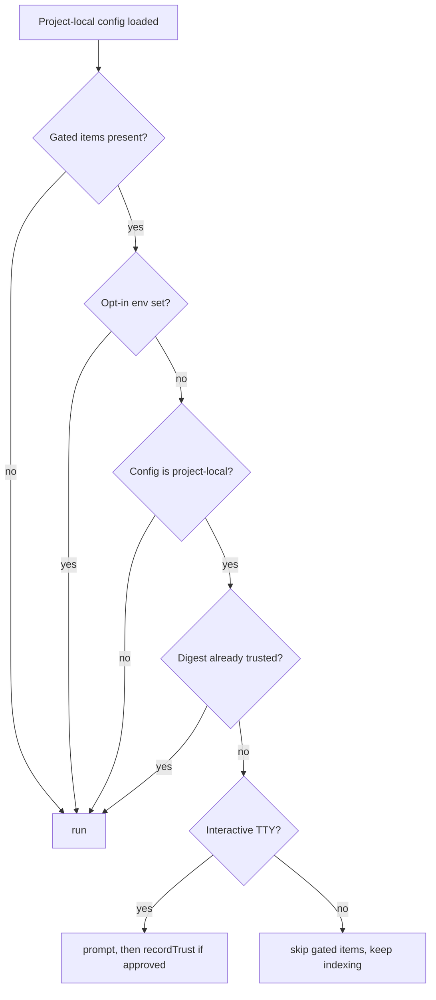

# Design Decisions and Repository Progression

This page explains why several non-obvious parts of QMD are written the way they are. Each decision entry gives the problem, the code location, the behaviour chosen, and any issue or PR number that a code comment or the changelog cites. Where a decision has a related operational page, it is linked from the entry.

## How to read the history

The git history visible in this checkout is limited. The local reflog shows one clone from `https://github.com/tobi/qmd.git` at commit `86d2365`, a checkout onto a local `openwiki` branch, and one commit on that branch that added the OpenWiki brief and ignore file. There is no deeper commit log to mine for rationale. The progression described below therefore rests on two sources: comments in the code, which often name an issue, and the `[Unreleased]` section of [CHANGELOG.md](repo://CHANGELOG.md#L3-L60), which records the changes that have not yet shipped in a tagged release. Older versions in the changelog are referenced only where a code comment cites them.

## DNS-rebinding guard for the HTTP transport

**Problem.** Binding the HTTP MCP server to localhost keeps remote clients out but not web pages. A page on another origin can re-point its hostname to `127.0.0.1` after load, and the browser then treats the local server as same-origin. The only server-side signals that separate such a request from a local client are the `Origin` and `Host` headers. The module comment cites the MCP spec requirement for local HTTP servers to validate them ([origin-guard.ts](repo://src/mcp/origin-guard.ts#L1-L15)).

**Where.** The guard is pure logic in [origin-guard.ts](repo://src/mcp/origin-guard.ts#L17-L167). It is applied in the HTTP request handler before routing, at [server.ts](repo://src/mcp/server.ts#L1160-L1184). The comment there notes that the screen runs ahead of routing so the REST `/query` and `/search` endpoints, which bypass the MCP transport, are covered too, and cites #881.

**Behaviour chosen.**

- Loopback is recognised by hostname: `localhost`, `*.localhost`, `::1`, IPv4-mapped loopback, and the whole `127.0.0.0/8` range. `0.0.0.0` is deliberately excluded because browsers route it to loopback on Linux and macOS ([origin-guard.ts](repo://src/mcp/origin-guard.ts#L21-L35)).
- A missing `Origin` header is allowed, because non-browser clients omit it. A present `Origin` must be loopback or appear in the explicit allowlist, otherwise the request is rejected ([origin-guard.ts](repo://src/mcp/origin-guard.ts#L127-L150)).
- `Host` is enforced only when the bind address names a concrete interface, or when the operator supplies an explicit host allowlist. On a wildcard bind such as `0.0.0.0` (for example in Docker) the check is skipped unless an allowlist exists ([origin-guard.ts](repo://src/mcp/origin-guard.ts#L82-L123), [origin-guard.ts](repo://src/mcp/origin-guard.ts#L153-L164)).
- A concrete non-loopback bind address is added to the accepted hosts, since it is then a legitimate `Host` value ([origin-guard.ts](repo://src/mcp/origin-guard.ts#L110-L115)).
- `QMD_ALLOWED_ORIGINS=*` disables every check ([origin-guard.ts](repo://src/mcp/origin-guard.ts#L101-L103), [origin-guard.ts](repo://src/mcp/origin-guard.ts#L139)).
- A rejected request receives an HTTP 403 with a JSON-RPC error body and a log line ([server.ts](repo://src/mcp/server.ts#L1164-L1184)).

The operational details of the allowlist variables are on the [HTTP API and Origin Guard](../integrations/http-api-and-origin-guard.md) page. The tests that pin these branches are in [mcp-origin-guard.test.ts](repo://test/mcp-origin-guard.test.ts).

## Project-local config trust gating

**Problem.** A `.qmd/index.yml` arrives with a `git clone` and is adopted automatically for any command run inside the tree. Three fields can reach outside the project: the `update:` shell command (#886), collection `path` values that can point at any readable directory (#889), and model URIs that can name any `hf:` repo or local GGUF path (#889). The module comment lists these fields ([trust.ts](repo://src/trust.ts#L1-L15)).

**Where.** The gate logic is in [trust.ts](repo://src/trust.ts). The CLI consumer is `resolveLocalConfigTrust` in [qmd.ts](repo://src/cli/qmd.ts#L831-L870), which the update flow calls before it opens the store ([qmd.ts](repo://src/cli/qmd.ts#L916-L925)).

**Behaviour chosen.**

- The global config in the user's config directory is never gated. A config counts as project-local when its parent directory is named `.qmd` ([trust.ts](repo://src/trust.ts#L77-L85)).
- Gated items are the hooks, the collection paths that resolve outside the project, and the model URIs that differ from the built-in defaults. In-project paths and default models pass without a decision ([trust.ts](repo://src/trust.ts#L144-L158), [trust.ts](repo://src/trust.ts#L126-L133), [trust.ts](repo://src/trust.ts#L135-L142)).
- Each approval is a SHA-256 digest of the gated surface, keyed on the resolved config path and stored in `trusted.json` beside the global config. The digest is order-independent, so reordering collections does not invalidate it. Editing a command, pointing a collection outside the project, or changing a custom model changes the digest and re-arms the gate ([trust.ts](repo://src/trust.ts#L168-L208), [trust.ts](repo://src/trust.ts#L234-L244)).
- The gate sorts a config into one of three actions: `run`, `prompt`, or `skip`. Non-interactive callers such as agents, CI, and the MCP server get `skip`, so in-project indexing continues while gated items are left out. A failed run is not forced by the gate ([trust.ts](repo://src/trust.ts#L299-L333)). The CLI reports that skipping is in effect and names `qmd trust` and `QMD_TRUST_LOCAL_CONFIG=1` as the ways to approve ([qmd.ts](repo://src/cli/qmd.ts#L836-L861)).
- `QMD_TRUST_LOCAL_CONFIG` or `QMD_TRUST_UPDATE_HOOKS` set to a truthy value opts unattended runs in ([trust.ts](repo://src/trust.ts#L268-L274)).
- A corrupt or non-object `trusted.json` is read as an empty store, so it never counts as an approval ([trust.ts](repo://src/trust.ts#L209-L220)).

**Note on the hook path.** `decideHookGate` in [trust.ts](repo://src/trust.ts#L283-L301) is a narrower helper that gates only the `update:` hooks. In the production code it is referenced only by the unit tests in [update-hook-trust.test.ts](repo://test/update-hook-trust.test.ts). The live update flow decides hooks through the combined `decideLocalConfigGate` in [trust.ts](repo://src/trust.ts#L313-L333), because the gated-items snapshot includes hooks. Changes to hook gating should be made in the combined gate, or the helper's behaviour will diverge from what users see. Operational steps are on the [trust gating](../operations/trust-gating.md) page.

## Scoped BM25 search completeness

**Problem.** Keyword search used to apply a collection or metadata scope after an inner candidate window of `limit * 10`. When stronger matches outside the scope filled that window, a scoped query returned empty or incomplete results. Issue #922 records this, and the changelog's `[Unreleased]` Fixed section describes the change ([CHANGELOG.md](repo://CHANGELOG.md#L3-L60)).

**Where.** `searchFTS` in [store.ts](repo://src/store.ts#L4710-L4773).

**Behaviour chosen.**

- The query branches on whether a scope exists. A scope is either a collection name list or a metadata filter, and `scoped` is true when either is present ([store.ts](repo://src/store.ts#L4723-L4745)).
- Unscoped search keeps an inner `ORDER BY bm25_score ASC LIMIT ${limit}` so FTS5 stops early ([store.ts](repo://src/store.ts#L4736-L4742)).
- Scoped search materialises the full FTS5 match set once with `MATERIALIZED`, so the scope sees every match. The comment states that this keeps the planner from folding the filter back into the MATCH, and that the set is bounded by the number of matching documents ([store.ts](repo://src/store.ts#L4724-L4736)).
- A search across several collections runs one keyword query rather than one per collection. The comment ties this to #775 and says the result matches a per-collection query merged by score ([store.ts](repo://src/store.ts#L4727-L4733)).
- Ties are broken by filepath, so the order in which collections were named cannot decide which equal hit survives ([store.ts](repo://src/store.ts#L4770-L4773)).

The collection scope and the metadata filter both apply here. The filter is compiled with the `d` alias and gated by `extraction_version` and a null `extraction_error`, so an unprocessed document cannot match a negative condition such as `exists: false` ([store.ts](repo://src/store.ts#L4760-L4769)).

## Missing collection root protection

**Problem.** A collection whose root folder is missing, for example an unmounted drive, an offline share, or a deleted folder, globs to an empty file list. The deactivation pass reads an empty list as "every file was deleted", so a later `qmd cleanup` could delete rows for good. The changelog records this as a fix under #990 in the `[Unreleased]` section ([CHANGELOG.md](repo://CHANGELOG.md#L3-L60)).

**Where.** The reindex routine in [store.ts](repo://src/store.ts#L1885-L1902) and the warning formatter in [qmd.ts](repo://src/cli/qmd.ts#L2288-L2296).

**Behaviour chosen.**

- Before globbing, the routine stats the collection path. Only `ENOENT` and `ENOTDIR` are treated as "root missing". Any other error, such as a permission or I/O error, is rethrown with its original cause ([store.ts](repo://src/store.ts#L1885-L1894)).
- A path that is not a directory returns early with `skipped: 1` and a `ROOT_MISSING` skipped entry. Nothing is globbed and no document is deactivated ([store.ts](repo://src/store.ts#L1895-L1901)).
- The CLI prints `Collection root not found, index left unchanged` for that code, so the operator sees why nothing changed ([qmd.ts](repo://src/cli/qmd.ts#L2292)).

The code comment does not cite #990, so the link to that issue comes only from the changelog.

## Partitioned vector index

**Problem.** Vectors were originally one table with no collection key. A collection-scoped vector search then had to pre-filter the whole index, and a small collection could be crowded out of the results by a large one. Renaming a collection also required rewriting every vector row, because a name-keyed partition is not updatable. The partitioned layout is recorded as a change under #983 in the changelog's `[Unreleased]` section ([CHANGELOG.md](repo://CHANGELOG.md#L3-L60)).

**Where.** [vec-layout.ts](repo://src/vec-layout.ts#L1-L16) (module comment), [vecLayout](repo://src/vec-layout.ts#L57-L82), [createPartitionedVecTable](repo://src/vec-layout.ts#L121-L123), and the id helpers at [vec-layout.ts](repo://src/vec-layout.ts#L127-L160).

**Behaviour chosen.**

- Vectors live in one `vec0` virtual table named `vectors_by_collection`, partitioned by an integer `collection_id`, with cosine distance ([vec-layout.ts](repo://src/vec-layout.ts#L121-L123)).
- A side table `vector_rows` maps each vec0 rowid to its `(hash, seq, collection_id)`, and `vector_collection_ids` maps names to integer ids ([vec-layout.ts](repo://src/vec-layout.ts#L102-L118)).
- Because the partition key is an integer, renaming a collection is a one-row update of the id table. The module comment states that vec0 rejects `UPDATE` on a partition key, so renaming must not touch vector rows ([vec-layout.ts](repo://src/vec-layout.ts#L1-L16), [vec-layout.ts](repo://src/vec-layout.ts#L152-L154)).
- A layout change needs a new permanent table name. The module comment explains that `ALTER TABLE RENAME` on a vec0 table leaves its shadow tables under the old name in sqlite-vec 0.1.9. `vecLayout` is the only place that knows which table is live ([vec-layout.ts](repo://src/vec-layout.ts#L1-L16)).

The schema side of this layout is covered on [Storage Schema](storage-schema.md).

## Legacy vector table flip and migration

**Problem.** Databases built before the partition change hold a legacy `vectors_vec` table keyed by `hash_seq`. The migration has to copy every live vector without losing rows written during the copy, and it must not leave a `content_vectors` row whose only vector sits in a table that is about to be dropped.

**Where.** [vecLayout](repo://src/vec-layout.ts#L57-L82) decides which table is live. The migration is in [store-migrations.ts](repo://src/store-migrations.ts#L160-L198) and [migrateVectorLayout](repo://src/store-migrations.ts#L234-L262). The runner entry is [runStoreMigrations](repo://src/store-migrations.ts#L277-L294).

**Behaviour chosen.**

- A legacy table wins while it exists. The module comment says the migration drops it as its last step, so that drop is the flip ([vec-layout.ts](repo://src/vec-layout.ts#L57-L82)).
- If sqlite-vec is not loaded or the legacy table is unreadable, the step returns `deferred`. The version stays behind, and the next open with the extension retries. FTS keeps working in the meantime ([store-migrations.ts](repo://src/store-migrations.ts#L234-L262)).
- A legacy table without a `hash_seq` key or without known dimensions is simply dropped as a versioned step ([store-migrations.ts](repo://src/store-migrations.ts#L243-L246)).
- Otherwise the migration creates the partitioned table, copies legacy chunks, then flips inside one immediate write transaction. That transaction copies stragglers by key, deletes vectorless `content_vectors` rows so they are re-embedded, removes the copy cursor, bumps the user version, and drops the legacy table ([store-migrations.ts](repo://src/store-migrations.ts#L187-L198)).
- The comment on the flip explains why the straggler copy, the vectorless cleanup, and the drop share one lock: a legacy row written between them would otherwise be stranded in the dropped table ([store-migrations.ts](repo://src/store-migrations.ts#L179-L186)).
- A `VACUUM` runs after the flip to reclaim the old table's space. If it fails, the migration warns and suggests `qmd cleanup` ([store-migrations.ts](repo://src/store-migrations.ts#L262-L273)).
- On a stamped store that still holds a legacy table, a failed repair is downgraded to a warning, so vector search degrades instead of blocking every open ([store-migrations.ts](repo://src/store-migrations.ts#L277-L294)).

Two binding details also matter here. `vecInteger` passes partition keys and rowids as `bigint`, because better-sqlite3 binds JS numbers as doubles and vec0 checks the bound type ([vec-layout.ts](repo://src/vec-layout.ts#L158-L167)). `rowidList` passes a large rowid set as one JSON parameter, because a scoped search can exceed SQLite's 32,766-parameter limit ([vec-layout.ts](repo://src/vec-layout.ts#L169-L176)).

## Metadata filter grammar and validation

**Problem.** Every search surface (CLI, SDK, MCP, HTTP) accepts a filter from untrusted callers. The grammar has to be recursive, typed, and safe to compile into SQL, and it must reject malformed input before any query runs.

**Where.** The grammar header is at [metadata-filter.ts](repo://src/metadata-filter.ts#L1-L30). Strict validation starts at [parseMetadataFilter](repo://src/metadata-filter.ts#L157-L166) and [parseMetadataMatch](repo://src/metadata-filter.ts#L168-L178), with the recursive walker at [parseFilterNode](repo://src/metadata-filter.ts#L180). Limits are at [METADATA_FILTER_LIMITS](repo://src/metadata-filter.ts#L122-L131). SQL compilation is at [compileMetadataFilter](repo://src/metadata-filter.ts#L425-L443).

**Behaviour chosen.**

- One `operator`-discriminated recursive shape serves two records: documents, whose fields are metadata keys, and metadata entries, whose fields are `key` and `value`. `MetadataFilter` and `MetadataMatch` are both instances of the same `MetadataPredicate` grammar ([metadata-filter.ts](repo://src/metadata-filter.ts#L1-L30)).
- Validation is strict. The walker enforces a maximum nesting depth of 16, a maximum of 256 nodes, group and membership limits, and rejects unknown operators and operator-incompatible values ([metadata-filter.ts](repo://src/metadata-filter.ts#L122-L131), [metadata-filter.ts](repo://src/metadata-filter.ts#L180-L200)).
- `exists` and `all` have no meaning for a single metadata entry, so the entry-mode parser rejects them ([metadata-filter.ts](repo://src/metadata-filter.ts#L168-L178)).
- Operators are typed by their operand. A string operand compares only with string values, and a mismatch never matches ([metadata-filter.ts](repo://src/metadata-filter.ts#L1-L30)).
- Every user value binds as a SQL parameter. Metadata keys and values are data and never SQL text ([metadata-filter.ts](repo://src/metadata-filter.ts#L1-L30), [metadata-filter.ts](repo://src/metadata-filter.ts#L425-L443)).

The user-facing behaviour of this grammar is covered on [Metadata Filtering and Discovery](../concepts/metadata-filtering-and-discovery.md).

## Metadata-filtered vector search inside the KNN scan

**Problem.** A selective metadata filter applied after a top-k vector scan can return fewer results than requested, or none, when the admitted rows are not among the nearest k. Binding every admitted rowid as a parameter can also exceed SQLite's variable limit.

**Where.** `knnVecScanner` and `metadataEligibleRowsSql` in [store.ts](repo://src/store.ts#L4842-L4890), `vecDocumentResolver` in [store.ts](repo://src/store.ts#L4919-L4944), and `searchVec` in [store.ts](repo://src/store.ts#L4976).

**Behaviour chosen.**

- The filter becomes a `rowid IN (SELECT vr.id ...)` restriction evaluated inside the vec0 scan. The result is an exact top-k of the rows the filter admits, not a post-filter of a larger top-k ([store.ts](repo://src/store.ts#L4842-L4866)).
- The restriction is an eligibility subquery rather than a bound list of rowids, so the number of admitted rows does not add bound parameters ([store.ts](repo://src/store.ts#L4842-L4852)).
- A row is eligible when any document in its collection that holds the row's content passes the filter. Vectors are content-scoped, so one hash can belong to both a matching and a non-matching document. The document resolver therefore re-applies the filter on the document join ([store.ts](repo://src/store.ts#L4886-L4893), [store.ts](repo://src/store.ts#L4919-L4925)).
- The nearest-document search starts with three chunks per requested document. While the matches collapse into fewer documents than the limit, and the target holds more rows, `k` doubles up to sqlite-vec's cap. A single long document can therefore not fill the result set ([store.ts](repo://src/store.ts#L4957-L4972)).

## Darwin Metal residency workaround

**Problem.** On macOS, libggml-metal keeps model memory wired through "residency sets" with a 180-second keep-alive timer. A process-static device destructor runs during libc `exit()` and asserts that the residency set is empty. Because the keep-alive has not expired by exit, the assertion fails and a multi-kilobyte backtrace is printed to stderr after the correct output has already been written. The cause is tracked upstream as ggml-org/llama.cpp#22593. No JavaScript-side dispose call can prevent it, because the destructor runs after every JS-reachable cleanup ([llm.ts](repo://src/llm.ts#L2169-L2189)).

**Where.** The launcher sets the environment variable before the native binding loads: [bin/qmd](repo://bin/qmd#L33-L52). The reporting helpers are at [llm.ts](repo://src/llm.ts#L2169-L2214) and in the doctor check at [qmd.ts](repo://src/cli/qmd.ts#L4399-L4418).

**Behaviour chosen.**

- On `darwin`, unless `QMD_METAL_KEEP_RESIDENCY` is `1`, the launcher sets `GGML_METAL_NO_RESIDENCY=1`, keeping any value the user already set ([bin/qmd](repo://bin/qmd#L50-L52)).
- The variable must be set in the launcher rather than the JavaScript entry point, because it has to exist before the native llama.cpp binding loads ([bin/qmd](repo://bin/qmd#L33-L49)).
- The justification is that short-lived CLI calls showed no measurable performance cost from disabling residency sets. The launcher comment records this measurement, and the trade-off is documented for long-lived processes ([bin/qmd](repo://bin/qmd#L40-L49)).
- `isDarwinMetalMitigationActive` returns true only on darwin, when residency is disabled and `QMD_METAL_KEEP_RESIDENCY` is not `1`. Otherwise the function returns false, and `qmd doctor` reports that the libggml-metal backtrace may appear at exit ([llm.ts](repo://src/llm.ts#L2196-L2206), [qmd.ts](repo://src/cli/qmd.ts#L4399-L4418)).
- The compatibility shim `installDarwinExitGuard` is a no-op. The comment explains that an earlier `process.reallyExit` approach did not work on Node, and that the launcher variable replaced it ([llm.ts](repo://src/llm.ts#L2207-L2214)).
- Test subprocesses mirror the same mitigation ([scripts/test-all.mjs](repo://scripts/test-all.mjs#L8-L10)).

## Recent direction from the Unreleased changelog

The `[Unreleased]` section records several changes that extend the decisions above. They are summarised here as rationale, not as release notes.

- Metadata filtering and discovery were added as a single grammar across surfaces. The changelog states that results are filtered before reciprocal rank fusion and reranking, and that highly selective filters remain best-effort for top-K completeness ([CHANGELOG.md](repo://CHANGELOG.md#L3-L60)).
- Scoped BM25 and missing-root protection were added as fixes under #922 and #990, matching the code comments in [store.ts](repo://src/store.ts#L4724-L4736) and [store.ts](repo://src/store.ts#L1885-L1887).
- The partitioned vector layout (#983) and the cleanup repack that moves live rows out of mostly empty vec0 chunks (#937) are recorded as changes to vector storage ([CHANGELOG.md](repo://CHANGELOG.md#L3-L60)).
- Doctor's sampling queries were changed to avoid loading document bodies, citing #978, #994, and #995 ([CHANGELOG.md](repo://CHANGELOG.md#L3-L60)).

The trust gate (#886, #889) and the origin guard (#881) have code comments that cite their issues, but they are not in the `[Unreleased]` section. Their rationale is therefore taken from the code comments themselves.

## Testing that pins these decisions

- Origin guard: [mcp-origin-guard.test.ts](repo://test/mcp-origin-guard.test.ts) covers loopback, wildcard binds, allowlists, and rejected rebinding.
- Trust: [local-config-trust-cli.test.ts](repo://test/local-config-trust-cli.test.ts), [update-hook-trust.test.ts](repo://test/update-hook-trust.test.ts), and [local-config.test.ts](repo://test/local-config.test.ts).
- Vector layout and migration: [vec-layout.test.ts](repo://test/vec-layout.test.ts), [store-migrations.test.ts](repo://test/store-migrations.test.ts), and [cleanup-repack-partitions.test.ts](repo://test/cleanup-repack-partitions.test.ts).
- Metadata filters: [metadata-filter.test.ts](repo://test/metadata-filter.test.ts) and [metadata-search.test.ts](repo://test/metadata-search.test.ts).
- Store behaviour, including scoped search and missing roots: [store.test.ts](repo://test/store.test.ts).
