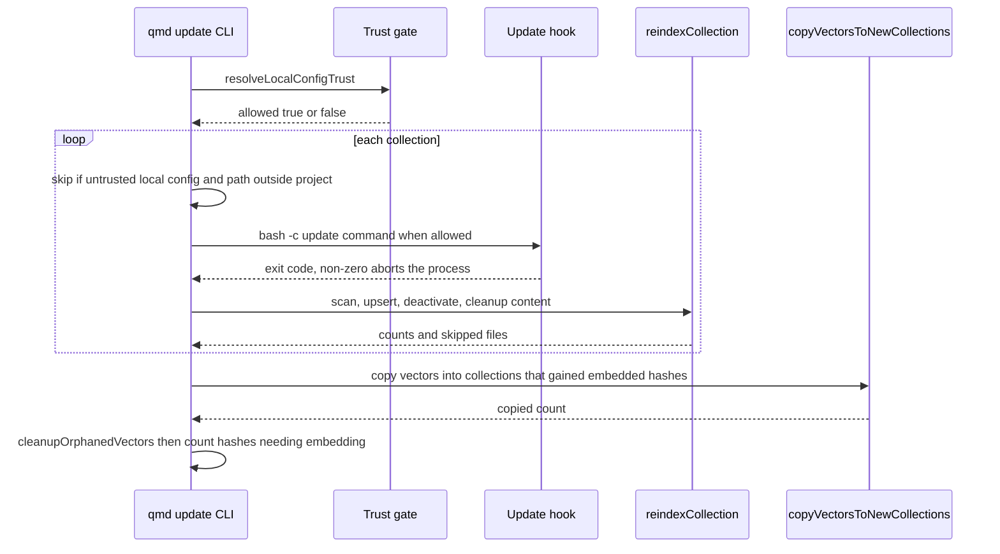
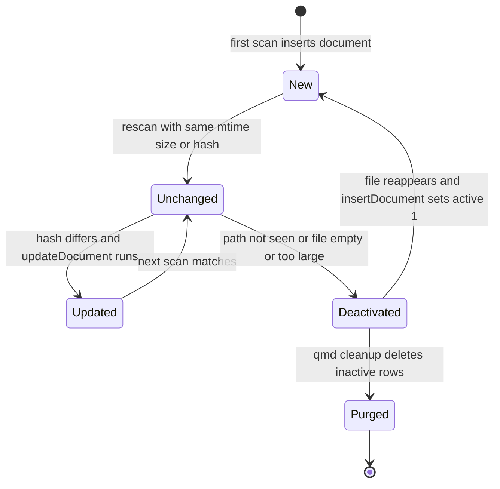

# Indexing and Update Pipeline

The indexing pipeline turns the markdown files of each configured collection into rows in the SQLite index: `documents`, `content`, `file_sync_state`, the FTS table, and the vector tables. `qmd update` drives it from the CLI, and the SDK `update` method drives the same core function. Embedding generation is a separate step (`qmd embed`) that is guarded by its own process lock.

The page follows one run from the top: the CLI decides which collections may run, the update hook runs, `reindexCollection` scans and upserts each collection, and then vectors are copied, stale vector rows are removed, and the user is told whether embeddings are still pending.

## Entry points

| Entry point | Code | What it does |
| --- | --- | --- |
| `qmd update` (CLI) | `updateCollections` in `src/cli/qmd.ts` | Resolves trust, runs update hooks, calls `reindexCollection` per collection, then copies vectors and removes stale vector rows. |
| SDK `update` | `src/index.ts` `update` method | Calls `reindexCollection` for each stored collection, then runs the same vector copy and stale-vector cleanup. It does not run update hooks or the trust gate. |
| `qmd embed` | `vectorIndex` in `src/cli/qmd.ts` | Takes the embed lock, then calls `generateEmbeddings` in `src/store.ts`. |
| `qmd cleanup` | `runCleanup` in `src/store.ts` | Hard-deletes inactive document rows and then orphaned content. It is the only path that removes deactivated documents. |

The CLI collection list comes from the database (`listCollections`), while the update hook and the `ignore` list come from the YAML config (`getCollectionFromYaml`). Both are keyed by collection name.

## Trust gate and update hook (CLI)

`updateCollections` first calls `resolveLocalConfigTrust` before opening the store, so an approval prompt is visible before any writes happen (`src/cli/qmd.ts` 921-924 and 831-861). The function only has work to do when the config defines gated items. Gated items are update hooks, collection paths outside the project, and non-default model URIs.

`decideLocalConfigGate` in `src/trust.ts` (313-333) decides the outcome:

- No gated items, trust opt-in environment variables, or a config that is not project-local: run.
- A project-local config whose digest matches a recorded approval: run.
- Otherwise: prompt on a terminal, or skip when there is no terminal.

When the result is "skip", `resolveLocalConfigTrust` returns `false`, and `hooksAllowed` is `false` for the rest of the run. The config is not rejected as a whole; in-project indexing still proceeds.

Per collection, the loop checks the trust gate again for the collection path. If the config is untrusted, local, and the collection path resolves outside the project, the collection is skipped with a message and the loop moves on (`src/cli/qmd.ts` 956-960). `isCollectionPathInsideProject` (`src/trust.ts` 126-132) resolves `~`, relative paths, and symlinks before the containment check.

The update hook runs only when `yamlCol.update` is set and `hooksAllowed` is true (`src/cli/qmd.ts` 961-993):

- It is started as `bash -c <update command>` with `cwd` set to the collection path (`col.pwd`), and stdout and stderr are captured and printed.
- A non-zero exit code prints a failure line and calls `process.exit(exitCode)`. The whole `qmd update` process stops, so later collections are not indexed and the vector copy and cleanup steps do not run.
- A spawn error also exits the process with code 1.

A hook defined in an untrusted local config is not run, and no per-hook message is printed by the loop; the aggregate skip message from `resolveLocalConfigTrust` is the only signal. The SDK `update` path (`src/index.ts` 606-650) has no hook execution and no trust check.

Caption: the `qmd update` run order. Trust is resolved once, hooks and gating are checked per collection, and vector copying happens after all collections are reindexed.

## Scanning a collection

`reindexCollection` (`src/store.ts` 1844-1863) wraps `reindexCollectionIn` in a write batch. The batch is committed when the function returns and rolled back if it throws. Batches close after 500 files or 250 ms (`scanWriteBatch`, 1805-1833). Only the open batch is rolled back on error, so a collection scan is not atomic across the whole collection: batches committed before the failure remain.

**Root check.** The first step is a `statSync` of the collection root (`src/store.ts` 1888-1894). If the root is missing or not a directory, the function returns immediately with `skipped: 1`, `skippedFiles` containing `ROOT_MISSING`, and all counts zero (1895-1902). Because it returns before the scan, the deactivation pass never runs, so the index is left unchanged. This protects against an unmounted drive or deleted folder being read as "every file was deleted". The CLI reports this code in its output (`src/cli/qmd.ts` 2291-2303), and the store test at `test/store.test.ts` around line 3050 covers it.

**Ignore merge.** The exclusion list is built in one place (`src/store.ts` 1877-1882). The directory names `node_modules`, `.git`, `.cache`, `vendor`, `dist`, and `build` become `**/<dir>/**` globs, which match at any depth. The collection's `ignore` patterns from configuration (`yamlCol?.ignore` in the CLI, `col.ignore` in the SDK) are appended to that list.

**Listing and hidden files.** The files are listed with `fastGlob` using the collection's glob split into masks, `onlyFiles: true`, `followSymbolicLinks: false`, `dot: false`, and the merged ignore list (`src/store.ts` 1904-1910). The result is then filtered again: any relative path with a segment that begins with `.` is dropped (1911-1915). Hidden files and hidden directories are therefore never indexed, even though `dot` is also disabled in the glob.

**Per-file checks.** For each listed file (`src/store.ts` 1926 onward):

- The path is resolved with `getRealPath` and must stay inside the collection root (`isPathInsideDir`). Paths that escape, for example through a symlink, are recorded as `OUTSIDE_COLLECTION` and are not added to `seenPaths`.
- The path is added to `seenPaths` before the `stat` call, so a file that cannot be stat'ed or read is recorded in `skippedFiles` but still counts as seen and is not deactivated.
- Files larger than `REINDEX_MAX_FILE_SIZE` (10 MB, `src/store.ts` 1778) are recorded as `FILE_TOO_LARGE`, and any previously indexed document for that path is retired.
- Empty files, after trimming whitespace, are retired the same way.

## Change detection

Change detection has three levels, from cheapest to most expensive.

1. **Stat fast path.** `getFileSyncStateMap` (`src/store.ts` 1711-1735) loads the `file_sync_state` rows of the collection. A row is trusted only if its document is still the active row for the same collection, path, and content hash. If the stored `mtime_ms` and `size` match the file's stat and the metadata extraction version is current, the file is counted as unchanged without being read (fast path at 1970-1982).
2. **Racy-clean protection.** A file modified within `RACY_SYNC_WINDOW_MS` (2000 ms, `src/store.ts` 1772) of the stat that read it has its sync row stored with `UNTRUSTED_SYNC_MTIME` (-1, line 1773). The fast path never matches that value, so the next update reads the file again. This guards against same-size rewrites inside a coarse mtime granule.
3. **Hash comparison.** Files that need a read are hashed with SHA-256 (`hashContent`, `src/store.ts` 3484-3488; called at 2003). If the hash matches the cached sync row but the mtime differs, only the sync row's mtime and size are updated, and metadata is backfilled only if it is stale.

**Title extraction.** `extractTitle` (`src/store.ts` 3512-3520) picks a per-extension extractor, `.md` for the first heading and `.org` for `#+TITLE` or the first top-level heading, and falls back to the file name without its extension. Markdown headings titled "Notes" are replaced by the next level-2 heading when one exists.

## Document upsert

Changed or new files reach the upsert path (`src/store.ts` 2003 onward):

- `insertContent` stores the text in the content-addressable `content` table with `INSERT OR IGNORE`, so identical text is stored once.
- `findOrMigrateLegacyDocument` looks up the active document for the collection and literal path. If none exists, it may migrate a row stored under an older slugged path (`handelize`). A legacy row is adopted only when no live file in the current scan owns that path. This guard prevents `2026_06_16.md` from taking over the row of `2026-06-16.md` (issue #717, covered by `test/path-fidelity.test.ts`).
- If an active document exists with the same hash, only its title or timestamp is refreshed. If the hash differs, `updateDocument` rewrites the hash, title, and modified time. If no document exists, `insertDocument` upserts on `(collection, path)` and sets `active` back to 1 (`src/store.ts` 3561-3580). The `documents` table has `UNIQUE(collection, path)` (`src/store.ts` 1277).
- `upsertFileSyncState` records the new mtime, size, hash, and document id.
- `syncDocumentMetadata` extracts metadata for the document. It runs only when content changed, or when metadata is stale in the unchanged case.

FTS rows are rebuilt for the document on every title, hash, or insert change (`rebuildDocumentFTS`).

## Deactivation and orphan cleanup

After the scan, `reindexCollectionIn` deactivates every active path of the collection that was not seen in the scan (`src/store.ts` 2064-2075), then runs `cleanupOrphanedContent` (2078). Deactivation sets `active = 0`, removes the sync row, and counts a removal. Deactivated documents are kept as tombstones so that a reappearing file can be reactivated and so that their content can still be referenced.

`cleanupOrphanedContent` (`src/store.ts` 3167-3174) deletes `content` rows that no `documents` row references. Because the query uses all `documents` rows, including inactive ones, it does not remove content during `qmd update`. Content is freed only after `deleteInactiveDocuments` hard-deletes the tombstones, which happens in `runCleanup` (`deleteInactiveDocuments` at `src/store.ts` 3156-3160, called from the `runCleanup` sequence around 3457-3477). The store test `cleanup.test.ts` checks that deactivation leaves content in place until cleanup.

Vector cleanup is separate. `cleanupOrphanedVectors` (`src/store.ts` 3216 onward) removes partition rows whose `(hash, collection)` pair has no active document in that collection, and it removes `content_vectors` rows for hashes with no active document at all. It is a no-op when the vector layout is not partitioned or sqlite-vec is not loaded.

## Copying vectors and reporting pending embeddings

`copyVectorsToNewCollections` (`src/store.ts` 5160-5190) gives each active `(hash, collection)` pair that has embedded chunks a row in that collection's partition. It copies the stored vector from another partition, so a hash that gains a collection becomes searchable there without a model call. A chunk with no stored vector is queued by deleting its `content_vectors` rows, which makes the pending detector pick it up. Rows commit in batches of `VECTOR_COPY_BATCH_ROWS` (1000, line 5145-5146).

`qmd update` calls it after all collections are reindexed and before `cleanupOrphanedVectors`, because the cleanup would delete the partition rows the copy reads from (`src/cli/qmd.ts` 1026-1031). The SDK `update` method uses the same order (`src/index.ts` 636-637). Afterwards, `getHashesNeedingEmbedding` (`src/store.ts` 2956-2978) counts the distinct hashes of active documents that lack a complete set of chunks for the current model and fingerprint. If that count is above zero, the CLI prints `Run 'qmd embed' to update embeddings`. `qmd update` itself does not call the embedding model.

## Document lifecycle

The states below are the ones the code supports. "New" and "Updated" are counted in the `indexed` and `updated` totals of the `reindexCollection` result.

Caption: a document's lifecycle in the `documents` table. Content rows are removed only in the Purged step, when no document row references their hash any longer.

## Embed lock

`qmd embed` is the only operation that takes an exclusive process lock. The lock is held in `src/cli/embed-lock.ts` and is acquired in `vectorIndex` (`src/cli/qmd.ts` 2399) and released in a `finally` block (2489-2492). `qmd update` does not take this lock.

- **Lock file location.** `embedLockPathForDb` (`src/cli/embed-lock.ts` 19-23) places `.qmd-embed.lock` in the same directory as the index database. A custom database path therefore moves the lock with it (`test/embed-lock.test.ts`).
- **Acquisition.** `createOwnedLock` (44-59) writes the current PID with the `wx` flag, which fails if the file already exists. `tryAcquireEmbedLock` (66-96) tries this at most twice. Only an `EEXIST` error is handled; any other error is rethrown (75).
- **Stale-PID recovery.** On `EEXIST`, the PID in the lock file is read. If it is a live embed holder, acquisition returns `null` (77-80). Otherwise the file is removed and creation is retried once (82-87). An unreadable or non-numeric lock file is treated as stale.
- **What counts as live.** `isLiveEmbedLockHolder` (36-42) returns true for the current process and otherwise delegates to `isQmdMcpPid` (`src/cli/mcp-pid.ts` 74-86). That function requires the PID to be alive and its command line to look like qmd. A recycled PID that belongs to some other program is therefore treated as stale.
- **Release.** `release` (46-57) is idempotent and deletes the file only if it still contains this process's PID, so a lock taken over by another process is not removed.
- **Busy behavior.** When acquisition fails, `vectorIndex` prints `EMBED_LOCK_BUSY_MESSAGE` (`src/cli/embed-lock.ts` 99-101), closes the database, and returns without embedding.

A narrow window exists between the `wx` file creation and the PID write. A second process that reads the file during that window sees an empty value, treats it as stale, and removes it. This race is theoretical in practice but is not guarded against.

Embedding itself is done by `generateEmbeddings` (`src/store.ts` 2333 onward). It runs `copyVectorsToNewCollections` first, then embeds pending documents in batches of 32 chunks, retries failed chunks after every 64 successful ones, and gives up on a chunk after 3 attempts.

## Tests that anchor this pipeline

- `test/cleanup.test.ts`: deactivation removes FTS rows but keeps content until cleanup; `runCleanup` removes inactive documents and orphaned content; shared hashes stay while an active document still uses them.
- `test/embed-lock.test.ts`: a second acquire in the same process is refused; a live qmd-like holder in another process blocks acquisition; a dead PID is replaced; release does not remove a lock it does not own.
- `test/path-fidelity.test.ts`: the reindex stores literal relative paths rather than slugs; legacy migration does not adopt a row owned by a live file; a fresh index keeps names that differ only by separators.
- `test/store.test.ts` (around line 3050): a missing root returns `ROOT_MISSING` and leaves existing documents in place.

## Operational notes

- A failing update hook stops the whole `qmd update` run, not just that collection.
- An untrusted project-local config can silently drop collection indexing for out-of-project paths and hooks; approve it with `qmd trust` or the opt-in environment variables described in [Trust gating](../operations/trust-gating.md).
- A missing collection root is reported as skipped rather than as an error, so check the `ROOT_MISSING` count after an update when a drive is unmounted.
- Documents are soft-deleted on every update, but disk space for their content is only reclaimed by `qmd cleanup`. See [Maintenance and troubleshooting](../operations/maintenance-and-troubleshooting.md).
- The chunking that produces the embedded chunks is described in [Chunking](../concepts/chunking.md); the tables written here are described in [Storage schema](storage-schema.md); collection configuration and the `ignore` and `update` fields are described in [Collections and config](../concepts/collections-and-config.md).
