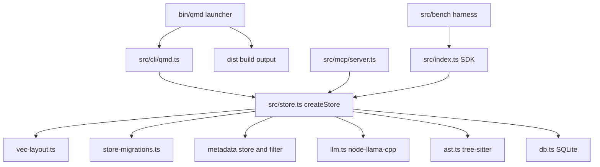

# Source Map

This page is a finder for the QMD repository. For each area it names the files that own a responsibility and the function anchors to start from. It does not describe every line of the code. For the overall runtime picture, read [System Overview](system-overview.md). For the chunking algorithm, read [Chunking](../concepts/chunking.md). For benchmark operation, read [Benchmarking](../operations/benchmarking.md). For how tests are organized, read [Test Strategy](../testing/test-strategy.md).

`finetune/` holds model training code. It is covered in the models page and is not part of this map.

## How the areas connect

The CLI and the MCP server are two front ends over the same store. Both reach the index through `createStore` in `src/store.ts`, which owns the SQLite database and delegates vector layout, migrations, metadata, and LLM calls to dedicated modules.

Caption: the launcher picks a runtime and entry point; the CLI, MCP server, and SDK all go through the store, which delegates to focused modules.

## Core modules under src/

| Module | Responsibility | Start here |
| --- | --- | --- |
| `store.ts` | Central data-access and retrieval layer. It is very large (about 7,000 lines), so use the anchors below rather than reading it top to bottom. | `createStore`, `initializeDatabase` |
| `store.ts` (indexing) | Filesystem scan into the `content` and `documents` tables, with a fast path that skips unchanged files. | `reindexCollection` (scan), `scanWriteBatch` (transaction batch) |
| `store.ts` (embeddings) | Embedding generation for pending chunks and KNN vector retrieval. | `generateEmbeddings`, `getHashesNeedingEmbedding`, `insertEmbedding`, `searchVec` |
| `store.ts` (lexical) | BM25 full-text search through FTS5, with query sanitization. | `searchFTS`, `sanitizeFTS5Term` |
| `store.ts` (hybrid) | Orchestrates the full search: probe, expansion, fusion, chunk selection, reranking, and score blending. | `hybridQuery`, `reciprocalRankFusion`, `vectorSearchQuery`, `structuredSearch` |
| `store.ts` (chunking) | Splits documents into chunks at break points, optionally merging AST break points. | `chunkDocumentAsync`, `chunkDocument`, `chunkDocumentByTokens` |
| `store.ts` (documents and paths) | Document lookup by path or docid, virtual `qmd://` path handling, and context lookup. | `findDocument`, `getDocumentBody`, `buildVirtualPath`, `resolveVirtualPath`, `getContextForPath` |
| `store.ts` (cleanup) | Orphan and inactive document removal, vector repacking, and VACUUM. | `runCleanup`, `previewCleanup`, `repackVectors` |
| `store-migrations.ts` | Versioned schema steps stamped in `PRAGMA user_version`, including the vector layout migration. | `applyVersionedStep`, `migrateVectorLayout`, `runStoreMigrations` |
| `vec-layout.ts` | Names and resolution of the sqlite-vec tables. The only module that knows which vector table is live. | `vecLayout`, `VEC_TABLE` |
| `metadata.ts` | Public metadata types and frontmatter extraction from the `qmd.metadata` block. | extraction entry points in the module |
| `metadata-store.ts` | Metadata schema, persistence, and batch loading, keyed by `documents.id`. | `initializeMetadataSchema`, `syncDocumentMetadata` |
| `metadata-filter.ts` | Recursive predicate grammar, validation, and parameterized SQL compilation shared by all search surfaces. | `compileMetadataFilter`, `compileMetadataMatch`, `parseMetadataMatch` |
| `metadata-format.ts` | Plain-text rendering of metadata discovery, shared by the CLI and the MCP `metadata` tool. | the render functions in the module |
| `collections.ts` | Reads and writes the YAML collection config at the config path, and provides config directory helpers. | `getConfigPath`, `getConfigDir` |
| `trust.ts` | Approval gate for project-local config fields that reach outside the project. | the gating and approval record functions in the module |
| `llm.ts` | Lazy node-llama-cpp loading, embedding, generation, reranking, and the default model singleton. | `getDefaultLlamaCpp`, `disposeDefaultLlamaCpp`, `withNativeStdoutRedirectedToStderr` |
| `ast.ts` | Language detection and AST break points through web-tree-sitter. Falls back to empty results. | `detectLanguage`, `getASTBreakPoints` |
| `db.ts` | Cross-runtime SQLite open path for Bun and Node, sqlite-vec loading, busy handling. | `openDatabase`, `loadSqliteVec`, `isBusyError` |
| `maintenance.ts` | Class wrapper over store cleanup operations used by the CLI for housekeeping. | `Maintenance` class |
| `paths.ts` | Home directory resolution for config and cache locations. | `qmdHomedir` |
| `index.ts` | The SDK entry (`@tobilu/qmd`). Re-exports the store, search, and collection functions as a library surface. | exported functions |
| `bench-rerank.ts` | Standalone reranker benchmark script for throughput and memory measurement. | top-level script |
| `test-preload.ts` | Bun test preload that disposes llama.cpp resources after the suite. | `afterAll` hook |

### Function anchors inside store.ts

Use these names to jump to the right region of `src/store.ts`. Line numbers shift between revisions, so search by name.

| Anchor | Area |
| --- | --- |
| `createStore` | Opens the database, runs `initializeDatabase`, and returns the bound store object. |
| `initializeDatabase` | Creates the core tables, loads sqlite-vec optionally, and enables foreign keys. |
| `reindexCollection` | Scans a collection into the database inside one write batch, committed or rolled back as a unit. |
| `generateEmbeddings` | Embeds pending documents, copying vectors into new collections first. |
| `searchFTS` | BM25 query with a materialized CTE so FTS5 runs before collection and metadata filters. |
| `searchVec` | Two-step KNN retrieval per collection, then document resolution. |
| `hybridQuery` | End-to-end hybrid search pipeline. |
| `chunkDocumentAsync` | Async chunking entry that merges AST break points when the strategy is `auto`. |
| `vectorTableLayout`, `repackVectors` | Vector chunk inspection and compaction. |

## Program entrypoints and launch

| Path | Responsibility |
| --- | --- |
| `bin/qmd` | Node launcher that is the published `qmd` binary. It selects a runtime and entry point, then spawns or imports it. |
| `src/cli/qmd.ts` | The CLI command implementation (very large). Dispatches subcommands to the store and formatter. |
| `src/cli/formatter.ts` | Output formatting for JSON, CSV, XML, Markdown, file lists, and colored terminal output. |
| `src/cli/embed-lock.ts` | Process-level exclusive lock for `qmd embed`, stored next to the index database. |
| `src/cli/mcp-pid.ts` | Pid file identity helpers for the MCP HTTP daemon, so a stale PID is not signalled. |
| `src/cli/version.ts` | Reads the commit stamped at build time for `qmd --version`. |

## MCP server under src/mcp/

| Path | Responsibility |
| --- | --- |
| `src/mcp/server.ts` | Registers the MCP tools `query`, `get`, `multi_get`, `status`, and `metadata`, and serves stdio and HTTP transports. |
| `src/mcp/server.ts` (HTTP) | `startMcpHttpServer` applies origin checks to every request before routing. |
| `src/mcp/origin-guard.ts` | DNS-rebinding protection for the HTTP transport: loopback hostname and `Origin` and `Host` validation. |

## Benchmark harness under src/bench/

| Path | Responsibility |
| --- | --- |
| `src/bench/bench.ts` | Runs fixture queries against four backends (`bm25`, `vector`, `hybrid`, `full`) and reports the results. |
| `src/bench/score.ts` | Computes precision at k, recall, MRR, and F1 against expected files, with path normalization. |
| `src/bench/types.ts` | Fixture and result types, including query types `exact`, `semantic`, `topical`, `cross-domain`, and `alias`. |
| `src/bench/fixtures/example.json` | Example benchmark fixture for the harness. |

## Scripts under scripts/

| Path | Responsibility |
| --- | --- |
| `scripts/build.mjs` | Compiles with `tsconfig.build.json`, makes `dist/cli/qmd.js` executable with a Node shebang, and writes `build-info.json`. The commit is stamped only when the enclosing repository is this package, and a dirty tree is suffixed `-dirty`. |
| `scripts/test-all.mjs` | Runs the typecheck, Vitest under Node, Bun tests with the preload, and the package smoke test. |
| `scripts/package-smoke.mjs` | Packaged-install smoke check. |
| `scripts/check-package-grammars.mjs` | Verifies that the tree-sitter grammar `.wasm` files resolve. |
| `scripts/release.sh` | Renames the Unreleased changelog section, bumps the version, commits, and tags. Publishing happens in CI on tag push. |
| `scripts/pre-push` | Pre-push hook that validates `v*` tag pushes against the package version, the changelog entry, and upstream CI. |
| `scripts/install-hooks.mjs` | Copies `pre-push` into `.git/hooks` from the `prepare` script. |
| `scripts/extract-changelog.sh` | Extracts cumulative release notes for a version's minor series from `CHANGELOG.md`, so each GitHub release restates the series. |
| `scripts/repro-metal-rsets-crash.mjs` | Minimal reproduction for an upstream llama.cpp Metal teardown assertion. Diagnostic only. |

## Lint plugin under tools/oxlint/

| Path | Responsibility |
| --- | --- |
| `tools/oxlint/anti-slop/index.ts` | Oxlint JS plugin that registers the `anti-slop` rules. |
| `tools/oxlint/anti-slop/rules/` | One file per rule, each with a `.test.ts` file for most rules. Rules cover module mocking, chained type assertions, `Reflect` use, and unknown types. |

The repository's `oxlint.config.ts` turns the built-in categories off and enables only selected `anti-slop` rules. Some `anti-slop` rules are disabled there on purpose, because SQLite row casts and CLI and MCP boundaries would produce too many hits.

## Test suite under test/

Tests are grouped by the behavior they cover. Pick the representative file in each group rather than scanning the whole directory.

| Behavior group | Representative files | What they lock |
| --- | --- | --- |
| Store core, paths, concurrency | `store.test.ts`, `store-paths.test.ts`, `store-concurrency.test.ts`, `store.helpers.unit.test.ts` | Store API, virtual paths, and concurrent access. |
| Vector layout and migrations | `store-migrations.test.ts`, `vec-layout.test.ts`, `cleanup-repack-partitions.test.ts` | Versioned steps, the partitioned vector layout, and repacking. |
| Lexical search | `store-cjk-fts.test.ts`, `store-fts-separator-queries.test.ts` | FTS5 query sanitization and CJK handling. |
| Chunking | `ast-chunking.test.ts`, `ast.test.ts` | AST break points and fallback behavior. |
| Hybrid and structured search | `structured-search.test.ts`, `rrf-trace.test.ts`, `intent.test.ts` | Fusion, tracing, and typed query handling. |
| Metadata | `metadata-store.test.ts`, `metadata-filter.test.ts`, `metadata-filter.test-d.ts`, `metadata-search.test.ts`, `metadata-discovery.test.ts` | Extraction, filter compilation, and discovery. |
| CLI behavior | `cli.test.ts`, `cli-exit-lifecycle.test.ts`, `bin-wrapper.test.ts`, `launcher-detection.test.sh` | Command behavior, exit lifecycle, and the launcher's runtime choice. |
| MCP | `mcp.test.ts`, `mcp-stdio-lifecycle.test.ts`, `mcp-origin-guard.test.ts`, `mcp-pid.test.ts` | Tools, stdio lifecycle, origin checks, and pid identity. |
| Trust and config | `update-hook-trust.test.ts`, `local-config-trust-cli.test.ts`, `collections-config.test.ts` | Approval gate and collection config. |
| Benchmark and evaluation | `bench-guard.test.ts`, `bench-score.test.ts`, `eval.test.ts`, `eval-bm25.test.ts` | Collection fail-fast checks and scoring. |
| Packaging and build | `package.test.ts`, `build-script.test.ts`, `esm-ambiguous-module.test.ts`, `version.test.ts` | Package shape, build output, and version stamping. |

`test/_helpers/` holds worker scripts that run in child processes for cross-process tests, such as the embed-lock holder and the vector sampling workers. `test/Containerfile` and `test/smoke-install.sh` support install smoke testing.

## Where to change what

- **Changing search ranking or fusion:** start at `hybridQuery` and `reciprocalRankFusion` in `src/store.ts`, then check `test/structured-search.test.ts` and `test/rrf-trace.test.ts`.
- **Changing vector storage:** touch `src/vec-layout.ts` for names and layout, and `src/store-migrations.ts` for any new versioned step. A layout change needs a new permanent table name, as the module header explains.
- **Changing a metadata filter operator:** edit `src/metadata-filter.ts`, which the store, SDK, MCP, and CLI all share.
- **Changing project-local config behavior:** edit `src/trust.ts`. Gated fields are `update` hooks, collection paths outside the project, and custom model URIs.
- **Changing launch behavior:** edit `bin/qmd`. Its tests are in `test/bin-wrapper.test.ts` and `test/launcher-detection.test.sh`.

## Related pages

- [System Overview](system-overview.md)
- [Chunking](../concepts/chunking.md)
- [Benchmarking](../operations/benchmarking.md)
- [Test Strategy](../testing/test-strategy.md)
