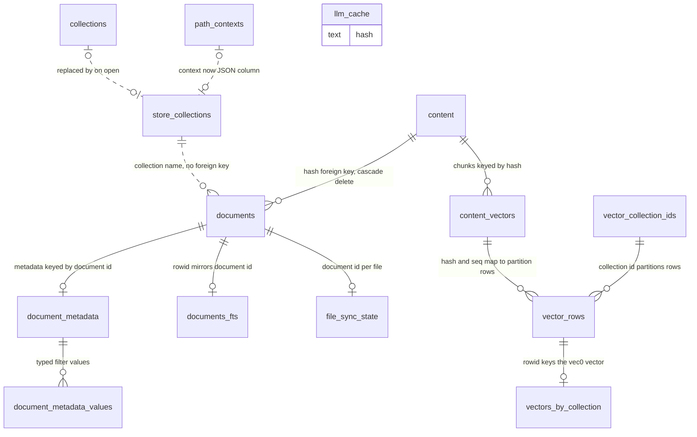
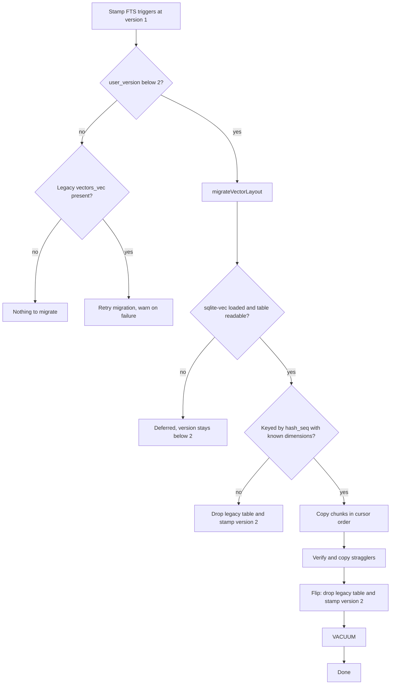

# Storage Schema and Vector Layout

QMD keeps its whole index in one SQLite file. The README places it at `~/.cache/qmd/index.sqlite` ([README](repo://README.md#L1-L400)). The schema has three layers: relational tables for documents, content, collections, and caches; an FTS5 virtual table for BM25 keyword search; and a sqlite-vec `vec0` table for vector search. Schema evolution is driven by `PRAGMA user_version`, with each step applied under a write lock so concurrent processes can open the same database safely.

This page covers the storage layer itself. For how chunks get produced and written, see [Indexing Pipeline](./indexing-pipeline.md). For the reasoning behind the layout choices, see [Design Decisions](./design-decisions.md). For metadata filter semantics, see [Metadata Filtering and Discovery](../concepts/metadata-filtering-and-discovery.md). For repair commands, see [Maintenance and Troubleshooting](../operations/maintenance-and-troubleshooting.md).

## Connection setup

Every connection goes through `openDatabase` in `src/db.ts`. It sets `PRAGMA busy_timeout` and then enables WAL with a bounded retry ([db.ts](repo://src/db.ts#L84-L103), [db.ts](repo://src/db.ts#L116-L124)). The busy timeout defaults to 120000 ms. The environment variable `QMD_SQLITE_BUSY_TIMEOUT` overrides it, and `0` restores fail-fast behavior. The WAL retry exists because switching journal mode needs a brief exclusive lock that the busy handler does not cover, so concurrent first opens of a cold database could otherwise fail.

`initializeDatabase` in `src/store.ts` loads sqlite-vec and records whether vector support is available. A load failure is not fatal: the store warns and keeps running with FTS only ([store.ts](repo://src/store.ts#L1237-L1248)). It then sets `PRAGMA foreign_keys = ON` ([store.ts](repo://src/store.ts#L1249)).

## Table inventory

| Table or virtual table | Role | Defined in |
|---|---|---|
| `content` | Content-addressed document bodies keyed by hash | [store.ts](repo://src/store.ts#L1257-L1264) |
| `documents` | Maps `collection` and `path` to a content hash, with an `active` flag | [store.ts](repo://src/store.ts#L1267-L1284) |
| `documents_fts` | FTS5 index over `filepath`, `title`, and `body` | [store.ts](repo://src/store.ts#L1076-L1081) |
| `content_vectors` | One row per embedded chunk, keyed by `(hash, seq)` | [store.ts](repo://src/store.ts#L1297-L1310) |
| `vector_collection_ids` | Integer id per collection name, used as the vec0 partition key | [vec-layout.ts](repo://src/vec-layout.ts#L102-L118) |
| `vector_rows` | Maps each vec0 rowid to `(hash, seq, collection_id)` | [vec-layout.ts](repo://src/vec-layout.ts#L102-L118) |
| `vectors_by_collection` | sqlite-vec `vec0` virtual table, partitioned by collection id | [vec-layout.ts](repo://src/vec-layout.ts#L121-L125) |
| `llm_cache` | Cached LLM results keyed by a cache hash | [store.ts](repo://src/store.ts#L1287-L1295) |
| `store_collections` | Collection definitions, including context JSON | [store.ts](repo://src/store.ts#L1318-L1329) |
| `store_config` | Key-value settings, cursors, and version markers | [store.ts](repo://src/store.ts#L1331-L1338) |
| `file_sync_state` | mtime and size fast path for incremental file sync | [store.ts](repo://src/store.ts#L1340-L1352) |
| `document_metadata` and `document_metadata_values` | Extraction state and typed filter values | [metadata-store.ts](repo://src/metadata-store.ts#L41-L86) |

The README lists `collections` and `path_contexts` as current tables. The code no longer uses them. `initializeDatabase` drops both on every open ([store.ts](repo://src/store.ts#L1250-L1253)), and collection definitions now live in `store_collections`. Treat the README schema block as stale on this point.

Caption: the main tables and how they link. Foreign keys are enforced only for `documents` to `content` and for the metadata tables. The vector, collection, and chunk links are matched by value, not by foreign key, and the legacy `collections` and `path_contexts` tables are shown only as replaced by the current model.

## Documents, content, and FTS5

`content` stores each document body once, keyed by its content hash. `documents` maps a `(collection, path)` pair to a hash. It has an autoincrement `id`, a unique `(collection, path)` constraint, an `active` flag, and a foreign key to `content(hash)` with `ON DELETE CASCADE` ([store.ts](repo://src/store.ts#L1267-L1284)). The short docid shown to users is the first 6 characters of the hash ([store.ts](repo://src/store.ts#L2727-L2729)).

`documents_fts` is an FTS5 table with the columns `filepath`, `title`, and `body`, tokenized with `porter unicode61` ([store.ts](repo://src/store.ts#L1076-L1081)). Its rowid equals `documents.id`. Three triggers keep it in step with direct writes to `documents`:

- `documents_ai` inserts a row when a new active document is added.
- `documents_au` deletes the row when a document becomes inactive, and otherwise replaces it.
- `documents_ad` deletes the row when a document is removed.

The trigger bodies are in `installFtsSyncTriggers` ([store.ts](repo://src/store.ts#L964-L1010)). Production indexing rebuilds FTS in TypeScript so it can normalize CJK text first, so these triggers serve callers that write to `documents` directly.

`ensureDocumentsFtsSchema` repairs an older FTS table. An older schema used `content='documents'` or a `name` column instead of `filepath`. The check reads both `sqlite_master` and `PRAGMA table_info`, and a non-current table is dropped and recreated under `BEGIN IMMEDIATE` ([store.ts](repo://src/store.ts#L1040-L1063), [store.ts](repo://src/store.ts#L1104-L1121)). The repair is needed because a CJK rebuild against that legacy table fails with `no such column: T.name` (#792), which the CJK test file covers.

CJK text is handled separately. `normalizeCjkForFTS` puts a space between every character in CJK runs, so exact CJK queries can match as phrases ([store.ts](repo://src/store.ts#L924-L934)). The rebuild is gated by `store_config` key `fts_cjk_normalized_version`, whose current value is `"1"` ([store.ts](repo://src/store.ts#L924)). It builds a per-process shadow table in batches of 500 rows, then swaps it into `documents_fts` under `BEGIN IMMEDIATE` after re-reading the version ([store.ts](repo://src/store.ts#L1141-L1230)). This gate is separate from `user_version`.

## Chunks, embeddings, and the fingerprint

The chunking constants are defined in `src/store.ts`. `CHUNK_SIZE_TOKENS` is 900, `CHUNK_OVERLAP_TOKENS` is 135 (15% of 900, floored), and the character fallbacks are `CHUNK_SIZE_CHARS` of 3600 and `CHUNK_OVERLAP_CHARS` of 540 at about four characters per token ([store.ts](repo://src/store.ts#L166-L173)). The README's 900-token chunk size matches the code. The README's 6-character docid also matches `getDocid`.

`content_vectors` has primary key `(hash, seq)` and records `pos`, `model`, `embed_fingerprint`, `total_chunks`, and `embedded_at` ([store.ts](repo://src/store.ts#L1297-L1310)). `getEmbeddingFingerprint` hashes the model, the query and document formatting probes, `chunk_tokens`, and `chunk_overlap_tokens`, and keeps the first 6 hex characters ([store.ts](repo://src/store.ts#L175-L186)). Changing chunk sizes or the model therefore changes the fingerprint.

The query probe is the constant `EMBED_FINGERPRINT_PROBE_QUERY`, with the exact value `__qmd_embedding_query_probe__` ([store.ts](repo://src/store.ts#L160)). It is a fixed sentinel string, not user input. `getEmbeddingFingerprint` passes it through `formatQueryForEmbedding` for the active model, so the fingerprint records the query prompt wrapper as the model expects it. The wrapper differs by model family: the default nomic-style `task: search result | query: ...` form, or the Qwen3-Embedding `Instruct: ... Query: ...` form ([llm.ts](repo://src/llm.ts#L99-L106)). A change to the query prefix format for a model therefore changes the fingerprint even when the model name and chunk sizes stay the same. The document probes (`EMBED_FINGERPRINT_PROBE_TITLE` and `EMBED_FINGERPRINT_PROBE_DOC`) play the same role on the document side ([store.ts](repo://src/store.ts#L161-L162)). `ensureContentVectorsStatusIndex` creates `idx_content_vectors_model_fingerprint` on `(model, embed_fingerprint, hash, total_chunks)`, skipping it on legacy databases that lack those columns ([store.ts](repo://src/store.ts#L2198-L2210)).

## Vector layout

`src/vec-layout.ts` is the only module that knows the vector table names. It defines four constants ([vec-layout.ts](repo://src/vec-layout.ts#L19-L22)):

- `VEC_TABLE` is `vectors_by_collection`, the live partitioned vec0 table.
- `VEC_ROWS_TABLE` is `vector_rows`, the rowid-to-key map.
- `VEC_COLLECTION_IDS_TABLE` is `vector_collection_ids`, the name-to-id map.
- `LEGACY_VEC_TABLE` is `vectors_vec`, the older one-row-per-chunk table.

The header comment gives the reason for the integer partition key. vec0 rejects `UPDATE` on a partition key, so keying partitions by name would force a rewrite of every row on `qmd collection rename`. Keying by integer id makes a rename a one-row update on `vector_collection_ids` ([vec-layout.ts](repo://src/vec-layout.ts#L1-L15)). The same comment says a layout change needs a new permanent table name, because renaming a vec0 table leaves its shadow tables under the old name.

`vecLayout(db)` decides which layout is live. It reads `sqlite_master` for both names. A legacy table wins while it exists, because the migration drops it last, and that drop is the flip. The function reports `keyedByHashSeq` for the legacy table and returns `none` when neither table exists ([vec-layout.ts](repo://src/vec-layout.ts#L57-L82)). `hasVectorIndex` is true only for the partitioned layout ([vec-layout.ts](repo://src/vec-layout.ts#L85-L87)).

The partitioned table is created as `vec0(collection_id INTEGER PARTITION KEY, embedding float[dims] distance_metric=cosine)` ([vec-layout.ts](repo://src/vec-layout.ts#L121-L125)). `createVectorMetadataTables` creates the two mapping tables. `vector_rows` has `UNIQUE(hash, seq, collection_id)` and an index on `collection_id` ([vec-layout.ts](repo://src/vec-layout.ts#L102-L118)).

Writes go through two helpers. `upsertPartitionVector` deletes the existing vec0 row and reuses its rowid, because vec0 ignores `OR REPLACE` ([vec-layout.ts](repo://src/vec-layout.ts#L198-L218)). `PartitionWriter` is the bulk writer. It inserts into `vector_rows` with `INSERT OR IGNORE` and writes the vector only when the row was new ([vec-layout.ts](repo://src/vec-layout.ts#L220-L262)).

Reads are gated on the layout. `searchVec` returns no results unless `hasVectorIndex` is true ([store.ts](repo://src/store.ts#L4974-L4977)). A database that is still on the legacy layout therefore serves no vector hits until the migration runs.

## Schema versions and user_version gating

Two integer constants record the schema steps ([store-migrations.ts](repo://src/store-migrations.ts#L32-L33)):

- `FTS_SYNC_TRIGGERS_VERSION = 1` installs the three FTS sync triggers.
- `VECTOR_PARTITION_VERSION = 2` moves vectors from the legacy table into the partitioned layout.

`applyVersionedStep` implements the gate. If `user_version` is already at or above the target, it returns. Otherwise it opens `BEGIN IMMEDIATE`, reads `user_version` again, runs the step, stamps the new version, and commits. Any error rolls back ([store-migrations.ts](repo://src/store-migrations.ts#L37-L63)). The second read is what makes concurrent first opens apply a step once.

`runStoreMigrations` runs in `initializeDatabase` after the FTS table is ensured ([store.ts](repo://src/store.ts#L1355-L1362)). It applies the trigger step first. Then:

- If `user_version` is below 2, it calls `migrateVectorLayout` and returns ([store-migrations.ts](repo://src/store-migrations.ts#L277-L283)).
- If the store is already at 2 but still has a legacy `vectors_vec` table, an older build must have recreated it. The store attempts the migration again, and on failure logs `Legacy vector table left in place` and continues ([store-migrations.ts](repo://src/store-migrations.ts#L285-L294)).

The deferred path is the one to know. `migrateVectorLayout` returns `deferred` when sqlite-vec is not loaded or the legacy table cannot be read, and it leaves `user_version` below 2 ([store-migrations.ts](repo://src/store-migrations.ts#L240)). The next open with the extension retries. `runStoreMigrations` does not inspect that return value, so the deferral is silent, and FTS keeps working in the meantime.

Caption: how `runStoreMigrations` chooses between the trigger step, the vector migration, the deferred branch, and the stamped-store repair.

## Vector migration steps

`migrateVectorLayout` reports five phases through `onProgress`: `copy`, `verify`, `flip`, `vacuum`, and `done` ([store-migrations.ts](repo://src/store-migrations.ts#L234-L266)). Each step has a specific safety role:

1. **Copy.** `copyLegacyChunks` walks the legacy table's chunk blobs in `chunk_id` order. Each chunk is copied in its own `IMMEDIATE` transaction, and the last copied `chunk_id` is saved under `store_config` key `vector_partition_cursor` ([store-migrations.ts](repo://src/store-migrations.ts#L35), [store-migrations.ts](repo://src/store-migrations.ts#L115-L158)). A killed process resumes from that cursor. Two processes take turns on chunks because each reads the cursor inside its own write transaction.
2. **Verify.** The `verify` phase reports, and `copyStragglers` runs as part of the flip. It copies by key any row the chunk walk missed. Such rows appear when a pre-upgrade `qmd cleanup` repacks the legacy table or an old-layout process writes into an already-walked chunk ([store-migrations.ts](repo://src/store-migrations.ts#L160-L171)).
3. **Flip.** `flipToPartitioned` runs one `IMMEDIATE` transaction. It copies the stragglers, deletes `content_vectors` rows that have no vector left (`deleteVectorlessContentVectors`), calls the `onFlip` hook, deletes the cursor, stamps `user_version` to at least 2, and drops `vectors_vec` ([store-migrations.ts](repo://src/store-migrations.ts#L173-L198)). Because the drop shares the transaction with the stamp, the drop is the flip.
4. **Vacuum.** The store runs `VACUUM`. A failure logs a warning that says to run `qmd cleanup` to reclaim space. The migration itself is already complete at this point ([store-migrations.ts](repo://src/store-migrations.ts#L255-L264)).
5. **Done.** The final progress report fires.

Two other branches sit beside the main path. A legacy table keyed by `hash` alone, or one with unknown dimensions, skips the copy and is dropped inside the version step ([store-migrations.ts](repo://src/store-migrations.ts#L241-L247)). If a partitioned table already exists with different dimensions, `ensurePartitionedTable` throws rather than overwriting it ([store-migrations.ts](repo://src/store-migrations.ts#L210-L225)).

The embed path runs the same migration lazily. `ensureVecTableInternal` migrates a legacy layout before it creates or reuses the partitioned table. It throws `Embedding dimension mismatch` when the existing dimensions differ from the model's output ([store.ts](repo://src/store.ts#L1557-L1582)).

## Collections and context

`store_collections` stores one row per collection: `name`, `path`, `pattern` (default `**/*.md`), `ignore_patterns` as JSON, `include_by_default`, `update_command`, and `context` as JSON ([store.ts](repo://src/store.ts#L1318-L1329)). Path-level context lives inside that JSON. The global context is a `store_config` row keyed `global_context`. `getStoreContexts` flattens both into `(collection, path, context)` triples, using `*` and `/` for the global entry ([store.ts](repo://src/store.ts#L1408-L1428)).

`removeCollection` runs in one transaction. It deletes the collection's vector partition and id, its documents and sync state, any content no active document references, and its `store_collections` row ([store.ts](repo://src/store.ts#L4294-L4312)). The single transaction keeps the mapping and the vec0 table consistent. A partition delete that commits without the document delete would leave orphaned mapping rows.

## LLM cache and file sync state

`llm_cache` has primary key `hash`, a `result` text column, and `created_at` ([store.ts](repo://src/store.ts#L1287-L1295)). `setCachedResult` upserts a row. On about 1% of writes it prunes the table to the newest 1000 rows ([store.ts](repo://src/store.ts#L3127-L3134)). `clearCache` and `deleteLLMCache` empty the table.

`file_sync_state` is keyed by `(collection, relative_path)` and stores `mtime_ms`, `size`, `content_hash`, and `document_id`. It serves as the mtime and size fast path for incremental sync ([store.ts](repo://src/store.ts#L1338-L1352)).

## Metadata tables

`document_metadata` is keyed by `document_id`, with a cascade foreign key to `documents` ([metadata-store.ts](repo://src/metadata-store.ts#L41-L52)). `document_metadata_values` holds one row per `(document_id, key, ordinal)`. A `CHECK` constraint ties each row's typed column to its `value_type` of `string`, `number`, or `boolean`. Three partial indexes cover the typed lookups ([metadata-store.ts](repo://src/metadata-store.ts#L54-L86)). The filter grammar that uses these tables is covered in [Metadata Filtering and Discovery](../concepts/metadata-filtering-and-discovery.md).

## Settings and keys

| Name | Where | Effect |
|---|---|---|
| `QMD_SQLITE_BUSY_TIMEOUT` | environment | Overrides the 120000 ms default busy timeout; `0` disables waiting ([db.ts](repo://src/db.ts#L116-L124)) |
| `PRAGMA user_version` | SQLite pragma | Stores the migration version: 1 for FTS triggers, 2 for partitioned vectors |
| `vector_partition_cursor` | `store_config` | Last legacy `chunk_id` copied; deleted at the flip |
| `fts_cjk_normalized_version` | `store_config` | Marks the CJK FTS rebuild as done when equal to `"1"` |
| `global_context` | `store_config` | Global context text returned by `getStoreContexts` |
| `CHUNK_SIZE_TOKENS` | source constant | 900 tokens per chunk |
| `CHUNK_OVERLAP_TOKENS` | source constant | 135 tokens of overlap |

## Invariants and failure modes

- A single `vecLayout` decision governs both reads and writes. Only one vector table is live at a time, and a legacy table always takes precedence.
- The version gate and the trigger step are applied inside `BEGIN IMMEDIATE`. A failed step rolls back and leaves `user_version` unchanged.
- A deferred migration does not block FTS or other commands. Vector search returns nothing until the layout is partitioned.
- An embedding whose only vector sat in the dropped legacy table is removed from `content_vectors` at the flip, so the pending detector re-embeds it.
- Dimension mismatches are refused, never silently overwritten.

## Tests that matter

- `test/store-migrations.test.ts` covers the copy and flip, the deferred branch without sqlite-vec, resuming from the cursor after a failure, two openers taking turns, the write lock held across the flip, the dimension-mismatch refusal, and repair of a legacy table on a stamped store.
- `test/vec-layout.test.ts` covers layout resolution, the `vector_rows` uniqueness constraint, integer collection ids that survive rename, and the 60,000-id `json_each` rowid list.
- `test/store-cjk-fts.test.ts` covers the batched CJK rebuild, the shadow-table swap, and the legacy `documents_fts` schema repair (#792).

## Related pages

- [Design Decisions](./design-decisions.md) explains why the vector layout uses integer partition keys.
- [Indexing Pipeline](./indexing-pipeline.md) describes how chunks reach `content_vectors`.
- [Metadata Filtering and Discovery](../concepts/metadata-filtering-and-discovery.md) describes the metadata tables from the query side.
- [Maintenance and Troubleshooting](../operations/maintenance-and-troubleshooting.md) covers `qmd cleanup` and other repair steps.
