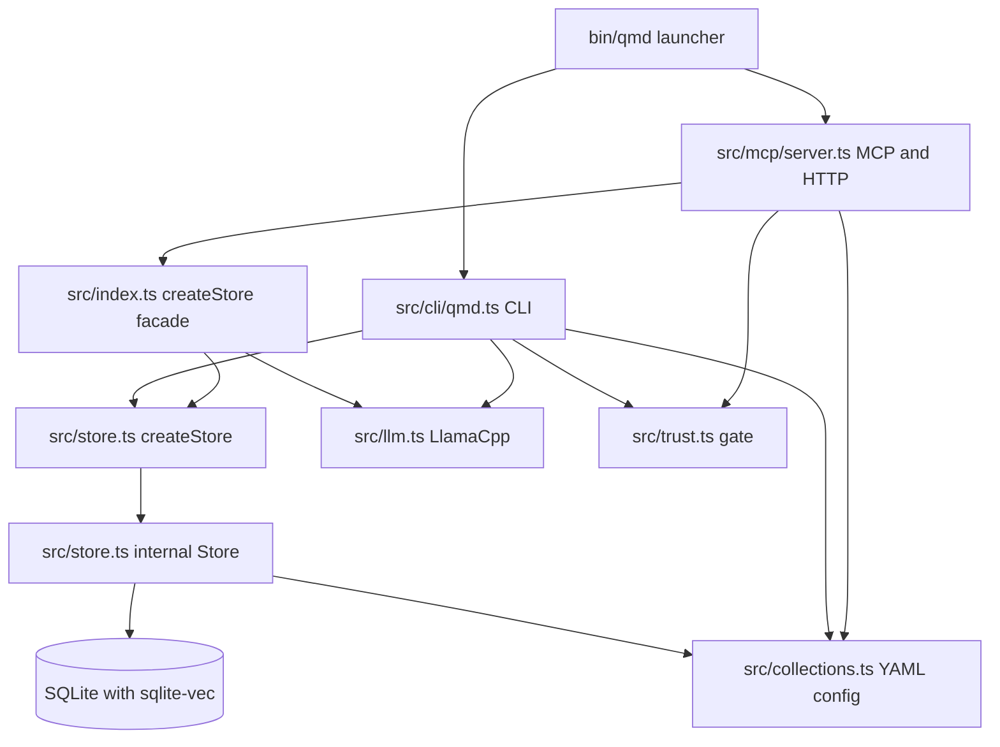

# System Overview

QMD is a local search engine over markdown collections. Its runtime is split into a
small set of layers. Each layer has one job: the launcher picks a runtime, the
front ends parse requests, the SDK facade opens a store, the internal store owns
SQLite, the LLM runtime serves embeddings and reranking, and the config and trust
modules decide which collections and models a process may use. This page describes
those layers and the edges between them. Retrieval details are covered in
[Hybrid Query Pipeline](../workflows/hybrid-query-pipeline.md), and indexing details
in [Indexing Pipeline](indexing-pipeline.md).

## Layer map

The diagram shows the call edges. Every front end ends up at `Store`, and the
`LlamaCpp` instance is attached to that store for model work.

Caption: call graph of the QMD layers, from the launcher to SQLite and the LLM runtime.

## Layers at a glance

| Layer | Source | Responsibility |
|-------|--------|----------------|
| Launcher | `bin/qmd` | Picks Node or Bun, picks `dist/` or `src/` entry, seeds MCP log env, forwards exit status. |
| CLI | `src/cli/qmd.ts` | Parses commands, owns its own lazily created store, runs `update` hooks, and dispatches `mcp`. |
| MCP and HTTP server | `src/mcp/server.ts` | Exposes search and retrieval over stdio or Streamable HTTP plus REST endpoints. |
| SDK facade | `src/index.ts` | `createStore` entry point that validates options, syncs config, and wraps the internal store. |
| Internal store | `src/store.ts`, `src/db.ts` | Opens SQLite, creates tables, and implements indexing, search, cache, and context operations. |
| LLM runtime | `src/llm.ts` | `LlamaCpp` loads GGUF models lazily and unloads them after inactivity. |
| Collections config | `src/collections.ts` | Reads and writes the YAML collection config and locates project-local `.qmd` configs. |
| Trust layer | `src/trust.ts` | Gates the fields a project-local config may use: hooks, outside paths, and custom models. |
| Maintenance | `src/maintenance.ts` | Wraps housekeeping operations (vacuum, orphan cleanup, cache clear) over an internal store. |
| Paths | `src/paths.ts` | Resolves the home directory used for config and cache locations. |

## Launcher: `bin/qmd`

`bin/qmd` is a Node script, not a shell script. npm generates native shims that call
`node` directly, so the launcher is the only file a global install runs. It does
four things in order.

1. **Resolves the package directory.** It follows symlinks with `realpathSync` and
   derives `dist/cli/qmd.js` and `src/cli/qmd.ts` from the package root
   ([bin/qmd#L17-L20](repo://bin/qmd#L17-L20)).
2. **Seeds native log env for MCP only.** When the first argument is `mcp`, it sets
   `LLAMA_LOG_LEVEL`, `GGML_LOG_LEVEL`, and `GGML_BACKEND_SILENT` if they are not
   already set, so native logs do not corrupt the JSON-RPC stdout stream
   ([bin/qmd#L27-L31](repo://bin/qmd#L27-L31)). On darwin it also sets
   `GGML_METAL_NO_RESIDENCY=1` unless `QMD_METAL_KEEP_RESIDENCY=1`
   ([bin/qmd#L50-L52](repo://bin/qmd#L50-L52)).
3. **Chooses source or dist mode.** Source mode is allowed only when the package is
   not under a `node_modules` segment, unless `QMD_SOURCE_MODE` overrides it
   ([bin/qmd#L80-L82](repo://bin/qmd#L80-L82)). Source mode also needs a `.git`
   directory and `src/cli/qmd.ts` to exist ([bin/qmd#L87](repo://bin/qmd#L87)). A
   source checkout runs `src/cli/qmd.ts` through `tsx` under Node when `package-lock.json`
   and `tsx` are present, or through Bun when `bun.lock` and Bun are present
   ([bin/qmd#L101-L105](repo://bin/qmd#L101-L105)). Otherwise the launcher runs the
   compiled `dist/cli/qmd.js`. If that file is missing, it prints a build hint and exits 1
   ([bin/qmd#L116-L121](repo://bin/qmd#L116-L121)).
4. **Picks the runtime.** In dist mode the runner comes from the lockfile, not from
   what is on `PATH`. A `package-lock.json` in the package or the install root selects
   `node`. A `bun.lock` or `bun.lockb` selects `bun`. With no lockfile the default is
   `node` ([bin/qmd#L149-L160](repo://bin/qmd#L149-L160)). `hasBun()` is consulted
   only in source mode ([bin/qmd#L54-L60](repo://bin/qmd#L54-L60)). Line 2 of the
   file is a POSIX shell fallback that execs `node` if present and `bun` otherwise,
   for cases where the file is run through `sh`
   ([bin/qmd#L2](repo://bin/qmd#L2)).

Two execution paths follow from the selected runtime.

- **In-process import.** If the runtime that launched the script already matches the
   selected runtime, the launcher rewrites `argv[1]` to the entry file and dynamically
   imports it, avoiding a second process ([bin/qmd#L164-L173](repo://bin/qmd#L164-L173)).
- **Child process.** Otherwise it spawns the selected runner with inherited stdio
   ([bin/qmd#L183-L188](repo://bin/qmd#L183-L188)). When Node was selected from a Node
   launcher, it pins the runner to `process.execPath` so native addons built for that
   ABI load ([bin/qmd#L183-L185](repo://bin/qmd#L183-L185)). Exit codes and signals are
   forwarded to the parent ([bin/qmd#L190-L197](repo://bin/qmd#L190-L197)). Spawn
   failures print `qmd: failed to launch` and exit 1
   ([bin/qmd#L202-L205](repo://bin/qmd#L202-L205)).

The launcher's behaviour is pinned by [bin-wrapper.test.ts](repo://test/bin-wrapper.test.ts),
which checks that the trampoline does not re-resolve `node` from `PATH` for the child.

## CLI: `src/cli/qmd.ts`

The CLI runs only when the file is the main module. The guard accepts the `.ts` or
`.js` entry and symlinked `argv[1]` ([src/cli/qmd.ts#L4598-L4604](repo://src/cli/qmd.ts#L4598-L4604)).
Only then does it enable production mode and parse commands. Importing the module for
its exports does not change global state, so tests can import it safely.

The CLI keeps its own lazily created store. `getStore()` calls the internal
`createStore` from `src/store.ts` with the `--index` path override, then syncs the YAML
config into SQLite ([src/cli/qmd.ts#L174](repo://src/cli/qmd.ts#L174)). It then builds a
`LlamaCpp` with the models from config. When the local config is not fully trusted, it
uses the untrusted resolution instead ([src/cli/qmd.ts#L180-L182](repo://src/cli/qmd.ts#L180-L182)).

The CLI calls the internal store directly rather than the SDK facade. This is a real
boundary: CLI behaviour that differs from the SDK, such as trust checks and hooks, lives
in the CLI file.

The `mcp` command dispatches to the server layer. Without `--http` it calls
`startMcpServer` over stdio. With `--http` it runs in the foreground, or with
`--daemon` it spawns a detached child that writes a PID file
([src/cli/qmd.ts#L5068-L5170](repo://src/cli/qmd.ts#L5068-L5170)). The `update` command runs a
collection's `update:` shell hook through `bash -c`, but only when hooks are allowed
for the current config ([src/cli/qmd.ts#L941-L961](repo://src/cli/qmd.ts#L941-L961)).

## MCP and HTTP server: `src/mcp/server.ts`

The server exposes the same search and retrieval operations to agents over two
transports. Both transports open their own store.

- **stdio.** `startMcpServer` enables production mode, opens the store at the default DB
  path with the config file if one exists, and serves stdio. When stdin reaches EOF it
  waits for in-flight requests, closes the server, and closes the store
  ([src/mcp/server.ts#L1017-L1020](repo://src/mcp/server.ts#L1017-L1020)).
- **Streamable HTTP.** `startMcpHttpServer` opens its store the same way
  ([src/mcp/server.ts#L1071](repo://src/mcp/server.ts#L1071)). It is sessionless: there
  is no `Mcp-Session-Id` and no idle-session reaper. Requests are checked for
  DNS-rebinding before routing. The origin guard rejects a non-loopback `Origin` and a
  `Host` that does not match the bind address with 403
  ([src/mcp/server.ts#L1164](repo://src/mcp/server.ts#L1164)). The HTTP surface also
  includes `POST /query`, `POST /metadata`, and `GET /health`, as described in the
  [MCP server integration page](../integrations/mcp-server.md).

Both servers import `createStore` from `src/index.ts`, so MCP is a consumer of the SDK
facade and not of the internal store. The HTTP server builds its handler with one
per-request MCP server created from the shared store.

## SDK facade: `createStore` in `src/index.ts`

`createStore(options: StoreOptions)` is the public entry point for library consumers
and for the MCP server. Its branches are the contract for opening a store.

- **`dbPath` is required.** An empty `dbPath` throws `dbPath is required`
  ([src/index.ts#L444-L446](repo://src/index.ts#L444-L446)).
- **`configPath` and `config` are mutually exclusive.** Passing both throws
  `Provide either configPath or config, not both`
  ([src/index.ts#L447-L449](repo://src/index.ts#L447-L449)).
- **YAML mode.** A `configPath` sets the config source to that file, loads it, and syncs
  it into `store_collections` ([src/index.ts#L460-L464](repo://src/index.ts#L460-L464)).
- **Inline mode.** A `config` object sets the config source to memory and syncs that
  object into SQLite ([src/index.ts#L465-L470](repo://src/index.ts#L465-L470)).
- **DB-only mode.** When neither is given, no config is loaded. The store reads the
  existing `store_collections` rows left by an earlier run
  ([src/index.ts#L471](repo://src/index.ts#L471)).

After the branches, the facade creates a per-store `LlamaCpp` with a 5-minute inactivity
timeout and attaches it to the internal store
([src/index.ts#L473-L482](repo://src/index.ts#L473-L482)). Line 475 is the constructor call. The returned object wraps
search, indexing, collection, context, and lifecycle methods around the internal store.
Its `search` also validates metadata filters, because TypeScript types do not protect
plain-JavaScript callers ([src/index.ts#L500-L502](repo://src/index.ts#L500-L502)).

Each `createStore` call opens its own SQLite connection and its own `LlamaCpp`. There
is no process-wide store singleton in the SDK path.

## Internal store: `src/store.ts` and `src/db.ts`

The internal `createStore(dbPath?)` opens the database, runs `initializeDatabase`, and
returns a `Store` object ([src/store.ts#L2615-L2619](repo://src/store.ts#L2615-L2619)). If
no path is given it uses `getDefaultDbPath()`.

`getDefaultDbPath()` has two rules. The `INDEX_PATH` environment variable always wins. If
it is unset and the process is not in production mode, the function throws, so tests
cannot write to the global index by accident ([src/store.ts#L697-L715](repo://src/store.ts#L697-L715)).
Production mode is switched on only by the CLI main guard and by the server start
functions, not by importing modules.

`openDatabase` sets a busy timeout that defaults to 120 seconds and can be overridden by
`QMD_SQLITE_BUSY_TIMEOUT`, then enables WAL ([src/db.ts#L116-L124](repo://src/db.ts#L116-L124)).

`initializeDatabase` loads `sqlite-vec` inside a try block. A failure disables vector
search, records the reason, and warns, but FTS keeps working
([src/store.ts#L1237-L1247](repo://src/store.ts#L1237-L1247)). It enables foreign keys,
drops the legacy `collections` and `path_contexts` tables because collections now live in
YAML ([src/store.ts#L1252-L1253](repo://src/store.ts#L1252-L1253)), and then creates the
content-addressed tables. The `store_collections` table holds the synced copy of the
config ([src/store.ts#L1318](repo://src/store.ts#L1318)).

The `Store` type bundles the raw `db`, the optional `llm`, and grouped methods for index
health, cache, cleanup, context, virtual paths, and search
([src/store.ts#L1585-L1600](repo://src/store.ts#L1585-L1600)). Table layout and migrations
are in [Storage Schema](storage-schema.md).

`src/maintenance.ts` wraps housekeeping operations (vacuum, orphan cleanup, LLM cache
clear, FTS optimize, vector repack) over a `Store`
([src/maintenance.ts#L25-L30](repo://src/maintenance.ts#L25-L30)). The SDK re-exports it
([src/index.ts#L188](repo://src/index.ts#L188)).

## LLM runtime: `src/llm.ts`

`LlamaCpp` implements the `LLM` interface and loads models lazily. Its constructor only
resolves model URIs and timers ([src/llm.ts#L867-L876](repo://src/llm.ts#L867-L876)).
Each `ensure*` method, such as `ensureEmbedModel` and `ensureRerankModel`, loads a model
the first time it is needed ([src/llm.ts#L1138](repo://src/llm.ts#L1138),
[src/llm.ts#L1302](repo://src/llm.ts#L1302)). A single-flight promise prevents two
concurrent callers from building two `Llama` runtimes
([src/llm.ts#L999-L1003](repo://src/llm.ts#L999-L1003)).

Each model operation resets an inactivity timer through `touchActivity`
([src/llm.ts#L900](repo://src/llm.ts#L900)). The default timeout is five minutes
([src/llm.ts#L659](repo://src/llm.ts#L659)). The SDK sets `disposeModelsOnInactivity` to
`true`, so models unload when idle and reload on the next call. Model choice comes from
the config's `models` block, falling back to built-in defaults. See
[Models and LLM Runtime](../concepts/models-and-llm-runtime.md).

## Collections config: `src/collections.ts`

The YAML file is the source of truth for collections and contexts. The store's
`store_collections` table is a derived copy.

- `setConfigSource` selects file mode with an optional path, or inline mode with an
  in-memory object ([src/collections.ts#L81-L99](repo://src/collections.ts#L81-L99)).
- `getConfigDir` honours `QMD_CONFIG_DIR`, then `XDG_CONFIG_HOME`, then `~/.config/qmd`
  ([src/collections.ts#L119-L129](repo://src/collections.ts#L119-L129)).
- `findLocalConfigPath` walks upward from the working directory looking for
  `.qmd/index.yaml` or `.qmd/index.yml` ([src/collections.ts#L141-L157](repo://src/collections.ts#L141-L157)).
  When it finds one, the database becomes `index.sqlite` beside that config
  ([src/collections.ts#L159-L161](repo://src/collections.ts#L159-L161)). This is how a
  project keeps its config and index together.
- `loadConfig` returns an empty collection map when the file is missing, and throws a
  parse error for invalid YAML ([src/collections.ts#L183-L210](repo://src/collections.ts#L183-L210)).
  Inline mode returns the in-memory object instead.

## Trust layer: `src/trust.ts`

A project-local `.qmd` config can arrive with a `git clone`, so it cannot be trusted
blindly. Three fields can reach outside the project: `update:` shell hooks, collection
paths, and custom model URIs ([src/trust.ts#L1-L19](repo://src/trust.ts#L1-L19)). The
global config in `~/.config/qmd` is never gated.

The gate works like this.

- `isLocalConfigPath` is true when the config's parent directory is named `.qmd`
  ([src/trust.ts#L82-L86](repo://src/trust.ts#L82-L86)).
- `gatedItems` collects hooks, paths outside the project, and non-default model URIs
  ([src/trust.ts#L149-L159](repo://src/trust.ts#L149-L159)).
- `sensitiveDigest` hashes that gated set, so reordering collections does not invalidate
  an approval, but editing a hook or path does ([src/trust.ts#L191-L207](repo://src/trust.ts#L191-L207)).
- Approvals are stored per config path in `<config dir>/trusted.json`
  ([src/trust.ts#L70-L72](repo://src/trust.ts#L70-L72), [src/trust.ts#L234-L244](repo://src/trust.ts#L234-L244)).

The CLI enforces the gate. `localConfigIsFullyTrusted` returns true for global configs,
when `QMD_TRUST_LOCAL_CONFIG` or `QMD_TRUST_UPDATE_HOOKS` is set, or when no gated items
exist. Otherwise it compares the stored digest ([src/cli/qmd.ts#L775-L783](repo://src/cli/qmd.ts#L775-L783)).
The `update` command skips out-of-project paths and hooks while the config is untrusted
([src/cli/qmd.ts#L956-L961](repo://src/cli/qmd.ts#L956-L961)). Trust helpers in
`src/trust.ts` also define `skip`, `prompt`, and `run` outcomes for non-interactive
callers ([src/trust.ts#L283-L330](repo://src/trust.ts#L283-L330)). The CLI's own
update path does not call those helpers.

## Lifecycle and failure semantics

- **Store lifetime.** A store is opened by the caller and must be closed. `close()`
  releases the database connection and the store's own `LlamaCpp`.
- **Stdout discipline.** In MCP mode, stdout carries only JSON-RPC frames. The launcher
  silences native logs before the runtime loads, and the server's stdin EOF handler
  shuts the process down instead of orphaning it.
- **Missing sqlite-vec.** Vector search is unavailable, but keyword search and document
  retrieval still work.
- **Untrusted local config.** Non-interactive callers get a skip, not a failure. In-project
  indexing proceeds, while hooks, outside paths, and custom models are skipped.
- **Model load failures** surface when a model is first used, not at store open, because
  loading is lazy.

## Invariants

- Every front end opens a store through a `createStore` and closes it on exit or shutdown.
- The YAML config, when present, is synced into SQLite. Store operations read the synced
  copy, so CLI mutations re-sync the config after they change it.
- Vector and LLM capabilities are optional at the store layer. Only the LLM and trust
  layers decide whether a call may load a model or run a hook.
- The launcher never re-resolves `node` from `PATH` for a child that is already
  running under the matching runtime, which keeps native addons on the ABI they were
  built for.

## Extension points

- **SDK consumers** call the facade in `src/index.ts`, passing either `configPath` or
  an inline `config`, or neither to reuse an existing database. See
  [SDK Library](../integrations/sdk-library.md).
- **New transports** can reuse `createMcpServer` from `src/mcp/server.ts`, as the stdio
  and HTTP entry points already do.
- **New housekeeping operations** belong on `Maintenance`, which takes an internal store.

## Tests that matter for this layering

- [bin-wrapper.test.ts](repo://test/bin-wrapper.test.ts) covers launcher runtime
  selection and the rule against re-resolving `node`.
- [sdk.test.ts](repo://test/sdk.test.ts) covers the `createStore` facade.
- [mcp-origin-guard.test.ts](repo://test/mcp-origin-guard.test.ts) covers HTTP origin
  and host screening.
- [mcp-stdio-lifecycle.test.ts](repo://test/mcp-stdio-lifecycle.test.ts) covers stdin EOF
  shutdown.
- [local-config-trust-cli.test.ts](repo://test/local-config-trust-cli.test.ts) and
  [update-hook-trust.test.ts](repo://test/update-hook-trust.test.ts) cover the trust gate.
- [cli-lazy-llm-import.test.ts](repo://test/cli-lazy-llm-import.test.ts) covers deferred
  LLM loading in the CLI.

For file-by-file navigation, see [Source Map](source-map.md). For the flows that run on
top of these layers, see [Indexing Pipeline](indexing-pipeline.md) and
[Hybrid Query Pipeline](../workflows/hybrid-query-pipeline.md).
