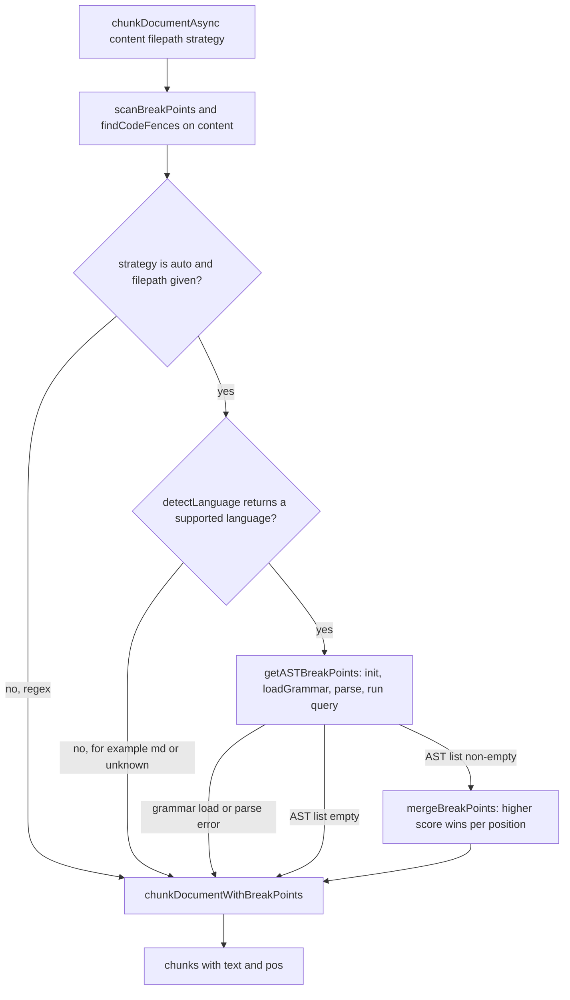

# Document Chunking: Regex Break Points and AST-Aware Splits

QMD splits every indexed document into overlapping chunks before embedding. Each chunk is embedded separately and stored with its `seq` and character `pos` in the original document (see [Indexing Pipeline](../architecture/indexing-pipeline.md)). This page explains how the split points are chosen. Chunking has two layers:

1. **Break-point selection.** Candidate cut positions are scored. Regex scores apply to every document. Optional tree-sitter scores apply only to supported code files when the strategy is `auto`.
2. **Chunk loop.** The shared algorithm walks the document, picks the best cut inside a search window, protects code fences, and applies overlap. A second, token-bounded pass re-splits any chunk that still exceeds the embedding model's token limit.

The default is regex-only. AST-aware chunking is opt-in through `--chunk-strategy auto`.

## Entry points and defaults

| Function | Role | Strategy behavior |
|---|---|---|
| `chunkDocument` | Sync, regex-only chunking used by tests and legacy callers | No strategy parameter; always regex |
| `chunkDocumentAsync` | Chooses break points, optionally adding AST points | `chunkStrategy` defaults to `"regex"` |
| `chunkDocumentByTokens` | Public token-bounded entry point; calls the LLM tokenizer | `chunkStrategy` defaults to `"regex"` |
| `chunkDocumentByTokensWithLlm` | Internal token-bounded implementation used by embed and sample checks | Passes the strategy to the first pass only |

`chunkDocument` is the only regex-only sync API. `chunkDocumentAsync` and `chunkDocumentByTokens` both default to `"regex"`, and `undefined` from callers falls through to that default ([store.ts L3739-L3748](repo://src/store.ts#L3739-L3748), [store.ts L3758-L3766](repo://src/store.ts#L3758-L3766), [store.ts L3938-L3946](repo://src/store.ts#L3938-L3946)).

The CLI flag is `--chunk-strategy <auto|regex>`. Its help text states that the default is `regex` ([cli/qmd.ts L2326-L2331](repo://src/cli/qmd.ts#L2326-L2331), [cli/qmd.ts L3980](repo://src/cli/qmd.ts#L3980)). The flag is parsed for `embed` and `query` ([cli/qmd.ts L3456](repo://src/cli/qmd.ts#L3456), [cli/qmd.ts L4966-L4977](repo://src/cli/qmd.ts#L4966-L4977)). Any other value throws `--chunk-strategy must be "auto" or "regex"`.

## Chunk selection

The following flowchart shows how `chunkDocumentAsync` chooses break points. Regex points are always computed. AST points are added only when the strategy is `auto`, a filepath is present, and the language is supported. Any grammar or parse failure returns an empty AST list, which leaves regex-only break points in place.



Caption: chunk selection in `chunkDocumentAsync`. Regex break points are the baseline. AST points are merged only when the gate passes and the grammar parses successfully. Source: [store.ts L3758-L3778](repo://src/store.ts#L3758-L3778), [ast.ts L274-L322](repo://src/ast.ts#L274-L322).

The gate is a single `if` in `chunkDocumentAsync`. AST points are merged only when `chunkStrategy === "auto"` and `filepath` is set. Points are merged only when `getASTBreakPoints` returns a non-empty array ([store.ts L3768-L3778](repo://src/store.ts#L3768-L3778)).

## Regex break points

`BREAK_PATTERNS` defines a scored regex for each markdown-style boundary. Higher scores mean better places to split ([store.ts L222-L235](repo://src/store.ts#L222-L235)):

| Pattern | Score | Type |
|---|---|---|
| `# ` heading (h1) | 100 | `h1` |
| `## ` heading (h2) | 90 | `h2` |
| `### ` heading (h3) | 80 | `h3` |
| `#### ` heading (h4) | 70 | `h4` |
| `##### ` heading (h5) | 60 | `h5` |
| `###### ` heading (h6) | 50 | `h6` |
| Code fence line (```` ``` ````) | 80 | `codeblock` |
| Horizontal rule (`---`, `***`, `___`) | 60 | `hr` |
| Blank line run | 20 | `blank` |
| Unordered list item | 5 | `list` |
| Ordered list item | 5 | `numlist` |
| Any newline | 1 | `newline` |

These values match the break-point table in the [README](repo://README.md#L1456-L1525). `scanBreakPoints` runs every pattern and keeps only the highest score at each position. The result is sorted by position ([store.ts L237-L262](repo://src/store.ts#L237-L262)).

## Code-fence protection

`findCodeFences` pairs ```` ``` ```` markers that start a line. An unclosed fence extends to the end of the document. `isInsideCodeFence` returns true only for positions strictly inside a region ([store.ts L269-L295](repo://src/store.ts#L269-L295)). `findBestCutoff` skips any break point inside a fence ([store.ts L313-L350](repo://src/store.ts#L313-L350)). If a fenced block is larger than the window, no cut is found inside it and the chunk loop falls back to the hard target.

Fence protection applies to every break point, including AST points. Fences come from `findCodeFences(content)` for every file, not only markdown. In a code file, a line that begins with three backticks, for example inside a template literal or a Python docstring, can therefore suppress nearby AST break points. This is a limitation to keep in mind when reviewing chunk quality for code.

## Distance-decayed cutoff

`findBestCutoff` searches only break points in the window `[target - windowChars, target]`. For each candidate it computes:

```
multiplier = 1 - (distance / windowChars)^2 * decayFactor    (decayFactor = 0.7)
finalScore = bp.score * multiplier
```

The best `finalScore` wins. If no candidate exists, the function returns `targetCharPos` ([store.ts L313-L350](repo://src/store.ts#L313-L350)). The decay is squared, so it is gentle near the target and steep near the window edge. The code comments give these multipliers: 0.956 at 25% back, 0.825 at 50%, 0.606 at 75%, and 0.3 at the edge.

Consequences at the default 800-character window (200 tokens at 4 characters per token):

- An h1 at the window edge scores 100 × 0.3 = 30. That still beats a plain newline at the target (score 1). This matches the README example.
- A blank line at the target scores 20. An h2 one quarter of the window back scores about 86.
- A closer heading beats a distant heading of the same level, because the multiplier decreases with distance.

## Core chunk loop

`chunkDocumentWithBreakPoints` is shared by regex and AST chunking ([store.ts L418-L473](repo://src/store.ts#L418-L473)). Its behavior:

- If the content is at most `maxChars`, it returns one chunk starting at position 0.
- Otherwise, for each chunk it targets `charPos + maxChars`. It accepts `findBestCutoff`'s result only when that result is strictly after `charPos` and not beyond the target. Otherwise it cuts at the target.
- It never splits a UTF-16 surrogate pair. It retreats one code unit when that keeps forward progress, and advances one code unit otherwise.
- The next chunk starts at `endPos - overlapChars`. If that would not move past the previous chunk start, the next start is set to `endPos`, so overlap is dropped instead of looping.

With defaults, `maxChars` is 3600 characters, `overlapChars` is 540 characters, and `windowChars` is 800 characters ([store.ts L164-L173](repo://src/store.ts#L164-L173)).

## Token budget

The embedding model has a token limit, so character sizes are only an estimate. The constants define the token budget ([store.ts L164-L173](repo://src/store.ts#L164-L173)):

- `CHUNK_SIZE_TOKENS` = 900 tokens per chunk.
- `CHUNK_OVERLAP_TOKENS` = 135 tokens, which is 15% of 900.
- `CHUNK_WINDOW_TOKENS` = 200 tokens for the break-point search window.

`chunkDocumentByTokensWithLlm` converts these to characters with an estimate of 3 characters per token ([store.ts L3852-L3855](repo://src/store.ts#L3852-L3855)). It then runs the first pass through `chunkDocumentAsync`, which carries the strategy. Each resulting chunk is tokenized. Any chunk over the limit is re-split with the regex-only `chunkDocument`, using a character budget scaled to the observed characters per token. If that does not shrink the chunk, the code halves it. If it still does not shrink, the code truncates the token list and detokenizes it, with stripping of unpaired surrogates ([store.ts L3840-L3935](repo://src/store.ts#L3840-L3935)).

This means AST break points influence only the first pass. Oversized sub-chunks are split by regex, even in `auto` mode.

## AST break points

AST-aware chunking is implemented in [src/ast.ts](repo://src/ast.ts) with `web-tree-sitter`.

### Supported languages and extension mapping

`EXTENSION_MAP` maps file extensions to six supported languages: `typescript`, `tsx`, `javascript`, `python`, `go`, and `rust`. `.jsx` maps to `tsx`. `.mts` and `.cts` map to `typescript`. `.mjs` and `.cjs` map to `javascript` ([ast.ts L36-L48](repo://src/ast.ts#L36-L48)). `detectLanguage` lowercases the extension and returns `null` for anything not in the map ([ast.ts L51-L56](repo://src/ast.ts#L51-L56)). Markdown (`.md`) returns `null`, so it always uses regex chunking. Unknown extensions also return `null`.

`GRAMMAR_MAP` maps each language to a grammar package and WASM file. `typescript`, `tsx`, and `javascript` share the `tree-sitter-typescript` package with different WASM files ([ast.ts L66-L73](repo://src/ast.ts#L66-L73)).

### Queries and scores

Each language has a tree-sitter query whose captures become break points ([ast.ts L94-L156](repo://src/ast.ts#L94-L156)). `SCORE_MAP` assigns the score by capture name ([ast.ts L158-L172](repo://src/ast.ts#L158-L172)):

| Captures | Score |
|---|---|
| `class`, `iface`, `struct`, `trait`, `impl`, `mod` | 100 |
| `export`, `func`, `method`, `decorated` | 90 |
| `type`, `enum` | 80 |
| `import` | 60 |
| any other capture | 20 (fallback) |

The README table lists only class, interface, struct, impl, trait (100), function and method (90), type alias and enum (80), and import (60). It does not mention `mod`, `export`, or `decorated`. The code is the authority for these values.

`getASTBreakPoints` keeps one capture per start position, the highest-scoring one. Capture positions are node start indexes. Because `export_statement` wraps a declaration, the earliest position wins, so a cut lands before `export`. The result is sorted by position ([ast.ts L274-L322](repo://src/ast.ts#L274-L322)).

### Merging with regex points

`mergeBreakPoints` combines the regex and AST lists and keeps the higher score at each position. The result is sorted by position ([store.ts L361-L378](repo://src/store.ts#L361-L378)). For example, an AST import at position 10 with score 60 replaces a blank-line point with score 20 at the same position.

## Failure and fallback

Every AST failure returns an empty list, and the chunk loop continues with regex points ([ast.ts L274-L322](repo://src/ast.ts#L274-L322)):

- **Unsupported or unknown language**: returns `[]` before any parser work.
- **Grammar load failure**: `loadGrammar` caches the grammar promise per WASM file. On failure it removes the cache entry, adds the language to `failedLanguages`, records a message, and logs a warning once per process. Later calls for that language return `null` immediately. The message comes from `formatGrammarLoadError` and includes a repair command ([ast.ts L225-L245](repo://src/ast.ts#L225-L245), [ast.ts L75-L80](repo://src/ast.ts#L75-L80)).
- **Parse or query failure**: a `try`/`catch` around the whole function logs a warning on every call and returns `[]`. Tree-sitter is error-tolerant, so syntactically invalid code usually produces partial break points rather than an exception.

`getASTStatus` checks each grammar and reports availability per language. The `qmd` status output prints it under "AST Chunking" ([ast.ts L333-L350](repo://src/ast.ts#L333-L350), [cli/qmd.ts L615-L628](repo://src/cli/qmd.ts#L615-L628)).

## Where the strategy is used

- **Embedding.** `embed` passes `options.chunkStrategy` into `chunkDocumentByTokensWithLlm` for each document body. The title is extracted from the body. Each chunk gets `seq`, `pos`, and `tokens` ([store.ts L2458-L2478](repo://src/store.ts#L2458-L2478)). When the option is `undefined`, the default `regex` applies.
- **Query.** The hybrid query path chunks each candidate with `chunkDocumentAsync` and the same strategy. It then picks the chunk with the most keyword overlap for reranking ([store.ts L6412-L6414](repo://src/store.ts#L6412-L6414)). This keeps chunk selection consistent between indexing and query, as the README notes. See [Hybrid Query Pipeline](../workflows/hybrid-query-pipeline.md).
- **Sample check.** A legacy-embedding adoption check calls `chunkDocumentByTokensWithLlm` with no strategy, so it uses regex ([store.ts L3046-L3056](repo://src/store.ts#L3046-L3056)).

## Dependencies and install

The tree-sitter packages and `web-tree-sitter` are listed under `dependencies` in [package.json](repo://package.json#L59-L72). The header comment in `ast.ts` says they are `optionalDependencies`, which is stale. The comment also says QMD only needs the WASM files. Install and build details are in [Installation and Build](../operations/installation-and-build.md).

The repair message in `GRAMMAR_MAP` suggests `bun add tree-sitter-go@0.23.4` and `bun add tree-sitter-python@0.23.4`. The pinned versions in `package.json` are 0.25.0 for both. Following the hint could install a version different from the pinned one. Check the pins before acting on the message.

## Tests that matter

- [test/ast.test.ts](repo://test/ast.test.ts#L1-L339) covers language detection, including `.md` returning `null`, case-insensitive extensions, and `qmd://` paths. It checks per-language break-point types and scores, and checks that unsupported files, empty content, and broken syntax do not throw. It also checks the repair message.
- [test/ast-chunking.test.ts](repo://test/ast-chunking.test.ts#L1-L199) covers `mergeBreakPoints` precedence, AST versus regex split counts on a large TypeScript file, identical output for markdown in `auto` and regex mode, `regex` bypassing AST, missing filepath falling back to regex, and equivalence of `chunkDocumentWithBreakPoints` with `chunkDocument`.

## Related pages

- [Indexing Pipeline](../architecture/indexing-pipeline.md): where chunking runs during `embed`.
- [Score Fusion and Blending](score-fusion-and-blending.md): how chunk-level scores are combined at query time.
- [Hybrid Query Pipeline](../workflows/hybrid-query-pipeline.md): how the query path uses chunk selection for reranking.
- [Installation and Build](../operations/installation-and-build.md): grammar packages and build setup.
