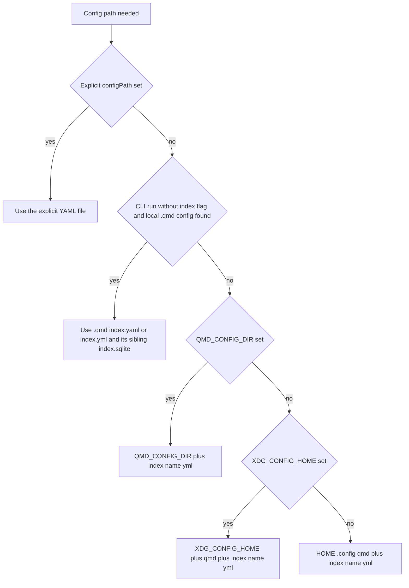
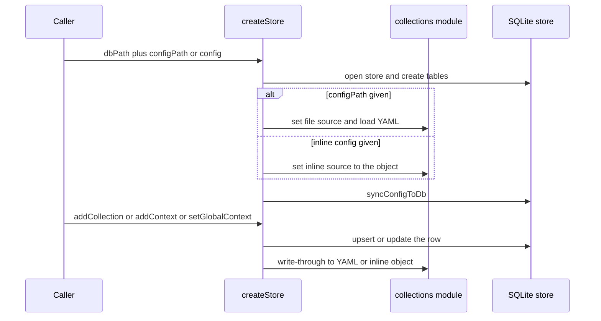

# Collections and index.yml Configuration

QMD keeps its collection definitions in a YAML file, `index.yml`. Every
`qmd collection ...` and `qmd context ...` command, and every SDK mutation
method, reads and writes that file. The collections in the file are then copied
into the `store_collections` table of the SQLite index, and the indexer
(`qmd update`) reads collections from that table rather than from YAML. This
page covers where the file is found, what keys it accepts and what they default
to, how it is synced into SQLite, and how project-local `.qmd/` configs differ.

For how the indexer walks the files a collection points at, see
[Indexing Pipeline](../architecture/indexing-pipeline.md). For model URIs and
runtime loading, see [Models and LLM Runtime](./models-and-llm-runtime.md). For
the approval gate on project-local configs, see
[Trust Gating](../operations/trust-gating.md).

## Locating the config file

The config location is resolved by a short chain of branches. The order below
is the order the code runs them.

Caption: the branches that decide which `index.yml` a QMD call reads and writes.

1. **Explicit `configPath` (SDK).** `loadConfig`, `saveConfig` and `getConfigPath`
   all check `configSource.path` first; if it is set, that file is used
   ([`src/collections.ts`](../../src/collections.ts)). `createStore` sets it
   when `StoreOptions.configPath` is given ([`src/index.ts`](../../src/index.ts)).
2. **Local project config (CLI only).** The CLI calls `findLocalConfigPath()`
   only when no `--index` flag is passed. If it returns a path, the CLI sets it
   as the explicit config source and points the database at
   `getLocalDbPath(configPath)`, which is `index.sqlite` in the same `.qmd`
   folder ([`src/cli/qmd.ts`](../../src/cli/qmd.ts)). Passing `--index` skips
   this step and uses the global directory instead.
3. **`QMD_CONFIG_DIR`.** `getConfigDir()` returns this value verbatim when set. It
   is documented as an override for testing and takes priority over XDG
   ([`src/collections.ts`](../../src/collections.ts)).
4. **`XDG_CONFIG_HOME`.** When `QMD_CONFIG_DIR` is unset and this variable is set,
   the directory is `$XDG_CONFIG_HOME/qmd`.
5. **Default.** Otherwise the directory is `qmdHomedir()/.config/qmd`.
   `qmdHomedir()` returns `HOME`, then `USERPROFILE`, then the OS home directory,
   then `/tmp` ([`src/paths.ts`](../../src/paths.ts)).

Steps 3 to 5 produce `<configDir>/<indexName>.yml`. The default index name is
`index`, so the default file is `index.yml`. `setConfigIndexName` changes the
name: `qmd --index work` reads `work.yml`. A name containing path separators or
a Windows drive is made absolute (relative names are resolved against the
current directory) and then flattened into a filename, with `:`, `\` and `/`
replaced by underscores ([`src/collections.ts`](../../src/collections.ts)).

### Local `.qmd` discovery

`findLocalConfigPath(startDir = process.cwd())` walks upward from `startDir`.
At each directory it checks `.qmd/index.yaml` first and `.qmd/index.yml` second,
returns the first that exists, and returns `undefined` once it reaches the
filesystem root ([`src/collections.ts`](../../src/collections.ts)). The index
name does not affect this lookup. `qmd init` uses the same file names: it keeps
an existing `index.yaml`, otherwise it writes `index.yml`, creates
`.qmd/index.sqlite` beside it, and fills `models` with the resolved defaults
([`src/cli/qmd.ts`](../../src/cli/qmd.ts)).

The tests cover these rules: nested working directories find the `.qmd` file,
`index.yaml` wins over `index.yml`, the local database is `.qmd/index.sqlite`,
and a CLI run inside a project uses the local config and database without
touching the global cache ([`test/local-config.test.ts`](../../test/local-config.test.ts)).
The global branches are tested in
[`test/collections-config.test.ts`](../../test/collections-config.test.ts),
including the precedence `QMD_CONFIG_DIR` over `XDG_CONFIG_HOME` and the
Windows-path sanitization.

## Schema and defaults

The `CollectionConfig` type defines the file shape ([`src/collections.ts`](../../src/collections.ts)).
The table lists the keys the code reads and the defaults it applies when a key
is absent.

| Key | Scope | Accepted values | Default in code | Notes |
|-----|-------|-----------------|-----------------|-------|
| `global_context` | top level | string | none (`undefined`) | Stored in `store_config`; returned for every collection in context lookup. Set with `qmd context add /`. |
| `editor_uri` | top level | URI template string | falls through to `vscode://file/{path}:{line}:{col}` | Read from `editor_uri`, then `editor_uri_template`, `editorUri`, `editor-uri`; the `QMD_EDITOR_URI` environment variable overrides all of them ([`src/cli/qmd.ts`](../../src/cli/qmd.ts)). |
| `models.embed` | top level | `hf:` URI or local GGUF path | `QMD_EMBED_MODEL`, then `hf:ggml-org/embeddinggemma-300M-GGUF/embeddinggemma-300M-Q8_0.gguf` | Resolved by `resolveEmbedModel` ([`src/llm.ts`](../../src/llm.ts)). |
| `models.rerank` | top level | `hf:` URI or local GGUF path | `QMD_RERANK_MODEL`, then `hf:ggml-org/Qwen3-Reranker-0.6B-Q8_0-GGUF/qwen3-reranker-0.6b-q8_0.gguf` | Resolved by `resolveRerankModel`. |
| `models.generate` | top level | `hf:` URI or local GGUF path | `QMD_GENERATE_MODEL`, then `hf:tobil/qmd-query-expansion-1.7B-gguf/qmd-query-expansion-1.7B-q4_k_m.gguf` | Resolved by `resolveGenerateModel`. |
| `collections.<name>.path` | per collection | absolute or `~` path | none; required | Stored as `NOT NULL` in `store_collections`. |
| `collections.<name>.pattern` | per collection | glob string | `**/*.md` | Applied in `upsertStoreCollection` and the `addCollection` default parameter. |
| `collections.<name>.ignore` | per collection | array of glob strings | none; no user exclusions | Stored as JSON; prepended with the built-in exclusions at index time (see below). |
| `collections.<name>.update` | per collection | shell command string | none (no hook) | Run with `bash -c` by `qmd update`. |
| `collections.<name>.includeByDefault` | per collection | boolean | `true` | Only `false` is stored (as `0`); anything else reads back as included. |
| `collections.<name>.context` | per collection | map of path prefix to description | none | Longest matching prefix wins; falls back to `global_context`. |

The `models` block is optional. The sample [`example-index.yml`](../../example-index.yml)
shows it commented out, and the README lists the same keys and defaults
([`README.md`](../../README.md), "Configuring `index.yml`").

## Loading, saving and the SQLite sync

### Reading and writing the file

`loadConfig()` returns the inline object when the source is inline. Otherwise
it reads the file on every call, returns `{ collections: {} }` if the file is
missing, treats an empty YAML document as an empty config, and ensures
`collections` exists. A parse error is rethrown as `Failed to parse <path>`.
`saveConfig()` writes the YAML with two-space indentation and no line wrapping,
creating the directory if needed ([`src/collections.ts`](../../src/collections.ts)).

Collection helpers such as `addCollection`, `updateCollectionSettings`,
`renameCollection`, `addContext` and `setGlobalContext` all follow the same
pattern: load, mutate the object, save. `updateCollectionSettings` removes the
`update` or `includeByDefault` key when it is cleared or set back to its default,
so the file stays minimal.

### `syncConfigToDb` (src/store.ts)

`syncConfigToDb(db, config)` copies the YAML or inline config into SQLite
([`src/store.ts`](../../src/store.ts), function near line 1503):

1. It computes a SHA-256 digest of `JSON.stringify(config)`.
2. If `store_config.config_hash` already equals that digest, it returns without
   changing anything.
3. It upserts every collection in the config into `store_collections`.
4. It deletes rows in `store_collections` whose names are absent from the config.
   It does not touch the documents of those collections.
5. It writes `global_context` to `store_config`, or deletes that row if the
   config has no `global_context`.
6. It stores the new digest as `config_hash`.

The table has the columns `name`, `path`, `pattern`, `ignore_patterns` (JSON),
`include_by_default`, `update_command` and `context` (JSON). `models`,
`editor_uri` and the other top-level keys are not copied; the CLI and LLM code
read them from YAML directly.

### Where the sync runs

- **`createStore`** ([`src/index.ts`](../../src/index.ts), around lines 455–470).
  If `configPath` is given, it sets the file source, loads the file and syncs it.
  If `config` is given, it sets the inline source and syncs that object. If
  neither is given, the store reuses whatever is already in `store_collections`.
  Passing both throws. The LLM instance is built from `config.models`, so model
  overrides also apply to SDK stores.
- **CLI `getStore()`** ([`src/cli/qmd.ts`](../../src/cli/qmd.ts)). On first use it
  syncs the loaded config into the database, so edits to `index.yml` are visible
  to the next command.
- **CLI `resyncConfig()`**. After CLI mutations it deletes `config_hash` first,
  which forces a full re-sync even when the digest would match.

Caption: `createStore` syncs the config into SQLite, and SDK mutations write to SQLite and then through to the YAML file or inline object.

### SDK write-through

When `createStore` was given a `configPath` or an inline `config`, each SDK
mutation does two writes: first to SQLite, then to the YAML file or to the
in-memory object. The collection, context and global-context methods in
`createStore` all do this ([`src/index.ts`](../../src/index.ts)). Without either
option, mutations go only to SQLite.

With an inline config the write-through mutates the object in place, so the
caller's object reflects the change. The SQLite write happens directly and does
not update `config_hash`; the stored digest only changes on the next
`syncConfigToDb` run, which recomputes it from the current object.

Known gap: the SDK `addCollection` write-through calls the YAML helper with only
`path` and `pattern`. The `ignore` option is written to SQLite, but the helper
replaces the whole YAML entry, so `ignore`, `update` and `includeByDefault` are
dropped from the file. A later sync from that file then clears `ignore` in
SQLite ([`src/index.ts`](../../src/index.ts), [`src/collections.ts`](../../src/collections.ts)).
Set `ignore` and `update` by editing the YAML directly, or re-apply them after
an SDK `addCollection`.

## Collection semantics that affect indexing

- **Built-in exclusions are additive and cannot be removed.** At index time
  `reindexCollectionIn` builds `allIgnore` by prepending `**/<dir>/**` for each of
  `node_modules`, `.git`, `.cache`, `vendor`, `dist` and `build`, then appending
  the collection's own `ignore` list. The CLI indexer has the same list. There is
  no key that turns these off ([`src/store.ts`](../../src/store.ts),
  `excludeDirs` near line 1878; [`src/cli/qmd.ts`](../../src/cli/qmd.ts),
  near line 2099). The README and `example-index.yml` describe these exclusions
  as additive and not removable through `ignore`.
- **Hidden files and folders are always skipped.** After globbing with
  `dot: false`, any path with a segment that starts with `.` is dropped
  ([`src/store.ts`](../../src/store.ts)).
- **A missing root does not deactivate documents.** If the collection `path` is
  not a directory, the indexer returns a `ROOT_MISSING` skip and leaves the index
  unchanged. This prevents an unmounted drive from being read as "every file was
  deleted" ([`src/store.ts`](../../src/store.ts)).
- **`qmd update` runs hooks, then re-indexes.** `updateCollections` loads the
  collections from SQLite, looks up the YAML entry for the `update` command and
  the `ignore` list, runs the hook with `bash -c` in the collection directory, and
  exits the process if the hook fails. Collections after the failing one are not
  re-indexed ([`src/cli/qmd.ts`](../../src/cli/qmd.ts), `updateCollections`;
  [`README.md`](../../README.md), "Automatic update commands").
- **Context lookup uses the longest prefix.** `findContextForPath` normalizes
  leading slashes on both the file path and the prefix, keeps every prefix that
  matches, sorts by length and returns the longest. With no match it returns
  `global_context`. `listAllContexts` reports the global entry with collection
  `*` and path `/` ([`src/collections.ts`](../../src/collections.ts)).
- **`includeByDefault` drives unscoped queries.** `getDefaultCollections` keeps
  collections where the value is not `false`. The store's `listCollections`
  reports the same boolean, and `getDefaultCollectionNames` uses it
  ([`src/collections.ts`](../../src/collections.ts), [`src/store.ts`](../../src/store.ts),
  [`src/index.ts`](../../src/index.ts)).

## Editing the file does not re-index

Editing `index.yml` changes what QMD uses on the next command, because the CLI
re-syncs on first store access. It does **not** re-scan the filesystem. The README
and [`example-index.yml`](../../example-index.yml) state this directly:

- After changing `path`, `pattern` or `ignore`, run `qmd update`.
- After changing `models.embed`, run `qmd embed`, because existing vectors were
  produced by the previous model. The CLI's own hint for this case is
  `qmd embed -f`, which re-embeds with the new model.
- Changing `update`, `includeByDefault`, `context` or `global_context` takes
  effect without re-indexing, because those values are read at query or update
  time.

## Project-local configs and the trust gate

A `.qmd/index.yml` checked into a repository is adopted automatically by the CLI
(see the discovery section above). `trust.ts` gates three kinds of field that can
reach outside the project: `update` hooks, collection `path`s that resolve outside
the project root, and `models` URIs other than the built-in defaults. Global config
in `~/.config/qmd` is never gated. Approvals are stored per config file and per
gated set in `trusted.json` next to the global config. Changing a gated value
asks again. The mechanics are covered in [Trust Gating](../operations/trust-gating.md).

For the model caveat, note that the CLI writes resolved model URIs into the YAML.
`ensureModelsConfiguredForCli` calls `resolveModels(config.models)` and, if any of
the three values differs from what is stored, saves a `models` block containing
all three. Values that come from environment variables or defaults are therefore
persisted into the file ([`src/cli/qmd.ts`](../../src/cli/qmd.ts)). When a
project-local config's custom model URIs are not trusted, the runtime uses
`resolveModels()` instead, so untrusted values are not loaded.

## Related pages

- [Indexing Pipeline](../architecture/indexing-pipeline.md): how collection roots, globs and ignore lists are walked and hashed.
- [Models and LLM Runtime](./models-and-llm-runtime.md): how the resolved model URIs are loaded.
- [Virtual Paths and DocIDs](./virtual-paths-and-docids.md): how collection names appear in document paths.
- [SDK Library](../integrations/sdk-library.md): `createStore`, `configPath`, inline `config` and the mutation methods.
- [Trust Gating](../operations/trust-gating.md): approvals for project-local `.qmd` configs.
