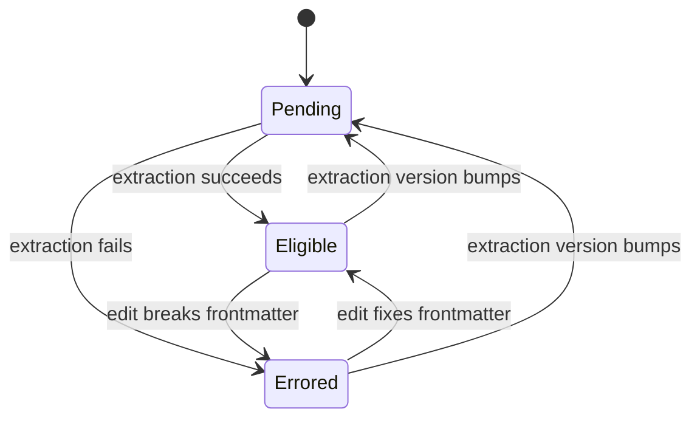
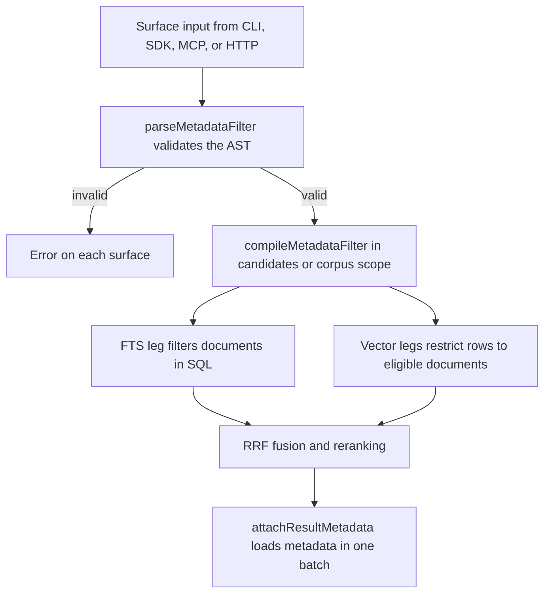

# Metadata Filtering and Discovery

Metadata filtering lets a caller narrow search to documents whose frontmatter matches a typed condition, and discovery lets a caller learn which keys, types, and values exist before writing that condition. Both share one JSON grammar, one validator, and one SQL compiler. This page covers the grammar, the extraction and storage path that feeds it, how filters enter search, the discovery report, and the error contract on each surface.

## Responsibilities at a glance

| Concern | Owner | Notes |
|---|---|---|
| Extract `qmd.metadata` from frontmatter | `src/metadata.ts` | Pure, never throws, all-or-nothing per document |
| Persist metadata rows | `src/metadata-store.ts` | `document_metadata` plus one row per scalar value |
| Validate untrusted AST | `src/metadata-filter.ts` | `parseMetadataFilter`, `parseMetadataMatch` |
| Compile AST to parameterized SQL | `src/metadata-filter.ts` | `compileMetadataFilter`, `compileMetadataMatch` |
| Apply filter to search | `src/store.ts` | FTS and vector legs, metadata attached after fusion |
| Discovery report | `src/metadata-store.ts` | `listMetadata` and collection overviews |
| Text rendering | `src/metadata-format.ts` | Shared by CLI and the MCP `metadata` tool |

The source of truth is SQLite. Metadata is derived from document content on indexing and is never edited in place, so the database can be rebuilt from source documents with `qmd update` (see [Storage Schema](../architecture/storage-schema.md)).

## Declaring metadata in a document

A Markdown, `.markdown`, or `.mdx` file opts in through a namespaced frontmatter block:

```yaml
---
qmd:
  metadata:
    topics:
      - typescript
      - programming
    status: published
---
```

`extractDocumentMetadata` in [src/metadata.ts](../../src/metadata.ts) reads the leading `---` block (tolerating a UTF-8 BOM and CRLF line endings), parses it with the `yaml` library under a YAML alias cap, and reads only the `qmd.metadata` mapping. Files with other extensions, no frontmatter, or no `qmd` namespace yield empty metadata with no error. The raw document is never modified: frontmatter stays part of the stored, indexed, chunked, and embedded content.

Accepted values are strings, finite numbers, booleans, and flat, non-empty, homogeneous arrays of one of those. `null`, empty arrays, nested arrays, and mixed-type arrays are rejected. Duplicate array elements are removed while preserving order. Limits from `METADATA_LIMITS`:

| Limit | Value |
|---|---|
| Frontmatter size | 64 KiB |
| Keys per document | 64 |
| Key size | 128 bytes, no control characters |
| String length | 1024 characters |
| Array length | 128 values |
| YAML alias count | 100 |
| Stored error message | 200 characters |

### Extraction is all-or-nothing

Normalization throws on the first unsupported key or value, and the caller turns that into a failure result. A failed extraction stores empty metadata plus a bounded error string, and the document still indexes normally. It is then excluded from filtered search and discovery until the frontmatter is fixed and the file is re-indexed. The design keeps stale partial metadata from persisting after a bad edit.

`METADATA_EXTRACTION_VERSION` is currently `1`. Bumping it makes existing rows fail the current-version check, so `qmd update` re-extracts them.

## Storage model

`initializeMetadataSchema` in [src/metadata-store.ts](../../src/metadata-store.ts) creates two tables:

- `document_metadata` is keyed by `document_id`, not by content hash, so two paths that share content can carry different metadata. It records `metadata_json`, `extraction_version`, `extraction_error`, and `extracted_at`. A row exists for every extracted document, including successful extractions that found no metadata.
- `document_metadata_values` holds one row per scalar, keyed by `(document_id, key, ordinal)`. Each row has a `value_type` and exactly one typed column (`text_value`, `number_value`, or `boolean_value`), enforced by CHECK constraints. Booleans store as 0 or 1. Three partial indexes cover the lookup patterns by value type.

`replaceDocumentMetadata` writes both tables inside one transaction, deleting prior value rows first. `syncDocumentMetadata` is the entry point during indexing. Its `onlyIfStale` option skips documents whose stored extraction version is already current, which is how unchanged documents are cheap to re-index.

The extraction state a document can be in determines whether it is visible to filters:



Caption: only Eligible documents, which are active, have a current-version row, and have no extraction error, can satisfy a filter or appear in discovery. `countDocumentsPendingMetadata` counts the documents outside that state for `qmd status`.

The stale check compares only the extraction version. A file whose content or mtime changes is always re-extracted through the full sync path, so a fixed frontmatter takes effect on the next re-index of that file.

## The filter AST

Every surface accepts one recursive shape, discriminated by `operator`:

```json
{ "operator": "and", "operands": [
  { "field": "status", "operator": "eq", "value": "published" },
  { "operator": "not", "operand": { "field": "topics", "operator": "eq", "value": "draft" } }
] }
```

`MetadataPredicate<Condition>` in [src/metadata-filter.ts](../../src/metadata-filter.ts) is the one grammar. It is instantiated twice:

- `MetadataFilter` is a predicate over a **document**, whose fields are its metadata keys. Search and document counting use it.
- `MetadataMatch` is a predicate over a **metadata entry**, whose fields are `key` and `value`. Discovery's `match` option uses it.

### Operators

| Group | Operators | Notes |
|---|---|---|
| Logical | `and`, `or` | Non-empty `operands` array, at most 32 entries |
| Logical | `not` | Exactly one `operand` |
| Comparison | `eq`, `ne` | Any scalar operand, typed by the operand |
| Ordered | `gt`, `gte`, `lt`, `lte` | Numbers or strings only, never booleans |
| Membership | `in`, `nin` | Non-empty, homogeneous array, at most 64 values, de-duplicated |
| Membership | `all` | Document only; every listed value must be present under the key |
| Text | `contains`, `prefix`, `suffix` | Non-empty string operand, string-typed values only |
| Type | `type` | `string`, `number`, or `boolean` |
| Presence | `exists` | Document only; boolean `value` |

`caseInsensitive` is an optional flag, not an operator. It is accepted only when the operand is a string or an array of strings, and it is rejected on `exists` and `type`. Folding is ASCII-only on both sides, matching SQLite `lower()`.

`parseFilterNode` dispatches on `operator`. Group operators go to `parseFilterGroup`, `not` to `parseFilterNegation`, and the condition set to `parseFilterCondition`. Unknown operators, unknown properties, and missing required properties throw `MetadataFilterError` with the JSON path of the failing node. `parseMetadataMatch` runs the same walker with `recordType` set to `entry`, which narrows the admitted fields and rejects `exists` and `all`.

### Limits

`METADATA_FILTER_LIMITS` bounds untrusted input: nesting depth 16, 256 nodes, 32 group operands, 64 membership values, and the same key-byte and string-length caps used at extraction. Exceeding a limit throws `MetadataFilterError`.

### Type strictness

A condition only ever compares values of its operand's type. A string `eq` never matches a number, and a number `gt` never matches a string. A mismatch yields no match rather than a coercion. Array-valued keys are sets: a condition matches when any element satisfies it. `all` requires every listed value. `ne` and `nin` require at least one same-type value under the key and no same-type value equal to the operand. Independent conditions on one array key can match different elements.

### Compilation

`compileFilterNode` produces parameterized SQL. Every user key and value is a bound parameter, and tests check that injection payloads stay data. The compiler takes a scope:

- `candidates` compiles each condition to a correlated `EXISTS` over `document_metadata_values`, used when search checks its results.
- `corpus` compiles each condition to an uncorrelated `IN (SELECT document_id ...)`, used when discovery counts documents. SQLite evaluates it once per statement and probes it per document.

`compileMetadataMatch` compiles a match against a single `mv` row. For `key` the column is always the string `'string'`, so a number or boolean operand never matches. `key` and `value` text columns are compared directly.

## How filters enter search

The filter is applied in SQL inside each retrieval leg, before any ranking or fusion:



Caption: validation happens once at the surface boundary, and the filter reaches both legs. Metadata is attached only to the final results.

- **Lexical leg.** `searchFTS` in [src/store.ts](../../src/store.ts) adds `dm.extraction_version = current AND dm.extraction_error IS NULL AND <compiled filter>` to the query. When a collection scope or a filter is present, the FTS match CTE is `MATERIALIZED` and has no inner `LIMIT`, so the filter sees the complete match set. An unscoped query keeps the inner `LIMIT`.
- **Vector leg.** `searchVec` first restricts to collections that hold an eligible row (`metadataEligibleCollections`). `knnVecScanner` then adds `rowid IN (eligible rows)` inside the vec0 scan, so the nearest-neighbor search runs over eligible rows only. `vecDocumentResolver` applies the filter a second time on the document join, because a content hash can belong to both matching and non-matching documents.
- **Hybrid query.** `hybridQuery` passes the same filter to `searchFTS` for the strong-signal probe and the expansion legs. `attachResultMetadata` runs after RRF and reranking, so `metadata` is not duplicated through fusion.

### Top-K completeness is best-effort

Every returned result satisfies the filter. Completeness of the top K is not guaranteed for highly selective filters. The changelog states this for the filter feature: highly selective filters remain best-effort for top-K completeness, like collection filtering. The code shows where that bound comes from:

- The hybrid pipeline seeds fusion with the top 20 FTS results.
- `nearestVecDocuments` starts with `k = limit * 3` and doubles `k` only while fewer than `limit` documents resolve and the target has more rows, up to the sqlite-vec cap.
- A document is returned only if the filter admits it, so a selective filter can return fewer than `limit` results even when more eligible documents exist beyond the candidate window.

Callers that need an exhaustive list of matches should use discovery's `filteredDocuments` count, or narrow the query differently, rather than rely on top-K.

## Discovery

`listMetadata(db, options)` in [src/metadata-store.ts](../../src/metadata-store.ts) reports keys, types, and value counts for documents in scope. It sees the same data filtering sees: the same extraction gate, active-document rule, and collection scope. Every value it reports is one an `eq` filter under the same scope can match.

### Options and defaults

| Option | Default | Meaning |
|---|---|---|
| `collection` | every collection | Restrict scope to one or more collections |
| `match` | none | Report only entries matching a `MetadataMatch` |
| `filter` | none | Count only documents matching a `MetadataFilter` |
| `keyLimit` | 50 | Keys reported. `Infinity` removes the window |
| `keyOffset` | 0 | Keys skipped in report order |
| `valueLimit` | 10 | Values reported per key and type. `Infinity` removes the window |
| `valueOffset` | 0 | Values skipped per key and type, in `sort` order |
| `sort` | `count` | `count` (documents descending) or `value` (ascending) |
| `minCount` | 1 | Drop values held by fewer documents than this |

Defaults are applied in `resolveWindow`, which constants `DEFAULT_METADATA_KEY_LIMIT` (50) and `DEFAULT_METADATA_VALUE_LIMIT` (10) back. Out-of-domain values throw `MetadataOptionError`, which names the option and the expected domain. Limits must be safe positive integers or `Infinity`. Offsets must be non-negative safe integers. `sort` must be `count` or `value`.

### Two different narrowing roles

- `filter` decides **which documents are counted**. When present, the result carries `filteredDocuments`, and every coverage count is measured against that denominator.
- `match` decides **which metadata entries are reported**. A condition's `field` is `key` or `value`, so one grammar covers a single key, a family of keys, a reverse lookup of a value, typed thresholds, and `and`, `or`, and `not` compositions.

Counts are documents, not values. A document with `topics: [a, b]` adds one to each value's count and one to the key's coverage.

### Result shape

`ListMetadataResult` has `documents`, `filteredDocuments` (only with a filter), `totalKeys`, `keys`, and `remainingKeys`. Each key has `documents` and one `MetadataKeyTypeSummary` per stored type. A type summary reports `documents`, `multiValued`, `distinctValues`, a `values` window, `remainingValues`, `collections`, and for numbers a `range` with `min`, `median`, and `max`.

A key whose documents hold different types is split per type, with separate counts. Keys are ordered by documents descending, then by key name in SQLite BINARY order. Values are ordered by the requested `sort`, with a deterministic tie-break.

### Consistency and budgets

The whole report is read inside one deferred transaction, so counts come from one snapshot even while another connection writes. The key window is a `MATERIALIZED` CTE that ranks keys once per report. Values are grouped once for both totals and the window.

`assertBindingBudget` checks the bound-parameter count against `METADATA_SQL_BINDING_BUDGET` (30,000) before any statement is prepared. A `filter` and a `match` each pass the parser's own limits, but the match is bound twice, so their combination is checked. Exceeding the budget throws `MetadataBindingBudgetError`, which reports the bindings and budget and suggests shortening membership lists.

Collection-level overviews (`listMetadataCollectionSummaries`) use one `GROUP BY` without values, so `collection list`, `status`, and the MCP `status` tool can show top keys cheaply.

## Surfaces

All four surfaces parse filters and matches with the same validator before compiling SQL.

### SDK

`src/index.ts` exposes `filter` on `search`, `searchLex`, and `searchVector`, and `listMetadata` takes `filter` and `match`. Each option is run through `parseMetadataFilter` or `parseMetadataMatch` at the SDK boundary, so plain JavaScript callers get the same checks as TypeScript callers. The SDK re-exports `MetadataFilterError`, `MetadataOptionError`, and `MetadataBindingBudgetError`. See [SDK Library](../integrations/sdk-library.md).

### CLI

`--filter <json>` applies to `search`, `vsearch`, `query`, and `qmd collection metadata`. `--match <json>` applies to discovery only. The discovery command has window and ordering flags (`--key-limit`, `--key-offset`, `--all-keys`, `--value-limit`, `--value-offset`, `--all-values`, `--sort`, `--min-count`). It rejects `-n`, `--all`, and structured output formats, because it prints text only. Those callers are pointed at the SDK, the MCP tool, or `POST /metadata`.

The text output is rendered by `formatMetadataKeySummaries` in [src/metadata-format.ts](../../src/metadata-format.ts), which prints a `filter:` line when a filter is in play. Values print bare only when that is unambiguous, otherwise as JSON strings, so what the reader sees is exactly the stored value.

### MCP

The `query` tool takes `filter` and returns `metadata` on each result when it is non-empty. Invalid filters return a tool result with `isError: true` and the validator's message. See [MCP Server](../integrations/mcp-server.md).

The `metadata` tool takes `collections`, `match`, `filter`, and the window options. Its description defines the `match` field semantic:

- `match` selects **which metadata entries are reported**. A condition's `field` is `"key"` (the entry's key name) or `"value"` (the entry's value).
- `filter` selects **which documents are counted**, and its `field` is a metadata key.
- `exists` and `all` are invalid in `match`, because they have no meaning for a single entry.

The tool returns the CLI text and the result as `structuredContent`. Invalid `match` or `filter` arguments and binding-budget errors return an `isError` result.

### HTTP

`POST /query` and its alias `POST /search` accept the same `filter` object. A non-object `filter` returns `400` with `Invalid field: filter (must be an object)`. An invalid AST returns `400` with the validator's message, for example `unknown operator 'equal'`. See [HTTP API and Origin Guard](../integrations/http-api-and-origin-guard.md).

`POST /metadata` accepts the same body as the MCP `metadata` tool and returns `400` for each of these conditions:

- Invalid JSON, or a body that is not an object.
- A `filter` or `match` that is not an object, or fails validation.
- A `sort` that is not `count` or `value`.
- A `collections` value that is not an array.
- A non-numeric window option, checked by `readNumberFields`.
- A `MetadataOptionError` or `MetadataBindingBudgetError` from the store.

Successful responses return the `ListMetadataResult` as JSON.

## Invariants and failure modes

- A returned search result always satisfies the filter. The filter is applied in both legs and again when vector rows resolve to documents.
- A document with a failed or missing current extraction never matches a filter and never appears in discovery. It remains searchable by plain text search.
- Filter and match values never reach SQL text. Keys and values bind as parameters, and the `candidates` and `corpus` scopes differ only in the subquery shape.
- A value reported by discovery is reachable through an `eq` filter in the same scope.
- Type mismatch never matches. This is the case for ordered operators on booleans, for number or boolean operands against `key`, and for a text operator against a number or boolean value.
- Invalid filters fail at the boundary, before any search or discovery work, with the JSON path of the failing node.

## Extension points and constraints

- A new non-frontmatter metadata source can produce the same `MetadataExtractionResult` shape and reuse storage and filtering unchanged. The module comment in `src/metadata.ts` describes this boundary.
- Adding an operator requires changes in four places that must stay aligned: the operator sets in `src/metadata-filter.ts`, the parser branch, the compiler branch for both scopes, and the type unions. The type-level tests in `test/metadata-filter.test-d.ts` guard the public grammar.
- Changing extraction or normalization semantics requires bumping `METADATA_EXTRACTION_VERSION` so existing rows are re-extracted on `qmd update`.

## Tests that matter

- `test/metadata-filter.test.ts` covers accepted shapes, node validation with JSON paths, depth and count limits, match compilation, every operator's semantics, `caseInsensitive` rules, SQL injection payloads, and the seek and scope shapes of the compiled SQL.
- `test/metadata-filter.test-d.ts` checks the public TypeScript grammar, including that document-only conditions are rejected in a match.
- `test/metadata-search.test.ts` covers filtered FTS and vector search, the extraction gate, shared content hashes, the case where a filtered document ranks below the unfiltered window, selective filters that under-fill but never return ineligible rows, and the bound on vector bindings.
- `test/metadata-discovery.test.ts` covers counting documents rather than values, the windows and offsets, type splits, medians, `MetadataOptionError` and `MetadataBindingBudgetError`, snapshot reads, and the guarantee that every reported value is reachable through `eq`.
- `test/metadata-surfaces.test.ts` covers the SDK boundary, the MCP `query` and `metadata` tools, and the HTTP `400` responses for `/query`, `/search`, and `/metadata`.
