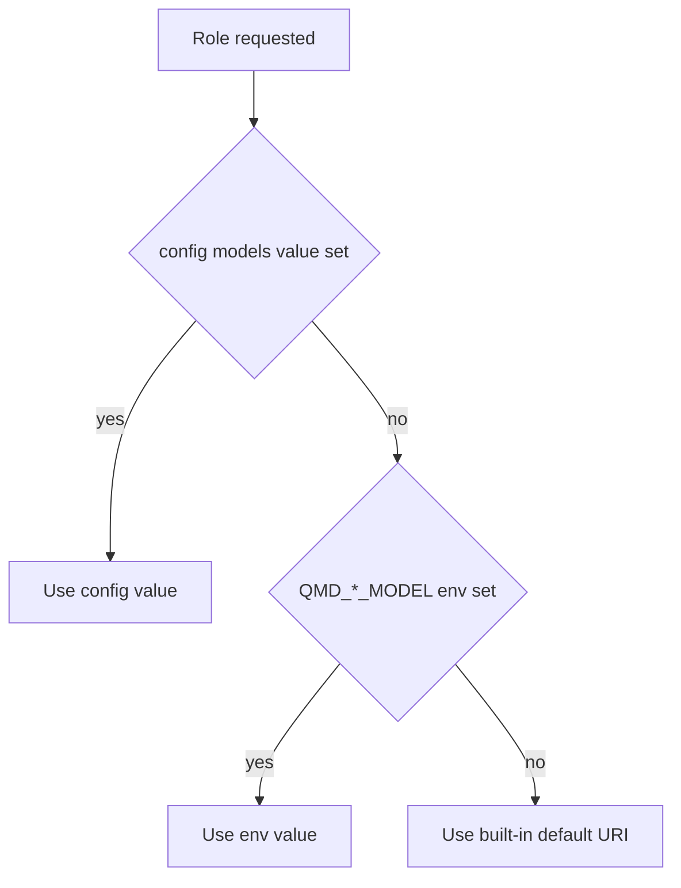
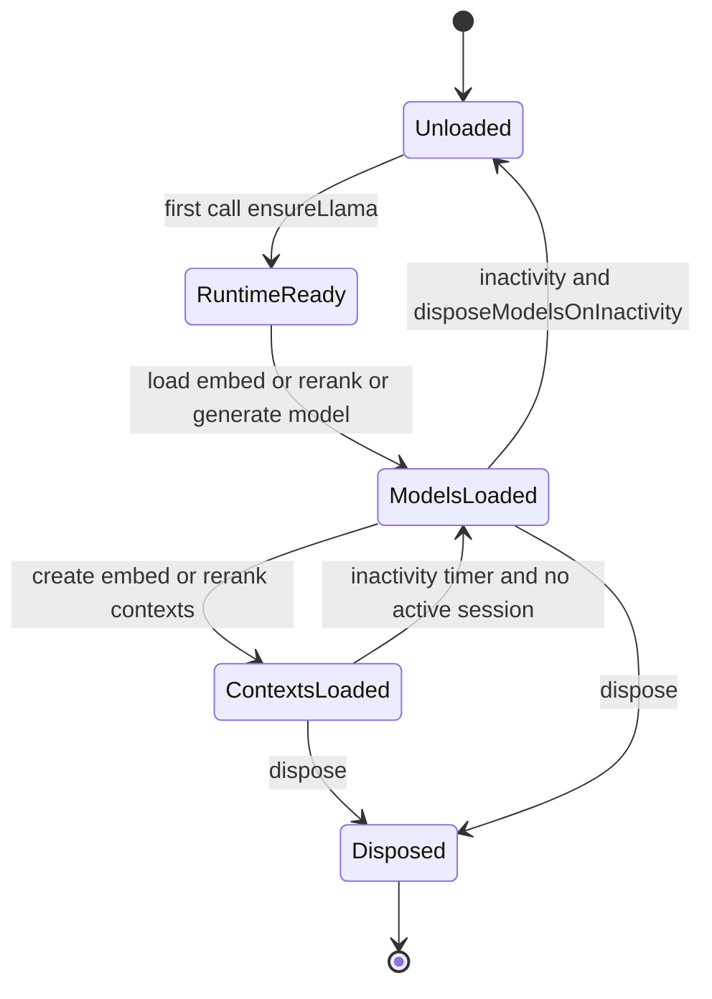

# Models and LLM Runtime

QMD runs three kinds of local GGUF models through `node-llama-cpp`: an **embedding** model, a **reranker**, and a **generation** model used for query expansion. All of the runtime lives in `src/llm.ts`. The class `LlamaCpp` owns the native runtime, the loaded models, and their contexts. Everything else (the SDK store, the CLI, and the query pipeline) talks to it through a small set of methods: `embed`, `embedBatch`, `expandQuery`, `rerank`, and `generate`.

This page covers model selection, the lazy lifecycle, idle unloading, sessions, GPU selection, embedding parallelism, prompt formats, and the Darwin Metal launcher workaround. For how these calls fit into search, see [Hybrid Query Pipeline](../workflows/hybrid-query-pipeline.md). For the YAML `models:` block, see [Collections and Config](./collections-and-config.md).

## Default models

Built-in defaults are plain HuggingFace URIs in the `hf:<user>/<repo>/<file>` form:

| Role | Default URI | Notes |
| --- | --- | --- |
| Embedding | `hf:ggml-org/embeddinggemma-300M-GGUF/embeddinggemma-300M-Q8_0.gguf` | Uses the EmbeddingGemma prompt format. |
| Rerank | `hf:ggml-org/Qwen3-Reranker-0.6B-Q8_0-GGUF/qwen3-reranker-0.6b-q8_0.gguf` | Scores query and document pairs. |
| Generate | `hf:tobil/qmd-query-expansion-1.7B-gguf/qmd-query-expansion-1.7B-q4_k_m.gguf` | A query-expansion model fine-tuned from Qwen3-1.7B. The fine-tuning setup is documented under `finetune/`. This page does not describe its weights or training artifacts. |

The defaults are declared at `src/llm.ts` lines 282-285. Two alternative generation models, LiquidAI LFM2 variants, are exported as constants (`LFM2_GENERATE_MODEL`, `LFM2_INSTRUCT_MODEL`) but are not defaults. The `finetune/SCORING.md` file explains how expansion output is scored, which is useful context when choosing a generation model.

### Fine-tuning source configuration

The fine-tuning scripts under `finetune/` read two environment variables. This describes source behavior only; it does not describe the published weights or any training artifacts.

- `HF_TOKEN` is read by `finetune/convert_gguf.py` (lines 111-115). The script calls the Hugging Face `login` only when the variable is set and nonempty. When it is unset or empty, no explicit login happens and the script runs without one.
- `QMD_BASE_MODEL` is read by `get_tokenizer` in `finetune/dataset/prepare_data.py` (lines 37-43). It names the tokenizer to load with `AutoTokenizer.from_pretrained` and defaults to `Qwen/Qwen3-1.7B`. The tokenizer is cached in a module-level variable, and it reloads only when the resolved model name differs from the cached one.

These variables affect only the `finetune/` tooling. They are unrelated to the `QMD_*_MODEL` variables that select runtime GGUF models in `src/llm.ts`.

## Per-role model resolution

Each role has a resolver with the same three-step precedence: **config value, then environment variable, then built-in default**.

- `resolveEmbedModel` returns `config.embed`, then `QMD_EMBED_MODEL`, then `DEFAULT_EMBED_MODEL` (`src/llm.ts` lines 303-305).
- `resolveGenerateModel` follows the same pattern with `config.generate`, `QMD_GENERATE_MODEL`, and the generation default (lines 307-309).
- `resolveRerankModel` follows the same pattern with `config.rerank`, `QMD_RERANK_MODEL`, and the rerank default (lines 311-313).
- `resolveModels` (lines 315-321) bundles all three into one object.

Empty strings fall through, because the code uses `||` rather than `??`. The `LlamaCpp` constructor calls these same resolvers (around lines 875-877), so runtime and status displays agree on which model is active. A test asserts that the constructor and the resolvers return identical names.

The CLI adds two layers on top of this resolver:

- `ensureModelsConfiguredForCli` (`src/cli/qmd.ts` around lines 2344-2360) loads the YAML config, resolves the three roles, and writes any resolved values back into the config file when they differ from what is stored. In practice, environment values and defaults get persisted into `models:` the first time the CLI runs.
- Project-local configs can request custom model URIs. Those URIs are only used at runtime when the local config is fully trusted (issue #889). Otherwise the CLI falls back to `resolveModels()` (around lines 2385-2390 and `getStore` at lines 171-195). Status output still shows the YAML values.

The SDK path is simpler. `createStore` in `src/index.ts` (around lines 476-484) passes `config.models.embed`, `generate`, and `rerank` straight into `new LlamaCpp(...)`. Missing values then resolve through the same env and default chain.

Caption: model URI precedence for each role, as implemented by the `resolve*Model` functions.

## Model files and validation

Model URIs are turned into local paths by `resolveModelFile` from `node-llama-cpp`, which downloads into the cache directory. The default cache is `$XDG_CACHE_HOME/qmd/models`, or `~/.cache/qmd/models` when that variable is not set (`src/llm.ts` around line 322).

Downloaded files are checked before they are loaded. `inspectGgufFile` reads the first bytes and classifies the file as `gguf`, `html`, `invalid`, `unreadable`, or `missing`. `validateGgufFile` acts on that result:

- An `html` result means a proxy, firewall, or captive portal intercepted the download. The file is deleted and the error suggests `HF_ENDPOINT` mirrors or a manual `QMD_EMBED_MODEL=/path/to/model.gguf`.
- An `invalid` result (wrong magic bytes) also deletes the file, so the next run downloads it again.
- An `unreadable` result means the read itself failed. The file is left alone, because deleting a usable multi-gigabyte model is costly.

`pullModels` uses ETag checks against HuggingFace to decide whether a cached file is stale. It also disables the node-llama-cpp progress bar by default, so agent transcripts stay short.

## LlamaCpp lifecycle

`LlamaCpp` loads everything lazily. Constructing it reads config and env only, and it does not touch the native library. The first call to a method triggers the load chain:

1. `ensureLlama` creates the `Llama` runtime once. A promise guard prevents two concurrent callers from building two runtimes.
2. The role-specific loader (`ensureEmbedModel`, `ensureGenerateModel`, or `ensureRerankModel`) resolves the model file and calls `llama.loadModel`. Each loader also has a promise guard, so concurrent first calls share one load.
3. Contexts are created on demand. Embedding contexts come from `ensureEmbedContexts`, and rerank contexts come from `ensureRerankContexts`. Generation creates a fresh context, sequence, and `LlamaChatSession` for every `generate` call and disposes them afterwards. `expandQuery` creates a bounded context sized by `expandContextSize`, which defaults to 2048 and can be set with the `QMD_EXPAND_CONTEXT_SIZE` env var or the `expandContextSize` config option.

Context sizes are fixed by constants that can be overridden: embedding uses 2048 tokens (`QMD_EMBED_CONTEXT_SIZE`), and reranking uses 4096 tokens (`QMD_RERANK_CONTEXT_SIZE`). Embedding input is truncated to the smaller of the context size and the model's trained context size, with a 4-token margin (`resolveEmbedTokenLimit` and `truncateToContextSize`).

### Idle unload

`touchActivity` resets an inactivity timer. The timer runs whenever the instance has at least one loaded embedding or rerank context, and it is `unref`'d so it does not keep the process alive. Activity is recorded at the start of every public operation and during model loads.

When the timer fires, it checks `canUnloadLLM()`. If a session or operation is active, the timer reschedules itself. Otherwise `unloadIdleResources` runs. That method disposes all embedding and rerank contexts. It disposes the models only when `disposeModelsOnInactivity` is true. It always keeps the `Llama` runtime alive.

The inactivity timeout has two values that differ by caller:

- `createStore` in `src/index.ts` (around lines 476-484) sets `inactivityTimeoutMs` to 5 minutes and `disposeModelsOnInactivity` to `true`. Models are freed as well as contexts, which is the setting SDK users get.
- The CLI's `getStore` constructs `LlamaCpp` without these options. The class default applies: 5 minutes, with models kept loaded. The JSDoc on `LlamaCppConfig` still says "2 minutes", which is out of date. The code constant `DEFAULT_INACTIVITY_TIMEOUT_MS` is 5 minutes.

Caption: `LlamaCpp` lifecycle. Contexts are released on idle in every configuration. Models are released on idle only when `disposeModelsOnInactivity` is set. `dispose` ends the instance from any state.

### Dispose order

`dispose` is idempotent. It disposes embedding contexts, rerank contexts, then the embedding, generation, and rerank models, and finally the `Llama` runtime. Each step runs under a 1-second timeout, so a stuck native call prints a warning and shutdown continues. Contexts go first, following the dependency order the code documents (model, then context, then sequence).

## Sessions and concurrency

Callers that run several model operations in a row should wrap them in `withLLMSession`. The session layer lives in `src/llm.ts` around lines 1925-2160:

- `LLMSessionManager` tracks two counters: active sessions and in-flight operations. `canUnload()` returns true only when both are zero.
- `LLMSession` takes a lease when it is created and releases it on exit. Its `maxDuration` defaults to 10 minutes and aborts the session when it expires. Operations started after the session is released or aborted throw `SessionReleasedError`.
- `withLLMSession` uses the default singleton's manager. `withLLMSessionForLlm` makes a separate manager for a specific instance.
- `canUnloadLLM()` reads only the default singleton's manager. Sessions opened through `withLLMSessionForLlm` on another instance do not stop that instance's idle unload, so SDK callers that hold a non-default instance should keep their own operations inside the idle window.

## Failure behavior

Errors are handled differently depending on the operation:

- `embed` returns `null` and logs the error. `embedBatch` returns a `null` entry for each text that fails, and returns an array of `null`s if the whole batch fails.
- `expandQuery` falls back to the original query. If the model returns no usable lines, it returns `hyde`, `lex`, and `vec` entries built from the query. If the operation throws, it returns `lex` and `vec` entries for the query, without `lex` when lexical search is off. The expansion prompt uses only the query text. Caller intent is not sent to the expansion model.
- `rerank` returns neutral scores with `model: "fallback"` when no rerank context could be created. The reranker warning suggests `--no-rerank`.
- When CI is set (`process.env.CI`), `embedBatch`, `generate`, `expandQuery`, and `rerank` throw immediately. `embed` does not check this flag.

## GPU selection

GPU selection is set by `resolveLlamaGpuMode` (`src/llm.ts` around lines 754-770). It returns `auto`, `metal`, `vulkan`, `cuda`, or `false` (CPU) from two env vars:

- `QMD_FORCE_CPU` wins over everything. Any value except the disabling words `false`, `off`, `none`, `disable`, `disabled`, and `0` forces CPU mode.
- `QMD_LLAMA_GPU` is read next. Blank means `auto`. The disabling words map to `false`. `metal`, `vulkan`, and `cuda` pass through. Any other value prints a warning and falls back to `auto`.
- The CLI flag `--no-gpu` sets `QMD_FORCE_CPU=1` before anything else runs (`src/cli/qmd.ts` around lines 3397-3399).

`loadLlamaRuntime` (around lines 1014-1108) uses the mode as follows:

- In CPU mode it looks for a CPU-only prebuilt with `build: "never"`. If none exists, it falls back to the packaged backend and sets `gpuLayers: 0` on every model load through `modelLoadOptions`.
- In `auto` mode it asks node-llama-cpp for the best backend. If that comes back as CPU, it probes every OS-valid GPU backend with no-build loads and switches to the first one that works.
- A GPU backend that throws during init is added to `failedGpuInitModes` for the process lifetime. Later loads skip it and use CPU.
- Builds are attempted only when the llama directory is writable (`canWriteLlamaDir`). On read-only installs such as NixOS, the runtime loads with `build: "never"` and `skipDownload`.

When no GPU is in use, the first load prints a one-time warning that inference runs on CPU and suggests `qmd doctor`.

## Embedding parallelism

Embedding throughput comes from a pool of embedding contexts. `ensureEmbedContexts` decides the pool size:

1. `estimateEmbedContextMB` estimates one context's VRAM from the GGUF file size. Models up to 350 MB use the measured 150 MB baseline. Larger models use `modelMB × 1.85`, scaled by context size, so a 640 MB Qwen3-Embedding file is estimated at about 1190 MB per context.
2. `computeParallelism` picks a count. On GPU it uses `computeGpuContextPoolSize`, which takes 25% of free VRAM after a 1000 MB reserve (kept free for the reranker) and caps the result at 8. On CPU it uses `min(4, cores / 4)`, with at least one context.
3. `resolveSafeParallelism` applies the override and safety rules. `QMD_EMBED_PARALLELISM` wins if set. Otherwise, Windows with CUDA is capped at one context, because multiple CUDA contexts are unstable there.
4. `threadsPerContext` splits CPU math cores evenly across contexts. On GPU it returns 0 and lets the library decide.

`QMD_EMBED_PARALLELISM` is trimmed and must be an integer of at least 1. Invalid values print a warning and are ignored. Valid values are capped at 8 (`resolveParallelismOverride`, around lines 671-682).

`embedBatch` splits the input list into one contiguous chunk per context and runs the chunks with `Promise.all`. With a single context it processes texts one at a time. Reranking follows the same pattern. It uses at most four rerank contexts, sends about ten documents to each, and deduplicates identical texts before scoring.

## Prompt formats

Text sent to the embedding model is wrapped in a format chosen by the model URI. `isQwen3EmbeddingModel` (`src/llm.ts` lines 90-92) matches URIs that contain both "qwen" and "embed" in either order. All other models use the EmbeddingGemma format.

Queries (`formatQueryForEmbedding`, lines 99-106):

- EmbeddingGemma and other models: `task: search result | query: {query}`
- Qwen3-Embedding: `Instruct: Retrieve relevant documents for the given query` followed by a newline and `Query: {query}`

Documents (`formatDocForEmbedding`, lines 112-119):

- EmbeddingGemma and other models: `title: {title} | text: {content}`. When no title is given, the title is `none`.
- Qwen3-Embedding: the raw text, prefixed by `{title}` and a newline when a title exists. No task prefix is used.

When `modelUri` is not passed, both functions call `resolveEmbedModel()`. The embedding fingerprint in `src/store.ts` (around lines 175-184) hashes the model URI, the formatted probe query and document, and the chunk sizes into a six-character value. That value changes whenever any of those inputs change, which is what makes it usable as a compatibility marker for stored vectors.

Generation and expansion use fixed prompt shapes. `expandQuery` sends `/no_think Expand this search query: {query}` and constrains output with a grammar whose lines are `lex`, `vec`, or `hyde`, followed by `: ` and text. Sampling uses temperature 0.7, topK 20, topP 0.8, `maxTokens` 600, and a repeat penalty with presence 0.5. Plain `generate` defaults to 150 tokens with the same sampling values. Greedy decoding is avoided on purpose because it causes repetition loops.

## Darwin Metal residency workaround

On macOS, the libggml-metal library can abort during process exit, which dumps a stack trace after otherwise-correct output (upstream issue ggml-org/llama.cpp#22593). The workaround is an environment variable set before the native binding loads:

- `bin/qmd` sets `GGML_METAL_NO_RESIDENCY=1` when `process.platform` is `darwin` and `QMD_METAL_KEEP_RESIDENCY` is not `1`. It uses `||`, so a value the caller already set is kept (`bin/qmd` around lines 45-52).
- Setting `QMD_METAL_KEEP_RESIDENCY=1` opts back into Metal residency sets, which may help long-running processes such as the MCP daemon but brings the exit noise back.
- The Nix flake wrapper sets the same variable. The launcher is skipped for Nix installs.
- `isDarwinMetalMitigationActive` (`src/llm.ts` lines 2202-2206) reports whether the mitigation is in effect. It returns false on non-darwin platforms and when `QMD_METAL_KEEP_RESIDENCY=1`. The `qmd doctor` diagnostics around `src/cli/qmd.ts` lines 4403-4418 report these same states and suggest unsetting `QMD_METAL_KEEP_RESIDENCY` when residency is active.
- Shutdown during a successful CLI command avoids `process.exit` so Node's `beforeExit` can run the dispose path first. The `finishSuccessfulCliCommand` lifecycle test covers this.

The legacy `installDarwinExitGuard` is kept only as a no-op. Constructing a `LlamaCpp` does not install any guard.

## Diagnostics

`getDeviceInfo` returns the active GPU backend, whether offloading is supported, device names, VRAM totals, and CPU cores. It respects forced CPU mode. `qmd doctor` uses it, along with `inspectGgufFile` and the Metal check, to report model and device problems. See [Maintenance and Troubleshooting](../operations/maintenance-and-troubleshooting.md) for how to act on those reports.

## Focused tests

- `test/llm.test.ts` covers the resolver precedence (config over env over default), the `QMD_LLAMA_GPU` and `QMD_FORCE_CPU` branches, `QMD_EMBED_PARALLELISM` clamping and warnings, the Windows CUDA default, the VRAM pool sizing for embedding models, GGUF inspection, the read-only llama directory path, and expand context size.
- `test/cli-lazy-llm-import.test.ts` checks that `src/llm.ts` imports `node-llama-cpp` only dynamically, so lightweight CLI commands do not load the native library.
- `test/cli-exit-lifecycle.test.ts` covers the successful-exit path and the Darwin mitigation predicate.
