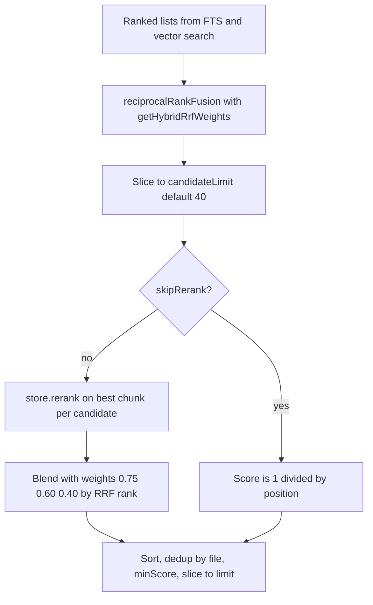

# Score Normalization, RRF Fusion, and Position-Aware Blending

This page documents the scoring math that turns raw backend results (SQLite FTS5 BM25 and sqlite-vec cosine distance) into the final ordered list returned by hybrid query. The math lives in `src/store.ts`: the fusion primitive `reciprocalRankFusion`, the list weighting `getHybridRrfWeights`, and the orchestration functions `hybridQuery` and `structuredSearch`, which both end in a blend step. The code is the source of truth. Where the README disagrees, the notes in [Resolved discrepancies](#resolved-discrepancies) say which behavior the code implements.

For the surrounding pipeline (probe, expansion, routing) see the [source map](../architecture/source-map.md). For how chunks are produced before selection see [Chunking](chunking.md).

## Where the scoring runs

| Entry point | Used by | Fusion | Reranking |
|---|---|---|---|
| `hybridQuery` (`src/store.ts`) | Plain-text `query` through the SDK, CLI, and MCP `query` tool | `getHybridRrfWeights` (original lists 2.0, expansions 1.0) | Yes, unless `skipRerank` |
| `structuredSearch` (`src/store.ts`) | Caller-supplied typed `searches` (lex/vec/hyde) | First list 2.0, all others 1.0 | Yes, unless `skipRerank` |
| `vectorSearchQuery` (`src/store.ts`) | Vector-only search | None; per-file max score | None |

`src/index.ts` routes `query` to `hybridQuery` and `queries` to `structuredSearch`, and maps `rerank === false` to `skipRerank` (`src/index.ts` around lines 498-528). The MCP `query` tool forwards `candidateLimit` and `rerank` into the same store search (`src/mcp/server.ts` around lines 431-470).

## Backend score normalization

Each backend emits a score in a different scale. The code normalizes them before fusion. Note that fusion itself uses only the rank position, not the backend score. Backend scores matter only for strong-signal detection, explain output, and `vectorSearchQuery` thresholds.

- **FTS (BM25).** `searchFTS` converts the negative FTS5 `bm25_score` with `score = |x| / (1 + |x|)`. The mapping is monotonic and query-independent, so it lands in `[0, 1)`. This is in `src/store.ts` around lines 4780-4784. The code comment gives the reference points: `-10` maps to about 0.91, `-2` to about 0.67, and `-0.5` to about 0.33.
- **Vector.** `searchVec` sets `score = 1 - row.distance`, which is cosine similarity from a cosine distance (`src/store.ts` around lines 4976-5040).
- **Reranker.** The LLM rerank value is used without rescaling (see [Reranker scores](#reranker-scores)).

## Reciprocal rank fusion

`reciprocalRankFusion(resultLists, weights = [], k = 60)` is defined in `src/store.ts` lines 5371-5414. For each list `listIdx` with weight `weights[listIdx] ?? 1.0`, and each 0-indexed position `rank`, the contribution is:

```text
rrfContribution = weight / (k + rank + 1)
```

Contributions for the same `file` are summed across lists, and the best (lowest) 0-indexed rank is kept as `topRank`. After summation, a top-rank bonus is added once per file, not per list:

```text
if topRank == 0          -> rrfScore += 0.05
else if topRank <= 2     -> rrfScore += 0.02
```

Results are sorted by `rrfScore` descending and returned with `score = rrfScore`. `hybridQuery` and `structuredSearch` both call it without passing `k`, so the effective value is always 60 in the search paths. The bonus is not multiplied by the list weight. A rank-1 entry in a list weighted 2.0 contributes `2/61 ≈ 0.033`, which is less than the 0.05 bonus, so the bonus is a large part of the fused score for top-ranked documents. Treat the fused score as a sum of positional terms, not as a probability.

The README formula `Σ(1/(k+rank+1))` with `k=60` matches the code, since `rank` there is 0-indexed.

## Original-query weighting

`getHybridRrfWeights(rankedListMeta)` (`src/store.ts` lines 6247-6249) assigns weight by list type:

```text
queryType === "original"  -> 2.0
otherwise (lex, vec, hyde) -> 1.0
```

The weight depends only on `queryType`, not on list order. The doc comment states the intent: a lex expansion inserted before the original vector list must not take the original vector boost. The original lists are the original-query FTS list (seeded from the initial BM25 probe) and the original-query vector list. Expansion-derived FTS and vector lists stay at 1.0.

## Candidate limit

`RERANK_CANDIDATE_LIMIT = 40` (`src/store.ts` lines 480-482). `hybridQuery` and `structuredSearch` default `candidateLimit` to this value (`src/store.ts` around lines 6271 and 6689). The fused list is sliced with `fused.slice(0, candidateLimit)` before chunking (around line 6402). Only these candidates reach chunk selection and reranking. The MCP `candidateLimit` schema description states a default of 40 (`src/mcp/server.ts` lines 408-410), and the CLI help says the same (`src/cli/qmd.ts` around line 2547). The README's "top 30" is stale.

## Chunk selection before reranking

Each candidate is chunked with `chunkDocumentAsync`. Candidates that produce no chunks are dropped from the rerank set. The best chunk is chosen by a keyword score (`src/store.ts` around lines 6408-6430):

- one point for each query term with length greater than 2 that appears in the lowercased chunk;
- plus `INTENT_WEIGHT_CHUNK = 0.5` for each intent term found (`src/store.ts` line 6028);
- the first chunk with the highest score wins, since the comparison is strict (`>`). Ties keep the earlier chunk, and if no chunk scores above -1 the fallback is index 0.

Only that best chunk is sent to the reranker. This avoids the full-body cost noted in the code comments.

## Reranker scores

`store.rerank` (`src/store.ts` around lines 5318-5366) prepends the intent to the query when an intent is set (`rerankQuery = intent ? "<intent>\n\n<query>" : query`). It caches scores per chunk text, scores the uncached chunks with `llm.rerank`, and returns every document with `cachedResults.get(doc.text) || 0`, sorted descending.

`LlamaCpp.rerank` (`src/llm.ts` around lines 1733-1830) returns each item's `score` from the context's `rankAll` call. It does not divide by 10. The README's "LLM 0-10 rating, `score / 10`" description is stale. `rankAll` comes from node-llama-cpp, which is not installed in this checkout, so the exact range of that library value cannot be checked in this repository. The blend and `minScore` logic treat the value as a 0-1 relevance score.

When no rerank contexts can be created, `llm.rerank` returns `score: 0.5` for every document with `model: "fallback"` (`src/llm.ts` lines 1743-1749). Blending then runs on a uniform reranker value, so ordering comes from RRF position alone.

## Position-aware blend

The blend step in `hybridQuery` (`src/store.ts` lines 6498-6512) uses the 1-indexed RRF position of each candidate. The weight depends on which bucket the position falls in:

```text
rrfRank = rrfRankMap.get(file) || candidateLimit
rrfWeight = 0.75  if rrfRank <= 3
          = 0.60  if rrfRank <= 10
          = 0.40  otherwise
rrfScore     = 1 / rrfRank
blendedScore = rrfWeight * rrfScore + (1 - rrfWeight) * rerankScore
```

`structuredSearch` applies the same buckets and formula (`src/store.ts` around lines 6898-6912).

The fallback `|| candidateLimit` runs only when a reranked file is missing from `rrfRankMap`. Reranked files come from the same candidate list, so this is defensive. If it fires, the file gets the 0.40 bucket and a positional score of `1 / candidateLimit`.

Because `rrfScore = 1 / rrfRank` is positional, the blend mixes a rank-based term with the reranker value. The result is not a calibrated probability.

After blending, `hybridQuery` sorts by `blendedScore` descending, then deduplicates by file, filters by `minScore` (default 0), and slices to `limit` (default 10). Metadata is attached last, in one batch (`src/store.ts` around lines 6521-6540).



Caption: decision flow of `hybridQuery` after the initial ranked lists are collected. The `skipRerank` branch bypasses the reranker and the blend.

## The skipRerank path

When `skipRerank` is true, `hybridQuery` returns before the reranker and blend (`src/store.ts` around lines 6433-6468):

- Each candidate's score is `rrfScore = 1 / (i + 1)`, where `i` is its index in the fused candidate list. The fused RRF score itself is not returned in `score`. It appears only in the `explain` trace (`baseScore` and `totalScore`).
- The `rerankScore` field in `explain` is `0`.
- `bestChunk` is the best chunk from the chunk-selection step. If there are no chunks, it falls back to the candidate's full body.
- The output is deduplicated, filtered by `minScore`, sliced to `limit`, and then metadata is attached. Since candidates are already unique by file, the dedup is redundant here.

For the MCP and CLI, `rerank: false` or `--no-rerank` sets `skipRerank`. The SDK maps `rerank === false` the same way (`src/index.ts` around line 498).

## Strong-signal bypass

Before expansion, `hybridQuery` runs an FTS probe with a limit of 20 (`src/store.ts` around line 6287). `hasStrongSignal` is true only when there is no intent, the top normalized score is at least `STRONG_SIGNAL_MIN_SCORE = 0.85`, and the gap to the second result is at least `STRONG_SIGNAL_MIN_GAP = 0.15` (`src/store.ts` lines 478-479 and around 6291-6297). Expansion is then skipped (`expanded = []`), but the probe list is still kept as the original FTS list in fusion. Because the thresholds apply to the normalized value, a top BM25 score of about -5.7 or stronger (where `|x|/(1+|x|) >= 0.85`) is the cutoff. Setting an intent disables this bypass.

## Structured search differences

`structuredSearch` does not use `getHybridRrfWeights`. It sets weights by list position: `i === 0 ? 2.0 : 1.0` (`src/store.ts` around lines 6786-6790). The caller is expected to order the lists by importance. Its primary query for keyword chunk selection is the first `lex` search, then the first `vec` search, then `searches[0]` (`src/store.ts` around lines 6797-6802).

## Vector-only search

`vectorSearchQuery` does not use RRF. It runs `searchVec` for the original and each vec/hyde expansion (lex expansions are filtered out), keeps the maximum score per file, sorts descending, and drops results below `minScore`, which defaults to 0.3 (`src/store.ts` around lines 6600-6640). Vector scores are therefore compared directly, as cosine similarity.

## Explain traces

When `explain` is set, `buildRrfTrace` (`src/store.ts` around lines 5417-5480) recomputes per-file contributions with 1-indexed ranks: `weight / (k + rank)`. Its bonus thresholds are rank 1 for `0.05` and ranks 2-3 for `0.02`, which equals the 0-indexed thresholds in `reciprocalRankFusion`. Traces are read-only: they do not change ranking, and `totalScore` equals the fusion score. The explain payload carries `ftsScores`, `vectorScores`, and the per-list `contributions`.

## Score interpretation

The README gives a heuristic reading of final scores:

| Score | Meaning (README, heuristic) |
|---|---|
| 0.8 - 1.0 | Highly relevant |
| 0.5 - 0.8 | Moderately relevant |
| 0.2 - 0.5 | Somewhat relevant |
| 0.0 - 0.2 | Low relevance |

Treat this table as a guideline only, not a calibrated scale. Blended scores mix `1/rank` with the reranker value, and the reranker value may be the `0.5` fallback. In `skipRerank` mode, scores are `1/position` and so are not comparable to blended scores. Use `minScore` and the `explain` output for thresholds rather than these bands.

## Resolved discrepancies

The README and code disagree in several places. The code is authoritative.

- **Candidate count.** The README says "Top 30 candidates" for reranking. The code uses `RERANK_CANDIDATE_LIMIT = 40` for hybrid and structured search, and MCP and CLI both default to 40. Set `candidateLimit` to change it.
- **Reranker scale.** The README says the LLM 0-10 rating is divided by 10. The code does not divide anything; `llm.rerank` passes the `rankAll` value through.
- **BM25 conversion.** The README says `Math.abs(score)`. The code uses `|x| / (1 + |x|)`.
- **Vector conversion.** The README says `1 / (1 + distance)`. The code uses `1 - distance`, which is cosine similarity from cosine distance.
- **Blend weights.** The README lists "75% RRF / 25% reranker", "60/40", and "40/60" by bucket. These match the code.
- **Fusion formula.** The README `Σ(1/(k+rank+1))` with `k=60` matches the code.

## Tests that anchor this behavior

- `test/rrf-trace.test.ts` checks that `buildRrfTrace` totals equal `reciprocalRankFusion` scores for the same inputs, that per-list contributions are recorded in order, and that top-rank bonus thresholds are 0.05 at rank 1, 0.02 at ranks 2-3, and 0 beyond.
- `test/store.test.ts` (RRF section) checks that single-list order is preserved, that `[2.0, 1.0]` weights put the heavier list first, that `getHybridRrfWeights` boosts original vector evidence over expansion-only hits, that the top-rank bonus orders rank 1 above rank 2, that empty lists return nothing, and that a smaller `k` (30 versus 60) yields higher top scores.
- `test/eval.test.ts` and `test/eval-bm25.test.ts` exercise end-to-end hit rates over labeled queries. They depend on the fusion behavior above, so a change to weights, `k`, or the bonus can move those thresholds.

## Operational notes and invariants

- Changing `candidateLimit` changes how many documents reach the reranker. Recall past rank 30 depends on it, as the code comment says: rank 31-40 stays visible to the reranker.
- Reranker score caching is keyed by query (or intent-prefixed query), model URI, and chunk text, not file path. Changing the rerank model URI invalidates the cache.
- `k` is not configurable from `hybridQuery` or `structuredSearch`. Changing it requires a code change; `reciprocalRankFusion` accepts it only as a parameter.
- Fusion is deterministic for fixed inputs. Ties in fused score keep sort order from `Array.prototype.sort`, and blended ties depend on reranker output order.
- Adding a new list type to `hybridQuery` requires a branch in `getHybridRrfWeights`. The default is `1.0` for any non-`original` type, so a new original-query source would need explicit handling.
