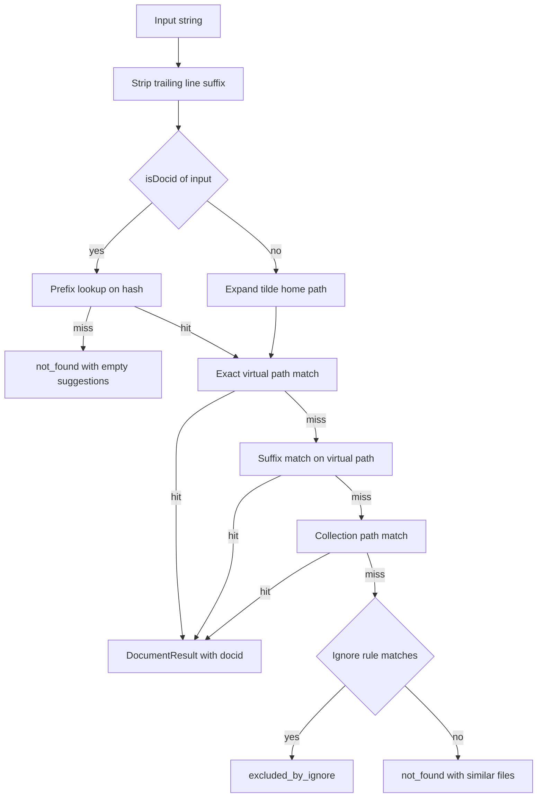

# Virtual Paths and Docids

QMD identifies an indexed document in two ways. A **virtual path** names it inside a collection, as `qmd://<collection>/<relative-path>`. A **docid** is a short, stable handle derived from the document's content hash, written `#abc123` (six hex characters). Both identifiers flow through the same helpers in `src/store.ts`, and the CLI and MCP server call those helpers when they accept or print identifiers. This page covers the helper functions, the lookup order used by `findDocument`, the error shapes it returns, and how the `get` and `multi_get` surfaces apply them.

For how collections are configured and how their paths are stored, see [Collections and Config](./collections-and-config.md) and [Storage Schema](../architecture/storage-schema.md).

## Virtual path helpers

The helpers live in one block of `src/store.ts` (lines 746-886). Each has a narrow job.

- **`normalizeVirtualPath`** (`src/store.ts` 767-785) repairs only explicitly virtual forms. An input starting with `qmd:` has the prefix removed, its leading slashes collapsed, and `qmd://` re-applied, so `qmd:////collection/path.md` becomes `qmd://collection/path.md`. An input starting with `//` gains the `qmd:` prefix. Anything else, including bare `collection/path.md`, filesystem paths, and `#docid` values, is returned unchanged after trimming. The comment on the function states that the `:linenum` suffix must be stripped by the caller first.
- **`parseVirtualPath`** (lines 794-811) normalizes its input, splits off a `?query` string, and matches `qmd://<name>[/<path>]`. It returns `{ collectionName, path, indexName? }`. The `path` is an empty string for a collection root such as `qmd://notes` or `qmd://notes/`. An `index` query parameter becomes `indexName`. It returns `null` for absolute filesystem paths, `~/` paths, `#docid`, and bare relative paths.
- **`buildVirtualPath`** (lines 814-817) composes `qmd://<collection>/<path>`. When an index name is given it appends `?index=` with the value URI-encoded.
- **`isVirtualPath`** (lines 828-838) is a cheap prefix test. It returns `true` only for a trimmed input starting with `qmd:` or `//`. A bare `collection/path.md` is deliberately not treated as virtual, so the caller must decide that case using collection names.
- **`resolveVirtualPath`** (lines 843-852) turns a virtual path into an absolute filesystem path. It parses the input, loads the collection by name, joins the relative path onto the collection's `pwd`, and rejects the result if it is not inside that directory. It returns `null` when parsing fails, the collection is unknown, or the path escapes the collection. The test `resolveVirtualPath refuses .. segments that leave the collection` in `test/store.test.ts` (around line 3138) checks the escape case.
- **`toVirtualPath`** (lines 859-886) goes the other way. It scans collections for one whose `path` prefixes the absolute path, then confirms an active document row exists for the relative path before building a virtual path. It returns `null` if no collection matches or no active document is stored. Within `src/`, `toVirtualPath` is only exposed through the store API (`src/store.ts` around line 2657) and has no internal caller. Its behaviour for paths with punctuation is covered by `test/path-fidelity.test.ts`.

The stored `documents` rows keep literal filesystem paths rather than slugified ones. `test/path-fidelity.test.ts` documents the failures this avoids, such as `--full-path` falling back on a slug and `toVirtualPath` returning `null` for names containing `&`, `(`, or `[`.

## Docid helpers

Docids are derived from the document hash and matched by prefix.

- **`getDocid`** (`src/store.ts` 2727-2729) returns the first six characters of a hash. `src/cli/formatter.ts` (lines 64-66) has a separate copy of the same function, so a docid in CLI output and in store results is the same six characters.
- **`normalizeDocid`** (lines 3988-4001) trims the input, removes one pair of matching surrounding single or double quotes, and then removes one leading `#`. It returns the bare string. It accepts `#abc123`, `abc123`, `"#abc123"`, and `'abc123'`. It does not validate the characters.
- **`isDocid`** (lines 4010-4013) calls `normalizeDocid` and returns `true` only when the result is at least six characters and matches `/^[a-f0-9]+$/i`. Five-character values, values containing non-hex letters such as `ghijkl`, file names such as `abc123.md`, and paths are rejected. Tests in `test/store.test.ts` (around lines 7318-7369) cover these cases.
- **`findDocumentByDocid`** (lines 4023-4036) normalizes the input, returns `null` when the result is empty, and then selects the first active document whose `hash` starts with the prefix (`LIKE 'prefix%'`, `LIMIT 1`). The function does not call `isDocid`. The store API exposes it directly (`src/store.ts` around line 2682), so a caller that passes raw input must check `isDocid` itself. The docstring notes that a collision returns the first match.

The docid is shown with a leading hash in every surface, and the leading hash is stripped on the way in. In the CLI, `get` headers print `qmd://<collection>/<path>  #<docid>` (`src/cli/qmd.ts` around lines 1339-1357), and search and multi-get output uses `#${docid}` in CSV, JSON, and XML fields (`src/cli/qmd.ts` around lines 2734-2746 and 2898-2903). In MCP, search results carry `docid: \`#${r.docid}\`` (`src/mcp/server.ts` around line 484), and the `get` and `multi_get` tool descriptions tell agents to pass docids as `#abc123`. Because `normalizeDocid` strips the leading `#`, the `#` form and the bare hex form are interchangeable on input.

## findDocument lookup order

`findDocument` (`src/store.ts` 5565-5672) is the shared resolver behind the CLI `get` command, the SDK `get`, and the MCP `get` tool. Its order is as follows.

1. It removes a trailing `:<digits>` line suffix (lines 5566-5570). Callers that need the `:from:count` form strip it earlier.
2. If `isDocid` accepts the remaining string, it calls `findDocumentByDocid`. A hit replaces the input with the hit's `qmd://` path. A miss returns `{ error: "not_found", similarFiles: [] }` immediately (lines 5575-5581). A docid miss never checks ignore rules and never produces suggestions.
3. It expands a leading `~/` to the home directory.
4. It runs an exact match on `'qmd://' || collection || '/' || path`, then a `LIKE '%<suffix>'` match on the same expression with `escapeLikePattern`.
5. For input that is not a `qmd://` path, it tries to match an absolute path under a collection's `path`, or a path relative to a collection, against `(collection, path)`.
6. On a miss it calls `getIgnoredLookupMatch` (lines 5513-5547). If a collection's `ignore` rule matches the candidate path, the result is `excluded_by_ignore`. Otherwise it returns `not_found` with `similarFiles` from `findSimilarFiles(db, filepath, 5, 5)`.

On a hit it attaches the `qmd://` filepath, `displayPath`, `title`, `context` from `getContextForFile`, `hash`, `docid` from `getDocid`, collection name, modification time, and body length. The body is included only when `includeBody` is set.

The diagram shows the order `findDocument` uses to resolve one input string. The docid branch is the only path that skips suggestions.

## Lookup errors

`findDocument` returns either a `DocumentResult` or a `DocumentLookupError`, defined in `src/store.ts` (lines 2857-2874) as one of two shapes.

- **`not_found`** carries `query` (the original input) and `similarFiles` (a list of strings). It is returned from two places: a failed docid lookup, which always has an empty `similarFiles`, and the final fallthrough, which fills `similarFiles` from `findSimilarFiles`.
- **`excluded_by_ignore`** carries `query`, `collection`, the candidate `path`, and the matching `rule`. It is returned before suggestions are computed, so a file excluded by an ignore rule is reported as excluded rather than as missing.

`findSimilarFiles` (`src/store.ts` 4039-4056) iterates over active documents and compares each stored relative `d.path`, lowercased, against the lowercased query with a Levenshtein distance. Only matches within `maxDistance` are kept. They are sorted by distance and truncated to `limit`. The lookup calls it with a distance of 5 and a limit of 5. Because it compares relative paths, a query written as a `qmd://` URI is usually far from every candidate, so suggestions are most useful for plain relative paths. The tests in `test/store.test.ts` (around line 2223) and `test/mcp.test.ts` (around line 489) only assert that `similarFiles` is an array, not specific suggestions.

Callers render these errors differently. The CLI `get` command prints `Document not found` and up to the listed similar files to stderr, then exits with status 1 (`src/cli/qmd.ts` 1291-1360). The MCP `get` tool returns `isError` with a `Did you mean one of these?` list, or the ignore-rule details for `excluded_by_ignore` (`src/mcp/server.ts` 506-560).

## get and the line-range suffix

The `get` surfaces parse a suffix before lookup. The MCP `get` tool (`src/mcp/server.ts` 506-560) recognises `:from:count` first and then `:from`, and passes only the remaining string to `store.get`. An explicit `fromLine` or `maxLines` argument overrides the suffix. A value such as `#abc123:100:40` therefore resolves to docid `#abc123`, starting at line 100, with 40 lines. The CLI `get` (`src/cli/qmd.ts` 1291-1310) applies the same rules, and before lookup it rewrites a virtual path through `parseVirtualPath` and `buildVirtualPath`. That rewrite also applies an `index=` name to the active index.

The SDK wrapper in `src/index.ts` routes `get` to `findDocument` and `getDocumentBody` to `findDocument` followed by `getDocumentBody`. It returns `null` for any lookup error.

## multi_get and comma lists

`findDocuments` (`src/store.ts` 5849-5948) chooses one of two branches from the pattern.

- If the pattern contains a comma and no `*`, `?`, or `{`, or if `isDocid` accepts the whole pattern, it splits the pattern on commas and resolves each name with `resolveCommaListName`. Names that do not resolve are added to `errors` as `File not found: <name>`.
- Otherwise the pattern is treated as a glob and matched with `matchFilesByGlob` (`src/store.ts` 4058-4096), which tests the glob against the virtual path, the relative path, and the `collection/path` form. A glob that matches nothing yields `No files matched pattern`.

`resolveCommaListName` (`src/store.ts` 5791-5846) applies a fixed order. A docid or exact `qmd://` URI is matched exactly. Otherwise it tries an exact `collection/path`, then an exact document `path`, then a path-boundary suffix `%/<name>`. The suffix match is anchored at a slash, so `NTAX.md` cannot select `SYNTAX.md`, and multiple hits at one tier are reported rather than silently truncated.

Each matched document is then checked against `maxBytes`. A document whose body length exceeds the limit is returned as `skipped` with a reason, not as an error (inside the row loop of `findDocuments`, `src/store.ts` 5849-5948). The MCP `multi_get` tool echoes a `qmd_get` hint for skipped documents, and it defaults `maxBytes` to 64 KB (`src/mcp/server.ts` 585-640).

## --full-path resolution

The CLI `get` and `multi-get` commands can print the on-disk path instead of the virtual identifier. `resolveVirtualPath` builds the candidate path from `qmd://<displayPath>`, and the header uses it only if `existsSync` confirms the file. Otherwise the output keeps `qmd://` and `#docid` and writes a warning to stderr (`src/cli/qmd.ts` 1344-1360). `test/full-path-fallback.test.ts` (lines 163-196) checks that `get` and `multi-get` warn and fall back, that search keeps the docid on fallback rows, and that nothing changes without `--full-path`.

## Invariants and failure modes

- A docid is a prefix of the content hash, not an identifier of a file. Two documents with the same six-character prefix resolve to whichever active row the query returns first. Callers that need certainty should use the virtual path.
- `isDocid` gates the docid branch in `findDocument` and `resolveCommaListName`. A hex-only input of six or more characters, such as a bare file name `deadbeef`, is therefore read as a docid, and if no document has that prefix the lookup fails without trying the path forms.
- `normalizeVirtualPath` leaves bare `collection/path` strings untouched. Only `qmd:` and `//` inputs are treated as virtual, so a relative path that happens to start with a collection name is resolved by `findDocument` through the collection-relative branch, not by `parseVirtualPath`.
- `resolveVirtualPath` never returns a path outside the collection directory, even when `..` segments are present.
- Normalization is not uniform across entry points. The CLI `get` rebuilds a virtual input through `parseVirtualPath` and `buildVirtualPath`, so `qmd:////a/b.md` resolves like `qmd://a/b.md`. The SDK and MCP `get` paths pass the raw string to `findDocument`, which compares it without calling `normalizeVirtualPath`, so callers of those paths should use the canonical `qmd://` form.

## Related pages

- [Collections and Config](./collections-and-config.md) explains the collection `pwd`, `path`, and `ignore` rules that these helpers rely on.
- [Storage Schema](../architecture/storage-schema.md) describes the `documents` and `content` tables that store the hash, path, and active flag.
- [MCP Server](../integrations/mcp-server.md) describes the tools that accept docids and virtual paths.
- [Agent Retrieval](../workflows/agent-retrieval.md) shows how agents move from search results to `get` and `multi_get` calls.
