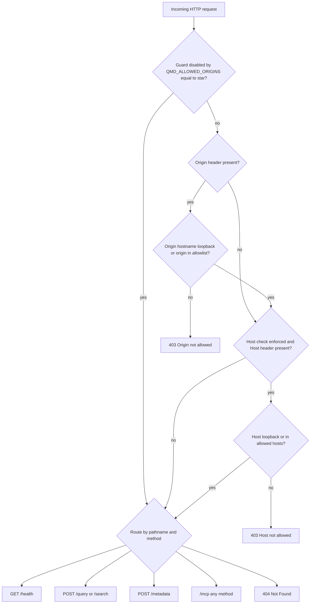

# HTTP Transport, REST Routes, and Origin/Host Validation

`qmd mcp --http` runs the QMD MCP server over Streamable HTTP and also exposes a few plain REST routes on the same port. Every request, including the REST routes, passes through an Origin/Host guard before routing. The endpoints have no authentication: the README says so explicitly, so the guard and the bind address are the only access controls the server itself provides. For the stdio transport and tool surface, see [MCP Server](mcp-server.md).

## Responsibilities and entrypoints

| Concern | Where it lives |
|---------|----------------|
| CLI entry (`qmd mcp --http`, `--port`, `--host`, `--daemon`) | `src/cli/qmd.ts` (around L5098-L5160) |
| HTTP server, routing, REST handlers | `startMcpHttpServer` in `src/mcp/server.ts` (starts at L1062) |
| Guard construction and request predicates | `src/mcp/origin-guard.ts` (`resolveOriginGuard`, `checkRequestOrigin`) |
| Tests | `test/mcp-origin-guard.test.ts` |

`startMcpHttpServer(port, options)` opens the store, pre-fetches default collection names for the REST routes, builds one MCP handler, and creates a Node `http` server. The CLI calls it with the `dbPath` and optional `host`; the port defaults to `8181` (`Number(cli.values.port) || 8181`).

The MCP transport is sessionless. There is no `Mcp-Session-Id` and no initialize handshake state to track; the handler is created with `responseMode: "json"` and is invoked per request.

## Bind host and port

The bind address is resolved in one place:

```text
host = options.host ?? process.env.QMD_HOST ?? "localhost"
```

This is `src/mcp/server.ts` L1148. The CLI passes `--host` only when the flag is present, so without the flag the order is `QMD_HOST`, then `localhost`. The README documents `--host 0.0.0.0` for container liveness probes ([README](../../README.md), the MCP HTTP section).

`--daemon` re-spawns the server as a detached child, passing `--host` through when it was given, and writes a PID file. Foreground mode calls `startMcpHttpServer` directly.

## Request screening flow

Each request is screened by `checkRequestOrigin` before the handler looks at the path. The guard is built once at startup by `resolveOriginGuard`.



Caption: request screening order inside `startMcpHttpServer`. The Origin branch runs first, the Host branch second, and only a request that passes both reaches routing.

### Origin branch

- **Disable switch.** If the allowlist contains `*`, `checkRequestOrigin` returns OK immediately, so neither header is checked (`src/mcp/origin-guard.ts` L139; construction at L101-L102).
- **Missing Origin is allowed.** The check runs only when a non-empty `Origin` is present (L141-L142). The code comment explains that curl, MCP SDK clients, and editors omit the header, while browsers always send it.
- **Loopback origins are allowed.** The origin's hostname is tested with `isLoopbackHostname` (L143-L146). Accepted names are `localhost`, `*.localhost`, `::1`, and `127.0.0.0/8`, including IPv4-mapped IPv6. `0.0.0.0` is deliberately not loopback.
- **Allowlist.** Otherwise the normalized origin must appear in `allowedOrigins`, which comes from `QMD_ALLOWED_ORIGINS` (or the programmatic `allowedOrigins` option) (L147).
- **Rejection.** Failure returns `Origin not allowed: <origin>` (L148-L149).

Origins with a non-http(s) scheme, the opaque `null` origin, and origins that merely contain a loopback name (for example `https://localhost.evil.example`) are rejected by these rules; the test file asserts each case.

### Host branch

- **Enforcement.** The Host check runs only when `enforceHost` is true and a `Host` header is present (L154).
- **Allowed names.** A Host passes if its hostname is loopback, or if the lowercased value (or its bare hostname) is in `allowedHosts` (L155-L160).
- **Rejection.** Failure returns `Host not allowed: <host>` (L161-L162).

### How the guard is built

`resolveOriginGuard` takes `host`, optional `allowedOrigins` and `allowedHosts`, and an `env` (default `process.env`). Lists fall back to `QMD_ALLOWED_ORIGINS` and `QMD_ALLOWED_HOSTS` (comma-separated, trimmed). Then:

1. If the origin list contains `*`, the guard is disabled entirely (L101-L102).
2. Origins are normalized with `URL.origin` and lowercased; unparseable entries are dropped (L104-L105).
3. If the bind host is a concrete, non-loopback address, that address is added to `allowedHosts` (L111-L113). A concrete interface's own name is therefore a legitimate Host.
4. `enforceHost` is `!isWildcardBind || allowedHosts.length > 0` (L117-L122).

Wildcard bind values are `""`, `0.0.0.0`, `::`, `[::]`, and `*`. So with `--host 0.0.0.0` (typical in Docker), Host validation is off unless `QMD_ALLOWED_HOSTS` is set, because the container's legitimate names are unknowable. Origin validation still applies on wildcard binds.

### Startup warnings

The server prints one of two plain-text warnings at startup (no warning code is emitted); both are suppressed when `quiet` is set (`src/mcp/server.ts` L1445-L1450):

- With `QMD_ALLOWED_ORIGINS=*`: DNS-rebinding protection is off, and the operator should run only behind an authenticating proxy.
- When bound to a host with no `QMD_ALLOWED_HOSTS` and Host validation is not enforced: Host validation is off and the index is readable by anyone who can reach the port.

## Rejection response shape

A screened request receives HTTP `403` with `Content-Type: application/json` and a JSON-RPC-style body:

```json
{"jsonrpc":"2.0","error":{"code":-32003,"message":"Forbidden: Origin not allowed: <origin>"},"id":null}
```

The server also logs the rejection as `<time> <method> <path> 403 — <reason>` unless quiet (L1170-L1179). Rejected requests never reach the store, so the REST search path leaks nothing to a foreign origin; the live test asserts that a `403` body does not contain indexed text.

## Routes

| Route | Method | Handler behavior | Success |
|-------|--------|------------------|---------|
| `/health` | GET | Returns uptime in whole seconds | `200` JSON `{"status":"ok","uptime":N}` |
| `/query` (alias `/search`) | POST | Structured search over `store.search` | `200` JSON `{"results":[...]}` |
| `/metadata` | POST | Metadata discovery over `store.listMetadata` | `200` JSON of the list result |
| `/mcp` | any method | Forwards the request to the MCP handler with the parsed body | Status and body from the MCP handler |
| anything else | any | Plain `404` with body `Not Found` | — |

Other method/path combinations, such as `GET /query`, fall through to the `404`. An uncaught handler error returns `500` with body `Internal Server Error` and logs `HTTP handler error`.

`/mcp` is not parsed by the REST code: the raw body is read, JSON-parsed best-effort for logging and forwarded to `mcpHandler.fetch`, and the response status and headers are copied back. Malformed JSON is passed through to the MCP handler, which produces its own error.

### POST /query and POST /search

Both paths share one handler. Request body validation runs in this order, and each failure returns `400` with `Content-Type: application/json` and `{"error": "<message>"}`:

| Condition | Error message (exact) |
|-----------|-----------------------|
| Body is not parseable JSON | `Invalid JSON body` |
| Body parses to a non-object, `null`, or an array | `JSON body must be an object` |
| `searches` is missing, falsy, or not an array | `Missing required field: searches (array)` |
| `filter` is present but not a plain object | `Invalid field: filter (must be an object)` |
| `filter` fails the metadata filter parser | the parser's own message, returned verbatim |

`searches` is a required array. Each entry is mapped to `{ type, query }`: `type` is cast without checking its value, and `query` is `String(s.query || "")`. An empty array passes validation.

`filter` is validated through the shared `validateFilterArgument` helper, which wraps `parseMetadataFilter`; see [Metadata Filtering and Discovery](../concepts/metadata-filtering-and-discovery.md) for the filter grammar.

Optional body fields and their defaults:

| Field | Behavior when absent or of the wrong JSON type |
|-------|-----------------------------------------------|
| `collections` | If an array, its entries are stringified; otherwise the collections pre-fetched at startup (`getDefaultCollectionNames`). An empty result is passed to the store as no collection filter. |
| `limit` | `10` |
| `minScore` | `0` |
| `candidateLimit` | Not sent (store default applies) |
| `intent` | Not sent; a string is used both for search and for snippet extraction |
| `rerank` | Not sent unless a boolean (store default applies) |

Results are reshaped into `docid` (prefixed `#`), `file` (a `qmd://` path), `title`, rounded `score`, `context`, `metadata` (only when non-empty), `line`, and a numbered `snippet`. The snippet is taken from the first `lex` query, else the first `vec` query, else the first query.

### POST /metadata

An empty body is treated as `{}`. The same `400` shape applies. Validation order and messages:

| Condition | Error message (exact) |
|-----------|-----------------------|
| Body is not parseable JSON | `Invalid JSON body` |
| Body is not a plain object | `JSON body must be an object` |
| `filter` not an object | `Invalid field: filter (must be an object)`, or the filter parser message |
| `match` not an object | `Invalid field: match (must be an object)`, or the match parser message |
| `sort` present and not `count` or `value` | `Invalid field: sort (must be 'count' or 'value')` |
| `collections` present and not an array | `Invalid field: collections (must be an array)` |
| A numeric field (`keyLimit`, `keyOffset`, `valueLimit`, `valueOffset`, `minCount`) has the wrong JSON type | the error from `readNumberFields` |
| `store.listMetadata` raises a metadata option or binding-budget error | that error's message |

The store checks each number's domain; the handler checks only the JSON type. Other store errors are not caught here and fall through to the `500` handler.

## Operating the endpoints

- **Local use.** Clients without an `Origin` (curl, MCP clients) and loopback browser origins work with no configuration. `QMD_ALLOWED_ORIGINS` and `QMD_ALLOWED_HOSTS` are the only knobs the CLI path exposes; `startMcpHttpServer` also accepts `allowedOrigins` and `allowedHosts` as options, but the CLI does not pass them.
- **Off-host access.** Use `--host` (or `QMD_HOST`) to bind a concrete interface, or `0.0.0.0` for containers. For `0.0.0.0`, set `QMD_ALLOWED_HOSTS` to re-enable Host validation. Because the endpoints are unauthenticated, put an authenticating proxy in front of any off-host deployment, as the README advises.
- **Shutdown.** `SIGTERM` and `SIGINT` close the MCP handler, the HTTP server, and the store, then exit.

## Tests that anchor behavior

`test/mcp-origin-guard.test.ts` covers both layers:

- **Predicates.** `isLoopbackHostname` accepts loopback forms and rejects look-alikes and `0.0.0.0`; `resolveOriginGuard` checks Host enforcement for loopback, wildcard with and without allowlist, and concrete non-loopback binds, and parses comma-separated env lists; `checkRequestOrigin` covers missing Origin, loopback origins, foreign origins, rebound Host without Origin, the `null` origin, and wildcard binds.
- **Live server.** A real `startMcpHttpServer` on an ephemeral port asserts that `/query`, `/search`, and `/mcp` return `403` for a foreign Origin, that a raw request with `Host: evil.example` gets `403`, and that local clients (no Origin, loopback Origin, `/health`) still get `200`.

The live suite is skipped when `CI` is set.

## Related pages

- [MCP Server](mcp-server.md) describes the MCP tool surface served over this transport and over stdio.
- [Metadata Filtering and Discovery](../concepts/metadata-filtering-and-discovery.md) defines the `filter` and `match` grammars used by the REST bodies.
- [Design Decisions](../architecture/design-decisions.md) gives the rationale for the local-first, unauthenticated HTTP design.
- [Maintenance and Troubleshooting](../operations/maintenance-and-troubleshooting.md) covers daemon and PID file issues.
