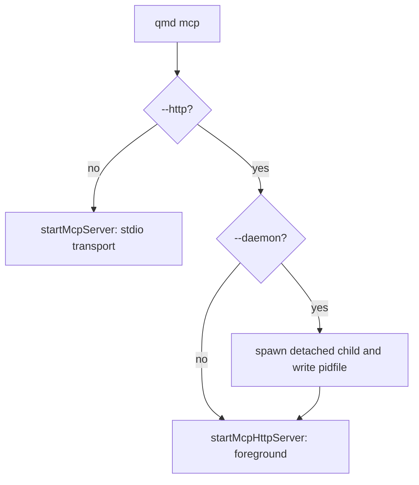

# MCP Server and Tools

QMD exposes its index to agents through a Model Context Protocol server. The server is built by `createMcpServer` in [`src/mcp/server.ts`](../../src/mcp/server.ts) and registers one document resource (`qmd://{+path}`) and five tools: `query`, `get`, `multi_get`, `status`, and `metadata`. Every tool runs against one `QMDStore` that the launch function opens once per process (stdio) or once per HTTP server. This page specifies the tool contracts exactly as the zod schemas declare them, the branches each handler takes, how the server is launched, and how it shuts down. The HTTP REST shortcuts and origin screening are covered in [HTTP API and Origin Guard](./http-api-and-origin-guard.md); the search pipeline behind `query` is covered in [Hybrid Query Pipeline](../workflows/hybrid-query-pipeline.md).

## Launch modes

The `qmd mcp` CLI command selects the transport. Without flags it starts the stdio transport: `startMcpServer` opens the store, then serves one connection over stdin and stdout. With `--http` it starts the Streamable HTTP transport through `startMcpHttpServer`. `--daemon` (valid only with `--http`) re-spawns the same entry as a detached child, writes its PID to a pidfile, and returns to the shell; `qmd mcp stop` signals that PID after an identity check ([`src/cli/qmd.ts`](../../src/cli/qmd.ts#L5068-L5172), [`src/cli/mcp-pid.ts`](../../src/cli/mcp-pid.ts#L74)).

| Mode | Entry | Transport | Notes |
|------|-------|-----------|-------|
| Default | `startMcpServer` | `serveStdio` | One client per process; stdout reserved for JSON-RPC frames. |
| `--http [--port N] [--host H]` | `startMcpHttpServer` | `createMcpHandler`, JSON responses, stateless | Default port 8181, default host `localhost` (overridable with `QMD_HOST`). |
| `--http --daemon` | Re-spawns the HTTP mode detached | Same as HTTP | Pidfile `mcp.pid` (default index) or `mcp-<name>.pid` (named index). |
| `qmd mcp stop` | Reads the pidfile | SIGTERM | Removes stale pidfiles when the PID is no longer a qmd MCP process. |

The stdio transport is the default for agents. The launcher [`bin/qmd`](../../bin/qmd#L27-L31) pre-seeds native llama.cpp and ggml log variables to `error` when the first argument is `mcp`, so native logs do not corrupt the JSON-RPC stream on stdout. Stdio sessions and HTTP both serve the same five tools; only the process lifecycle differs.



Caption: How the `qmd mcp` command chooses between the stdio transport and the foreground or daemonized HTTP server.

## Server construction

`createMcpServer(store, inflight?)` builds a fresh `McpServer` named `qmd` with the package version. Two things are fixed at construction:

- `instructions` come from `getInstructions(store)`, which is cached per store (see [Instructions cache](#instructions-cache)).
- `cacheHints` declare that `tools/list` and `server/discover` may be cached privately for 60 seconds, while `resources/read` must not be cached (`ttlMs: 0`), because the index can change under the client ([`src/mcp/server.ts`](../../src/mcp/server.ts#L251-L267)).

The server also pre-fetches the default collection names once with `store.getDefaultCollectionNames()`. That list is the collections whose `includeByDefault` flag is true, and it is the fallback scope for `query` and `metadata` when the caller omits `collections` ([`src/index.ts`](../../src/index.ts#L576-L579), [`src/mcp/server.ts`](../../src/mcp/server.ts#L270)).

Each handler is wrapped with `track(...)`. Under stdio this wrapper counts in-flight handlers so that shutdown can wait for them; under HTTP, `track` is a pass-through because no gate is passed.

## Instructions cache

The instructions string is a snapshot of index facts, injected into the client's system context during the handshake. `buildInstructions` ([`src/mcp/server.ts`](../../src/mcp/server.ts#L155)) reports the active document count, the global context, the collection names (names only, to keep the string small), a vector-embedding capability note, search examples for `lex`, `vec`, and `hyde`, the advice to always pass `intent`, and retrieval tips for `get` and `multi_get`. It deliberately does not rank metadata keys, because that would be a full scan on every initialize.

`getInstructions` caches the built string per store:

- The cache is a `WeakMap` keyed by the `QMDStore` object, so each store has its own entry.
- An entry is served for less than `INSTRUCTIONS_CACHE_TTL_MS` (60,000 ms) after it was built ([`src/mcp/server.ts`](../../src/mcp/server.ts#L224-L232)).
- A negative age (the clock stepped backwards) is treated as not fresh and triggers a rebuild.
- Concurrent callers share the in-flight promise, so overlapping requests do not start overlapping builds.
- A failed build is removed from the cache when its promise rejects, so the next initialize retries instead of replaying the failure for the rest of the window ([`src/mcp/server.ts`](../../src/mcp/server.ts#L236-L246)).

The HTTP transport builds a new `McpServer` for every request, so without this cache each request would rerun the index-status aggregation. The changelog records the same behavior: instructions are cached per store for up to 60 seconds, a failed build is not cached, and index changes from other processes appear within a minute ([`CHANGELOG.md`](../../CHANGELOG.md#L55-L58)). Index changes are therefore visible to a client only after the TTL lapses, not immediately.

## Tool reference

All five tools are declared `readOnlyHint: true` and `openWorldHint: false`. Parameter names below are the exact zod keys. Unknown keys are not rejected: the input schemas are plain `z.object` declarations without `.strict()`, so extra arguments are dropped during parsing ([`src/mcp/server.ts`](../../src/mcp/server.ts#L397-L430)).

### query

Schema at [`src/mcp/server.ts`](../../src/mcp/server.ts#L397-L430); handler at [`src/mcp/server.ts`](../../src/mcp/server.ts#L431-L500).

| Parameter | Zod type | Default | Meaning |
|-----------|----------|---------|---------|
| `query` | `string`, optional | none | Plain-text query. The SDK expands it into lex, vec, and hyde variants, fuses them, and reranks. Mutually exclusive with `searches`. |
| `searches` | array of `{type, query}`, max 10, optional | none | Typed sub-queries. `type` is `lex`, `vec`, or `hyde`. The first sub-query gets 2x weight. Mutually exclusive with `query`. |
| `limit` | `number`, optional | `10` | Maximum results. |
| `minScore` | `number`, optional | `0` | Minimum relevance, 0 to 1. |
| `candidateLimit` | `number`, optional | none in schema | Maximum candidates to rerank. The description says the default is 40. |
| `collections` | array of `string`, optional | default-included collections | Filter to collections (OR). Array only. |
| `filter` | record of unknown, optional | none | Metadata filter AST, validated by `parseMetadataFilter`. |
| `intent` | `string`, optional | none | Background context for disambiguation and snippets. It does not search by itself. |
| `rerank` | `boolean`, optional | `true` | Run LLM reranking. `false` returns fused RRF results. |

The `searches` sub-object has `type` (enum `lex`, `vec`, `hyde`, with a description per variant) and `query` (string). Each schema description is part of the contract that agents read.

Handler branches, in order:

1. If neither `query` nor a non-empty `searches` is provided, return an error result (`isError: true`) saying to provide one of them.
2. If both are provided, return an error result saying they are mutually exclusive.
3. Validate `filter` with `parseMetadataFilter`. An invalid AST returns an error result with the parser message; it does not reach the store.
4. Scope: `collections ?? defaultCollectionNames`. An empty effective list is passed to the store as `undefined`.
5. Route: a `query` string is passed as `{ query }`, which runs the hybrid pipeline; `searches` is mapped to `{ queries }`, which runs the caller's typed sub-queries directly. Both calls pass `limit`, `minScore`, `candidateLimit`, `rerank`, and `intent`.
6. Snippets: each result gets a 300-character snippet centered on the primary query. The primary query is the plain `query`, otherwise the first `lex` sub-query, otherwise the first `vec`, otherwise the first sub-query.
7. Output: a text summary (`Found N results for ...`, one line per result with docid, rounded score, file, and title) plus `structuredContent: { results }`. Each result carries `docid` as `#<id>`, `file` as the display path, `title`, `score` rounded to two decimals, `context`, `metadata` only when non-empty, the absolute 1-indexed `line`, and a line-numbered `snippet`.

```mermaid
sequenceDiagram
  participant C as MCP client
  participant S as MCP query handler
  participant D as QMDStore
  C->>S: tools/call query with query or searches
  S->>S: require exactly one of query or searches
  S->>S: validate filter AST
  S->>D: search with collections limit minScore candidateLimit rerank intent
  alt plain query string
    D->>D: expand fuse and rerank the hybrid pipeline
  else searches array
    D->>D: run typed lex vec hyde sub-queries
  end
  D-->>S: ranked results with bodies and metadata
  S->>S: extract snippet and add line numbers per result
  S-->>C: text summary and structuredContent results
  Note over D: store.close is not called per request; it runs only at shutdown
```

Caption: A `tools/call` for `query`: the handler validates arguments, delegates ranking to `store.search`, and formats each result; the store stays open across calls.

Error results are returned as tool content with `isError: true`, not as protocol errors, so the client receives a readable message. The `store.search` contract throws if neither `query` nor `queries` is supplied, but the handler guards that case first ([`src/index.ts`](../../src/index.ts#L489-L496)).

### get

Schema at [`src/mcp/server.ts`](../../src/mcp/server.ts#L506-L517); handler at [`src/mcp/server.ts`](../../src/mcp/server.ts#L519-L580).

| Parameter | Zod type | Default | Meaning |
|-----------|----------|---------|---------|
| `file` | `string` | required | File path or docid (`#abc123`). Accepts a line suffix: `path:N` starts at line N; `path:N:M` reads M lines from N; `#id:N:M` works too. |
| `fromLine` | `number`, optional | none | Start line, 1-indexed. Takes precedence over the suffix. |
| `maxLines` | `number`, optional | none | Maximum lines returned. Takes precedence over the suffix count. |
| `lineNumbers` | `boolean`, optional | `true` | Prefix lines as `N: content`. |

Suffix parsing strips `:N:M` (or `:N`) from `file` before lookup. `fromLine` is clamped to at least 1. The lookup calls `store.get(lookup, { includeBody: false })`, then `getDocumentBody` with the resolved range. A not-found result returns an error result; when the store finds similar files, the message lists them under "Did you mean". An ignored file returns an error that names the ignore rule. On success the handler returns a `resource` content item with a `qmd://` URI built from the encoded display path, a title, `text/markdown`, and the text, prefixed with an HTML comment carrying the collection context when one exists.

### multi_get

Schema at [`src/mcp/server.ts`](../../src/mcp/server.ts#L583-L596); handler at [`src/mcp/server.ts`](../../src/mcp/server.ts#L596-L650).

| Parameter | Zod type | Default | Meaning |
|-----------|----------|---------|---------|
| `pattern` | `string` | required | Glob pattern, docid, or comma-separated list of paths or docids. |
| `maxLines` | `number`, optional | none | Maximum lines per file. Truncation appends a `[... truncated N more lines]` marker. |
| `maxBytes` | `number`, optional | `DEFAULT_MULTI_GET_MAX_BYTES` (65536, 64 KB) | Files larger than this are skipped. |
| `lineNumbers` | `boolean`, optional | `true` | Prefix lines with numbers. |

The handler calls `store.multiGet(pattern, { includeBody: true, maxBytes })`. If nothing matched and there were no errors, it returns `No files matched pattern` with `isError: true`. Errors are reported first as one text item. A skipped document produces a text item that names the size reason and points the caller to `get` for that path. Each retrieved document becomes a `resource` item with a `qmd://` URI. The default size limit is defined once in the store as 64 KB ([`src/store.ts`](../../src/store.ts#L139)); the README table lists a different default (see [Documented versus implemented defaults](#documented-versus-implemented-defaults)).

### status

Schema at [`src/mcp/server.ts`](../../src/mcp/server.ts#L656-L666); handler at [`src/mcp/server.ts`](../../src/mcp/server.ts#L664-L694). The input schema is an empty object.

The handler calls `store.getStatus()` and returns a text summary with total documents, documents needing embedding, vector-index presence, and per collection the name, path, and document count, plus metadata keys with their value types and a hidden-key count when there are more than shown. When any collection has metadata keys, the summary tells the caller to use `metadata` before writing a `filter`. The structured content is the full `StatusResult`, including each collection's `pattern`, `lastUpdated`, `metadataKeyCount`, and `metadataKeys`.

### metadata

Schema at [`src/mcp/server.ts`](../../src/mcp/server.ts#L725-L742); handler at [`src/mcp/server.ts`](../../src/mcp/server.ts#L744-L800).

| Parameter | Zod type | Default | Meaning |
|-----------|----------|---------|---------|
| `collections` | array of `string`, optional | default-included collections | Restricts discovery. Array only. |
| `match` | record of unknown, optional | every entry | Reports only metadata entries matching this condition. The condition `field` is `key` or `value`. |
| `filter` | record of unknown, optional | none | Counts only documents matching this filter. |
| `keyLimit` | positive integer | `50` | Keys reported in this window. |
| `keyOffset` | non-negative integer | `0` | Keys skipped before the window. |
| `valueLimit` | positive integer | `10` | Values reported per key and type. |
| `valueOffset` | non-negative integer | `0` | Values skipped per key and type, in `sort` order. |
| `sort` | enum `count` or `value` | `count` | Order values by document count (descending) or by value (ascending). |
| `minCount` | positive integer | `1` | Hides values held by fewer documents. |

The handler validates `match` and `filter` first, returning an error result on failure. It calls `store.listMetadata` with the effective collections and all window options. A `MetadataBindingBudgetError` becomes an error result; any other error is rethrown. The text rendering names the next window to request (`keyLimit`/`keyOffset` or `valueLimit`/`valueOffset`) when results are truncated, and an empty result explains that no metadata matches. The structured content is the `ListMetadataResult`. The semantics of `match` versus `filter` and the window fields are described in [Metadata Filtering and Discovery](../concepts/metadata-filtering-and-discovery.md).

### Document resource

Besides tools, the server registers a read-only resource template `qmd://{+path}` with `list: undefined`, so clients cannot enumerate documents and must discover them through search. Reads decode the path, call `store.get(decodedPath, { includeBody: true })`, and return the body with line numbers and the context comment. An ignored file or a missing file returns a short text message instead of an error ([`src/mcp/server.ts`](../../src/mcp/server.ts#L277-L300)).

## Collections parameter

The `collections` parameter on `query` and `metadata` is an array of strings and nothing else. A singular `collection` key is not in either schema, so it is dropped during parsing and the call is scoped to the default collections instead of the one the caller meant. The README documents this as the reason to double-check parameter names when results look unscoped ([`README.md`](../../README.md#L216)). The HTTP `POST /metadata` route rejects a non-array `collections` with a 400, while `POST /query` silently falls back to default collections when the value is not an array; see [HTTP API and Origin Guard](./http-api-and-origin-guard.md).

## Lifecycle and shutdown

### Stdio

`startMcpServer` ([`src/mcp/server.ts`](../../src/mcp/server.ts#L1009-L1041)) first calls `enableProductionMode()`, opens the store at the resolved database path, and loads the config file when it exists. It then serves one connection with `serveStdio(() => createMcpServer(store, inflight))`. The in-flight gate counts running handlers.

`registerStdioEofShutdown` ([`src/mcp/server.ts`](../../src/mcp/server.ts#L924)) ties teardown to stdin. When stdin emits `end` or `close`, or is already ended or destroyed at registration, the shutdown runs once and in this order:

1. `closeServer()`, which stops the transport from dispatching new requests.
2. `waitForIdle(5000)` for handlers already running. A missed deadline logs a warning and shutdown continues.
3. `disposeLlm`, which the stdio entry leaves unset because the store disposes its own llama.cpp instance.
4. `closeStore()`, which is `store.close()`.

The function sets `process.exitCode` instead of calling `process.exit()` so that native teardown runs normally. Each step runs inside a guard: a thrown error is logged to stderr as a warning, and the remaining steps still run. A failing step sets the exit code to 1 even when an earlier nonzero exit code was already set. An earlier nonzero exit code is preserved only when every teardown step succeeds. The shutdown promise is shared by every trigger and never rejects. The stdio lifecycle tests cover ordering, idempotency, failure handling, drain deadlines, and exit codes ([`test/mcp-stdio-lifecycle.test.ts`](../../test/mcp-stdio-lifecycle.test.ts#L64-L270)).

### HTTP

`startMcpHttpServer` ([`src/mcp/server.ts`](../../src/mcp/server.ts#L1062)) creates one store for the process and one `createMcpHandler` with JSON responses. The MCP handler builds a fresh `McpServer` for each request, so there are no sessions, no `Mcp-Session-Id`, and no idle reaper. Requests pass an origin and host check before routing (see [HTTP API and Origin Guard](./http-api-and-origin-guard.md)). Its `stop()` closes the MCP handler, then the HTTP server, then the store ([`src/mcp/server.ts`](../../src/mcp/server.ts#L1426-L1433)). SIGTERM and SIGINT call `stop()` and then `process.exit(0)`.

### Store close semantics

`store.close()` disposes the store's LLM instance first and then closes the SQLite connection. It also resets the config source when a YAML or inline config was used ([`src/index.ts`](../../src/index.ts#L669-L676)). Because the store is shared by all requests, close is only called at process shutdown, never after a single tool call. A tool call that is still running at shutdown is what the stdio drain step exists to protect.

## Invariants and failure behavior

- Tool argument errors (missing or conflicting `query`/`searches`, invalid `filter` or `match`, no files matched, document not found) return content with `isError: true`. They do not terminate the server.
- The `query` handler never sends an unvalidated filter to the store; validation happens in the handler and again inside the store's `search` ([`src/index.ts`](../../src/index.ts#L489-L496)).
- Instructions are the only search-related state the server caches. The server declares no cache hint for `tools/call`, so each tool call reads the current index.
- Stdio shutdown attempts `store.close()` once after stdin ends, and never calls `process.exit()` inside the teardown path. If `store.close()` throws, the failure is logged and shutdown finishes without retrying, so the store can remain open in that case.

## Documented versus implemented defaults

Two README statements disagree with the code. The code is authoritative here:

- The README says `query` requires `searches`. The schema makes `query` and `searches` alternatives, and the handler requires exactly one.
- The README lists `multi_get` `maxBytes` as defaulting to 10240. The schema default is `DEFAULT_MULTI_GET_MAX_BYTES`, which is 65536 bytes (64 KB), and the schema description says the same.

## Tests that matter

- [`test/mcp.test.ts`](../../test/mcp.test.ts#L1134-L1180) checks that a legacy initialize serves the cached instructions across requests after the index changes.
- [`test/mcp.test.ts`](../../test/mcp.test.ts#L1476-L1537) covers instruction cache hits, expiry after 60 seconds, retry after a failed build, and a clock step backwards.
- [`test/mcp.test.ts`](../../test/mcp.test.ts#L452-L632) exercises the `get`, `multi_get`, and `status` tool behavior.
- [`test/mcp-stdio-lifecycle.test.ts`](../../test/mcp-stdio-lifecycle.test.ts#L64-L270) covers stdio EOF shutdown and in-flight draining.
- [`test/mcp-pid.test.ts`](../../test/mcp-pid.test.ts#L9-L60) covers qmd process identity checks and named-index pidfile names.

## Related pages

- [HTTP API and Origin Guard](./http-api-and-origin-guard.md) describes the REST shortcuts, origin and host screening, and HTTP routing.
- [Hybrid Query Pipeline](../workflows/hybrid-query-pipeline.md) explains what `store.search` does for plain and typed queries.
- [Metadata Filtering and Discovery](../concepts/metadata-filtering-and-discovery.md) defines the filter and match grammars used by `query` and `metadata`.
- [Agent Retrieval](../workflows/agent-retrieval.md) shows how an agent sequences `status`, `metadata`, `query`, and `get`.
- [Maintenance and Troubleshooting](../operations/maintenance-and-troubleshooting.md) covers stale pidfiles and index freshness.
