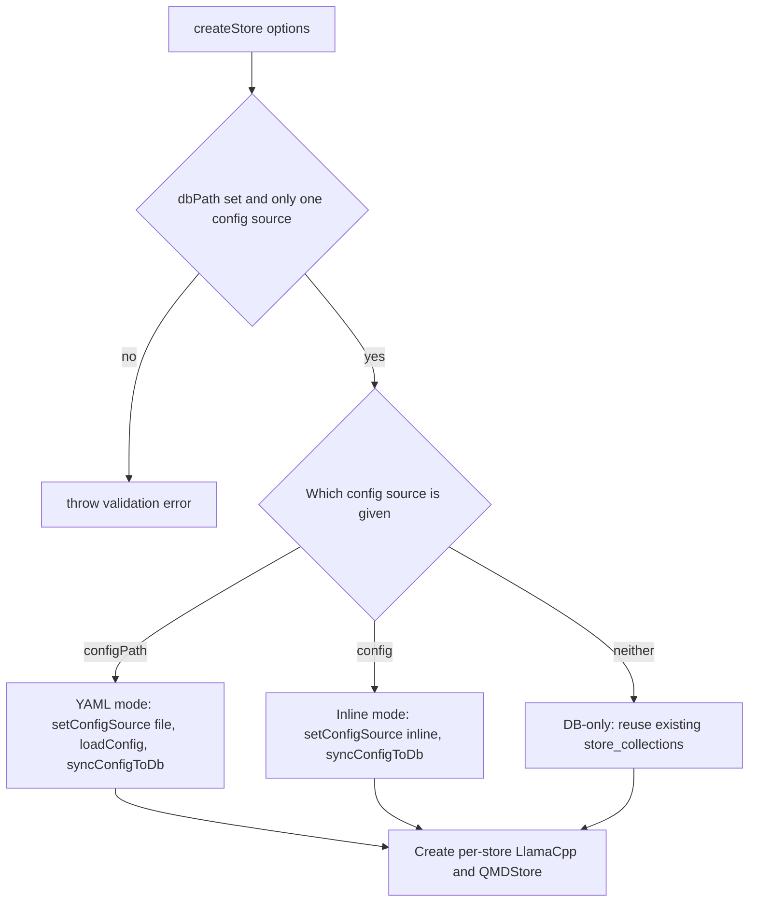
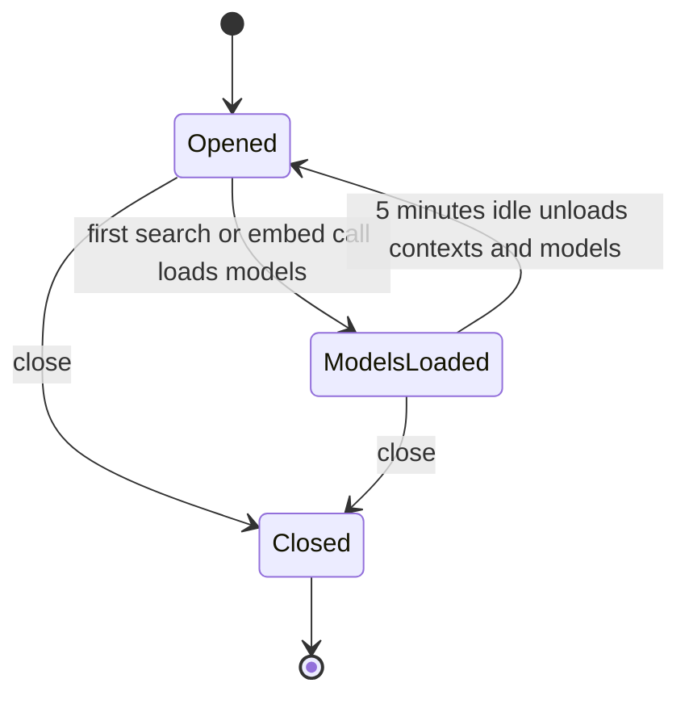

# SDK / Library Usage

The `@tobilu/qmd` package exposes a programmatic API from `dist/index.js` (see `package.json` `exports`). The entry point is `createStore()`, which returns a `QMDStore` object. The `QMDStore` exposes search, retrieval, collection and context management, indexing, index health, and a `close()` lifecycle method. The CLI and MCP server are other consumers of the same internal store layer, described in [System Overview](../architecture/system-overview.md).

Source of truth for this page: [src/index.ts](../../src/index.ts) (public surface), [src/store.ts](../../src/store.ts) (`getDefaultDbPath`, `syncConfigToDb`, internal store), [src/collections.ts](../../src/collections.ts) (config source and write-through), [src/llm.ts](../../src/llm.ts) (LlamaCpp lifecycle), and [src/maintenance.ts](../../src/maintenance.ts).

## Creating a store

`createStore(options: StoreOptions)` is defined at [src/index.ts](../../src/index.ts#L443). `StoreOptions` (lines 287-295) has a required `dbPath` and two mutually exclusive optional sources, `configPath` (a YAML file) and `config` (an inline `CollectionConfig`).

Validation happens before anything is opened:

- An empty `dbPath` throws `dbPath is required` ([src/index.ts](../../src/index.ts#L444-L446)).
- Passing both `configPath` and `config` throws `Provide either configPath or config, not both` ([src/index.ts](../../src/index.ts#L447-L449)).

The function then opens the SQLite database through the internal store (`createStoreInternal(options.dbPath)`, [src/index.ts](../../src/index.ts#L452)). Which config source is used depends on the mode.

Figure: the three `createStore` modes and their shared validation. Every mode ends with a per-store `LlamaCpp` instance and a `QMDStore` object.

### Mode 1: configPath (YAML write-through)

When `configPath` is set, the code calls `setConfigSource({ configPath })` and loads the YAML with `loadConfig()`, then calls `syncConfigToDb(db, config)` ([src/index.ts](../../src/index.ts#L460-L464)). Collection, context, and global-context mutations made through the store are written to SQLite and also written through to that YAML file. The write-through runs when `hasYamlConfig` is true ([src/index.ts](../../src/index.ts#L456), for example at lines 556-560 for `removeCollection`). On the file side, `saveConfig` writes the YAML with `YAML.stringify` ([src/collections.ts](../../src/collections.ts#L216-L236)).

### Mode 2: inline config (in-memory write-through)

When `config` is set, the code calls `setConfigSource({ config })` and assigns `config = options.config`, then runs `syncConfigToDb` ([src/index.ts](../../src/index.ts#L465-L470)). The config source keeps a reference to the caller's object. `setConfigSource` also ensures that `collections` exists on that object ([src/collections.ts](../../src/collections.ts#L81-L96)). When `saveConfig` runs in inline mode, it updates the in-memory object and does no file I/O ([src/collections.ts](../../src/collections.ts#L216-L222)). The test "inline config does not write any files to disk" checks that adding a collection or context leaves no config directory behind ([test/sdk.test.ts](../../test/sdk.test.ts#L349-L366)).

### Mode 3: DB-only

When neither source is set, the store does not touch the config source. The code comment reads "DB-only mode — no external config, use existing store_collections" ([src/index.ts](../../src/index.ts#L471)). Collection and context methods then write only to SQLite. The `update()` method still reads collections from `store_collections`. This is the reopen path: a store created earlier with a config keeps its collections, contexts, and global context in the database. The test "reopen store with just dbPath after config+update session" covers it ([test/sdk.test.ts](../../test/sdk.test.ts#L1432-L1480)).

### How config and database reconcile

`syncConfigToDb` ([src/store.ts](../../src/store.ts#L1503-L1535)) makes external config win. It computes a SHA-256 hash of the config JSON and returns early when the stored `config_hash` matches. Otherwise it upserts every configured collection, deletes `store_collections` rows whose names are not in the config, and sets or clears the global context from `config.global_context`. A reader should expect a reopened store opened with a config to drop collections that were added in the database only.

Because `configSource` is module-level state ([src/collections.ts](../../src/collections.ts#L72-L73)), only one `configPath` or `config` store should be active at a time. The tests close the first store before opening the second for this reason ([test/sdk.test.ts](../../test/sdk.test.ts#L1271-L1273)).

## QMDStore methods

`QMDStore` is declared at [src/index.ts](../../src/index.ts#L303). Every method is async. The members below are grouped as they appear in the interface. Signatures are copied from the interface declarations (lines 303-415), not from the README tables.

**Properties**

- `internal: InternalStore` and `dbPath: string` (lines 304-307). `internal` is the underlying store for advanced use.

**Search** (lines 312-321)

- `search(options: SearchOptions): Promise<HybridQueryResult[]>`
- `searchLex(query: string, options?: LexSearchOptions): Promise<SearchResult[]>`
- `searchVector(query: string, options?: VectorSearchOptions): Promise<SearchResult[]>`
- `expandQuery(query: string, options?: ExpandQueryOptions): Promise<ExpandedQuery[]>`

**Document retrieval** (lines 326-332)

- `get(pathOrDocid: string, options?: { includeBody?: boolean }): Promise<DocumentResult | DocumentLookupError>`
- `getDocumentBody(pathOrDocid: string, opts?: { fromLine?: number; maxLines?: number }): Promise<string | null>`
- `multiGet(pattern: string, options?: { includeBody?: boolean; maxBytes?: number }): Promise<{ docs: MultiGetResult[]; errors: string[] }>`

**Collection management** (lines 337-365)

- `addCollection(name: string, opts: { path: string; pattern?: string; ignore?: string[] }): Promise<void>`
- `removeCollection(name: string): Promise<boolean>`
- `renameCollection(oldName: string, newName: string): Promise<boolean>`
- `listCollections(): Promise<{ name; pwd; glob_pattern; doc_count; active_count; last_modified; includeByDefault }[]>`
- `listMetadata(options?: ListMetadataOptions): Promise<ListMetadataResult>`
- `getDefaultCollectionNames(): Promise<string[]>`

**Context management** (lines 370-382)

- `addContext(collectionName: string, pathPrefix: string, contextText: string): Promise<boolean>`
- `removeContext(collectionName: string, pathPrefix: string): Promise<boolean>`
- `setGlobalContext(context: string | undefined): Promise<void>`
- `getGlobalContext(): Promise<string | undefined>`
- `listContexts(): Promise<Array<{ collection; path; context }>>`

**Indexing** (lines 387-402)

- `update(options?: { collections?: string[]; onProgress?: (info: UpdateProgress) => void }): Promise<UpdateResult>`
- `embed(options?: { force?; model?; collection?; maxDocsPerBatch?; maxBatchBytes?; chunkStrategy?; onProgress? }): Promise<EmbedResult>`

**Index health** (lines 407-410)

- `getStatus(): Promise<IndexStatus>`
- `getIndexHealth(): Promise<IndexHealthInfo>`

The interface has no method named `status`. Use `getStatus()`.

**Lifecycle** (line 415)

- `close(): Promise<void>`

### Search semantics

`search()` ([src/index.ts](../../src/index.ts#L489)) rejects calls that have neither `query` nor `queries`. It merges `collection` and `collections` into one list. Before compiling any SQL it validates `filter` with `parseMetadataFilter`, because the SDK is also a JavaScript boundary. When `queries` is given, it calls `structuredSearch` with the pre-expanded queries. Otherwise it calls `hybridQuery`, which does expansion, search, and reranking. `rerank: false` sets `skipRerank`. `searchVector` uses the store's embedding model name from its own LlamaCpp instance ([src/index.ts](../../src/index.ts#L536-L539)). `searchLex` is BM25 only and needs no LLM ([src/index.ts](../../src/index.ts#L532-L535)). See [Hybrid Query Pipeline](../workflows/hybrid-query-pipeline.md) for the stages behind `search()`.

`expandQuery` takes an `ExpandQueryOptions` object whose `intent` field is deprecated and ignored. Callers should pass intent through `SearchOptions` instead, where it shapes reranking and snippet selection ([src/index.ts](../../src/index.ts#L270-L285)).

### Write methods and config write-through

Collection and context writes always go to SQLite first. In `configPath` and inline modes they also call the matching function in `collections.ts`. For example, `addCollection` calls `upsertStoreCollection` and then `collectionsAddCollection` ([src/index.ts](../../src/index.ts#L550-L555)). `update()` is the step that reads files: it reads collections from `store_collections`, calls `reindexCollection` per collection, and then runs `copyVectorsToNewCollections` followed by `cleanupOrphanedVectors` ([src/index.ts](../../src/index.ts#L606-L650)). The copy runs first, because cleanup deletes the partition rows that the copy reads from. The returned `UpdateResult` includes `staleVectorsRemoved`, `vectorsCopied`, and `needsEmbedding`.

`embed()` delegates to `generateEmbeddings` with the same options ([src/index.ts](../../src/index.ts#L652-L664)). It is the only method in this group that uses the LLM for indexing work, and it is also where `chunkStrategy` is passed through.

## Exports

The package entry [src/index.ts](../../src/index.ts) exports the following beyond `createStore` and `QMDStore`:

- **Runtime utilities**: `extractSnippet`, `addLineNumbers`, and `DEFAULT_MULTI_GET_MAX_BYTES` (64 KB) are re-exported from `store.ts` ([src/index.ts](../../src/index.ts#L181)).
- **Database path helper**: `getDefaultDbPath` is re-exported from `store.ts` for CLI and MCP use ([src/index.ts](../../src/index.ts#L184-L185)).
- **Maintenance class**: `Maintenance` is re-exported from `maintenance.ts` ([src/index.ts](../../src/index.ts#L187-L188)). See [Maintenance](#maintenance) below.
- **Metadata errors and parsers**: `parseMetadataFilter`, `parseMetadataMatch`, and `MetadataFilterError` ([src/index.ts](../../src/index.ts#L164)). `MetadataBindingBudgetError` and `MetadataOptionError` are exported at line 175.
- **Types for results and options**: a block re-exports `DocumentResult`, `DocumentNotFound`, `SearchResult`, `HybridQueryResult`, `HybridQueryOptions`, `ExpandedQuery`, `MultiGetResult`, `IndexStatus`, `IndexHealthInfo`, `SearchHooks`, `ReindexProgress`, `ReindexResult`, `EmbedProgress`, `EmbedResult`, `Collection`, `CollectionConfig`, `NamedCollection`, and `ContextMap` ([src/index.ts](../../src/index.ts#L121-L144)). The metadata types are exported at lines 147-162 and the metadata discovery types at lines 167-174.
- **Chunk strategy**: `ChunkStrategy` (`"auto" | "regex"`) is exported from `store.ts` ([src/index.ts](../../src/index.ts#L182)).
- **Internal store escape hatch**: `InternalStore` is re-exported as a type at line 178.
- **Interfaces declared in index.ts**: `UpdateProgress` (line 193), `UpdateResult` (line 203), `SearchOptions` (line 220), `LexSearchOptions` (line 250), `VectorSearchOptions` (line 260), `ExpandQueryOptions` (line 270), `StoreOptions` (line 287), and `QMDStore` (line 303).

The `package.json` `exports` map has a single `"."` entry that points to `dist/index.js` and `dist/index.d.ts` ([package.json](../../package.json)). Deep imports into `src/` are not part of the published surface.

## Lifecycle and LLM resources

Each store owns its own `LlamaCpp` instance. The comment in `createStore` says it lazy-loads models on first use and auto-unloads after 5 minutes of inactivity to free VRAM ([src/index.ts](../../src/index.ts#L473-L474)). The constructor call sets `inactivityTimeoutMs: 5 * 60 * 1000` and `disposeModelsOnInactivity: true` ([src/index.ts](../../src/index.ts#L475-L482)). Model names come from the optional `models` block of the config (`embed`, `generate`, `rerank`), so inline or YAML config can choose models. The store assigns the instance to `internal.llm`, and internal helpers reach it through `getLlm(store)`, which falls back to a global singleton only if the store has none ([src/store.ts](../../src/store.ts#L190-L192)).

The inactivity logic lives in `LlamaCpp`. The class-level default is also 5 minutes ([src/llm.ts](../../src/llm.ts#L659)), but `createStore` passes the value explicitly. The `disposeModelsOnInactivity` flag defaults to `false` inside `LlamaCpp` ([src/llm.ts](../../src/llm.ts#L881)), so the SDK's `true` value is what enables model disposal. `touchActivity()` re-arms a timer after each model operation. It arms only when contexts are loaded and the timeout is positive. The timer is `unref`'d so it does not keep the process alive. If a session is active, the timer reschedules ([src/llm.ts](../../src/llm.ts#L896-L925)). When it fires, `unloadIdleResources()` disposes contexts first, then the embed, generate, and rerank models when `disposeModelsOnInactivity` is set, and resets the load promises so models can reload later ([src/llm.ts](../../src/llm.ts#L940-L980)).

Figure: lifecycle of the per-store LLM resources and the store handle. Idle unload returns the store to the opened state, and models reload on the next use.

`close()` ([src/index.ts](../../src/index.ts#L669-L675)) runs in this order:

1. `await llm.dispose()`. `LlamaCpp.dispose()` is idempotent and clears the inactivity timer. It disposes embed contexts, rerank contexts, then each model, with a timeout guard around each dispose ([src/llm.ts](../../src/llm.ts#L1864-L1900)).
2. `internal.close()`, which closes the SQLite connection (`close: () => db.close()` at [src/store.ts](../../src/store.ts#L2623)).
3. If a config source was set (`configPath` or `config`), it resets the module-level config source with `setConfigSource(undefined)`.

Operations after `close()` fail. The test "close() makes subsequent operations throw" expects `getStatus()` to reject ([test/sdk.test.ts](../../test/sdk.test.ts#L1249-L1257)). Callers should `await close()` in a `finally` block when they open a store for a short task.

## Database path defaults

The README says the SDK requires an explicit `dbPath` and assumes no defaults ([README.md](../../README.md#L469)). The public `createStore` follows that: it throws on an empty `dbPath` and never calls the default-path helper. The helper `getDefaultDbPath` is for the CLI, MCP server, and benchmark code paths ([src/cli/qmd.ts](../../src/cli/qmd.ts#L222), [src/mcp/server.ts](../../src/mcp/server.ts#L1018), [src/bench/bench.ts](../../src/bench/bench.ts#L346)).

`getDefaultDbPath(indexName = "index")` ([src/store.ts](../../src/store.ts#L697-L716)) behaves as follows:

- If `INDEX_PATH` is set, it returns that value. This override applies even in production mode.
- If production mode is not enabled, it throws. The message says tests must set `INDEX_PATH` or use `createStore()` with an explicit path.
- In production mode it creates `$XDG_CACHE_HOME/qmd` (or `~/.cache/qmd`) and returns `<indexName>.sqlite` inside it.

Production mode is turned on by `enableProductionMode()` ([src/store.ts](../../src/store.ts#L688-L690)). The CLI calls it at startup ([src/cli/qmd.ts](../../src/cli/qmd.ts#L4606)), and the MCP server calls it in its entry paths ([src/mcp/server.ts](../../src/mcp/server.ts#L1015)). Library consumers that do not call it get the error whenever they use the helper without `INDEX_PATH`.

## Maintenance

`Maintenance` ([src/maintenance.ts](../../src/maintenance.ts)) is a thin wrapper that takes an internal `Store` in its constructor. It exposes `vacuum()`, `cleanupOrphanedContent()`, `cleanupOrphanedVectors()`, `clearLLMCache()`, `deleteInactiveDocs()`, `clearEmbeddings()`, `optimizeFts()`, `vectorLayout()`, `repackVectors()`, `preview()`, and `run()`. The `run()` method performs the full cleanup sequence that `qmd cleanup` runs. Because `Maintenance` takes the internal store and not a `QMDStore`, SDK users reach it through `store.internal`.

## Testing

The focused tests for this surface are in [test/sdk.test.ts](../../test/sdk.test.ts):

- `createStore` tests cover the three modes, the empty-`dbPath` error, the both-sources error, and `store.dbPath` matching the input (lines 69-155).
- The inline config isolation block verifies that inline mode writes no files and that mutations persist in the session (lines 348-422).
- The lifecycle block covers `close()` behavior and independent stores (lines 1236-1293).
- The DB-only block covers reopening a configured store from the database alone (lines 1431-1480).

[test/package.test.ts](../../test/package.test.ts) checks package-level invariants (required grammar dependencies and the packaging smoke scripts), not the SDK API itself.

## Related pages

- [System Overview](../architecture/system-overview.md) for how the SDK, CLI, and MCP share the store layer.
- [Collections and Config](../concepts/collections-and-config.md) for YAML and inline config semantics.
- [Models and LLM Runtime](../concepts/models-and-llm-runtime.md) for `LlamaCpp` and model roles.
- [Installation and Build](../operations/installation-and-build.md) for building `dist/` and packaging.
- [Hybrid Query Pipeline](../workflows/hybrid-query-pipeline.md) for what `search()` runs internally.
