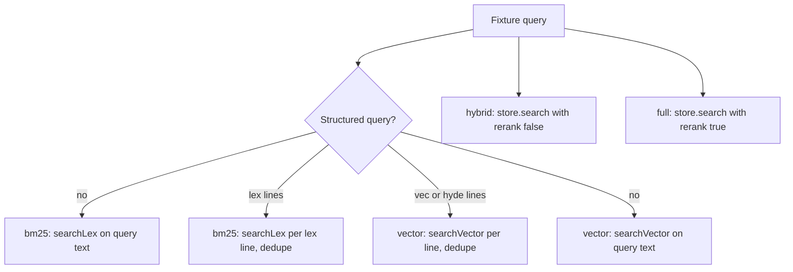
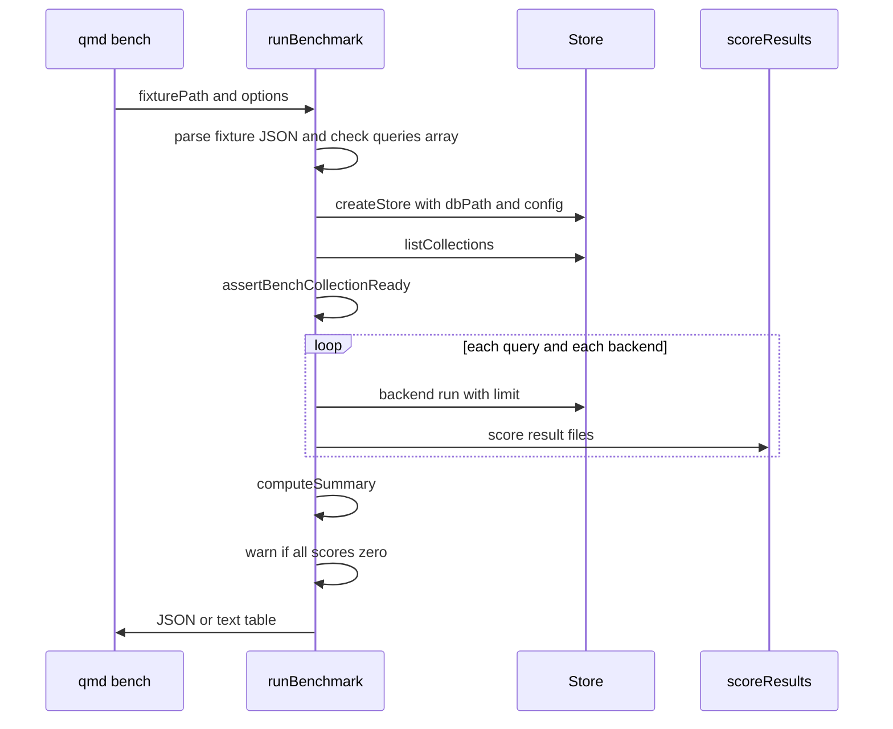

# Benchmarking (qmd bench)

`qmd bench` is the search-quality harness for QMD. It takes a JSON fixture of queries with known-relevant files, runs every query through up to four search backends, scores each result list against the expected files, and prints per-query rows plus per-backend averages. The harness lives in `src/bench/` (`bench.ts`, `score.ts`, `types.ts`) and is wired into the CLI by the `bench` case in `src/cli/qmd.ts`. A separate script, `src/bench-rerank.ts`, benchmarks the reranker model on its own and is not part of `qmd bench`.

For the CLI surface itself see [CLI Reference](cli-reference.md). For how the hybrid and full backends fuse and rerank scores see [Score Fusion and Blending](../concepts/score-fusion-and-blending.md). For where the harness sits in the repository see [Source Map](../architecture/source-map.md).

## Entry points

- **CLI**: `qmd bench <fixture.json> [--json] [-c collection]`. The `bench` case in `src/cli/qmd.ts` (around line 5044) requires a fixture path, lazily imports `runBenchmark` from `src/bench/bench.ts`, and passes the collection, DB path, and config path. Errors are routed through `exitWithError`.
- **Programmatic**: `runBenchmark(fixturePath, options)` in `src/bench/bench.ts` (L325). Options are `json`, `collection`, `backends` (a filter on backend names), `dbPath`, `configPath`, and `config`.
- **Reranker script**: `bun src/bench-rerank.ts` with optional `--quick` and `--docs <n>` flags. It is a top-level script with its own `main()`; the CLI does not reference it.

## Fixture format

Fixtures are JSON files typed by `BenchmarkFixture` in `src/bench/types.ts`. The top level has `description`, `version` (a number), an optional `collection` that scopes every search, and a `queries` array.

Each entry in `queries` is a `BenchmarkQuery`:

| Field | Meaning |
|-------|---------|
| `id` | Unique identifier, used as the row label in output |
| `query` | Query text. Either a plain string or a structured multi-line query (see below) |
| `type` | One of `exact`, `semantic`, `topical`, `cross-domain`, `alias`. Used only for grouping in output |
| `description` | Human-readable note on what the query tests |
| `expected_files` | Relative file paths that should be retrieved |
| `expected_in_top_k` | The k used for precision and the top-k hit count |

The loader only checks that `queries` is an array; it does not validate the other fields. A missing `queries` array throws `Invalid fixture: missing 'queries' array`.

The repository ships one example fixture at `src/bench/fixtures/example.json`. This page documents only its name and shape; its contents are not described here.

### Structured queries

A query string can carry explicit sub-queries, one per line, using these prefixes (parsed by `parseStructuredQuery`, `src/bench/bench.ts` L46):

- `lex:` a BM25 keyword query
- `vec:` a vector query
- `hyde:` a hypothetical-document query, treated as a vector query
- `intent:` a single domain hint, at most one per query

Rules enforced by the parser:

- A single-line query without a prefix is treated as a plain query.
- In a multi-line query, every non-empty line must carry a prefix. Otherwise the parser throws `Line N is missing a lex:/vec:/hyde:/intent: prefix.`
- A prefix with no text, a second `intent:` line, or an `intent:` line with no sub-query throws an error.

## Backends

`BACKENDS` in `src/bench/bench.ts` (L108) defines four backends. Each backend receives the store, the query, a result limit, and the optional collection.

Caption: the four backend call paths from a single fixture query. Structured queries fan out per line; plain queries make one call.

| Backend | Call path in `bench.ts` | What runs |
|---------|------------------------|-----------|
| `bm25` (L110-L126) | `store.searchLex` per `lex:` line (L117), or once on the query text (L123) | FTS keyword search only |
| `vector` (L128-L144) | `store.searchVector` per `vec:` or `hyde:` line, or once on the query text | Embedding similarity only |
| `hybrid` (L146-L154) | `store.search({ ..., rerank: false })` (L150-L151) | Multi-signal retrieval and fusion without the reranker |
| `full` (L156-L164) | `store.search({ ..., rerank: true })` (L160-L161) | Same pipeline with LLM reranking |

Structured bm25 and vector runs collect results from every matching sub-query in order and then call `uniqueFiles` (`src/bench/bench.ts` L96), which keeps the first occurrence of each file and stops at `limit`. Hybrid and full pass the structured searches and intent directly to `store.search`.

On the store side, `search()` in `src/index.ts` maps `rerank: false` to `skipRerank`, and dispatches to `structuredSearch` when pre-expanded queries are supplied, or to `hybridQuery` for a plain string (`src/index.ts` around L491-L525). `searchLex` calls the FTS search (`src/index.ts` around L532) and `searchVector` calls the vector search with the configured embedding model (around L536).

### Result limit

Each query runs with `limit = Math.max(query.expected_in_top_k, 10)` (`src/bench/bench.ts` L173). The result list is therefore never shorter than 10 files, even when `expected_in_top_k` is smaller.

### Failure handling

`runQuery` (`src/bench/bench.ts` from L167) wraps each backend call in a try block. If the backend throws, for example the vector backend when no embeddings exist, the row is recorded as all zeros with every expected file listed as unmatched. The latency is still measured. A failing backend therefore looks like a zero score rather than aborting the run.

## Scoring

Scoring is in `src/bench/score.ts`. `runQuery` calls `scoreResults(resultFiles, query.expected_files, query.expected_in_top_k)` (`src/bench/bench.ts` L199). Let `R` be the result file list (up to `limit` entries), `E` the expected files, `k` = `expected_in_top_k`, and `hits_k` the number of expected files that match some entry in the first `k` results.

- **hits at k** (`hits_at_k`): count of expected files that match at least one of the first `k` results. Computed by `hitsWithin` (`score.ts` L47).
- **precision@k**: `hits_k / min(k, |E|)`, or `0` when `|E| = 0` (`score.ts` L89-L90). The denominator is capped at the number of expected files.
- **recall**: `|matched| / |E|`, where `matched` is the set of expected files that match any entry in the full result list `R`, or `0` when `|E| = 0` (`score.ts` L91).
- **recall@1, recall@3, recall@5**: `hitsWithin(R, E, n) / |E|` for `n` = 1, 3, and 5 respectively (`score.ts` L92-L94). These are fixed cut-offs and do not depend on `expected_in_top_k`.
- **MRR**: `1 / rank` of the first entry in `R` that matches any expected file, or `0` if none matches (`score.ts` L77-L86).
- **F1**: `2 * P * R / (P + R)` where `P` is precision@k and `R` is recall. It is `0` when `P + R = 0` (`score.ts` L95-L96). F1 therefore uses `recall`, not recall@k.

File matching is done by `pathsMatch` (`score.ts` L26). Both sides are normalized by `normalizePath` (L12): a `qmd://` URI loses its scheme and collection segment, the path is lowercased, and leading and trailing slashes are removed. Two paths match when they are equal after normalization, or when one ends with the other. The suffix rule makes `readme.md` match `docs/readme.md`, but it also means a bare basename can match any longer path that ends with it. Fixture authors should use the most specific path they can.

The result row keeps `top_files` (the first 10 result paths), `matched_files`, and `unmatched_expected_files`, which are the main tools for diagnosing a low score.

### Summaries

After all queries run, `computeSummary` (`src/bench/bench.ts` L231) averages each metric across queries, per backend. The summary includes `avg_precision`, `avg_recall`, `avg_recall_at_1`, `avg_recall_at_3`, `avg_recall_at_5`, `avg_mrr`, `avg_f1`, and `avg_latency_ms`. Averages are unweighted means over queries.

## Run lifecycle

Caption: the lifecycle of one `runBenchmark` call. The store is closed in a `finally` block after the query loop.

1. **Parse.** The fixture is read and parsed. A missing `queries` array throws before any store is opened.
2. **Open store.** `createStore` is called with `dbPath` (defaulting to `getDefaultDbPath()`), plus `configPath` or `config` if given.
3. **Guard.** `store.listCollections()` runs, then `assertBenchCollectionReady` (`src/bench/bench.ts` L283). The guard fails fast when the named collection does not exist, when it has no active documents, or when no collection is named and the whole index is empty. This prevents a long run that prints only zeros.
4. **Run.** For each query, each active backend runs in order. Progress lines go to stderr when `--json` is off. The collection is `options.collection`, falling back to `fixture.collection`.
5. **Summarize and warn.** `computeSummary` runs. `benchSummaryAllZero` (L312) returns true only when at least one backend summary exists and every summary has zero `avg_precision`, `avg_recall`, and `avg_mrr`. In that case a warning is written to stderr. The run still succeeds and exits normally.
6. **Output.** With `--json`, the full `BenchmarkResult` (timestamp, fixture path, per-query results, summary) is printed as JSON. Otherwise a per-query table with P@k, R@1, R@3, R@5, MRR, F1, and latency is printed, followed by one summary line per backend. The timestamp is an ISO string with separators stripped and truncated to 15 characters.

## Invariants and caveats

- The collection guard runs before any query, so a misconfigured collection fails with an explicit message rather than a table of zeros.
- An error inside a backend never aborts the run. It produces a zeroed row, so a backend that is not set up (for example, no embeddings for `vector`) silently lowers its own averages.
- `expected_in_top_k` controls the precision denominator and the top-k hit count. Recall and MRR use the full result list, so they can be non-zero even when precision@k is zero.
- Path matching is suffix-based, as described above, so fixtures can use relative paths but should avoid ambiguous short names.
- `qmd bench` assumes a populated index. The repository example fixture and its `test/eval-docs/` corpus exist only in a git checkout, not in the npm package (see the README's Benchmarking section).

## Reranker benchmark script

`src/bench-rerank.ts` is a standalone script. It is not part of the `qmd bench` harness and shares no code with it. Its header documents three invocations: `bun src/bench-rerank.ts` for the full run, `--quick` for a smoke test, and `--docs <n>` for a custom document count.

Its `main()` (near the end of the file) does the following:

- Loads the `node-llama-cpp` runtime with `getLlama` and resolves the reranker model `hf:ggml-org/Qwen3-Reranker-0.6B-Q8_0-GGUF/qwen3-reranker-0.6b-q8_0.gguf` into `~/.cache/qmd/models`.
- Generates synthetic documents from ten fixed templates and scores them against one fixed query.
- For each parallelism level (`[1, 2, 4, 8]`, or `[1, 4]` with `--quick`), creates that many ranking contexts, runs `rankAll` in parallel over document chunks, and records median time, docs per second, and VRAM and RSS usage. It first tries with flash attention and retries without it on failure.
- On CPU, skips parallel levels that lack four cores per context.
- Checks that every score lies in `[0, 1]` and throws `Invalid scores detected` otherwise.

Use this script to choose reranker concurrency on a given machine. Its numbers measure model throughput on synthetic text, not retrieval quality, so it does not replace `qmd bench full`.

## Tests

Two test files cover the harness.

- `test/bench-score.test.ts` pins the metric behavior. It checks `normalizePath` (case, `qmd://` stripping, slashes), `pathsMatch` (exact, case-insensitive, suffix in either direction, different files), and `scoreResults` for perfect, zero, out-of-top-k, MRR at rank 2 and 3, recall@1/3/5 with matched and unmatched lists, and empty inputs.
- `test/bench-guard.test.ts` covers the collection guard (#716). It asserts that `assertBenchCollectionReady` throws for a missing collection, an empty collection, and an empty index, and accepts a populated collection. It checks `benchSummaryAllZero` and the `allZeroBenchWarning` text. Its `runBenchmark` tests confirm that a missing or empty collection fails before searching, that bm25 over an indexed collection produces non-zero recall with no warning, and that a query with no matching token triggers the all-zero stderr warning.

For how these tests fit the wider suite see [Test Strategy](../testing/test-strategy.md).

## Extension points

- **New fixtures.** Add a JSON file that matches `BenchmarkFixture` and run it with `qmd bench <file> -c <collection>`. No code change is needed.
- **New backend.** Add an entry to `BACKENDS` with a `name` and a `run` function that returns ordered file paths. The name is also the key for `options.backends` filtering.
- **New metric.** Extend `ScoreMetrics` in `score.ts`, add it to `BackendResult` in `types.ts`, and extend `computeSummary`. Add a case to `bench-score.test.ts`.
