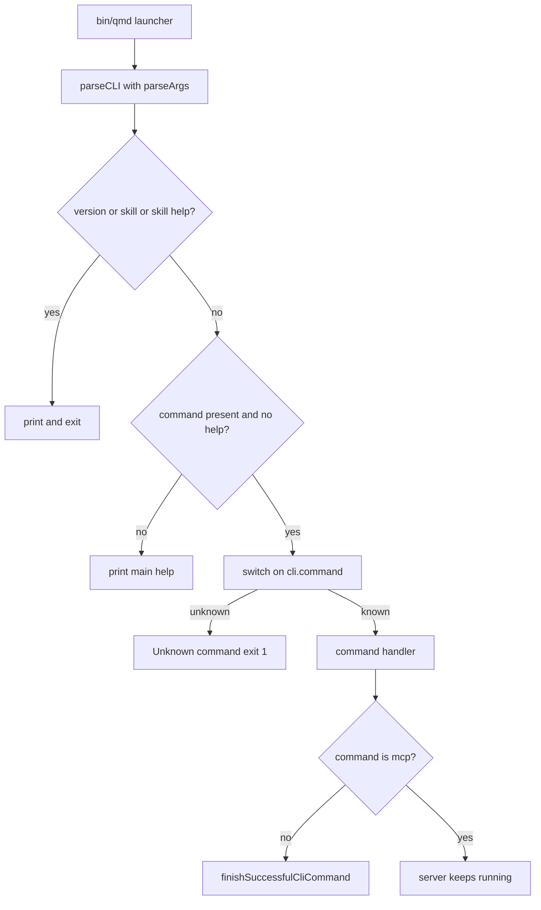

# CLI Command Reference

This page documents the `qmd` command-line interface as it is implemented in `src/cli/qmd.ts`. It covers how a command line becomes a dispatched handler, which global flags exist and what environment variables they set, and what each command group does. For the operational playbook (diagnosing a broken index, rebuilding embeddings), see [Maintenance and Troubleshooting](./maintenance-and-troubleshooting.md). For the trust model behind project-local config, see [Trust Gating](./trust-gating.md). For the MCP server that `qmd mcp` starts, see [MCP Server](../integrations/mcp-server.md).

## Entrypoint and launcher

The package exposes a single binary, `qmd`, mapped to `bin/qmd` in `package.json` ([package.json](repo://package.json#L14-L16)). `bin/qmd` is a Node launcher. It resolves symlinks, then runs `dist/cli/qmd.js` when present and otherwise `src/cli/qmd.ts` ([bin/qmd](repo://bin/qmd#L1-L30)). For `qmd mcp` only, the launcher pre-seeds quiet native logging variables (`LLAMA_LOG_LEVEL`, `GGML_LOG_LEVEL`, `GGML_BACKEND_SILENT`) so llama.cpp output cannot corrupt the MCP stdio stream ([bin/qmd](repo://bin/qmd#L30-L40)). On macOS it also defaults `GGML_METAL_NO_RESIDENCY=1` as a teardown safety net ([bin/qmd](repo://bin/qmd#L48-L52)).

The CLI body runs only when the module is the process entrypoint. The `isMain` guard checks `process.argv[1]` against the module file and calls `enableProductionMode()` only inside that guard, so importing `qmd.ts` for its exports (as the tests do) does not change the database path resolution ([src/cli/qmd.ts](repo://src/cli/qmd.ts#L4598-L4606)).

## Dispatch flow

`parseCLI()` parses `process.argv` with `util.parseArgs` in non-strict mode, so unknown options pass through. The first positional becomes `command`, the remaining positionals become `args`, and `query` is those remaining positionals joined with spaces ([src/cli/qmd.ts](repo://src/cli/qmd.ts#L3317-L3467)).

Before the command switch runs, the top-level flags short-circuit in this order:

1. `--version` / `-v` prints `qmd <version> (<commit>)` and exits 0 ([src/cli/qmd.ts](repo://src/cli/qmd.ts#L4604-L4611)).
2. `--skill` runs the skill show path and exits 0. The help text describes it as an alias for `qmd skill show` ([src/cli/qmd.ts](repo://src/cli/qmd.ts#L4612-L4616)).
3. `skill --help` prints skill-install usage and exits 0 ([src/cli/qmd.ts](repo://src/cli/qmd.ts#L4617-L4630)).
4. No command, or `--help`, prints the main help. It exits 0 when `--help` was given and 1 when no command was given ([src/cli/qmd.ts](repo://src/cli/qmd.ts#L4631-L4637)).

Otherwise the `switch (cli.command)` at [src/cli/qmd.ts](repo://src/cli/qmd.ts#L4639) selects a handler. An unrecognized command prints `Unknown command`, points at `qmd --help`, and exits 1 through the final `default:` branch of the switch ([src/cli/qmd.ts](repo://src/cli/qmd.ts#L5289-L5296)).

The diagram shows the dispatch from launcher to handler. Success paths other than `mcp` end in `finishSuccessfulCliCommand`, described under [Exit behavior](#exit-behavior).

## Global flags

These flags are declared in the `parseArgs` option table and apply to every command. Names are shown exactly as parsed.

| Flag | Parsed as | Effect | Environment equivalent |
| --- | --- | --- | --- |
| `--index <name>` | string | Selects a named index. Sets the index name, the config index name, and the database path. Without it, a project-local `.qmd` config can take over. | `INDEX_PATH` overrides the whole database path (see below). |
| `--no-gpu` | boolean | Forces CPU mode for llama.cpp operations. | `QMD_FORCE_CPU=1` (the flag sets it during parse). |
| `--chunk-strategy <auto\|regex>` | string | Chunking mode. `regex` is the default; `auto` uses AST chunking for code files. Any other value throws. | None. |
| `--format <kind>` | string | Output format: `cli` (default), `json`, `csv`, `md`, `xml`, `files`. Unknown values print the valid list and exit 1. | None. |
| `-c, --collection <name>` | string, repeatable | Filters by one or more collections. | None. |
| `--filter <json>` | string | Metadata filter as a JSON AST, for `search`, `vsearch`, `query`, and `collection metadata`. | None. |
| `-h, --help`, `-v, --version` | boolean | Help and version. | None. |

Sources: the option table is at [src/cli/qmd.ts](repo://src/cli/qmd.ts#L3320-L3390). `--no-gpu` sets `QMD_FORCE_CPU` at [src/cli/qmd.ts](repo://src/cli/qmd.ts#L3397-L3399). `--chunk-strategy` is validated in `parseChunkStrategy` ([src/cli/qmd.ts](repo://src/cli/qmd.ts#L2326-L2333)). The `--format` validation is in `parseCLI` ([src/cli/qmd.ts](repo://src/cli/qmd.ts#L3425-L3435)).

### `--no-gpu` and QMD_FORCE_CPU

`--no-gpu` is a parse-time shortcut. Setting it writes `QMD_FORCE_CPU=1` into the process environment. `isForceCpuEnabled()` treats the variable as on unless it is empty or one of `false`, `off`, `none`, `disable`, `disabled`, `0` ([src/cli/qmd.ts](repo://src/cli/qmd.ts#L499-L502)). The model layer reads the same variable when it resolves GPU selection, alongside `QMD_LLAMA_GPU` ([src/llm.ts](repo://src/llm.ts#L750-L765)). `doctor` reports CPU-forced mode when it is set ([src/cli/qmd.ts](repo://src/cli/qmd.ts#L504-L508)).

### `--index` and database location

`--index` is normalized by `setIndexName`. Path separators in the name are replaced with underscores, so `--index` cannot escape the cache directory. The name also resets the open database handle ([src/cli/qmd.ts](repo://src/cli/qmd.ts#L241-L258)). The index name flows into `getDefaultDbPath(name)`, which returns `<XDG_CACHE_HOME or ~/.cache>/qmd/<name>.sqlite` ([src/store.ts](repo://src/store.ts#L697-L717)).

Two other paths override that default:

- `INDEX_PATH` wins over everything in `getDefaultDbPath`. Outside production mode (tests), that function throws unless `INDEX_PATH` is set ([src/store.ts](repo://src/store.ts#L697-L712)).
- When `--index` is absent, `parseCLI` looks for a project-local config with `findLocalConfigPath()`. If one exists, it becomes the config source and its database path (`getLocalDbPath`) becomes the store override ([src/cli/qmd.ts](repo://src/cli/qmd.ts#L3397-L3416)).

`qmd mcp --http --daemon` passes the resolved path into the child through `INDEX_PATH`, so the daemon does not re-parse `--index` ([src/cli/qmd.ts](repo://src/cli/qmd.ts#L5118-L5133)).

### Other environment variables that shape the CLI

These variables are read directly by the CLI code. They are not parsed flags.

- `NO_COLOR` disables ANSI colors ([src/cli/qmd.ts](repo://src/cli/qmd.ts#L266-L267)).
- `QMD_EDITOR_URI` is an editor link template for clickable TTY search output ([src/cli/qmd.ts](repo://src/cli/qmd.ts#L2639-L2645)).
- `QMD_CONFIG_DIR`, then `XDG_CONFIG_HOME/qmd`, selects the config directory ([src/collections.ts](repo://src/collections.ts#L119-L128)).
- `QMD_HOST` is the fallback bind host for `qmd mcp --http`, after `--host` ([src/mcp/server.ts](repo://src/mcp/server.ts#L1148)).
- `QMD_TRUST_LOCAL_CONFIG` and `QMD_TRUST_UPDATE_HOOKS` approve project-local config without a prompt ([src/trust.ts](repo://src/trust.ts#L271-L274)).
- `QMD_EMBED_MODEL`, `QMD_GENERATE_MODEL`, and `QMD_RERANK_MODEL` override model selection; `doctor` lists them as environment overrides ([src/cli/qmd.ts](repo://src/cli/qmd.ts#L4176-L4178)).
- `QMD_DOCTOR_DEVICE_PROBE` can skip the device probe in `doctor` ([src/cli/qmd.ts](repo://src/cli/qmd.ts#L4367)).

## Command groups

The table lists each `switch` case in `src/cli/qmd.ts`, with the line that handles it. Subcommand details follow.

| Command | Case line | Handler | Purpose |
| --- | --- | --- | --- |
| `context` | [L4640](repo://src/cli/qmd.ts#L4640) | `contextAdd`, `contextList`, `contextRemove` | Attach human-written context to paths. |
| `get` | [L4717](repo://src/cli/qmd.ts#L4717) | `getDocument` | Show one document. |
| `multi-get` | [L4730](repo://src/cli/qmd.ts#L4730) | `multiGet` | Batch fetch by glob or comma list. |
| `ls` | [L4744](repo://src/cli/qmd.ts#L4744) | `listFiles` | List indexed files. |
| `collection` | [L4749](repo://src/cli/qmd.ts#L4749) | nested switch | Manage collections, including `metadata`. |
| `init` | [L4937](repo://src/cli/qmd.ts#L4937) | `initLocalIndex` | Create a project-local `.qmd` index. |
| `status` | [L4945](repo://src/cli/qmd.ts#L4945) | `showStatus` | Index and collection health. |
| `doctor` | [L4949](repo://src/cli/qmd.ts#L4949) | `showDoctor` | Diagnostics. |
| `update` | [L4953](repo://src/cli/qmd.ts#L4953) | `updateCollections` | Re-index collections. |
| `trust` | [L4957](repo://src/cli/qmd.ts#L4957) | `manageTrust` | Approve, list, or revoke project-local config. |
| `embed` | [L4961](repo://src/cli/qmd.ts#L4961) | `vectorIndex` | Generate or refresh vectors. |
| `pull` | [L4986](repo://src/cli/qmd.ts#L4986) | `pullModels` | Download the embed, generate, and rerank models. |
| `search` | [L5009](repo://src/cli/qmd.ts#L5009) | `search` | BM25 full-text search, no LLM. |
| `vsearch`, `vector-search` | [L5018-L5019](repo://src/cli/qmd.ts#L5018-L5019) | `vectorSearch` | Vector similarity search. |
| `query`, `deep-search` | [L5033-L5034](repo://src/cli/qmd.ts#L5033-L5034) | `querySearch` | Hybrid search with expansion and reranking. |
| `bench` | [L5044](repo://src/cli/qmd.ts#L5044) | `runBenchmark` | Search-quality benchmarks against a fixture. |
| `mcp` | [L5068](repo://src/cli/qmd.ts#L5068) | `startMcpServer`, `startMcpHttpServer` | MCP server over stdio or HTTP. |
| `skills` | [L5176](repo://src/cli/qmd.ts#L5176) | `runSkillsCommand` | List and print bundled runtime skills. |
| `skill` | [L5194](repo://src/cli/qmd.ts#L5194) | `showSkill`, `installSkill` | Show or install the QMD skill. |
| `cleanup` | [L5235](repo://src/cli/qmd.ts#L5235) | `previewCleanup`, `runCleanup` | Drop inactive and orphaned data, compact, vacuum. |

The `metadata` group is a subcommand of `collection`, not a top-level command. The `list`, `get`, `path`, and `help` cases near [src/cli/qmd.ts](repo://src/cli/qmd.ts#L3705-L3781) belong to the `skills` runner, not the main switch.

### `context`

`context` takes `add`, `list`, and `rm` (with `remove` accepted as a spelling of `rm`) ([src/cli/qmd.ts](repo://src/cli/qmd.ts#L4640-L4716)). `add` takes either one argument, which is the text and applies to the current directory, or two arguments, a path and the text. A path of `/` attaches global context to all collections. Virtual `qmd://collection/path` paths are accepted ([src/cli/qmd.ts](repo://src/cli/qmd.ts#L4654-L4690), [src/cli/qmd.ts](repo://src/cli/qmd.ts#L1085-L1150)).

### `get`, `multi-get`, and `ls`

`get <filepath>[:from[:count]]` accepts `--from`, `-l <lines>`, `--no-line-numbers`, and `--full-path`. Line numbers are on by default ([src/cli/qmd.ts](repo://src/cli/qmd.ts#L4717-L4729)).

`multi-get <pattern>` accepts a glob or a comma-separated list. It accepts `-l`, `--max-bytes`, `--no-line-numbers`, `--full-path`, and `--format`. The default byte cap is 64 KB (`DEFAULT_MULTI_GET_MAX_BYTES`) ([src/cli/qmd.ts](repo://src/cli/qmd.ts#L4730-L4743), [src/store.ts](repo://src/store.ts#L139)).

`ls [collection[/path]]` lists indexed files ([src/cli/qmd.ts](repo://src/cli/qmd.ts#L4744-L4748)).

### `collection`

The nested switch starts at [src/cli/qmd.ts](repo://src/cli/qmd.ts#L4749). The subcommands and their cases are:

- `list` (case at [L4752](repo://src/cli/qmd.ts#L4752)) lists collections.
- `add <path>` (case at [L4757](repo://src/cli/qmd.ts#L4757)) takes `--name`, `--mask`, and `--glob`. `.` means the current directory. The path must exist and be a directory, otherwise the command exits 1 ([src/cli/qmd.ts](repo://src/cli/qmd.ts#L4757-L4788)).
- `remove` and `rm` (case at [L4789](repo://src/cli/qmd.ts#L4789)) delete a collection.
- `rename` and `mv` (case at [L4800](repo://src/cli/qmd.ts#L4800)) rename one.
- `set-update` and `update-cmd` (case at [L4811](repo://src/cli/qmd.ts#L4811)) set or clear the pre-index command. Omitting the command clears it.
- `include` and `exclude` (case at [L4839](repo://src/cli/qmd.ts#L4839)) toggle default-query inclusion.
- `show` and `info` (case at [L4859](repo://src/cli/qmd.ts#L4859)) print details.
- `metadata` (case at [L4887](repo://src/cli/qmd.ts#L4887)) discovers metadata keys and values.
- `help`, or no subcommand (case at [L4896](repo://src/cli/qmd.ts#L4896)) prints usage and exits 0.

Unknown subcommands exit 1 after printing the doctor hint. The help text in the `help` case lists `update-cmd` and `remove`, while the code accepts the other spellings too. These spellings are not marked as undocumented aliases in the source, so this page does not describe them that way. The code only marks `vector-search` and `deep-search` as undocumented, as covered in [Search commands](#search-commands).

#### `collection add`

`collection add` resolves the path, rejects a missing or non-directory path, and derives the name from the directory's basename when `--name` is absent ([src/cli/qmd.ts](repo://src/cli/qmd.ts#L1882-L1900)). It refuses a name that already exists in the YAML config, and it refuses a second collection with the same path and pattern ([src/cli/qmd.ts](repo://src/cli/qmd.ts#L1900-L1922)). It then writes the YAML entry, calls `trustCurrentConfig()` because the user typed the path, resyncs the config into the database, and indexes the files ([src/cli/qmd.ts](repo://src/cli/qmd.ts#L1915-L1922)).

#### `collection update-cmd`

`update-cmd` sets the `update` field of the named collection, then calls `trustCurrentConfig()` so the trust digest covers the new hook. The hook is a shell command that `update` later runs in the collection directory ([src/cli/qmd.ts](repo://src/cli/qmd.ts#L4811-L4838)). Because the user typed the command directly, it needs no separate approval. Any later edit to the hook invalidates that approval (see [Trust and gated config](#trust-and-gated-config)).

#### `collection include` and `exclude`

These set `includeByDefault` on the collection through `updateCollectionSettings` ([src/cli/qmd.ts](repo://src/cli/qmd.ts#L4839-L4858)). The flag controls which collections are picked when no explicit collection is given. Default selection goes through `getDefaultCollections()`, which keeps every collection whose `includeByDefault` is not `false`, and `getDefaultCollectionNames()`, which maps that list to names ([src/collections.ts](repo://src/collections.ts#L270-L277), [src/collections.ts](repo://src/collections.ts#L276-L279)). An unset `includeByDefault` is therefore included; only an explicit `false` (set by `collection exclude`) excludes a collection from default selection.

#### `collection show`

`show` prints the path, glob pattern, include state, update command when set, and the number of contexts. It then appends metadata counts ([src/cli/qmd.ts](repo://src/cli/qmd.ts#L4859-L4886)).

#### `collection remove` and `rename`

`remove` deletes the collection's documents from the database through `removeCollection`, removes the YAML entry, and reports deleted documents and cleaned content hashes ([src/cli/qmd.ts](repo://src/cli/qmd.ts#L1924-L1944)). `rename` updates both the database and the YAML entry. Virtual `qmd://` paths for that collection change with it ([src/cli/qmd.ts](repo://src/cli/qmd.ts#L1946-L1974)).

#### `collection metadata`

With no names, `collection metadata` uses the default collections. This matches unscoped search. Named collections are validated and the command exits 1 on an unknown name ([src/cli/qmd.ts](repo://src/cli/qmd.ts#L2916-L2935), [src/cli/qmd.ts](repo://src/cli/qmd.ts#L4887-L4895)). Its options are `--match`, `--filter`, `--key-limit`, `--key-offset`, `--all-keys`, `--value-limit`, `--value-offset`, `--all-values`, `--sort count|value`, and `--min-count`. Defaults are 50 keys and 10 values per key ([src/cli/qmd.ts](repo://src/cli/qmd.ts#L4896-L4935)).

### `init`, `status`, and `doctor`

`init` creates `.qmd/` in the current directory. It refuses to run in `$HOME`, and it writes `index.yml` or reuses an existing `index.yaml`. It then creates `index.sqlite` and syncs the config into it ([src/cli/qmd.ts](repo://src/cli/qmd.ts#L466-L497)). Tests cover creation and the `$HOME` refusal ([test/cli.test.ts](repo://test/cli.test.ts#L444-L473)).

`status` and `doctor` are read-only health views. `doctor` owns GPU and device diagnostics. The `status` test asserts that device probing is left out ([test/cli.test.ts](repo://test/cli.test.ts#L944-L965), [test/cli.test.ts](repo://test/cli.test.ts#L728-L754)).

### `update`

`update` runs `updateCollections()`, which proceeds in order:

1. Resolve local-config trust before the store opens ([src/cli/qmd.ts](repo://src/cli/qmd.ts#L921-L925)).
2. For each collection, skip it when the config is untrusted and the collection path is outside the project ([src/cli/qmd.ts](repo://src/cli/qmd.ts#L950-L960)).
3. Run the collection's `update` command through `bash -c` in the collection directory, if trust allows. A non-zero exit terminates the command with that exit code ([src/cli/qmd.ts](repo://src/cli/qmd.ts#L961-L1000)).
4. Re-index the collection with `reindexCollection`, honoring the YAML `ignore` patterns ([src/cli/qmd.ts](repo://src/cli/qmd.ts#L1001-L1025)).
5. After all collections, copy vectors into collections that gained already-embedded documents, remove stale vector rows, and print how many hashes still need embedding ([src/cli/qmd.ts](repo://src/cli/qmd.ts#L1026-L1050)).

The help text documents `qmd update [--pull]`. The parser declares `pull` ([src/cli/qmd.ts](repo://src/cli/qmd.ts#L3369)), but no code reads `values.pull`. The `update` case calls `updateCollections()` with no arguments ([src/cli/qmd.ts](repo://src/cli/qmd.ts#L4953-L4956)). Treat `--pull` as not implemented: it has no effect on the current build, and the update hook in `collection update-cmd` is the supported way to run a pre-index command.

### `trust`

`trust` takes no subcommand or one of two subcommands:

- With no subcommand, it prints the gated items of the in-scope project config (update hooks, out-of-project paths, custom models), then records a trust digest for that config. It is a no-op for the user's own config, which is never gated ([src/cli/qmd.ts](repo://src/cli/qmd.ts#L869-L918)).
- `trust list` prints the trusted configs with their approval times.
- `trust revoke` removes the approval for the in-scope config.

Any other subcommand prints usage and exits 1 ([src/cli/qmd.ts](repo://src/cli/qmd.ts#L869-L918)). See [Trust Gating](./trust-gating.md) for the digest and the gate decision.

### `embed`

`embed` first resolves local-config trust. It then reads the batch and chunking options and dispatches to `vectorIndex` ([src/cli/qmd.ts](repo://src/cli/qmd.ts#L4961-L4985)):

- `-f, --force` re-embeds everything.
- `-c <name>` validates the name against configured collections before dispatch. Only the first value is used, because embedding works on one collection at a time.
- `--max-docs-per-batch <n>` and `--max-batch-mb <n>` must be positive integers. Anything else throws. The MB value is converted to bytes ([src/cli/qmd.ts](repo://src/cli/qmd.ts#L2317-L2325)).
- `--chunk-strategy` accepts `auto` or `regex` ([src/cli/qmd.ts](repo://src/cli/qmd.ts#L2326-L2333)).
- `--timeout <minutes>` caps the whole embed session. The default is 30 minutes, `0` disables the cap, and negative or non-numeric values throw. The minutes are converted to milliseconds ([src/cli/qmd.ts](repo://src/cli/qmd.ts#L2335-L2342)).

### `pull`

`pull` resolves local-config trust, then downloads three models in order: the embed, generate, and rerank models resolved for the runtime. It writes them into `DEFAULT_MODEL_CACHE_DIR` ([src/cli/qmd.ts](repo://src/cli/qmd.ts#L4986-L5008)). `--refresh` re-downloads, and `--progress` shows the download bar. Each result prints the model, path, size, and whether it was refreshed or cached ([src/cli/qmd.ts](repo://src/cli/qmd.ts#L4986-L5008)).

### Search commands

Search commands share the `-n`, `--min-score`, `--all`, `--full`, `--explain`, `--line-numbers`, `--full-path`, and `-C` options described in `showHelp` ([src/cli/qmd.ts](repo://src/cli/qmd.ts#L3879-L4028)). Each reads `--filter` through `parseCliMetadataFilter`.

- `search` runs BM25 full-text search with no LLM ([src/cli/qmd.ts](repo://src/cli/qmd.ts#L5009-L5017)).
- `vsearch` runs vector similarity. It defaults `minScore` to `0.3` unless `--min-score` is given. It resolves local-config trust first ([src/cli/qmd.ts](repo://src/cli/qmd.ts#L5018-L5030)).
- `query` runs hybrid search with query expansion and reranking. It resolves local-config trust first ([src/cli/qmd.ts](repo://src/cli/qmd.ts#L5033-L5041)). Its argument may be a plain query, which is expanded implicitly, or a typed document of `lex:`, `vec:`, and `hyde:` lines. The grammar is printed by `showHelp` ([src/cli/qmd.ts](repo://src/cli/qmd.ts#L3879-L4028)).

The code marks two spellings as undocumented aliases: `vector-search` for `vsearch` ([src/cli/qmd.ts](repo://src/cli/qmd.ts#L5019)) and `deep-search` for `query` ([src/cli/qmd.ts](repo://src/cli/qmd.ts#L5034)). They are not in the help text.

### `bench`

`bench <fixture.json>` runs search-quality benchmarks. It accepts `--json` and `-c <collection>`. It passes the database path and, when present, the config path to `runBenchmark`. Errors go through `exitWithError` ([src/cli/qmd.ts](repo://src/cli/qmd.ts#L5044-L5067)). See [Benchmarking](./benchmarking.md) for the fixture format and metrics.

### `mcp`

`mcp` has one subcommand, `stop`. It reads the PID file for the active index, verifies with `isQmdMcpPid` that the PID is still an MCP server, sends `SIGTERM`, and removes the file. A stale file is deleted and reported as a cleanup ([src/cli/qmd.ts](repo://src/cli/qmd.ts#L5068-L5095)). The code comment mentions `status`, but no `status` branch exists.

Without `stop`, the default is the stdio transport, which calls `startMcpServer` ([src/cli/qmd.ts](repo://src/cli/qmd.ts#L5169-L5172)). With `--http`:

- `--port` defaults to `8181`.
- `--host` overrides the bind address. When it is absent, `QMD_HOST` applies, and the server default is `localhost` ([src/mcp/server.ts](repo://src/mcp/server.ts#L1148)).
- `--daemon` checks for a live daemon by PID and refuses to start a second one. It spawns a detached child with stdout and stderr redirected to a log, passes `--index` through, and sets `INDEX_PATH` in the child's environment ([src/cli/qmd.ts](repo://src/cli/qmd.ts#L5104-L5141)).
- A port conflict (`EADDRINUSE`) exits 1 with a message to use `--port` ([src/cli/qmd.ts](repo://src/cli/qmd.ts#L5160-L5166)).

PID and log file names are scoped per `--index` through `mcpDaemonStateFiles(getActiveIndexName())` ([src/cli/qmd.ts](repo://src/cli/qmd.ts#L229-L239)). See [MCP Server](../integrations/mcp-server.md) for the protocol and tool surface.

### `skills` and `skill`

`skills` (plural) runs `runSkillsCommand`. Its subcommands are:

- `list` (default when no argument is given), which prints bundled runtime skills, or JSON when `--json` is set.
- `get <name>`, which prints a skill. `--full` adds the references, templates, and scripts. `--all` prints every runtime skill.
- `path [name]`, which prints skill directories.
- `help`.

An unknown name or subcommand throws, and with `--json` the error is wrapped in `{ success: false }` ([src/cli/qmd.ts](repo://src/cli/qmd.ts#L3700-L3790), [src/cli/qmd.ts](repo://src/cli/qmd.ts#L5176-L5193)).

`skill` (singular) runs `show`, `install`, or `help` ([src/cli/qmd.ts](repo://src/cli/qmd.ts#L5194-L5234)). `install` writes into `./.agents/skills/qmd`, or `~/.agents/skills/qmd` with `--global`. `--yes` also creates the `.claude/skills/qmd` symlink, and `-f, --force` replaces an existing install ([src/cli/qmd.ts](repo://src/cli/qmd.ts#L3860-L3877)).

### `cleanup`

`cleanup` opens the database and either previews or runs cleanup. With `--dry-run`, it reports the cached API responses, orphaned embedding chunks, inactive document records, orphaned content hashes, and whether the vector table would be repacked, then prints the FTS and vacuum step it would run. Without the flag, `runCleanup` performs the same steps, reports each count, and compacts FTS and vacuums the database ([src/cli/qmd.ts](repo://src/cli/qmd.ts#L5235-L5296)). It closes the database afterward.

## Exit behavior

Successful commands other than `mcp` end in `finishSuccessfulCliCommand`. That function flushes stdout, disposes the default llama.cpp handle, flushes stderr, and then sets `process.exitCode = 0` rather than calling `process.exit`. The source comment explains that `process.exit` skips `beforeExit` and triggers a native Metal assertion on macOS ([src/cli/qmd.ts](repo://src/cli/qmd.ts#L297-L366), [src/cli/qmd.ts](repo://src/cli/qmd.ts#L5296-L5304)). Failures from the cleanup step are reported as a warning and do not change the exit code.

Errors wrapped by `exitWithError` print the message, then the hint to run `qmd doctor`, and exit 1 ([src/cli/qmd.ts](repo://src/cli/qmd.ts#L4561-L4575)). The `mcp` path bypasses `finishSuccessfulCliCommand` so the server can keep running.

## Trust and gated config

Several commands call `resolveLocalConfigTrust()` before doing work. These are `embed`, `pull`, `vsearch`, `query`, and `update` ([src/cli/qmd.ts](repo://src/cli/qmd.ts#L4963), [src/cli/qmd.ts](repo://src/cli/qmd.ts#L4987), [src/cli/qmd.ts](repo://src/cli/qmd.ts#L5029), [src/cli/qmd.ts](repo://src/cli/qmd.ts#L5040), [src/cli/qmd.ts](repo://src/cli/qmd.ts#L921-L925)).

The function checks a project-local config for gated items: update hooks, collection paths outside the project, and custom model URIs. If none are present it returns true. Otherwise:

- In an interactive terminal, it asks `Trust this project's .qmd config? [y/N]`. An approval is recorded with the digest.
- Without a TTY, it skips the gated items and continues indexing the in-project collections. The message points to `qmd trust` or `QMD_TRUST_LOCAL_CONFIG=1`.

The decision logic is in `decideLocalConfigGate` ([src/trust.ts](repo://src/trust.ts#L291-L325)). The env opt-in is read by `isLocalConfigTrustOptedIn` ([src/trust.ts](repo://src/trust.ts#L271-L274)).

## Tests that anchor the behavior

- [test/cli.test.ts](repo://test/cli.test.ts#L237-L256) covers help output, and [test/cli.test.ts](repo://test/cli.test.ts#L257-L320) covers `skills` and `skill` behavior.
- [test/cli.test.ts](repo://test/cli.test.ts#L347-L360) checks that invalid `--max-docs-per-batch` and `--max-batch-mb` values are rejected.
- [test/cli.test.ts](repo://test/cli.test.ts#L444-L473) covers `init` creation and the `$HOME` refusal.
- [test/cli.test.ts](repo://test/cli.test.ts#L474-L711) covers `collection add`, including `--glob` aliasing, comma-separated masks, missing or non-directory paths, and recreating a collection after removal.
- [test/cli.test.ts](repo://test/cli.test.ts#L728-L943) covers `doctor`, including CPU-forced mode and environment overrides.
- [test/cli.test.ts](repo://test/cli.test.ts#L966-L1100) covers search output formats, `get`, and missing-file handling.
- [test/cli-exit-lifecycle.test.ts](repo://test/cli-exit-lifecycle.test.ts#L40-L60) covers the flush, cleanup, and exit ordering that `finishSuccessfulCliCommand` must preserve.
- [test/cli-lazy-llm-import.test.ts](repo://test/cli-lazy-llm-import.test.ts#L1-L20) asserts that `node-llama-cpp` is only dynamically imported and that the CLI module imports cleanly for lightweight commands.
- [test/version.test.ts](repo://test/version.test.ts) covers the commit suffix printed by `qmd --version`, which is resolved in [src/cli/version.ts](repo://src/cli/version.ts#L1-L80).

## Known gaps

- `qmd update --pull` is documented but not implemented. The flag is parsed and never read.
- `qmd mcp status` is mentioned in a code comment but has no branch.
- `--context` is declared in the option table ([src/cli/qmd.ts](repo://src/cli/qmd.ts#L3324-L3326)), but no code reads `values.context`.
