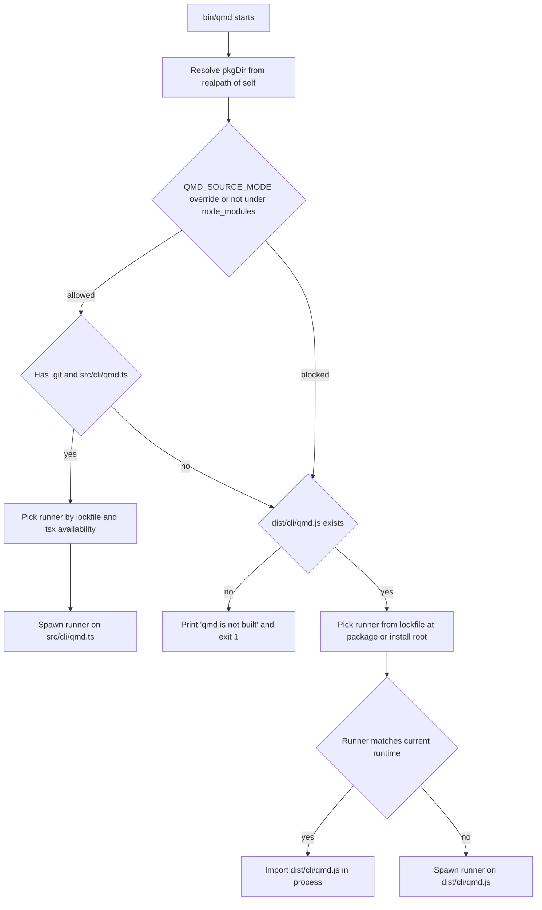

# Installation, Requirements, and Build

This page explains how QMD gets onto a machine, what it needs at runtime, how the published package is built and wrapped, and which checks protect that path. It covers the `bin/qmd` launcher, the `prepare` and `build` scripts, native dependencies, and the package smoke tests. For the internal component layout, see [System Overview](../architecture/system-overview.md). For operational problems after installation, see [Maintenance and Troubleshooting](maintenance-and-troubleshooting.md).

## Install commands

The README documents two install paths, one for global installs and one for running without installing:

```sh
# Install globally (Node or Bun)
npm install -g @tobilu/qmd
# or
bun install -g @tobilu/qmd

# Or run directly
npx @tobilu/qmd ...
bunx @tobilu/qmd ...
```

These are the commands from the README Quick Start ([README.md](../../README.md)). The library-only install is `npm install @tobilu/qmd`, described in the [SDK Library](../integrations/sdk-library.md) page. The README "Development" section describes a source checkout, which is `git clone https://github.com/tobi/qmd`, then `npm install`, then `npm link`.

The package exposes one `bin` entry, `qmd`, which points at `bin/qmd`. Its main export is `dist/index.js` with types at `dist/index.d.ts`, and it is an ES module (`"type": "module"`) ([package.json](../../package.json)).

## Requirements

| Requirement | Source | Notes |
|---|---|---|
| Node.js >= 22.0.0 | `engines.node` in package.json; README "System Requirements" | Enforced by the `engines` field only when a package manager applies engine checks. CI runs Node 22 and 23. |
| Bun >= 1.0.0 | README "System Requirements" | Needed for `bun install -g`, `bunx`, and the Bun test and smoke paths. |
| macOS Homebrew SQLite | README "System Requirements" (`brew install sqlite`) | Required for sqlite-vec extension loading under Bun on macOS (see below). |

The README also notes that GGUF models are downloaded on first use from HuggingFace and cached under `~/.cache/qmd/models/`. Those downloads are not part of the install step.

## Native and grammar dependencies

Dependency classes matter when an install fails or a platform is unsupported.

- **Runtime dependencies.** `better-sqlite3` (for Node), `sqlite-vec`, `node-llama-cpp`, `web-tree-sitter`, and the four tree-sitter grammar packages are listed under `dependencies` ([package.json](../../package.json)).
- **Platform optional dependencies.** Five `sqlite-vec-<platform>-<arch>` packages (darwin arm64 and x64, linux arm64 and x64, windows x64) are listed under `optionalDependencies`. Only the package matching the host platform is expected to install.
- **Grammar packages are required, not optional.** `tree-sitter-typescript`, `tree-sitter-python`, `tree-sitter-go`, and `tree-sitter-rust` are in `dependencies`. `test/package.test.ts` asserts that they must be present and must not be optional ([package.test.ts](../../test/package.test.ts)).

> **Stale comment warning.** The header of `src/ast.ts` says the grammar packages are `optionalDependencies` and suggests moving the `.wasm` files into the repository to avoid the install-size cost ([ast.ts](../../src/ast.ts)). That comment contradicts `package.json` and the package test. Treat the `dependencies` placement as the current behavior.

### How grammar `.wasm` files are loaded

QMD uses only the `.wasm` grammar files, not the native prebuilds. `src/ast.ts` maps each language to a package and wasm filename in `GRAMMAR_MAP` ([ast.ts](../../src/ast.ts)). At first use, `resolveGrammarPath` calls `createRequire(import.meta.url).require.resolve("<pkg>/<file>.wasm")`, then `LanguageClass.load(path)` loads it into `web-tree-sitter`. Failure is non-fatal: the loader records the error, warns once per language, and returns no break points, so chunking falls back to regex.

The `GRAMMAR_MAP` version strings used in the repair hint do not match the `package.json` pins for every language. For example, the hint names `tree-sitter-python@0.23.4` while `package.json` pins `tree-sitter-python` at `0.25.0`. When repairing a broken grammar install, use the version that `package.json` pins.

### SQLite and sqlite-vec

`src/db.ts` provides one `openDatabase` API over two drivers ([db.ts](../../src/db.ts)).

- **Node path.** The `else` branch imports `better-sqlite3` and loads sqlite-vec through `sqliteVec.load(db)`.
- **Bun path.** The `if (isBun)` branch (line 25) imports `bun:sqlite`. On macOS it calls `Database.setCustomSQLite()` with the Homebrew library at `/opt/homebrew/opt/sqlite/lib/libsqlite3.dylib` (Apple Silicon) or `/usr/local/opt/sqlite/lib/libsqlite3.dylib` (Intel). It then probes the sqlite-vec loadable path in an in-memory database. If the probe fails, the vector extension is set to `null`.
- **Failure behavior.** When sqlite-vec is unavailable, `loadSqliteVec` throws. Under Bun on macOS, the message tells the user to run `brew install sqlite`, or to install with npm instead. BM25 search is not affected by that failure.

`openDatabase` (line 116) sets `busy_timeout` to 120000 ms by default, overridable with `QMD_SQLITE_BUSY_TIMEOUT` (`0` restores fail-fast), then enables WAL with a bounded retry. The busy timeout and WAL setup run for every open, not only at install time.

## The `bin/qmd` launcher

`bin/qmd` is a Node script with a `#!/usr/bin/env node` shebang. npm generates shims that invoke `node` on every platform, which is why the launcher is written in Node rather than POSIX shell ([bin/qmd](../../bin/qmd)).



Its branches, with line references to `bin/qmd`:

1. **Path resolution (L18-L21).** `pkgDir` is derived from the realpath of the launcher, so global symlinks resolve to the package directory. `jsEntry` is `dist/cli/qmd.js`, and `tsEntry` is `src/cli/qmd.ts`.
2. **Environment seeding before imports (L24-L31, L40-L52).** For `qmd mcp`, the launcher sets `LLAMA_LOG_LEVEL`, `GGML_LOG_LEVEL`, and `GGML_BACKEND_SILENT` so native logs do not corrupt stdio JSON-RPC. On Darwin it sets `GGML_METAL_NO_RESIDENCY=1` unless `QMD_METAL_KEEP_RESIDENCY=1`. These must be set before the native binding loads, which is why they live in the launcher.
3. **Source-mode gate (L78-L84).** Source mode is allowed when `QMD_SOURCE_MODE=1`, or when `QMD_SOURCE_MODE` is not `0` and the package directory is not inside a `node_modules` segment. Source mode additionally requires a `.git` directory beside the package and an existing `src/cli/qmd.ts`. A package-manager install, including `npm install -g .`, is excluded because its path contains `node_modules`.
4. **Source runner selection (L94-L112).** Source mode prefers `node` with `tsx` when `package-lock.json` is present and `node_modules/tsx/dist/cli.mjs` exists. Otherwise it uses `bun` when a `bun.lock` or `bun.lockb` exists and Bun is on `PATH`. Otherwise it uses `node` with `tsx` if available.
5. **Missing-build error (L116-L121).** If source mode is not selected and `dist/cli/qmd.js` is missing, the launcher prints `qmd is not built`, the recovery commands (`bun install && bun run build` or `npm install && npm run build`), and `qmd doctor`, then exits with status 1.
6. **Dist runner selection (L142-L161).** The runner is chosen from lockfiles: `package-lock.json` in the package directory wins, then `bun.lock` or `bun.lockb`. If the package has neither, the launcher checks the install root above the last `node_modules` segment, with npm again taking priority. The default is `node`. The ordering matters because native addons such as better-sqlite3 and sqlite-vec are built for the installing runtime.
7. **In-process import (L162-L175).** If the selected runner matches the runtime that launched the launcher, the launcher rewrites `process.argv[1]` to `jsEntry` and imports the compiled CLI directly. This avoids a second process start.
8. **Child process (L176-L204).** Otherwise the launcher spawns the runner with `stdio: "inherit"`. A Node runner is pinned to `process.execPath` (L183-L184) rather than the first `node` on `PATH`. That avoids picking up version-manager shims that would load a native addon compiled for a different Node ABI. Signals are forwarded to the launcher, and spawn errors print `qmd: failed to launch <runner>` and exit 1.

The launcher is tested against this behavior in `test/bin-wrapper.test.ts`, which builds fake packages and asserts which runtime and entry point are chosen ([bin-wrapper.test.ts](../../test/bin-wrapper.test.ts)).

## The `prepare` and `build` scripts

`package.json` defines two lifecycle scripts ([package.json](../../package.json)):

- `"prepare": "node scripts/install-hooks.mjs && node scripts/build.mjs"` runs on local installs in a checkout. Hook installation runs first. It copies `scripts/pre-push` into `.git/hooks/pre-push` and marks it executable. Outside a git repository it logs `Not a git repository, skipping hook install` and exits 0 ([install-hooks.mjs](../../scripts/install-hooks.mjs)). The build then runs.
- `"build": "node scripts/build.mjs"` produces the compiled CLI.

`scripts/build.mjs` does three things ([build.mjs](../../scripts/build.mjs)):

1. **Type emit with `tsc`.** It runs the local TypeScript compiler (`node_modules/typescript/bin/tsc`) with `-p tsconfig.build.json` (L27). This is a per-file emit, not a bundle. No esbuild or other bundler is invoked by the build script. The `tsconfig.build.json` config sets `rootDir: src`, `outDir: dist`, `declaration: true`, `noImplicitAny`, and the `node` type set, and excludes `src/**/*.test.ts`, `src/test-preload.ts`, and `src/bench-*.ts` ([tsconfig.build.json](../../tsconfig.build.json)).
2. **Shebang and mode for the CLI.** It rewrites `dist/cli/qmd.js` with a leading `#!/usr/bin/env node` line, replacing any existing shebang, writes through a temporary file and rename, and sets mode `0755`.
3. **Commit stamp.** It writes `dist/cli/build-info.json` with the short commit and a build timestamp. The commit is taken only when the enclosing git repository's top level is this package root, and a `-dirty` suffix is added when the working tree has changes. A build outside git stamps an empty commit and still succeeds. The runtime `qmd --version` reads this stamp first, so a global install under a git-managed prefix does not report the prefix's HEAD ([version.ts](../../src/cli/version.ts)).

The build exits non-zero if `tsc` cannot be spawned or returns a non-zero status. It spawns without a shell so that a Node path containing spaces on Windows is not split (`shell: false`, see `test/build-script.test.ts`).

## Scripts and development checks

The scripts most relevant to contributors, from `package.json`:

| Script | What it runs | Purpose |
|---|---|---|
| `npm test` | `node scripts/test-all.mjs` | Full suite: typecheck, Vitest under Node, Bun tests, package smoke |
| `test:types` | `tsc -p tsconfig.build.json --noEmit` | Type check of the published source set |
| `test:node` | Vitest run with verbose reporting and a 60s timeout | Node test runner |
| `test:bun` | `bun test` with `--preload ./src/test-preload.ts` | Bun test runner |
| `test:unit` | Vitest over `test/`, then `bun test` over `test/`, both with `CI=true` | Unit tests under both runtimes |
| `test:package` | `node scripts/package-smoke.mjs` | Package layout and launcher checks |
| `lint` | `oxlint` | Linting |
| `smoke:package-grammars` | `node scripts/check-package-grammars.mjs` | Grammar `.wasm` resolution |

`scripts/test-all.mjs` runs four steps in order: the build typecheck, the Vitest suite under Node over `test/`, the Bun test suite, and the package smoke. It sets `GGML_METAL_NO_RESIDENCY=1` on Darwin for its subprocesses, matching the launcher ([test-all.mjs](../../scripts/test-all.mjs)). The `lint` script is not part of `npm test`. CI runs `npx oxlint` as a separate step ([ci.yml](../../.github/workflows/ci.yml)).

For the broader test layout, see [Test Strategy](../testing/test-strategy.md).

## Package smoke checks

`scripts/package-smoke.mjs` is the release gate for the package shape ([package-smoke.mjs](../../scripts/package-smoke.mjs)). In order, it:

1. Runs `scripts/build.mjs`, then `scripts/check-package-grammars.mjs`.
2. Confirms every path in `package.json` `files` exists, with the trailing slash removed.
3. Confirms every `bin` target exists and has an executable bit set.
4. Confirms `dist/index.js`, `dist/index.d.ts`, and `dist/cli/qmd.js` exist.
5. Runs `dist/cli/qmd.js --help` under Node, `bin/qmd --help` through `sh`, and `bin/qmd --help` under Node with `QMD_SOURCE_MODE=0`, which forces dist mode.
6. Runs the same CLI and wrapper checks under Bun, unless `QMD_SKIP_BUN_SMOKE=1` is set.

`scripts/check-package-grammars.mjs` resolves five wasm files (TypeScript, TSX, Python, Go, Rust) with `require.resolve`, and fails with a repair hint if any is missing ([check-package-grammars.mjs](../../scripts/check-package-grammars.mjs)).

The `files` array controls what is published: `bin/`, `dist/`, `skills/`, the three smoke and build scripts, `scripts/test-all.mjs`, `LICENSE`, and `CHANGELOG.md` ([package.json](../../package.json)).

### Release hook

`scripts/pre-push` guards release tags. For a `v*` tag push, it checks that `package.json` `version` equals the tag version, that `CHANGELOG.md` has a `## [<version>] - ` heading, and that CI passed for the tagged commit when the `gh` CLI is available ([pre-push](../../scripts/pre-push)). The hook is installed by `prepare` as described above.

## Container and install smoke tests

`test/smoke-install.sh` tests the published artifact in a clean container. It builds the package, runs `npm pack` into `test/`, copies `src`, `dist`, and the test files into a temporary test project, and builds an image from `test/Containerfile` ([smoke-install.sh](../../test/smoke-install.sh), [Containerfile](../../test/Containerfile)). The image is Debian bookworm-slim with `mise`-managed Node and Bun. It installs the tarball globally with npm and with Bun.

Three scenarios run with `--scenario node|npx|bun|all`:

- **node**: `npm install -g` of the packed tarball, then a `doctor` check, a collection add, list, and status check, and a `sqlite-vec` load check through `dist/db.js`.
- **npx**: `npm exec --package <tarball> -- qmd`, the same runtime matrix.
- **bun**: `bun install -g` of the tarball, with a Bun `sqlite-vec` load check.

Two checks are opt-in. `--with-embed` runs a tiny `qmd embed` on a fixture, and `--with-gpu` adds GPU backend probes via `QMD_LLAMA_GPU`.

## Nix flake

`flake.nix` builds QMD differently from the npm path ([flake.nix](../../flake.nix)).

- The `nodeModules` derivation runs `bun install --frozen-lockfile --ignore-scripts --production`. The output hash is pinned only for `x86_64-linux` and `aarch64-darwin`. The other two systems use `pkgs.lib.fakeHash` placeholders until someone populates them.
- The `qmd` derivation rebuilds `better-sqlite3` with `node-gyp rebuild --release`, then copies `src`, `skills`, `package.json`, and `node_modules` into `$out/lib/qmd`.
- The installed command is a `makeWrapper` around Bun that runs `src/cli/qmd.ts` directly. The wrapper never executes `bin/qmd`. It duplicates the launcher's pre-import environment (log levels, Darwin residency) and sets `DYLD_LIBRARY_PATH` and `LD_LIBRARY_PATH` to the Nix SQLite library.
- The flake's dev shell provides Bun and a SQLite build with `--enable-load-extension`.

Because the Nix wrapper skips `bin/qmd`, changes to the launcher's environment handling need to be mirrored in `flake.nix`. `test/package.test.ts` checks for the shared variable names in both files ([package.test.ts](../../test/package.test.ts)).

## CI coverage

`.github/workflows/ci.yml` runs two jobs ([ci.yml](../../.github/workflows/ci.yml)):

- **Node** on Ubuntu and macOS with Node 22 and 23. It installs SQLite (`libsqlite3-dev` on Linux, `brew install sqlite` on macOS), runs `npm install`, `npx oxlint`, and `npx vitest run` over `test/`.
- **Bun** on Ubuntu and macOS. It runs `bun install --frozen-lockfile`, then `bun test` with the preload file. It sets `DYLD_LIBRARY_PATH` to the Homebrew SQLite path on the macOS job.

## Failure modes and invariants

- **Install-time native failure.** If `better-sqlite3` or the sqlite-vec platform package is missing or built for another Node ABI, the launcher's runtime pinning and lockfile priority are the first defense. The launcher comments name `NODE_MODULE_VERSION` and `ERR_DLOPEN_FAILED` as the symptoms of that mismatch; the fix is to reinstall with the runtime that installed the package.
- **Unbuilt checkout.** Running `bin/qmd` in a checkout without `dist/` and without the source-mode prerequisites fails with the missing-build message. Source mode fills the gap only when `.git` is present and `tsx` or Bun is available.
- **Mixed lockfiles.** When both `package-lock.json` and `bun.lock` exist, npm wins for both source and dist selection.
- **Grammar absence.** Missing grammar packages do not stop the CLI. Chunking falls back to regex and `qmd status` reports the failure ([ast.ts](../../src/ast.ts)).
- **Missing sqlite-vec.** Vector search is unavailable, but BM25 remains usable. Under Bun on macOS, the fix is to install Homebrew SQLite.
- **Build outside git.** The build still succeeds. The commit stamp is empty, and `qmd --version` falls back to the verified checkout HEAD only when running from the checkout.

## Related pages

- [System Overview](../architecture/system-overview.md) for the component layout the installed CLI boots into.
- [Chunking](../concepts/chunking.md) for how AST break points from tree-sitter grammars are used.
- [SDK Library](../integrations/sdk-library.md) for the library install path.
- [Maintenance and Troubleshooting](maintenance-and-troubleshooting.md) for runtime diagnostics after installation.
- [Test Strategy](../testing/test-strategy.md) for how the test suites are organized.
