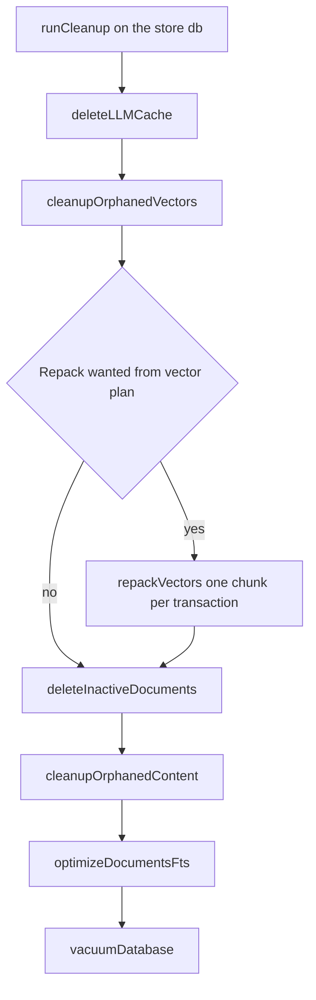
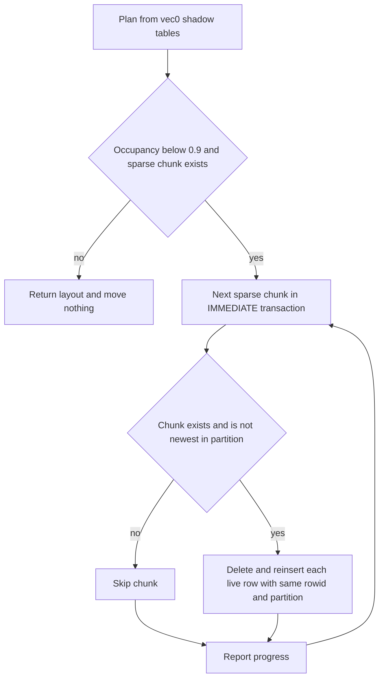
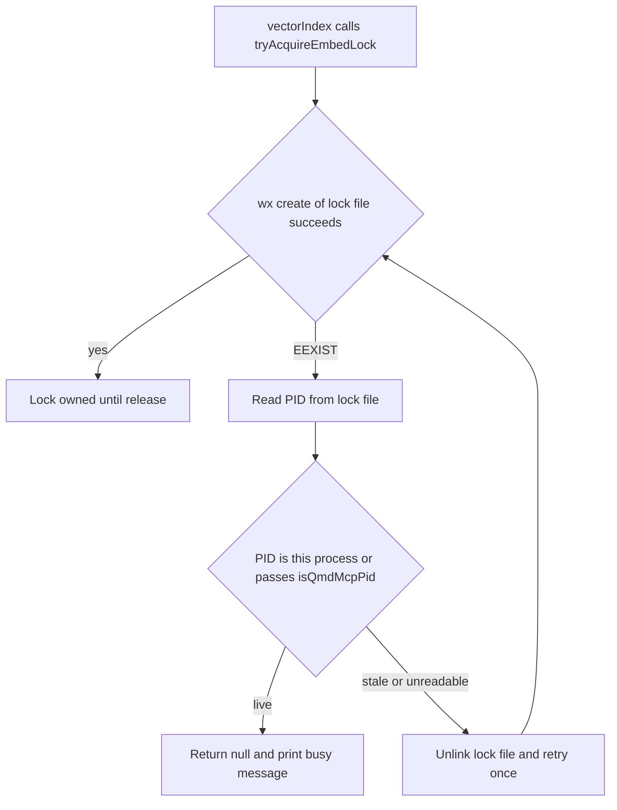

# Index Maintenance and Troubleshooting

This page is the operational runbook for keeping a QMD index healthy. It describes the housekeeping operations that `qmd cleanup` runs, the checks that `qmd doctor` performs, the lock and pidfile logic that prevents two processes from corrupting or misreporting state, and the environment variables that change GPU and parallelism behavior. The troubleshooting section is organized by symptom, and each entry names the code branch that produces the behavior.

For how documents become vectors in the first place, see [Indexing Pipeline](../architecture/indexing-pipeline.md). For table layouts, see [Storage Schema](../architecture/storage-schema.md). For model loading and the LLM runtime, see [Models and LLM Runtime](../concepts/models-and-llm-runtime.md). For the HTTP transport that the MCP daemon exposes, see [HTTP API and Origin Guard](../integrations/http-api-and-origin-guard.md). For flag syntax, see [CLI Reference](./cli-reference.md).

## Maintenance surface

The `Maintenance` class wraps the low-level store operations the CLI needs. It holds a `Store` and exposes one method per housekeeping action: `vacuum`, `cleanupOrphanedContent`, `cleanupOrphanedVectors`, `clearLLMCache`, `deleteInactiveDocs`, `clearEmbeddings`, `optimizeFts`, `vectorLayout`, `repackVectors`, `preview`, and `run` ([maintenance.ts](../../src/maintenance.ts#L19-L90)). `run()` delegates to `runCleanup`, and `preview()` delegates to `previewCleanup`, so both paths share one implementation with the CLI.

The CLI entry point is `qmd cleanup`, with an optional `--dry-run` ([qmd.ts](../../src/cli/qmd.ts#L5235-L5301)):

- With `--dry-run`, the command calls `previewCleanup`, prints "Dry run — no changes made", and reports what would be removed or repacked.
- Without it, the command calls `runCleanup` and passes an `onVectorRepack` hook that prints a progress line before the repack starts.

## Cleanup sequence and CleanupStats

`runCleanup` is the full housekeeping sequence ([store.ts](../../src/store.ts#L3464-L3476)). Its order matters because each step depends on the previous one:

Caption: the order of `runCleanup`. Orphaned vectors go before the repack plan is read, and inactive document rows go before orphaned content, so content pinned only by tombstones is freed in the same run.

The sequence runs in this order:

1. Clear the whole `llm_cache` table.
2. Remove orphaned vectors (see below).
3. Build a vector repack plan. If a repack is wanted, call the `onVectorRepack` hook and run `repackVectors`.
4. Hard-delete inactive document rows (`active = 0`).
5. Delete content rows that no document references.
6. Run FTS5 `optimize`.
7. Run `VACUUM`.

`CleanupStats` is the result type returned by both `runCleanup` and `previewCleanup` ([store.ts](../../src/store.ts#L3433-L3442)). It has these fields:

| Field | Meaning |
| --- | --- |
| `cacheCount` | Number of `llm_cache` rows cleared (or that would be cleared). |
| `orphanedVectors` | Number of orphaned embedding chunks removed (or counted). |
| `inactiveDocs` | Number of inactive document rows deleted (or counted). |
| `orphanedContent` | Number of content hashes deleted (or counted). |
| `vectorLayout` | Chunk layout of the vector table before any repack, or `null` without a vector table. |
| `vectorsRepacked` | `true` when the table was repacked, or would be repacked in a preview. |

`previewCleanup` reads the same counts without writing ([store.ts](../../src/store.ts#L3445-L3452)). Its vector plan is built with `dropOrphans = true`, so the preview's `vectorsRepacked` reflects the table as it will look after orphan removal, not the table as it looks now.

### What each operation removes

- **LLM cache.** `deleteLLMCache` runs `DELETE FROM llm_cache` with no age filter ([store.ts](../../src/store.ts#L3147-L3150)). Writes also trim the table: `setCachedResult` runs a trim with about 1% probability, keeping the 1000 newest rows ([store.ts](../../src/store.ts#L3126-L3133)). Between trims the table can hold more than 1000 rows.
- **Orphaned vectors.** `cleanupOrphanedVectors` returns 0 without doing anything when sqlite-vec is not loaded, or when the vector layout is not a readable partitioned table ([store.ts](../../src/store.ts#L3216-L3223)). Otherwise it runs one `BEGIN IMMEDIATE` transaction. The transaction deletes vec rows whose `(hash, collection)` has no active document, then deletes `content_vectors` rows whose hash no active document references ([store.ts](../../src/store.ts#L3228-L3262)). The comment in the source explains why both deletes share one transaction: a crash between them would leave `content_vectors` claiming chunks that no longer exist, and a revived hash would then be skipped by embedding and stay unsearchable.
- **Inactive documents.** `deleteInactiveDocuments` runs `DELETE FROM documents WHERE active = 0` ([store.ts](../../src/store.ts#L3156-L3159)).
- **Orphaned content.** `cleanupOrphanedContent` deletes content rows that no document references. Inactive documents still count as references until step 4 removes them ([store.ts](../../src/store.ts#L3163-L3170)). That ordering is what lets a single cleanup reclaim content pinned only by tombstones.
- **FTS and vacuum.** `optimizeDocumentsFts` runs FTS5's `optimize` command. It ignores the error only when the FTS table is missing ([store.ts](../../src/store.ts#L3423-L3431)). `vacuumDatabase` runs `VACUUM` ([store.ts](../../src/store.ts#L3415-L3417)). VACUUM alone does not compact FTS5, which is why the FTS optimize step exists.

## Vector table repack

The vector table is a partitioned sqlite-vec `vec0` table. Its chunks are shadow-table entries, and a chunk is reclaimed only when it becomes completely empty. Deleting rows in older chunks leaves holes that every brute-force scan still reads. The source records a measurement from the comment on the constants: at 36% occupancy, a scan took about twice as long as on a packed copy of the same rows ([store.ts](../../src/store.ts#L3262-L3273)).

**When repack runs.** The plan is built from the shadow tables ([store.ts](../../src/store.ts#L3303-L3344)). Occupancy is the number of chunks a freshly packed table would need, divided by the number of chunks that exist. Each partition's newest chunk is where its rows land, so it is not a candidate to move. A repack is wanted when two conditions hold ([store.ts](../../src/store.ts#L3350-L3353)):

- Occupancy is below `VEC_REPACK_BELOW_OCCUPANCY`, which is 0.9.
- At least one non-newest chunk is filled below `VEC_REPACK_CHUNK_FILL`, which is also 0.9.

**How repack moves rows.** `repackVectors` walks the sparse chunks in order ([store.ts](../../src/store.ts#L3379-L3407)). For each one it opens a `BEGIN IMMEDIATE` transaction and:

1. Reads the chunk again under the write lock. The plan can be stale, so the chunk may have been emptied, become the newest chunk in its partition, or have lost a row. If so, it is skipped.
2. For each live slot, reads the embedding by rowid, deletes the row, and inserts it again with the same rowid and partition.
3. Calls the optional progress callback.

Because each chunk is its own transaction, the write lock is held for at most one chunk of rows. Concurrent embed and update runs can interleave. An interrupted repack leaves a consistent table, and the next cleanup finishes the job.

Caption: the repack loop. Each chunk is re-validated under its own write transaction before any row moves.

The repack tests check two things. Surviving vectors keep their bytes, and the doctor's stored-vector check still passes after repack ([cleanup-repack-partitions.test.ts](../../test/cleanup-repack-partitions.test.ts#L1-L40)). A separate test seeds 1100 vectors and keeps rows 0, 1, and 1099 to produce two chunks with holes ([cleanup.test.ts](../../test/cleanup.test.ts#L100-L150)).

## Doctor checks

`qmd doctor` is implemented by `showDoctor` ([qmd.ts](../../src/cli/qmd.ts#L4441-L4560)). It prints a list of named checks and then a "Recommended next step" list built from the failed checks. The checks that matter for index health are:

- **embedding freshness** counts active documents that still need embeddings for the current model. It fails and recommends `qmd embed` when that count is above zero ([qmd.ts](../../src/cli/qmd.ts#L4490)).
- **embedding fingerprints** checks that `content_vectors` rows use the current model fingerprint. Legacy or stale fingerprints fail the check, and a mix of named fingerprints fails it with a hint to run `qmd embed --force` if old fingerprints remain ([qmd.ts](../../src/cli/qmd.ts#L4497-L4530)).
- **embedding vector sample** calls `checkEmbeddingVectorSamples` and recommends `qmd embed --force` if it fails ([qmd.ts](../../src/cli/qmd.ts#L4540-L4547)).

`checkEmbeddingVectorSamples` is the expensive check ([qmd.ts](../../src/cli/qmd.ts#L4245-L4315)). Its branches are:

- No active documents: returns ok with "no active documents indexed".
- No vector index: fails with "please run qmd embed again".
- No current embedded chunks for the model and fingerprint: fails with "please run qmd embed again".
- Otherwise it samples up to `sampleSize` rows, which defaults to 3. For each sample it re-chunks the stored document, finds the chunk whose `pos` matches the stored `pos`, re-embeds that passage, and compares the result with the stored vector using cosine distance against a threshold of 0.0001. The match is on `pos` rather than `seq`, because earlier chunks can split differently after a tokenizer or chunker change, which would shift sequence numbers.
- Any mismatch fails with the count of differing samples and the first mismatch, and recommends `qmd embed --force`.

The sampling check needs a loadable embedding model, because it runs inside `withLLMSession`. It is covered by [doctor-vector-sampling.test.ts](../../test/doctor-vector-sampling.test.ts#L1-L60).

The device checks run in `runDoctorDeviceChecks` ([qmd.ts](../../src/cli/qmd.ts#L4363-L4440)). `QMD_DOCTOR_DEVICE_PROBE` set to `0`, `false`, `off`, `no`, or `skip` skips the native GPU probe and reports the skip ([qmd.ts](../../src/cli/qmd.ts#L4368-L4371)). Before a probe starts, the command prints a hint that a crash during the probe can be avoided with `QMD_FORCE_CPU=1 qmd doctor` ([qmd.ts](../../src/cli/qmd.ts#L4374)).

## Embed lock

Concurrent embed runs against one index can race on `vector_rows`, which has a UNIQUE constraint on `(hash, seq, collection_id)`. The embed lock is a process-level exclusive file lock that prevents that race ([embed-lock.ts](../../src/cli/embed-lock.ts#L1-L9)).

**Where the lock lives.** `embedLockPathForDb` puts `.qmd-embed.lock` in the same directory as the index database ([embed-lock.ts](../../src/cli/embed-lock.ts#L21-L23)). `vectorIndex` acquires the lock before doing any embedding work ([qmd.ts](../../src/cli/qmd.ts#L2398-L2404)). It is the only caller of `tryAcquireEmbedLock` in the source. Cleanup and update do not take this lock. When the lock is busy, `vectorIndex` prints `EMBED_LOCK_BUSY_MESSAGE` ("Another embed process is already running. Skipping."), closes the database, and returns. That is a normal return, not an error exit.

**How acquisition works.** The lock file contains the owner's PID. `createOwnedLock` creates it with the `wx` flag, so creation fails if the file exists ([embed-lock.ts](../../src/cli/embed-lock.ts#L44-L58)). `tryAcquireEmbedLock` makes at most two attempts ([embed-lock.ts](../../src/cli/embed-lock.ts#L66-L97)):

1. Try to create the lock file. On success, return a handle.
2. On `EEXIST`, read the PID in the file. If `isLiveEmbedLockHolder` says the PID is live, return `null` (busy).
3. Otherwise the file is stale, unreadable, or belongs to a recycled PID. Unlink it and retry once.
4. If the retry also fails with `EEXIST`, return `null`, even when the holder turned out to be stale. A rare race can therefore report busy once. Running the command again clears it.

**How stale detection works.** `isLiveEmbedLockHolder` returns `true` for the current process. For any other PID, it returns the result of `isQmdMcpPid` ([embed-lock.ts](../../src/cli/embed-lock.ts#L36-L42)). So a PID counts as a live holder only if the process exists and its command line looks like a qmd invocation. A dead PID, a non-qmd process reusing the PID, an unreadable file, and a file with a non-positive PID are all treated as stale. `readLockPid` returns `null` for those last cases ([embed-lock.ts](../../src/cli/embed-lock.ts#L25-L34)).

**Release.** `release` unlinks the lock file only if it still contains this process's PID, and calling it twice is safe ([embed-lock.ts](../../src/cli/embed-lock.ts#L46-L57)). This protects a lock that another process has since taken over.

Caption: embed lock acquisition. The retry loop runs at most twice, as described above.

The embed-lock tests cover the busy path, a cross-process holder that has a qmd-like command line, replacement of a stale lock from a dead PID, and idempotent release that does not unlink a file owned by someone else ([embed-lock.test.ts](../../test/embed-lock.test.ts#L1-L156)).

## MCP daemon PID handling

The MCP HTTP daemon records its PID in a pidfile under the qmd cache directory. The cache directory is `$XDG_CACHE_HOME/qmd` when that variable is set, and `~/.cache/qmd` otherwise ([qmd.ts](../../src/cli/qmd.ts#L229-L238)).

**File names.** `mcpDaemonStateFiles` returns `mcp.pid` and `mcp.log` for the default index, for compatibility. A named index gets `mcp-<name>.pid` and `mcp-<name>.log`, so a named daemon can run beside the default one ([mcp-pid.ts](../../src/cli/mcp-pid.ts#L17-L24)). The file name is chosen from the active index, so `qmd mcp stop` must be run with the same `--index` that started the daemon.

**Identity check.** Pidfiles alone are unsafe after PID reuse, for example after a reboot. `isQmdMcpPid` therefore requires three things ([mcp-pid.ts](../../src/cli/mcp-pid.ts#L74-L86)):

1. The PID is a positive integer.
2. `process.kill(pid, 0)` succeeds, which means the process exists.
3. Its command line matches `looksLikeQmdMcpCommand`.

`looksLikeQmdMcpCommand` matches a bare `qmd` token, optionally with a `.ts` or `.js` extension, or a path ending in `/qmd`. It does not match `qmd` inside a longer word such as `myqmdtool` ([mcp-pid.ts](../../src/cli/mcp-pid.ts#L26-L31)). The command line is read from `/proc/<pid>/cmdline` when available, with a `ps` fallback.

**Where the check is applied.**

- `qmd status` checks the MCP pidfile. If the PID is live, it prints the daemon as running. Otherwise it removes the pidfile silently ([qmd.ts](../../src/cli/qmd.ts#L562-L571)).
- `qmd mcp stop` handles three cases ([qmd.ts](../../src/cli/qmd.ts#L5073-L5095)). With no pidfile, it prints "Not running". If the recorded PID fails the identity check, it removes the stale file and reports the cleanup. Otherwise it sends `SIGTERM` and removes the pidfile right after the signal is sent. It does not wait for the daemon to exit.
- Starting a daemon with `--daemon` refuses to start when the recorded PID passes the identity check. Otherwise it removes the stale file and continues ([qmd.ts](../../src/cli/qmd.ts#L5106-L5117)). The detached child gets an explicit `INDEX_PATH`, and the parent writes the child's PID to the pidfile ([qmd.ts](../../src/cli/qmd.ts#L5138)).
- A foreground HTTP server registers an exit handler that removes the pidfile only if it still contains this process's PID ([qmd.ts](../../src/cli/qmd.ts#L5146-L5157)).

**Shutdown.** The MCP server handles `SIGTERM` and `SIGINT` the same way. It closes the MCP handler, then the HTTP server, then the store, and exits with code 0 ([server.ts](../../src/mcp/server.ts#L1434-L1446)). If one of those steps never finishes, the process stays alive.

The MCP pid tests cover command-line matching, rejection of unrelated processes, dead PIDs, and the named-index file names ([mcp-pid.test.ts](../../test/mcp-pid.test.ts#L1-L69)).

## Environment variables that affect GPU and parallelism

These variables are read in `llm.ts`. The README documents their defaults ([README.md](../../README.md#L1436-L1438)). The table below restates those defaults and gives the parsing rules from code.

| Variable | Default | Effect and parsing |
| --- | --- | --- |
| `QMD_LLAMA_GPU` | `auto` | Selects the llama.cpp GPU backend. Blank means `auto`. `false`, `off`, `none`, `disable`, `disabled`, and `0` disable GPU. `metal`, `vulkan`, and `cuda` pass through. Any other value prints a warning and falls back to `auto`. |
| `QMD_FORCE_CPU` | unset | Any non-empty value other than the disabling words forces CPU mode. It takes precedence over `QMD_LLAMA_GPU`. The CLI flag `--no-gpu` is equivalent. |
| `QMD_EMBED_PARALLELISM` | automatic | Overrides the number of parallel embedding and reranking contexts. The value is trimmed and must be an integer of at least 1. Invalid values print a warning and are ignored. Values above 8 are capped at 8. |
| `QMD_DOCTOR_DEVICE_PROBE` | unset | `0`, `false`, `off`, `no`, or `skip` skips the native device probe in `qmd doctor`. |

**GPU mode resolution.** `resolveLlamaGpuMode` checks `QMD_FORCE_CPU` first. If it is set to anything other than a disabling word, the result is CPU (`false`). Otherwise it parses `QMD_LLAMA_GPU` ([llm.ts](../../src/llm.ts#L754-L770)). `isCpuModeRequested` is true when the result is `false` ([llm.ts](../../src/llm.ts#L827-L829)). The README says `QMD_FORCE_CPU` should be set to `1` or `true`. The code accepts any non-disabling value, so the README wording is narrower than the behavior.

**Parallelism bounds.** `resolveParallelismOverride` rejects non-integers and values below 1 with a warning and returns `undefined`. It returns `Math.min(8, parsed)` otherwise, so the usable range is 1 to 8 ([llm.ts](../../src/llm.ts#L671-L681)).

**Automatic parallelism.** `resolveSafeParallelism` applies the override first. Without one, Windows with CUDA returns 1. Other cases return `max(1, computed)` ([llm.ts](../../src/llm.ts#L684-L698)). The Windows CUDA rule exists because parallel CUDA contexts can crash with `ggml-cuda.cu:98`. The README documents the same default ([README.md](../../README.md#L1438)).

`computeParallelism` supplies the computed value ([llm.ts](../../src/llm.ts#L1173-L1192)). On a GPU, it sizes the pool from free VRAM. On CPU, it uses `min(4, floor(cores / 4))`, with a floor of 1 ([llm.ts](../../src/llm.ts#L1186-L1190)). The tests cover the override clamp and warning, and the Windows CUDA default ([llm.test.ts](../../test/llm.test.ts#L339-L360) and [llm.test.ts](../../test/llm.test.ts#L567-L583)).

## Troubleshooting by symptom

Each entry gives the symptom, the branch in code that produces it, and the action to take.

### Stale or missing embeddings

- **Symptom:** `qmd status` reports pending documents, or `qmd doctor` fails "embedding freshness".
  **Branch:** `getHashesNeedingEmbedding` counts active documents without a current embedding ([qmd.ts](../../src/cli/qmd.ts#L4490)).
  **Action:** run `qmd embed`. It returns early with "All content hashes already have embeddings" when there is no work and `--force` is not set ([qmd.ts](../../src/cli/qmd.ts#L2406-L2411)).

- **Symptom:** `qmd doctor` fails "embedding fingerprints", or reports legacy or mixed named fingerprints.
  **Branch:** the fingerprint check compares every `content_vectors` group against the current model fingerprint ([qmd.ts](../../src/cli/qmd.ts#L4497-L4530)).
  **Action:** run `qmd embed`. Use `qmd embed --force` if old fingerprints remain afterward.

- **Symptom:** "embedding vector sample" fails with "stored vector distance" or "chunk no longer exists", or with "no vector table" or "no current embedded chunks".
  **Branch:** `checkEmbeddingVectorSamples` re-embeds sampled passages and compares them with stored vectors ([qmd.ts](../../src/cli/qmd.ts#L4245-L4315)).
  **Action:** run `qmd embed --force` to rebuild vectors that no longer reproduce under the current pipeline. For the missing-table and missing-chunk messages, run `qmd embed` first.

- **Symptom:** `qmd status` reports orphaned embedding chunks.
  **Branch:** `countOrphanedVectors` counts `content_vectors` rows whose hash has no active document. It works even without sqlite-vec ([store.ts](../../src/store.ts#L3182-L3198)).
  **Action:** run `qmd cleanup`, or `qmd cleanup --dry-run` first.

### Empty search after moving a folder

- **Symptom:** search returns nothing for files that moved to a new folder.
  **Branch:** during an update, every active path in the collection that was not seen on disk is deactivated. The update also deletes its sync state ([qmd.ts](../../src/cli/qmd.ts#L2236-L2246) and [store.ts](../../src/store.ts#L2070-L2078)). Deactivation removes the row from FTS but keeps the content until cleanup ([store.ts](../../src/store.ts#L3713-L3716)). Read paths that the index relies on filter to `d.active = 1` ([store.ts](../../src/store.ts#L1196)).
  **Interpretation:** the old paths are now inactive tombstones, so they no longer appear in search. The new paths only become searchable once an update has indexed them. If the collection path still points at the old folder, or the update has not run, the new location has no active documents and search is empty.
  **Action:** confirm the collection path, run `qmd update`, then run `qmd status` to check the document counts. Run `qmd embed` if pending documents remain. The update path also calls `copyVectorsToNewCollections` ([qmd.ts](../../src/cli/qmd.ts#L2249-L2250) and [store.ts](../../src/store.ts#L5160)), so content that moved with the same hash is not re-embedded if the vectors are already present.

- **Symptom:** the index keeps old paths after a wrong-directory update.
  **Branch:** tombstones are hard-deleted only by `deleteInactiveDocuments` in cleanup, and the content they pinned is freed by `cleanupOrphanedContent` in the same run ([store.ts](../../src/store.ts#L3156-L3170)).
  **Action:** run `qmd cleanup` to remove the tombstones and reclaim their content. This is permanent for the inactive rows.

### LLM cache issues

- **Symptom:** query expansion or reranking returns stale results, or the cache keeps growing.
  **Branch:** cached results are keyed by a SHA-256 of the URL and request body ([store.ts](../../src/store.ts#L3110-L3117)). Lookup returns the stored result without checking its age ([store.ts](../../src/store.ts#L3122-L3125)). Writes trim the table to the 1000 newest rows only about 1% of the time ([store.ts](../../src/store.ts#L3126-L3133)).
  **Action:** run `qmd cleanup`. It clears the entire cache, and `cacheCount` reports how many rows it removed. Use `qmd cleanup --dry-run` to see the count before clearing. `Maintenance.clearLLMCache` performs only this step.

### Lock held by another embed

- **Symptom:** `qmd embed` prints "Another embed process is already running. Skipping." and does nothing.
  **Branch:** the lock file exists and its PID passes `isLiveEmbedLockHolder`, which means the process exists and its command line looks like qmd ([embed-lock.ts](../../src/cli/embed-lock.ts#L36-L42) and [qmd.ts](../../src/cli/qmd.ts#L2398-L2404)).
  **Action:** find the PID in `.qmd-embed.lock`, which sits next to the index database, and check it with `ps`. If it is a stuck `qmd embed`, stop that process and run the command again. If the PID is not a qmd process, the lock is stale and the next run removes it automatically.
  **Edge case:** if the PID was recycled to a running qmd process, such as an MCP daemon, the lock looks live until that process exits. The check is identity by command line, not by lock ownership.

### MCP daemon not stopping

- **Symptom:** `qmd mcp stop` reports that it stopped the server, but the process is still alive. Or `qmd status` no longer shows the daemon although it is still running.
  **Branch:** `stop` sends `SIGTERM` and removes the pidfile right after sending the signal, without waiting for exit ([qmd.ts](../../src/cli/qmd.ts#L5088-L5090)). The server's handler then awaits closing the MCP handler, the HTTP server, and the store before exiting ([server.ts](../../src/mcp/server.ts#L1434-L1446)). `qmd status` only reports a daemon whose pidfile is present and live ([qmd.ts](../../src/cli/qmd.ts#L562-L571)).
  **Action:** wait a moment and check whether the process is still running. If it is not exiting, find it with `ps` by its command line and the `mcp` argument, then stop it manually. Its log is at the path that `mcpDaemonPaths` derives, for a named index that is `mcp-<name>.log`. If the stop reports "Not running", the `--index` flag may not match the one used at start.

- **Symptom:** starting the daemon says it is already running.
  **Branch:** the start path refuses only when the recorded PID passes `isQmdMcpPid` ([qmd.ts](../../src/cli/qmd.ts#L5106-L5117)). Otherwise the stale file is removed.
  **Action:** run `qmd mcp stop`, then start again.

### GPU crash

- **Symptom:** a crash on Windows with CUDA during `qmd query` or `qmd embed`, which mentions `ggml-cuda.cu:98`.
  **Branch:** on Windows with CUDA and no `QMD_EMBED_PARALLELISM` override, parallelism is 1 ([llm.ts](../../src/llm.ts#L693-L695)).
  **Action:** keep the default. Raise `QMD_EMBED_PARALLELISM` only if your driver is stable, or use Vulkan. Setting `QMD_LLAMA_GPU=vulkan` or `QMD_LLAMA_GPU=cuda` selects a backend explicitly.

- **Symptom:** `qmd doctor` crashes during the device probe.
  **Branch:** the probe runs before any other doctor check. Its hint says to rerun with `QMD_FORCE_CPU=1 qmd doctor`, or with `QMD_DOCTOR_DEVICE_PROBE=0` to skip the probe ([qmd.ts](../../src/cli/qmd.ts#L4374)).
  **Action:** use one of those two commands to get the rest of the report.

- **Symptom:** a GPU backend throws during initialization, and the warning says "falling back to CPU".
  **Branch:** a GPU init error adds the mode to `failedGpuInitModes`, falls back to a CPU-compatible runtime, and prints a warning ([llm.ts](../../src/llm.ts#L1088-L1098)). The set is process-wide. Later loads in the same process skip the failed mode and print "skipping previously failed GPU init" ([llm.ts](../../src/llm.ts#L1054-L1060)). In `auto` mode, when detection picks CPU, the runtime also probes the other valid GPU backends without building them ([llm.ts](../../src/llm.ts#L1066-L1086)).
  **Action:** fix the driver or backend and run `qmd doctor`. To run on CPU deliberately, set `QMD_FORCE_CPU=1` or pass `--no-gpu`. The "no GPU acceleration, running on CPU (slow)" warning appears once per process when the runtime ends up on CPU ([llm.ts](../../src/llm.ts#L1103-L1108)).

- **Symptom:** a warning says the GPU backend was "skipped" or "invalid QMD_LLAMA_GPU".
  **Branch:** an unknown `QMD_LLAMA_GPU` value falls back to `auto` ([llm.ts](../../src/llm.ts#L768)).
  **Action:** set `QMD_LLAMA_GPU` to `metal`, `vulkan`, `cuda`, or `false`, or unset it.

## Tests that anchor this page

- [cleanup.test.ts](../../test/cleanup.test.ts#L1-L150): tombstone deactivation, `runCleanup` on inactive docs and orphaned content, and shared content kept while an active document references it.
- [cleanup-repack-partitions.test.ts](../../test/cleanup-repack-partitions.test.ts#L1-L40): repack keeps vector bytes and the doctor's stored-vector check passes afterward.
- [doctor-vector-sampling.test.ts](../../test/doctor-vector-sampling.test.ts#L1-L60): vector sampling follows the stored passage when earlier chunks shift sequence numbers.
- [embed-lock.test.ts](../../test/embed-lock.test.ts#L1-L156): busy path, cross-process holder, stale lock replacement, and safe release.
- [mcp-pid.test.ts](../../test/mcp-pid.test.ts#L1-L69): command-line identity, dead PIDs, and named-index file names.
- [llm.test.ts](../../test/llm.test.ts#L339-L583): GPU mode resolution, `QMD_FORCE_CPU` precedence, parallelism clamping, and the Windows CUDA default.
