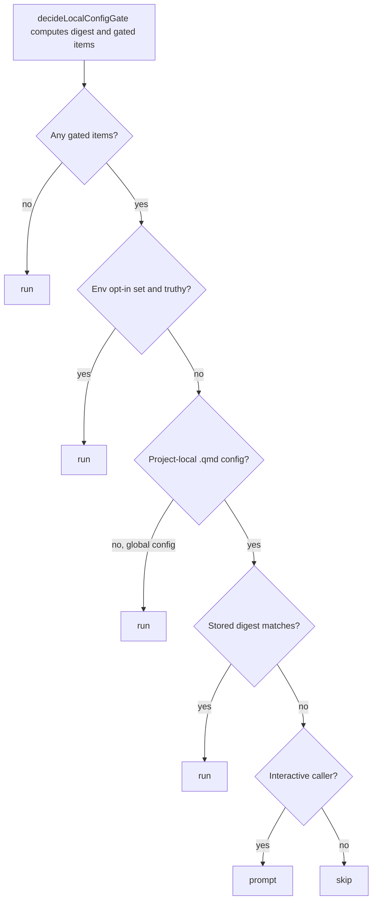

# Trust Gating for Checked-In .qmd Config

A project-local `.qmd/index.yml` (or `.yaml`) arrives with a `git clone`, and QMD adopts it automatically for any command run inside that tree. Three of its fields can reach outside the project, so QMD does not use them until the user approves them. This page covers which fields are gated, how the gate picks `run`, `prompt`, or `skip`, how approvals are stored and invalidated, and how the `qmd trust` subcommands fit in.

The gate logic lives in [src/trust.ts](../../src/trust.ts). The CLI wiring lives in [src/cli/qmd.ts](../../src/cli/qmd.ts). For the wider config model, see [Collections and config](../concepts/collections-and-config.md). For the update flow that calls the gate, see the [indexing pipeline](../architecture/indexing-pipeline.md).

## What is gated

Three kinds of field in the active YAML are gated:

- **Update hooks**: a collection's `update:` shell command, which `qmd update` runs with `bash -c`.
- **Out-of-project collection paths**: a collection `path` that, after `~` expansion, relative resolution, and symlink realpath, resolves outside the directory that contains `.qmd`.
- **Non-default model URIs**: `models.embed`, `models.rerank`, or `models.generate` set to anything other than the built-in default.

The module header states the boundary: the global config under `~/.config/qmd` is never gated, and in-project collection paths and built-in default model URIs need no approval ([src/trust.ts L1-L17](../../src/trust.ts#L1-L17)). The gated set is computed by `gatedItems`, which keeps hooks, keeps only paths that fail `isCollectionPathInsideProject`, and keeps only models that differ from the built-in defaults ([src/trust.ts L135-L159](../../src/trust.ts#L135-L159)).

A config counts as project-local only when its parent directory is named `.qmd`. `isLocalConfigPath` checks exactly that, and returns false for the `<inline>` sentinel ([src/trust.ts L82-L85](../../src/trust.ts#L82-L85)). The discovery walks upward from the working directory for `.qmd/index.yaml` and then `.qmd/index.yml` ([src/collections.ts L141-L155](../../src/collections.ts#L141-L155)).

## Where approvals are stored

Approvals are kept in `trusted.json` under the QMD config directory. `getTrustFilePath` returns `join(getConfigDir(), "trusted.json")` ([src/trust.ts L70-L72](../../src/trust.ts#L70-L72)). `getConfigDir` uses `QMD_CONFIG_DIR` if set, then `$XDG_CONFIG_HOME/qmd`, and otherwise `~/.config/qmd` ([src/collections.ts L119-L130](../../src/collections.ts#L119-L130)). The README's `~/.config/qmd/trusted.json` is the default location only.

The file is a JSON object keyed by the resolved absolute config path. Each record holds `hooks` (the digest that was approved) and `trustedAt` (an ISO timestamp) ([src/trust.ts L58-L65](../../src/trust.ts#L58-L65), [src/trust.ts L230-L245](../../src/trust.ts#L230-L245)). Two behaviours matter for operators:

- A missing, unparseable, or non-object file loads as an empty store. A corrupt file is never read as blanket trust ([src/trust.ts L209-L220](../../src/trust.ts#L209-L220)). The next approval rewrites the whole file.
- `isTrusted` is true only when the stored digest equals the digest computed now for the same config path ([src/trust.ts L234-L237](../../src/trust.ts#L234-L237)).

Note that the record field is named `hooks`, but for CLI approvals it stores the combined `sensitiveDigest`, not a hook-only digest. See the `decideHookGate` finding below.

## What the digest covers

An approval is bound to a digest of the gated set. Editing any gated item changes the digest, which re-arms the gate. The digest is built by `sensitiveDigest` ([src/trust.ts L191-L207](../../src/trust.ts#L191-L207)):

- `hooks`: pairs of `[collection, command]`, sorted by collection name.
- `paths`: pairs of `[collection, resolved absolute path]`, but only for paths that are outside the project. In-project paths are not part of the digest.
- `models`: pairs of `[slot, uri]` for non-default model URIs only.

The canonical form is JSON, hashed with SHA-256. Sorting makes the digest independent of YAML order. Leaving out in-project paths and default models means that `qmd init` filling defaults into the YAML does not invalidate an approval. The hook-only helper `hookDigest` uses the same sorted-hash idea over `[collection, command]` pairs alone ([src/trust.ts L168-L189](../../src/trust.ts#L168-L189)).

In practice:

- Editing an update command re-arms the gate.
- A collection gaining a hook re-arms the gate.
- Pointing an approved collection at a different outside path re-arms the gate.
- Changing a custom model URI re-arms the gate.
- Moving an in-project path, or setting a model to the default, does not.

## Decision logic

`decideLocalConfigGate` returns `run`, `prompt`, or `skip`, together with the digest. It checks the conditions in order.

Caption: the order of checks in `decideLocalConfigGate`. The CLI passes `isInteractive` as true only when both stdin and stdout are TTYs.

The steps map to source as follows:

1. **No gated items.** `hasGatedItems` is false, so the result is `run` ([src/trust.ts L325](../../src/trust.ts#L325)).
2. **Env opt-in.** `isLocalConfigTrustOptedIn` returns true when `QMD_TRUST_LOCAL_CONFIG` or `QMD_TRUST_UPDATE_HOOKS` is truthy. The result is `run` ([src/trust.ts L326](../../src/trust.ts#L326), [src/trust.ts L272-L274](../../src/trust.ts#L272-L274)).
3. **Not a local config.** A global config is never gated, so the result is `run` ([src/trust.ts L327](../../src/trust.ts#L327)).
4. **Trusted.** The `trustedCheck` (default `isTrusted`) matches the current digest, so the result is `run` ([src/trust.ts L329-L330](../../src/trust.ts#L329-L330)).
5. **Otherwise.** The result is `prompt` when `isInteractive` is true, and `skip` when it is false ([src/trust.ts L332](../../src/trust.ts#L332)).

Two details matter. The env check runs before the local-config check, so the env vars also short-circuit gating for any config that is not project-local. The env opt-in is read by `isTruthyEnv`, which returns false for an unset value, an empty string, or any of `0`, `false`, `off`, `no`, or `none`, compared after trimming and lowercasing. Any other non-empty value counts as truthy, including `1`, `true`, and `yes` ([src/trust.ts L266-L268](../../src/trust.ts#L266-L268)). The tests check the empty string and the falsy words as not opting in ([test/update-hook-trust.test.ts L195-L205](../../test/update-hook-trust.test.ts#L195-L205)).

### How the CLI acts on the decision

`resolveLocalConfigTrust` is the CLI wrapper ([src/cli/qmd.ts L831-L863](../../src/cli/qmd.ts#L831-L863)). It builds the snapshot, returns `true` if nothing is gated, and otherwise calls `decideLocalConfigGate` with `isInteractive` set from the TTY check. The branches are:

- `run`: returns `true` silently.
- `skip`: prints the gated items, says that the config was not trusted by default, says that indexing of the project continues, and suggests `qmd trust` or `QMD_TRUST_LOCAL_CONFIG=1`. Returns `false`.
- `prompt`: prints the gated items and asks `Trust this project's .qmd config? [y/N]`. A `y` or `yes` answer records trust under the decision's digest and returns `true`. Any other answer returns `false`.

The gate never fails the command. In a skip, the result is a boolean that tells callers which fields to ignore, and the run continues.

## What an untrusted run does

The boolean returned by `resolveLocalConfigTrust` is consumed differently by each command.

### qmd update

`updateCollections` calls the wrapper before it opens the store, so an approval granted at the prompt is already visible to `getStore` ([src/cli/qmd.ts L921-L923](../../src/cli/qmd.ts#L921-L923)). The single boolean is stored as `hooksAllowed` and governs both checks in the loop ([src/cli/qmd.ts L943](../../src/cli/qmd.ts#L943)):

- **Out-of-project paths are skipped.** When `hooksAllowed` is false, the config is local, and the collection's path is outside the project, the loop prints `Skipping collection '<name>'`, tells the user to approve with `qmd trust`, and continues to the next collection. Indexing of in-project collections carries on ([src/cli/qmd.ts L956-L960](../../src/cli/qmd.ts#L956-L960)). Because the boolean covers the whole gated set, an untrusted hook or model also causes outside paths to be skipped.
- **Update commands do not run.** The hook block requires `hooksAllowed` as well as a non-empty `update` value ([src/cli/qmd.ts L961](../../src/cli/qmd.ts#L961)). When allowed, the command runs under `bash -c` in the collection's directory. Non-zero exit prints a failure line and calls `process.exit` with that code, which aborts the whole update ([src/cli/qmd.ts L961-L993](../../src/cli/qmd.ts#L961-L993)).

Skipped hooks produce no per-collection message in the loop. The only notice is the upfront one from the wrapper.

### Models

Gated model URIs are handled separately. `localConfigIsFullyTrusted` returns true if the config is not local, opted in by env, has no gated items, or matches the stored digest ([src/cli/qmd.ts L775-L783](../../src/cli/qmd.ts#L775-L783)). When it is false:

- `getStore` builds the LLM runtime from `resolveModels()` instead of the YAML values ([src/cli/qmd.ts L182](../../src/cli/qmd.ts#L182)).
- `resolveModelsForRuntime` returns the defaults or env-derived models, not the configured ones ([src/cli/qmd.ts L2384-L2388](../../src/cli/qmd.ts#L2384-L2388)).

The status display still shows the YAML values, as the comment at the `getStore` call notes.

### embed, pull, vsearch, and query

`embed`, `pull`, `vsearch`, and `query` call `resolveLocalConfigTrust()` and do not use its return value ([src/cli/qmd.ts L4963](../../src/cli/qmd.ts#L4963), [src/cli/qmd.ts L4987](../../src/cli/qmd.ts#L4987), [src/cli/qmd.ts L5029](../../src/cli/qmd.ts#L5029), [src/cli/qmd.ts L5040](../../src/cli/qmd.ts#L5040)). Their gating effect comes from the model fallback above. The prompt still happens on a terminal, and a `y` answer still writes the approval.

## Managing approvals

`manageTrust` implements `qmd trust` and its subcommands ([src/cli/qmd.ts L869-L919](../../src/cli/qmd.ts#L869-L919)):

- **`qmd trust`** (no subcommand). For a project-local config with gated items, it prints the items and records approval for the current digest. It does not prompt, so an explicit command is itself the approval. If there is no project-local config or no gated items, it prints a message and writes nothing.
- **`qmd trust list`.** Prints each record's path and `trustedAt`, or `No trusted project configs.`
- **`qmd trust revoke`.** Removes the record for the config in scope and reports whether one existed. Outside a project-local config, it explains that the user's own config is never gated.
- **Any other argument.** Prints a usage line and exits with status 1.

Approvals are also written as a side effect of two other commands. `collectionAdd` calls `trustCurrentConfig()` after it adds a collection ([src/cli/qmd.ts L1914](../../src/cli/qmd.ts#L1914)), and `collection update-cmd` calls it after it sets an update command ([src/cli/qmd.ts L4830](../../src/cli/qmd.ts#L4830)). `trustCurrentConfig` records the digest of the whole current gated set, not only the item just added ([src/cli/qmd.ts L786-L790](../../src/cli/qmd.ts#L786-L790)). This means that running either command also approves any other unapproved hook, outside path, or custom model already present in the YAML. Operators who review a checked-in config should keep that in mind.

## Finding: decideHookGate is not used by the CLI

`decideHookGate` exists in [src/trust.ts L283-L303](../../src/trust.ts#L283-L303). It has the same contract as the combined gate, `run`, `prompt`, or `skip`, but covers only hooks. Its digest is `hookDigest`, the hook-only digest, not `sensitiveDigest`.

A search of the repository found no production caller. The CLI calls only `decideLocalConfigGate`, at [src/cli/qmd.ts L837](../../src/cli/qmd.ts#L837). The only references to `decideHookGate` are in [test/update-hook-trust.test.ts](../../test/update-hook-trust.test.ts), inside the `describe("decideHookGate")` block starting at line 135.

Two consequences follow for anyone who changes this code:

- The live update flow does not use `decideHookGate`. Changes to hook gating must go through `decideLocalConfigGate`, or the CLI will not reflect them.
- If `decideHookGate` were wired in as written, its `hookDigest` would not match the `sensitiveDigest` stored by CLI approvals. It would never see an existing approval, and it would not cover paths or models.

The [design decisions](../architecture/design-decisions.md) page records the same conclusion.

## Invariants and failure behaviour

- **Gated items require approval, but in-project indexing always continues.** A skip or declined prompt removes only the gated fields. It never stops indexing of in-project collections.
- **Non-interactive callers are never prompted.** The decision is `skip`, not an error, so agents, CI, and the MCP server get the same in-project behaviour.
- **Approval is keyed to path and digest.** A copy of a config at another path has no approval, and a changed gated set has no approval.
- **Corrupt trust state fails closed.** An unreadable `trusted.json` is treated as empty.
- **Env vars are a blanket opt-in.** `QMD_TRUST_LOCAL_CONFIG` and `QMD_TRUST_UPDATE_HOOKS` bypass the gate for every project-local config in the run. Set them only where the checked-in configs are known to be safe.

## Focused tests

- [test/update-hook-trust.test.ts](../../test/update-hook-trust.test.ts) covers the pure functions: digest stability across YAML order, digest changes for command edits and outside paths, in-project paths and defaults not changing the digest, `isTruthyEnv` edge cases, corrupt-file handling, and the `decideLocalConfigGate` and `decideHookGate` decision tables ([L84-L109](../../test/update-hook-trust.test.ts#L84-L109), [L184-L205](../../test/update-hook-trust.test.ts#L184-L205), [L271-L410](../../test/update-hook-trust.test.ts#L271-L410)).
- [test/update-hook-trust-cli.test.ts](../../test/update-hook-trust-cli.test.ts) covers `qmd update` end to end: a hook is not run unattended but in-project indexing proceeds, the hook runs after `qmd trust`, a changed command re-arms the gate, `qmd trust revoke` restores the gate, `QMD_TRUST_UPDATE_HOOKS=1` opts in, and `qmd trust list` reports the approval.
- [test/local-config-trust-cli.test.ts](../../test/local-config-trust-cli.test.ts) covers outside paths and custom models: an outside path is not indexed unattended, `qmd trust` approves it, rewriting the path re-arms the gate, a custom model is not treated as trusted while the project still indexes, and `QMD_TRUST_LOCAL_CONFIG=1` opts in.
- [test/local-config.test.ts](../../test/local-config.test.ts) covers local config discovery, which determines whether a config is gated at all.

## Related pages

- [CLI reference](./cli-reference.md) lists the `trust` command and the update and embed commands that call the gate.
- [Collections and config](../concepts/collections-and-config.md) describes the YAML fields and the global and local config locations.
- [Models and LLM runtime](../concepts/models-and-llm-runtime.md) describes how model URIs are resolved once the gate has decided.
- [Design decisions](../architecture/design-decisions.md) records the reasoning behind the skip-not-fail choice.
