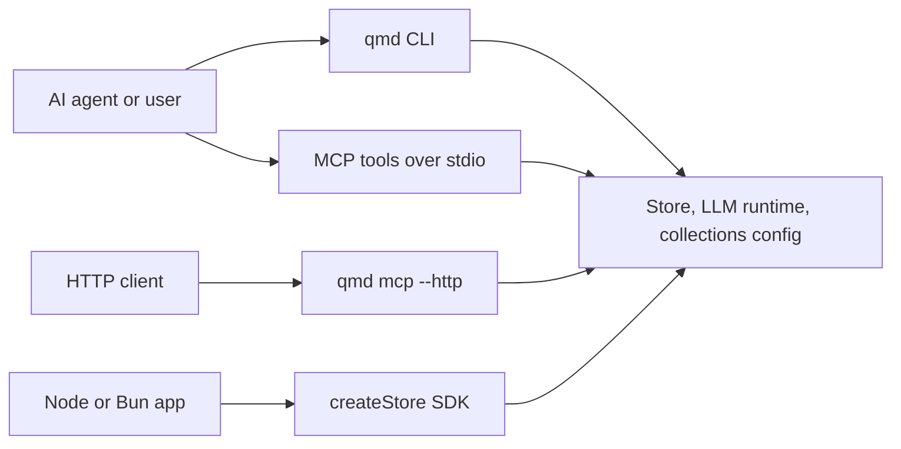

# QMD Wiki Quickstart

## What QMD is

QMD ("Query Markup Documents") is an on-device search engine for markdown. It indexes collections of files into a local SQLite database, then answers queries with three signals: BM25 full-text search, sqlite-vec vector search, and LLM reranking through node-llama-cpp with GGUF models ([README](repo://README.md#L1-L8)). The package is published as `@tobilu/qmd`, exposes a `qmd` binary, and requires Node 22 or later ([package.json](repo://package.json)).

A query runs through a BM25 probe, optional query expansion, type-routed FTS and vector searches, reciprocal rank fusion, and reranking. Typed sub-queries are routed by type: `lex` goes to BM25, while `vec` and `hyde` go to vector search. The original query is sent to both backends ([README](repo://README.md#L1-L8)). The full flow is documented in [Hybrid Query Pipeline](workflows/hybrid-query-pipeline.md).

## Surfaces

- **CLI.** `bin/qmd` is a Node launcher. It runs `dist/cli/qmd.js` for packaged installs and falls back to `src/cli/qmd.ts` in a git checkout ([bin/qmd](repo://bin/qmd#L1-L60)). The command switch in `src/cli/qmd.ts` dispatches `init`, `status`, `doctor`, `update`, `trust`, `embed`, `search`, `vsearch`, `query`, `mcp`, `cleanup`, and the collection and context groups ([src/cli/qmd.ts](repo://src/cli/qmd.ts#L4937-L4961)). Command details are in [CLI Command Reference](operations/cli-reference.md).
- **MCP.** `createMcpServer` registers five tools: `query`, `get`, `multi_get`, `status`, and `metadata` ([src/mcp/server.ts](repo://src/mcp/server.ts#L251-L251), [src/mcp/server.ts](repo://src/mcp/server.ts#L332-L333), [src/mcp/server.ts](repo://src/mcp/server.ts#L506-L507), [src/mcp/server.ts](repo://src/mcp/server.ts#L583-L584), [src/mcp/server.ts](repo://src/mcp/server.ts#L656-L657), [src/mcp/server.ts](repo://src/mcp/server.ts#L699-L700)). Stdio is the default launch mode through `serveStdio`. HTTP is started with `qmd mcp --http` and serves `POST /mcp`, `POST /query` (alias `/search`), `POST /metadata`, and `GET /health` ([README](repo://README.md#L1-L8), [src/mcp/server.ts](repo://src/mcp/server.ts#L1083-L1083)). Tool parameters are in [MCP Server and Tools](integrations/mcp-server.md). HTTP routes and origin checks are in [HTTP Transport and Origin Guard](integrations/http-api-and-origin-guard.md).
- **SDK.** `src/index.ts` is the library facade. Its header shows `createStore({ dbPath, config })` followed by `store.search(...)` and `store.close()` ([src/index.ts](repo://src/index.ts#L1-L16)). See [SDK / Library Usage](integrations/sdk-library.md).

## Configuration and state

- Collections, contexts, and model overrides live in `index.yml`. The user config directory is selected by `QMD_CONFIG_DIR`, then `XDG_CONFIG_HOME`, and the config is read from there ([src/collections.ts](repo://src/collections.ts#L120-L122), [src/cli/qmd.ts](repo://src/cli/qmd.ts#L4110-L4111)). The `update` field of a collection runs a shell command before re-indexing, and a non-zero exit aborts `qmd update` ([example-index.yml](repo://example-index.yml#L1-L60)). See [Collections and index.yml Configuration](concepts/collections-and-config.md).
- Editing `index.yml` does not re-index. Run `qmd update` after changing a path, pattern, or ignore list ([example-index.yml](repo://example-index.yml#L1-L60)).
- A project-local `.qmd` config is gated. Update hooks, collection paths outside the project, and non-default model URIs need an approval recorded in `trusted.json`. Non-interactive callers get `skip` for those gated items, and in-project indexing still proceeds ([src/trust.ts](repo://src/trust.ts#L1-L17), [src/trust.ts](repo://src/trust.ts#L313-L333)). Read [Trust Gating for Checked-In .qmd Config](operations/trust-gating.md) before changing this behaviour.
- The database is created by `createStore(dbPath?)`. When no path is given, it uses the default database path ([src/store.ts](repo://src/store.ts#L2615-L2626)).

## Task routing

| Task | Start here |
|------|------------|
| Understand the layers and how they connect | [System Overview](architecture/system-overview.md) |
| Find which source file owns a behaviour | [Source Map](architecture/source-map.md) |
| Install QMD, build from source, or run the bin launcher | [Installation, Requirements, and Build](operations/installation-and-build.md) |
| Configure collections, contexts, or model overrides | [Collections and index.yml Configuration](concepts/collections-and-config.md) |
| Index or update documents, or trace embedding generation | [Indexing and Update Pipeline](architecture/indexing-pipeline.md) |
| Change how documents are chunked | [Document Chunking](concepts/chunking.md) |
| Search from the CLI as an agent (choose `search`, `vsearch`, or `query`) | [Agent Retrieval Workflows](workflows/agent-retrieval.md) |
| Trace the hybrid query path end to end | [Hybrid Query Pipeline](workflows/hybrid-query-pipeline.md) |
| Change scoring, fusion, or reranker blending | [Score Normalization, RRF Fusion, and Blending](concepts/score-fusion-and-blending.md) |
| Add or change an MCP tool | [MCP Server and Tools](integrations/mcp-server.md) |
| Change the HTTP routes or origin and host checks | [HTTP Transport and Origin Guard](integrations/http-api-and-origin-guard.md) |
| Use QMD as a library from code | [SDK / Library Usage](integrations/sdk-library.md) |
| Debug a trust-gate `skip` or `prompt`, or manage approvals | [Trust Gating for Checked-In .qmd Config](operations/trust-gating.md) |
| Filter by frontmatter metadata | [Metadata Filtering and Discovery](concepts/metadata-filtering-and-discovery.md) |
| Check index health, clean up, or recover an embed lock | [Index Maintenance and Troubleshooting](operations/maintenance-and-troubleshooting.md) |
| Change model defaults or the LLM lifecycle | [Models and LLM Runtime](concepts/models-and-llm-runtime.md) |
| Change the SQLite schema or vector layout | [Storage Schema and Vector Layout](architecture/storage-schema.md) |
| Understand a non-obvious design choice | [Design Decisions and Repository Progression](architecture/design-decisions.md) |
| Run benchmarks | [Benchmarking (qmd bench)](operations/benchmarking.md) |
| Run tests or lint, or add a test | [Testing Strategy and Verification](testing/test-strategy.md) |

## Verification

The `test` script runs `scripts/test-all.mjs`. That script runs the TypeScript build typecheck, Vitest under Node, Bun tests with a preload file, and the package smoke check ([package.json](repo://package.json), [scripts/test-all.mjs](repo://scripts/test-all.mjs#L24-L38)). CI runs `oxlint` and Vitest on Node 22 and 23 across Ubuntu and macOS ([.github/workflows/ci.yml](repo://.github/workflows/ci.yml#L1-L50)). Pick the narrowest test file that covers the change, then run the full suite. The suite map is in [Testing Strategy and Verification](testing/test-strategy.md).
