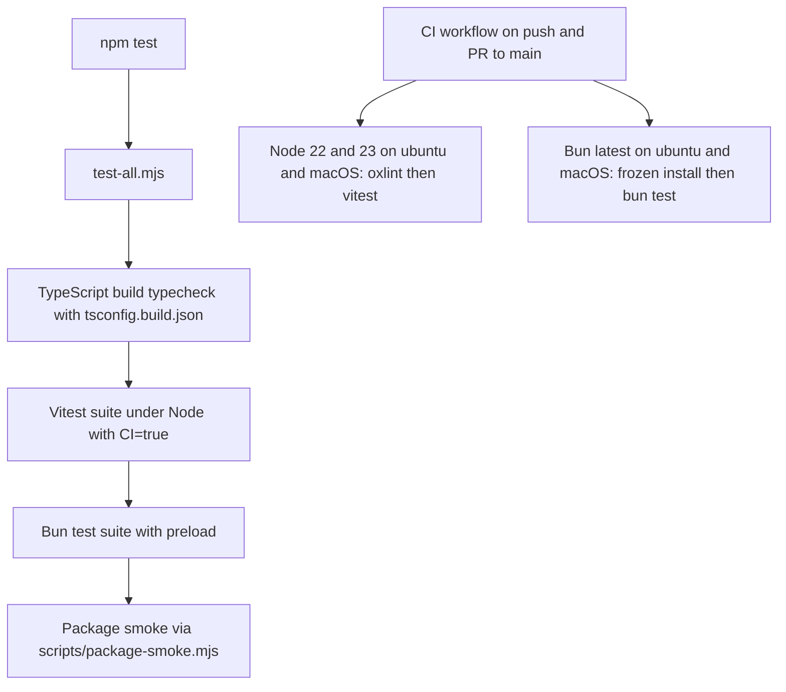

# Testing Strategy and Verification

QMD verifies itself with several layers that run on different triggers. Most behavioural coverage lives in Vitest and Bun test suites under `test/`. CI runs those suites on Node and Bun across ubuntu and macOS. The local aggregate task `npm test` adds a build-level type check and a packaged-artifact smoke check. A few shell scripts and a container smoke harness exist for launcher and install behaviour, but nothing in CI runs them. This page describes what each layer covers and what it does not.

For how the package is built and installed, see [Installation and Build](../operations/installation-and-build.md). For where the tested modules sit in the source tree, see [Source Map](../architecture/source-map.md).

## CI matrix

Two GitHub Actions workflows run on every push and pull request to `main`.

| Workflow and job | Runner matrix | Steps that verify behaviour |
|------------------|---------------|-----------------------------|
| `CI` / `test-node` | Node `22` and `23` on `ubuntu-latest` and `macos-latest` | `npm install`, then `npx oxlint`, then `npx vitest run --reporter=verbose --testTimeout 60000 test/` with `CI: true` |
| `CI` / `test-bun` | Bun `latest` on `ubuntu-latest` and `macos-latest` | `bun install --frozen-lockfile`, then `bun test --timeout 60000 --preload ./src/test-preload.ts test/` with `CI: true` |
| `Nix` / `build-flake` | `ubuntu-latest` and `macos-latest` | `nix build . --print-build-logs` with flakes enabled |

Evidence: the Node matrix and its Node versions are at [ci.yml](../../.github/workflows/ci.yml) lines 15-17. The lint and Vitest steps are at lines 36-42. The Bun matrix is at lines 49-50, the frozen-lockfile check at lines 67-68, and the Bun test command with preload and its `DYLD_LIBRARY_PATH` and `LD_LIBRARY_PATH` settings at lines 70-75. The Nix build is in [nix.yml](../../.github/workflows/nix.yml).

Both test jobs install SQLite first: `libsqlite3-dev` through apt on Linux and `sqlite` through Homebrew on macOS. Both jobs use `fail-fast: false`, so one failing cell does not cancel the others.

What CI does **not** run:

- The `tsc` build type check (`tsconfig.build.json`). It runs only in `npm test`.
- The package smoke check (`scripts/package-smoke.mjs`).
- The shell tests, such as `test/launcher-detection.test.sh`.
- The container install smoke, `test/smoke-install.sh`.

## Local aggregate: `npm test`

`npm test` runs `scripts/test-all.mjs`, which executes four labelled steps in order. The first failing step stops the run and exits with that step's status.

*The local aggregate runs four steps in sequence; CI runs the lint and test steps in separate matrix jobs and does not include the type build or the package smoke check.*

The steps are defined at [test-all.mjs](../../scripts/test-all.mjs) lines 35-38. Each step is spawned with `stdio: inherit`, and the Vitest and Bun steps add `CI: "true"` to their environment. The `package.json` scripts `test:types`, `test:node`, `test:bun`, `test:unit`, and `test:package` expose the same steps individually. `test:unit` chains the Vitest and Bun suites.

Because `oxlint` is not in `test-all.mjs`, linting is enforced only by the CI Node jobs and by the optional pre-push hook. Running `npm test` alone does not lint.

## Test-only guards

Tests must never write to the user's real index. Two mechanisms enforce this.

**`INDEX_PATH` requirement in `getDefaultDbPath`.** The function in [store.ts](../../src/store.ts) (lines 697-716) first returns `INDEX_PATH` if that environment variable is set. Otherwise, when production mode is not enabled, it throws with the message "Tests must set INDEX_PATH env var or use createStore() with explicit path". Only when production mode is on does it fall back to the XDG cache location. Production mode is turned on by `enableProductionMode()`, which the CLI and MCP entry points call. A unit test asserts both branches: the throw without `INDEX_PATH` and the override with it ([store.helpers.unit.test.ts](../../test/store.helpers.unit.test.ts), lines 56-78). Test files follow the pattern too. `eval.test.ts` sets `process.env.INDEX_PATH` to a temp file before importing the store, and `cli.test.ts` passes `INDEX_PATH` into each spawned CLI subprocess.

**Native-resource preload.** [test-preload.ts](../../src/test-preload.ts) registers a Bun `afterAll` hook that calls `disposeDefaultLlamaCpp()` once all test files finish (lines 21-24). Its header comment explains the reason: on darwin, llama.cpp's Metal residency destructor asserts at process exit unless it is disposed first. The same comment states that the `GGML_METAL_NO_RESIDENCY=1` mitigation must be set in the environment before Bun or Node starts, because Bun does not propagate `process.env` writes to the libc environment. The preload therefore cannot set it itself.

The environment variable is injected by the runner. In [test-all.mjs](../../scripts/test-all.mjs) lines 8-17, `GGML_METAL_NO_RESIDENCY=1` is added to every child process on darwin unless `QMD_METAL_KEEP_RESIDENCY=1` is set. Direct `bun test` invocations on darwin must set it manually, which the preload header points to `CLAUDE.md` for.

## Vitest configuration

[vitest.config.ts](../../vitest.config.ts) sets the following:

- `include: ["test/**/*.test.ts"]`. Only `*.test.ts` files are collected. Helpers under `test/_helpers/`, the eval scripts, and `.test-d.ts` files are not run as ordinary tests.
- `fileParallelism: false`. Test files run one at a time, which protects the shared SQLite and temp-directory fixtures.
- `testTimeout: 30000`. CI and `test-all.mjs` override this with `--testTimeout 60000` on the command line.
- `typecheck.enabled: true` with `include: ["test/**/*.test-d.ts"]` and `ignoreSourceErrors: true`. Type-level assertions run as part of the Vitest run. Source type errors are handled by the separate `tsc` build check.

Type-level tests are a distinct layer. [metadata-filter.test-d.ts](../../test/metadata-filter.test-d.ts) asserts at compile time that `MetadataFilter` and `MetadataMatch` share one predicate grammar. It also uses `@ts-expect-error` to lock in that a match cannot name a document's metadata key as a field, and cannot use set-level operators such as `exists` or `all`.

The build type check is separate. [tsconfig.build.json](../../tsconfig.build.json) includes only `src/**/*.ts` and excludes `*.test.ts`, `src/test-preload.ts`, and `src/bench-*.ts`. It checks the published build against Node's types only.

## Lint

Linting uses oxlint with [oxlint.config.ts](../../oxlint.config.ts). All built-in rule categories (correctness, suspicious, pedantic, perf, style, restriction, nursery) are turned off. The config instead enables a local `anti-slop` plugin. The enabled rules are an error-level set, which includes `anti-slop/no-module-mocking`, `no-chained-type-assertions`, `no-reflect-get`, `no-reflect-apply`, and `no-object-parameters`. Several noisier anti-slop rules are off, with a comment that SQLite row casts and CLI boundaries would produce too many hits. `skills/**` and the agent-tool directories are excluded.

Practical consequence for test authors: the `anti-slop/no-module-mocking` rule is an error, so module-level mocks will fail lint.

## Behaviour groups

Each group below names representative files only. Lists are not exhaustive.

| Group | What it protects | Representative files |
|-------|------------------|----------------------|
| Store and SQL | Document and content persistence, migrations, FTS, path handling, concurrency, and CJK full-text | `store.test.ts`, `store-migrations.test.ts`, `store-cjk-fts.test.ts`, `store-paths.test.ts`, `store-concurrency.test.ts`, `store.helpers.unit.test.ts`, `vec-layout.test.ts` |
| CLI | Command behaviour, exit lifecycle, lazy LLM import, and local config and hook trust from the command line | `cli.test.ts`, `cli-exit-lifecycle.test.ts`, `cli-lazy-llm-import.test.ts`, `local-config-trust-cli.test.ts`, `update-hook-trust-cli.test.ts` |
| MCP | Tools, resources, and prompts; HTTP origin guard; PID and stdio lifecycle | `mcp.test.ts`, `mcp-origin-guard.test.ts`, `mcp-pid.test.ts`, `mcp-stdio-lifecycle.test.ts` |
| SDK | The public `@tobilu/qmd` library API, tested with inline config and no YAML files | `sdk.test.ts` |
| Metadata | Predicate grammar, metadata persistence and reindex cascades, discovery, and output formatting | `metadata-store.test.ts`, `metadata-filter.test.ts`, `metadata-filter.test-d.ts`, `metadata-search.test.ts`, `metadata-cli.test.ts` |
| Trust | Project-local `update:` hooks and local config must not run unattended after a clone | `update-hook-trust.test.ts`, `local-config.test.ts` |
| Chunking | Break-point selection, AST-aware chunk boundaries, and code-fence handling | `ast.test.ts`, `ast-chunking.test.ts` |
| Search evaluation | Known-answer quality checks for BM25, vector, and hybrid RRF retrieval | `eval.test.ts`, `eval-bm25.test.ts` |
| Bench | Fail-fast checks for missing or empty collections, and scoring | `bench-guard.test.ts`, `bench-score.test.ts` |
| Packaging | Package scripts and file list, grammar dependencies, bin and version, and the Nix layout | `package.test.ts`, `build-script.test.ts`, `version.test.ts`, `esm-ambiguous-module.test.ts`, `bin-wrapper.test.ts` |

Some representative assertions worth knowing:

- The Trust group guards against remote-controlled shell execution. `update-hook-trust.test.ts` opens by stating that a `.qmd/index.yml` arrives with `git clone`, so its shell commands must not run just because someone ran `qmd update`.
- The MCP origin-guard tests cover DNS-rebinding protection for the HTTP transport. Predicate tests run everywhere. Live-server tests start `startMcpHttpServer` on an ephemeral port and send spoofed headers. See [MCP Server](../integrations/mcp-server.md).
- The Bench guard tests check that `assertBenchCollectionReady` throws for a missing collection, a collection with zero indexed documents, and an empty index with no collection name. See [Benchmarking](../operations/benchmarking.md).
- The packaging test checks that the `tree-sitter` grammar packages are required dependencies rather than optional ones, that the `test:*` scripts are wired as described above, and that the Nix `installPhase` copies `skills/` next to `src/`.

For the retrieval path that the search evaluation tests exercise, see [Hybrid Query Pipeline](../workflows/hybrid-query-pipeline.md).

## Packaging and launcher verification

[package-smoke.mjs](../../scripts/package-smoke.mjs) is the packaged-artifact check run by `npm test` and `test:package`. It runs the following in order:

1. `scripts/build.mjs`, then `scripts/check-package-grammars.mjs`.
2. Every `package.json` `files[]` entry must exist on disk.
3. Every `bin` entry must exist and be executable.
4. `dist/index.js`, `dist/index.d.ts`, and `dist/cli/qmd.js` must exist.
5. `dist/cli/qmd.js --help` under Node, `bin/qmd --help` through `sh`, and `bin/qmd --help` with `QMD_SOURCE_MODE=0` under Node.
6. The same compiled CLI and wrapper under Bun. Setting `QMD_SKIP_BUN_SMOKE=1` skips this step.

Note that step 6 does not run in CI's Bun job, which runs only `bun test`.

[launcher-detection.test.sh](../../test/launcher-detection.test.sh) tests the runtime choice that `bin/qmd` makes between Node and Bun. It is a bash script that creates lockfile combinations in a temp directory. Its ten cases check that `package-lock.json` takes priority over `bun.lock` and `bun.lockb`, that lockfiles at an install root are honoured for packages under `node_modules`, and that a layout with no lockfiles defaults to Node. The script does not call `bin/qmd`. It tests a copy of the detection logic, `detect_runtime`, that the script says it mirrors. Keep the copy in sync when `bin/qmd` changes. This script runs only when invoked directly (`bash test/launcher-detection.test.sh`). Neither CI nor `test-all.mjs` runs it.

[smoke-install.sh](../../test/smoke-install.sh) is a container-based install smoke harness. It builds the package, packs a tarball, copies the source and tests into a temp project, and builds an image from [Containerfile](../../test/Containerfile). The image is `debian:bookworm-slim`, with mise providing the latest Node and Bun, and it installs the tarball globally with both `npm` and `bun`. The script runs `node`, `npx`, and `bun` scenarios. It also accepts `--with-embed` and `--with-gpu` for opt-in embedding and GPU probes. It works with podman or docker. It is a manual tool documented in its usage header and is not referenced by any workflow.

## Evaluation harness

The `test/eval-*.ts` files are evaluation harness code, not ordinary Vitest suites. [eval.test.ts](../../test/eval.test.ts) is a Vitest suite that checks known-answer queries across three groups: BM25 lexical search, vector search, and hybrid reciprocal rank fusion. [eval-harness.ts](../../test/eval-harness.ts) is a standalone script with labelled queries of easy, medium, and hard difficulty. Its header says to run it with `bun test/eval-harness.ts`. It is excluded from the Vitest include pattern and is not referenced from `package.json`. The evaluation corpora and fixture contents are not described on this page.

## Gaps and caveats

- Lint runs in CI but not in `npm test`.
- The type build check and the package smoke run locally but not in CI.
- The shell launcher test and the container smoke harness are manual. Changes to `bin/qmd` are protected in CI only by `bin-wrapper.test.ts` and by the packaging test.
- The CI Bun job runs `bun test` directly on `test/` with the preload. Its workflow env sets only the SQLite library paths, not `GGML_METAL_NO_RESIDENCY`. The macOS residency workaround is applied by `test-all.mjs` for local runs, so it is not applied in the CI Bun job.
- The Vitest config default timeout is 30 seconds, but CI and `test-all.mjs` pass `--testTimeout 60000`, so the effective timeout in those runs is 60 seconds.

## Related pages

- [Installation and Build](../operations/installation-and-build.md) covers the build and install steps that the packaging tests verify.
- [Source Map](../architecture/source-map.md) maps the test files to the modules they cover.
- [MCP Server](../integrations/mcp-server.md) describes the transports and guards covered by the MCP tests.
- [Benchmarking](../operations/benchmarking.md) describes the bench harness and its guards.
- [Hybrid Query Pipeline](../workflows/hybrid-query-pipeline.md) describes the retrieval path that the search evaluation tests check.
