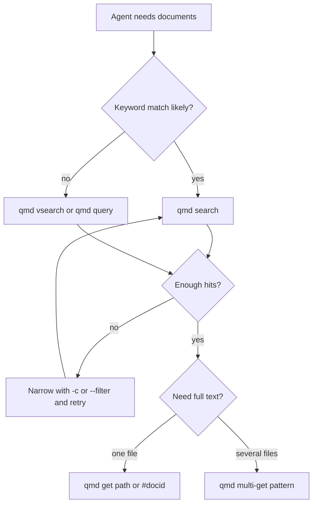
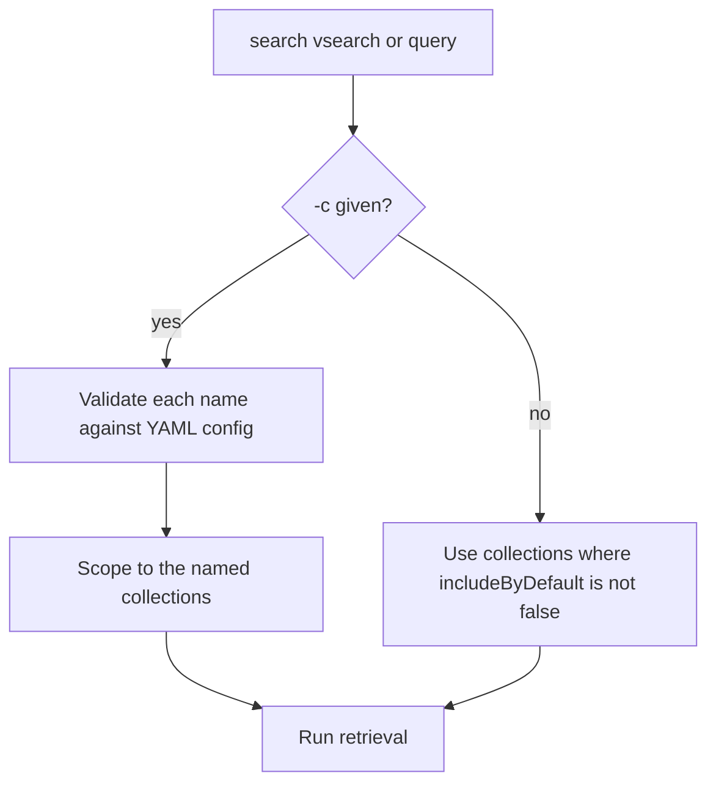
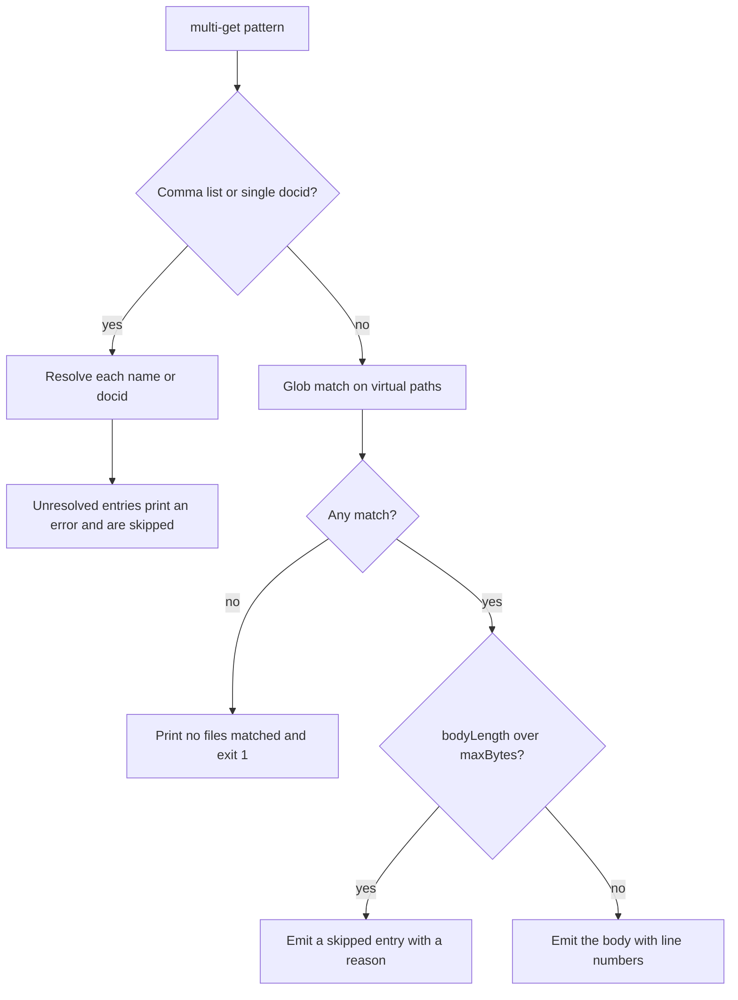

# Agent Retrieval Workflows (CLI Search and Get)

This page is a how-to for an agent that calls the `qmd` command line to find and read Markdown documents. It explains which search command to use, how results are scoped and limited, how to read the output, and how to fetch full text. The flags and defaults below are taken from the CLI parser in `src/cli/qmd.ts`, so they match what the binary actually does.

For the full command catalogue see [CLI Reference](../operations/cli-reference.md). For the hybrid pipeline behind `query` see [Hybrid Query Pipeline](hybrid-query-pipeline.md). For metadata predicates see [Metadata Filtering and Discovery](../concepts/metadata-filtering-and-discovery.md). For `qmd://` paths and `#docid` values see [Virtual Paths and DocIDs](../concepts/virtual-paths-and-docids.md). For the same retrieval exposed over MCP see [MCP Server](../integrations/mcp-server.md).

## Recommended loop

1. Run a cheap lexical search first with `qmd search`. It needs no model and is fastest.
2. If the lexical hits miss the concept, run `qmd vsearch` for semantic matches, or `qmd query` for the full hybrid pipeline.
3. Narrow with `-c <collection>` and, when metadata exists, `--filter <json>`.
4. Read the identifiers the search printed. Fetch a single document with `qmd get`, or several with `qmd multi-get`.
5. Use `--json` or `--format files` when the output is parsed by a program rather than read by a person.

Caption: the recommended agent loop, from search choice through retrieval.

## Choosing a search command

All three commands share the same option parser, but they run different retrieval code.

| Command | Retrieval | Notes |
|---|---|---|
| `qmd search` | BM25 full-text search over the FTS index | No model needed. Default minimum score is 0. |
| `qmd vsearch` | Vector search over stored embeddings | Default minimum score is 0.3. Returns nothing without a vector index. |
| `qmd query` | Hybrid pipeline: lexical plus vector, optional expansion and rerank | Accepts structured `lex:`, `vec:`, `hyde:`, and `intent:` lines. |

The dispatch is in `src/cli/qmd.ts`. `search` is at lines 5009-5016, `vsearch` (with alias `vector-search`) at lines 5018-5031, and `query` (with alias `deep-search`) at lines 5033-5042. `search` calls `searchFTS` directly, at `src/cli/qmd.ts` lines 3093-3099. `vsearch` sets its minimum score to 0.3 when `--min-score` is absent, at lines 5024-5027, and it also defaults the vector search's own minimum to 0.3 at line 3153. Inside `querySearch`, plain text is routed to `hybridQuery`, and text whose lines use `lex:`, `vec:`, or `hyde:` prefixes is routed to `structuredSearch` (`querySearch` in `src/cli/qmd.ts`, which begins at line 3183).

The `query` command accepts structured input. A plain single line is expanded automatically. Multiple lines must each start with `lex:`, `vec:`, `hyde:`, or `intent:`. `expand:` cannot be mixed with other lines, and `intent:` cannot appear alone (`parseStructuredQuery` in `src/cli/qmd.ts`). Use structured input only when you already know the sub-queries you want.

## Scoping by collection

The `-c` (or `--collection`) flag is repeatable. It is declared as `collection: { type: "string", short: "c", multiple: true }` at `src/cli/qmd.ts` line 3347.

The scoping rule is:

- If one or more `-c` values are given, each name is validated against the YAML collection config. An unknown name prints `Collection not found` and exits 1 (`resolveCollectionFilter`, `src/cli/qmd.ts` lines 2916-2934). Only the named collections are searched.
- If no `-c` is given, the command uses the default set from `getDefaultCollectionNames()` (`src/cli/qmd.ts` line 3093 passes `useDefaults = true`). This function returns the collections whose `includeByDefault` is not `false` (`src/collections.ts` lines 270 and 276).
- If the default set is empty, the search runs without a collection restriction (`collectionSearchFilter` returns `undefined` for an empty list, `src/cli/qmd.ts` lines 2937-2941).

So `includeByDefault: false` removes a collection from ordinary searches, but `-c` on that collection still searches it. The `collection list` output marks such collections with `[excluded]` (`src/cli/qmd.ts` line 1833). The flag is set through `qmd collection include` and `qmd collection exclude` (`src/cli/qmd.ts` lines 4839-4858).

Caption: how the collection scope is chosen for search, vsearch, and query.

## Metadata filters

`--filter` takes a JSON metadata predicate. The CLI parses it with `parseCliMetadataFilter`, which exits 1 with an example when the JSON or the predicate is invalid (`src/cli/qmd.ts` lines 3035-3040). It applies to `search`, `vsearch`, and `query`.

In the SQL layer, a filtered search keeps only documents whose metadata extraction is current and error-free (`src/store.ts` lines 4762-4766). A document that has not been processed cannot satisfy a filter, even a negative one such as `exists: false`. Because of this, the CLI warns on stderr when some documents lack current metadata and are therefore excluded (`warnPendingMetadata`, `src/cli/qmd.ts` lines 3082-3090). If you see that warning, run `qmd update` before trusting an empty filtered result.

## Output flags

Output format is chosen by `--format <kind>`, where `kind` is one of `cli`, `json`, `csv`, `md`, `xml`, or `files`. An unknown value prints the valid list and exits 1 (`src/cli/qmd.ts` lines 3424-3431). Legacy boolean aliases (`--csv`, `--md`, `--xml`, `--files`, `--json`) are still parsed, but only when `--format` is absent (`src/cli/qmd.ts` lines 3432-3437). Prefer `--format` in new agent code.

The flags that shape search output are:

| Flag | Effect | Source |
|---|---|---|
| `-n <count>` | Number of results. Defaults to 5, or 20 for `files` and `json`. | `src/cli/qmd.ts` lines 3334 and 3441-3447 |
| `--all` | Return all matches, using a limit of 100000 for search and 500 for vsearch and query. | lines 3336, 3447, 3098 |
| `--min-score <n>` | Drop results below this score after retrieval. Parsed as a float; a missing or invalid value means 0. | lines 3335, 3448, and the filter at 2678 |
| `--full` | Return the full document body instead of a snippet. | line 3337 |
| `--line-numbers` | Prefix body or snippet lines with numbers. Off by default for search. | lines 3377 and 3451 |
| `--explain` | Include retrieval score traces (query only). | line 3346 |
| `--full-path` | Show the on-disk path instead of the `qmd://` URI. Falls back to the `qmd://` form when the file is gone. | line 3379 |

Two rules matter for parsing. First, `--min-score` is applied after retrieval in `outputResults`. It filters the rows that were already fetched and then applies the `-n` limit (`src/cli/qmd.ts` lines 2677-2678). Second, the output limit in search is larger than `-n` so that the minimum-score filter still has candidates. The fetch limit is `max(50, limit * 2)`, or 100000 with `--all` (line 3098).

When `--min-score` removes every row, the command prints the threshold message and returns (`src/cli/qmd.ts` lines 2680-2683). The test suite checks this text at `test/cli.test.ts` line 1022.

### Empty results by format

`printEmptySearchResults` (lines 2592-2613) keeps each format parseable when nothing matches:

- `json` prints `[]`.
- `csv` prints only the header line.
- `xml` prints `<results></results>`.
- `md` and `files` print nothing.
- `cli` prints `No results found.`, or the threshold message when the cause was `--min-score`.

An agent parsing `--json` can therefore treat an empty array as "no matches" without special handling.

## Retrieving documents with get

`qmd get <identifier>` returns one document. Its usage line is at `src/cli/qmd.ts` line 4718, and the dispatch is at lines 4717-4728.

The identifier can take these forms:

- A virtual path, such as `qmd://collection/path.md` or `collection/path.md`.
- A short docid, such as `#abc123` or `abc123`. Any input of six or more hex characters is treated as a docid (`isDocid` in `src/store.ts` lines 4010-4017). The lookup is a prefix match against the active document hashes (`findDocumentByDocid`, lines 4023-4035), and a trailing `:N` is stripped first.
- A path followed by a line range, in the form `path:from` or `path:from:count`. The parser in `getDocument` reads a trailing `:from:count` first, then a trailing `:from` (`src/cli/qmd.ts` lines 1288-1305). Explicit `--from` and `-l` flags always win over values parsed from the identifier.

Line numbers are on by default for `get`. Pass `--no-line-numbers` to turn them off (`src/cli/qmd.ts` lines 4724-4725). The header prints the `qmd://` path with its docid, then a `Folder Context` line when the collection has context, then the body (`getDocument`, `src/cli/qmd.ts` lines 1287-1386).

If the document cannot be found, `get` prints `Document not found` with up to five similar paths and exits 1 (`src/cli/qmd.ts` lines 1323-1338). A match in an ignore rule prints the rule and exits 1 instead. The lookup itself tries, in order: the exact virtual path, a suffix match on the virtual path, and then a path relative to each collection (`src/store.ts` lines 5565-5655).

## Retrieving several documents with multi-get

`qmd multi-get <pattern>` returns many documents. The usage line is at `src/cli/qmd.ts` lines 4730-4736, and the handler at lines 4737-4742.

### Pattern forms

The pattern is classified in `multiGet` (`src/cli/qmd.ts` lines 1389-1396):

- A comma-separated list is used when the pattern contains a comma and no `*`, `?`, or `{`. Each entry may be a path, a `qmd://` path, or a docid. Spaces around commas are trimmed.
- A single docid is used when the whole pattern is a docid, for example `#abc123`.
- Anything else is treated as a glob and matched against virtual paths. Zero matches print `No files matched pattern` and exit 1 (line 1430).

In a comma list, an entry that cannot be resolved prints its error to stderr and is skipped. The other entries still print. A single docid that cannot be resolved exits 1 with `File not found`. The test `fails for a missing single docid` at `test/cli.test.ts` lines 1197-1202 checks exit code 1 and empty stdout.

### The size cap and oversize files

The default cap is `DEFAULT_MULTI_GET_MAX_BYTES`, defined as `64 * 1024`, which is 64 KB (`src/store.ts` line 139). The CLI reads `--max-bytes` and otherwise uses this default (`src/cli/qmd.ts` lines 4737 and 3376). The check compares the stored body length against the cap, not the file size on disk.

Caption: how `multi-get` classifies its pattern and handles oversize files.

When a document is over the cap, the handler does not load its body. It adds a skipped entry with the reason `File too large (<n>KB > <cap>KB)` and a hint to run `qmd get <path>` on that file (`src/cli/qmd.ts` lines 1472-1485). The output then depends on the format:

- In the default `cli` format, the entry prints `[SKIPPED: <reason>]` in place of a body (`src/cli/qmd.ts` line 1618).
- In `json`, the entry has `skipped: true` and a `reason` field, and no `body`.
- In `files`, the entry ends with `[SKIPPED]`.

The agent should therefore check for the skipped status on every entry. The size-skip test coverage is thin, so do not rely on a specific wording of the reason string. Rely on the `skipped` flag or the `[SKIPPED` marker. The `--max-bytes` flag lets you raise the cap for one call. The MCP `multi_get` tool uses the same 64 KB default through a separate store-level function (`src/mcp/server.ts` line 592 and `src/store.ts` lines 5851-5857).

Line limits are applied after the size check. `-l` truncates each body to that many lines and appends a `[... truncated N more lines]` marker (see the `maxLines` branch in `multiGet`).

### Multi-get output formats

`multi-get` accepts the same `--format` values as search, plus `--full-path`. Each entry carries a `#docid` in `md`, `json`, and `xml`. When `--full-path` finds the on-disk file, the identifier becomes the path and the docid is dropped (`identOf` and `docidOf`, `src/cli/qmd.ts` lines 1532-1533). When the file is missing, the entry keeps the `qmd://` path and its docid, and a warning is printed.

## Failure and empty-index behaviour

The code does not treat an unindexed database as a hard error for search. The branches are:

- `qmd search` opens the store, which creates and initializes the database if needed (`createStore` in `src/store.ts` lines 2615-2619). Its SQL then returns no rows, so the command prints `No results found.` and exits 0 (`src/cli/qmd.ts` lines 3116-3118). With no collections configured, the search runs unscoped and simply finds nothing.
- `qmd vsearch` returns an empty array when the database has no partitioned vector index. `vectorSearchQuery` checks `hasVectorIndex` and returns `[]` at `src/store.ts` lines 6603-6604. The CLI then prints the empty-result output for the active format (`src/cli/qmd.ts` line 3166). Before this, `checkIndexHealth` may print a stderr tip about pending embeddings.
- `qmd query` does not fail without vectors. `hybridQuery` seeds its candidates from BM25 and only adds vector lists when `hasVectors` is true (`src/store.ts` lines 6282, 6341, and 6390). The result is lexical-only retrieval.
- `qmd get` and `qmd multi-get` on a missing document exit 1 with a not-found message, whether or not an index exists.

The practical rule for an agent is that an empty `search` or `vsearch` result means either no match or no embeddings, not a broken command. Check `qmd status` before concluding that the corpus has no answer. An exit code of 1 from `get` or `multi-get` means the identifier did not resolve.

## Tests that anchor this behaviour

- `test/cli.test.ts` covers multi-get by pattern, comma list, docid, and `#docid` misses (lines 1106-1202), the `--md` and `--json` docid fields (lines 1152-1170), and the min-score threshold message (line 1022).
- `test/multi-collection-filter.test.ts` checks how `-c` values are normalised and how `parseArgs` collects repeated `-c` flags into an array. It tests the parsing only. The store-level behaviour is in `store.test.ts`.
- `test/formatter.test.ts` covers the document formatters, including the context line in every format (around line 201).
- `test/metadata-cli.test.ts` covers the metadata CLI surface that `--filter` builds on.

## Related pages

- [CLI Reference](../operations/cli-reference.md) lists every command and option.
- [Hybrid Query Pipeline](hybrid-query-pipeline.md) explains what `qmd query` does between the request and the ranked output.
- [Metadata Filtering and Discovery](../concepts/metadata-filtering-and-discovery.md) describes the `--filter` predicate grammar.
- [Virtual Paths and DocIDs](../concepts/virtual-paths-and-docids.md) explains `qmd://` identifiers and how docids are derived.
- [MCP Server](../integrations/mcp-server.md) exposes the same retrieval through tools for agents that do not shell out.
