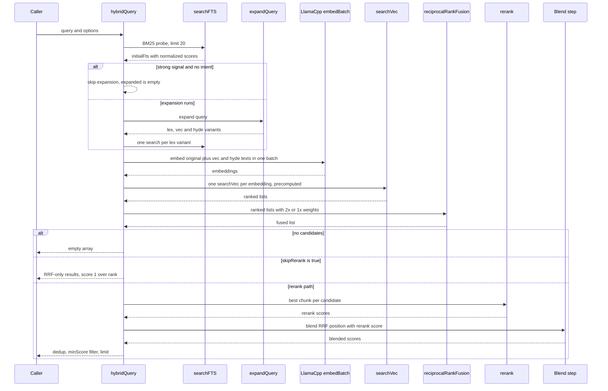

# Hybrid Query Pipeline

`hybridQuery()` in `src/store.ts` is the orchestration behind a plain-text search. The SDK `search({ query })`, the CLI `query` command, and the MCP `query` tool all reach it. It combines SQLite FTS5 BM25 keyword search, sqlite-vec vector search, an LLM query expansion step, Reciprocal Rank Fusion (RRF), chunk-level LLM reranking, and a position-aware score blend. The function is a standalone orchestrator over store primitives, not a `Store` method, so the CLI and MCP share one pipeline ([src/store.ts](repo://src/store.ts#L6161-L6170)).

This page follows the call path step by step. The fusion math itself is covered in [Score Fusion and Blending](../concepts/score-fusion-and-blending.md); chunk boundaries in [Chunking](../concepts/chunking.md); model loading in [Models and LLM Runtime](../concepts/models-and-llm-runtime.md); and filter semantics in [Metadata Filtering and Discovery](../concepts/metadata-filtering-and-discovery.md).

## Entry points and who calls what

Four public entry points reach the search primitives. Only the plain-text path runs the full hybrid pipeline.

| Entry point | Pipeline step it runs | Source |
|---|---|---|
| `search({ query })` in the SDK | `hybridQuery` (expand, search, fuse, rerank) | [src/index.ts](repo://src/index.ts#L489-L528) |
| `search({ queries })` in the SDK | `structuredSearch` with caller-supplied typed sub-queries; no expansion step | [src/index.ts](repo://src/index.ts#L498-L512) |
| `searchLex()` in the SDK | FTS only (`internal.searchFTS`); no LLM and no RRF | [src/index.ts](repo://src/index.ts#L532-L535) |
| `searchVector()` in the SDK | vector only (`internal.searchVec` with the store's embed model); no expansion, RRF, or rerank | [src/index.ts](repo://src/index.ts#L536-L539) |
| `expandQuery()` in the SDK | expansion only (`internal.expandQuery`); returns typed variants without searching | [src/index.ts](repo://src/index.ts#L540) |

`search()` maps `rerank: false` to `skipRerank` and then picks between the two orchestrators: `queries` goes to `structuredSearch`, and a plain `query` string goes to `hybridQuery` ([src/index.ts](repo://src/index.ts#L491-L525)). The CLI calls `hybridQuery` directly and wires `SearchHooks` to stderr progress messages ([src/cli/qmd.ts](repo://src/cli/qmd.ts#L3247-L3262)). The MCP `query` tool forwards `candidateLimit`, `rerank`, `filter`, and `intent` into `store.search()` ([src/mcp/server.ts](repo://src/mcp/server.ts#L431-L470)).

`hybridQuery` reads its options with fixed defaults: `limit` 10, `minScore` 0, `candidateLimit` `RERANK_CANDIDATE_LIMIT` (40), and `skipRerank` false ([src/store.ts](repo://src/store.ts#L6264-L6278)).

## Query types

The user-visible query grammar in [docs/SYNTAX.md](repo://docs/SYNTAX.md#L1-L40) defines three typed sub-query kinds:

- `lex` routes to BM25 keyword search (FTS5).
- `vec` routes to semantic vector search.
- `hyde` is a hypothetical-document embedding and also routes to vector search.

A single-line query with no prefix is an expand query. The expansion model then emits `lex`, `vec`, and `hyde` variants on its own. Inside `hybridQuery`, the same routing rule applies to the variants the model returns: `lex` goes to FTS, `vec` and `hyde` go to vector search. The original query text is always searched in both FTS and vector form, regardless of type.

## Pipeline steps

Caption: the call order of `hybridQuery` for a plain-text query. The strong-signal branch skips only the expansion call; the original-query vector search still runs.

### 1. BM25 probe and strong-signal bypass

`hybridQuery` first runs `store.searchFTS(query, 20, collection, filter)` ([src/store.ts](repo://src/store.ts#L6284-L6293)). The collection and metadata filter are pushed into the SQL, so the strong-signal decision only sees eligible documents.

The bypass is decided by three conditions ([src/store.ts](repo://src/store.ts#L6294-L6297)):

- `intent` must be unset. Passing an intent disables the bypass entirely, so the obvious keyword match cannot shortcut a query whose intent points elsewhere.
- The top normalized score must be at least `STRONG_SIGNAL_MIN_SCORE` (0.85).
- The gap between the top and second normalized scores must be at least `STRONG_SIGNAL_MIN_GAP` (0.15).

The constants are declared at [src/store.ts](repo://src/store.ts#L476-L482). The normalized score is `|bm25| / (1 + |bm25|)` ([src/store.ts](repo://src/store.ts#L4778-L4790)), so a top BM25 magnitude of about 5.7 or more clears the 0.85 threshold. When the bypass fires, the `onStrongSignal` hook runs and `expanded` is set to an empty array instead of calling `expandQuery` ([src/store.ts](repo://src/store.ts#L6300-L6308)). The probe list is not discarded; it still seeds the fusion as the original FTS list.

### 2. Query expansion

When the bypass does not fire, `store.expandQuery(query)` runs ([src/store.ts](repo://src/store.ts#L6303-L6305)). The store-level function ([src/store.ts](repo://src/store.ts#L5264-L5303)) does four things:

- It reads the cache key `expandQuery` with the query and model. Intent is intentionally excluded from both the key and the generation call, because intent text contaminated sub-queries.
- On a cache hit it parses the JSON and passes it through `uniqueExpansions`, which drops exact repeats of the same type and text. vec and hyde entries with the same text are both kept, since they route to different searches.
- On a miss it calls the LLM, filters out any variant whose text equals the original query, deduplicates, and caches only a non-empty result.
- A failed or unparseable cache entry falls through to regeneration.

The original query is never re-expanded in the result list. It is already the first FTS list and the first vector list.

### 3. Type-routed searches

Searches run in three sub-steps ([src/store.ts](repo://src/store.ts#L6319-L6383)):

- **FTS.** The initial probe list is pushed first with `queryType: "original"`. Each `lex` expansion runs `searchFTS` with limit 20 and is pushed as a `lex` list. Empty lists are not added.
- **Vector.** When `hasVectorIndex(store.db)` is true, the vector queries are the original query plus every `vec` and `hyde` expansion. All of them are embedded in one `llm.embedBatch` call on texts formatted by `formatQueryForEmbedding` ([src/store.ts](repo://src/store.ts#L6350-L6357)). Each returned embedding then goes to `store.searchVec` with the precomputed vector, limit 20, and the same filter ([src/store.ts](repo://src/store.ts#L6361-L6376)).
- **Stores without vectors.** When no vector index exists, the vector sub-step is skipped entirely, so `vec` and `hyde` expansions never run.

`searchVec` returns an empty array when the vector index is missing and returns `1 - distance` as its score ([src/store.ts](repo://src/store.ts#L4976-L4985)).

### 4. Cached-expansion invalidation

After routing, the pipeline checks whether the cached expansion was useless ([src/store.ts](repo://src/store.ts#L6384-L6395)):

- It counts only runnable expansions. A `lex` expansion is always runnable; `vec` and `hyde` count only when the store has a vector index. On FTS-only stores, vec and hyde variants are never executed and say nothing about quality.
- If at least one runnable expansion exists and no list in `rankedListMeta` has a `queryType` other than `original`, the cached expansion is deleted with `store.invalidateExpansionCache(query)`.

The deletion uses `deleteExpansionCacheEntry`, which removes the `llm_cache` row for the `(query, model)` key ([src/store.ts](repo://src/store.ts#L5305-L5312)). Without it, a dud expansion would be replayed on every warm repeat. Tests cover both sides of this rule: a cached expansion that found nothing is removed, and one that contributed results is kept ([test/store.test.ts](repo://test/store.test.ts#L1370-L1410)).

### 5. RRF fusion and the empty-candidate return

`hybridQuery` weights the lists with `getHybridRrfWeights`, which gives a list weight of 2.0 if its `queryType` is `original` and 1.0 otherwise ([src/store.ts](repo://src/store.ts#L6247-L6250)). The original FTS list and the original vector list both get 2.0; every `lex`, `vec`, and `hyde` list gets 1.0 regardless of insertion order. The lists go to `reciprocalRankFusion`, which accumulates `weight / (60 + rank + 1)` per list and then adds a top-rank bonus of 0.05 for rank 0 and 0.02 for ranks 1 and 2 ([src/store.ts](repo://src/store.ts#L5371-L5415)). `k` is fixed at 60 in this path.

The fused list is sliced to `candidateLimit`. If the slice is empty, `hybridQuery` returns `[]` immediately, before chunking, reranking, or blending ([src/store.ts](repo://src/store.ts#L6400-L6404)).

When `explain` is set, `buildRrfTrace` runs with the same lists and weights to record per-list contributions ([src/store.ts](repo://src/store.ts#L6401)).

### 6. Chunk selection

For each candidate, `chunkDocumentAsync` splits the body with the optional `chunkStrategy` ([src/store.ts](repo://src/store.ts#L6406-L6432)). Candidates that produce no chunks are dropped from the reranking map. The best chunk is the one with the most query-term hits, where each term with length greater than 2 scores 1. Intent terms add `INTENT_WEIGHT_CHUNK` (0.5) per hit. The first chunk wins ties. Only the best chunk per document is sent to the reranker, because reranking whole bodies is too costly.

### 7. Skip-rerank path

When `skipRerank` is true, the pipeline returns before reranking ([src/store.ts](repo://src/store.ts#L6433-L6470)). Each candidate gets `score = 1 / rank`, where rank is its 1-indexed position in the fused list. The `bestChunk` comes from the chunk map, falling back to the full body if the candidate had no chunks. Results are then deduplicated by file, filtered by `minScore`, and sliced to `limit`. The skip-rerank score is a positional value, not the RRF sum, so `minScore` compares against `1 / rank` on this path.

### 8. Reranking and blending

On the default path, the best chunks are passed to `store.rerank(query, chunks, undefined, intent)` ([src/store.ts](repo://src/store.ts#L6485-L6495)). The reranker prepends intent to the query when present, caches scores by chunk text, and returns results sorted by score ([src/store.ts](repo://src/store.ts#L5319-L5350)).

The blend step ([src/store.ts](repo://src/store.ts#L6503-L6520)) combines each candidate's RRF position with its reranker score:

- The RRF position score is `1 / rrfRank`, where `rrfRank` is the candidate's 1-indexed position in the fused list. If the file is missing from that map, the fallback is `candidateLimit`.
- The weight on the RRF position depends on rank: 0.75 for ranks 1 to 3, 0.60 for ranks 4 to 10, and 0.40 for lower ranks.
- `blendedScore = rrfWeight * (1 / rrfRank) + (1 - rrfWeight) * rerankScore`.

Blended results are sorted by `score` descending ([src/store.ts](repo://src/store.ts#L6512)).

### 9. Dedup, minScore, and limit

The final step ([src/store.ts](repo://src/store.ts#L6550-L6562)) keeps the first result for each `file`, drops results with `score < minScore`, and slices to `limit`. Metadata is attached last in one batch by `attachResultMetadata`, so `metadata` is not duplicated through the intermediate lists ([src/store.ts](repo://src/store.ts#L6222-L6231)). The dedup is a safety net; the fused candidate list is already unique per file.

## Invariants and failure behavior

- **Strong signal disables the expansion LLM call, not the vector search.** The original-query vector search still runs in step 3, so a strong-signal query still uses the embedding model.
- **Intent disables the strong-signal bypass.** Any non-empty intent forces expansion, even when the BM25 probe is clear.
- **Original lists dominate.** The original FTS and original vector lists carry 2.0 weight, so expansion lists can reorder results but cannot outrank the original evidence alone.
- **Empty candidates return empty.** A query with no FTS hits, no vector hits, and no expansion hits returns `[]` before any chunking or model call beyond expansion and embedding.
- **Candidates without chunks disappear on the rerank path.** A candidate whose chunking produces nothing is skipped in the rerank map and therefore absent from the blended list. On the skip-rerank path, the same candidate is kept with the full body as its best chunk.
- **Expansion results are cached only when non-empty.** Only non-empty expansions are written to the cache. `hybridQuery` does not catch an exception from `expandQuery` or `embedBatch`, so such an error propagates to the caller and nothing is cached for that attempt.

## Configuration and extension points

- `candidateLimit` (default `RERANK_CANDIDATE_LIMIT` = 40) controls how many fused candidates reach chunking and reranking. The MCP schema and CLI help state the same default ([src/mcp/server.ts](repo://src/mcp/server.ts#L408-L410)).
- `skipRerank` (SDK `rerank: false`, MCP `rerank: false`) skips the LLM reranker and the blend. The model-free path is useful on CPU-only machines.
- `intent` disables the strong-signal bypass and adds intent-term weight to chunk selection and to the reranker query.
- `filter` is applied at the SQL level for every FTS and vector call, so both the probe and the expansion legs see the same eligible set.
- `chunkStrategy` changes how candidate bodies are split before chunk selection.
- `k` is not configurable from `hybridQuery`; `reciprocalRankFusion` accepts it only as a parameter. Changing it requires a code change in the orchestrator.
- Adding a new list type needs a branch in `getHybridRrfWeights`. Any non-`original` type gets 1.0, so a new original-query source needs explicit handling.
- `SearchHooks` are optional progress callbacks. The CLI uses them; the MCP server leaves them unset.

## Focused tests

- [test/rrf-trace.test.ts](repo://test/rrf-trace.test.ts#L1-L55) checks that `buildRrfTrace` totals match `reciprocalRankFusion`, and that top-rank bonuses are 0.05 for rank 1 and 0.02 for ranks 2 and 3.
- [test/intent.test.ts](repo://test/intent.test.ts#L296-L375) covers intent-term chunk scoring and the strong-signal predicate logic, which mirrors the orchestrator.
- [test/store.test.ts](repo://test/store.test.ts#L1370-L1440) covers cached-expansion invalidation, the keep-if-contributed case, and embedding each distinct cached expansion once.
- [test/store.test.ts](repo://test/store.test.ts#L6205-L6240) checks that `lex` expansions go only to FTS and `vec` and `hyde` only to vector search.
- [test/structured-search.test.ts](repo://test/structured-search.test.ts) covers the sibling `structuredSearch` path, which shares the RRF and blend logic but takes caller-supplied typed sub-queries.

## Related pages

- [Score Fusion and Blending](../concepts/score-fusion-and-blending.md) gives the full formulas for RRF, the top-rank bonus, and the blend weights.
- [Agent Retrieval](agent-retrieval.md) describes how agents call this pipeline through the MCP and SDK surfaces.
- [Chunking](../concepts/chunking.md) covers the chunk boundaries that feed the reranker.
- [Metadata Filtering and Discovery](../concepts/metadata-filtering-and-discovery.md) covers how `filter` is compiled and applied.
- [Models and LLM Runtime](../concepts/models-and-llm-runtime.md) covers the embedding, expansion, and rerank models.
